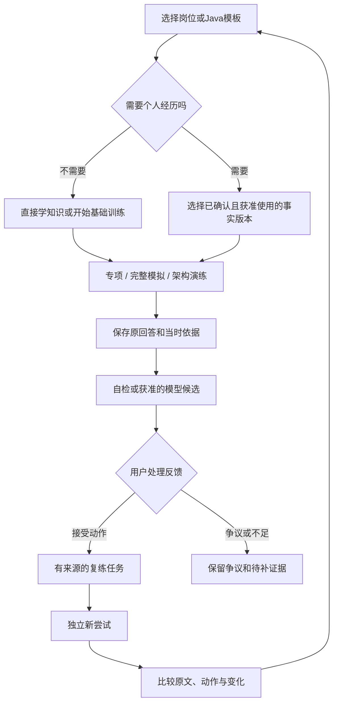

# 问阶 · Interview Studio 产品需求文档（PRD）

| 项目 | 内容 |
|---|---|
| 版本 | v0.4 · AI文字首期设计基线，供用户回审调整 |
| 日期 | 2026-11-04；产品与AI公开资料核对：11月3–4日 |
| 产品定位 | 面向 Java 后端求职者的证据式AI面试训练与复练工作台 |
| 当前阶段 | 首期需求、系统设计与独立合成交互预览；未正式开发、未接模型 |
| 本轮交付 | 本 PRD ＋ [系统设计与技术选型](docs/08-system-design.md) ＋ [两套内容样例](docs/09-content-samples.md) ＋ [AI功能调研](docs/11-ai-product-research.md) ＋ [AI体验设计](docs/12-ai-experience.md) ＋ [AI文字预览](design/ai/index.html) ＋ [开发就绪审查](docs/10-development-readiness.md) |
| 状态 | 用户已委托本轮直接作设计决定；决定可回审调整，不代表已批准正式工程、模型外发或上线。实际验证结果以就绪审查为准 |

**不使用工作流，不生成执行任务包，不更新 `plan.md`。**保留四版候选、旧原型与历史资料；首期以本稿和配套系统设计为准，不把历史完整范围叠加成首期承诺。本文描述目标产品，需求不等于已实现；原型只证明其实际被操作和观察到的设计行为，不证明数据库、身份、可靠保存或技术效果。

### 本轮已作的设计决定

| 决定 | 本轮选定的基线 | 理由与可调整边界 |
|---|---|---|
| 产品／用户 | 优先面向有真实项目、需要 Java 后端项目深挖准备的个人；保留无材料基础题入口 | 年限与真实需求仍是待验证假设，不是准入规则 |
| 首期 | AI生成／选题、文字专项及短模拟、证据评价、来源复练与对照；可靠无AI路径为内部里程碑和退路 | AI是首个用户版本的主线，不把用户自检冒称AI；两套自拟种子题B01／P01与自建题支持冷启动 |
| 使用方式 | 个人单实例自托管、一个预置账号、关闭公开注册、同源访问 | 不先承担公开多用户运营；仍按 owner 校验，不用单用户豁免安全 |
| 视觉 | A 纸感编辑式为全站基线；后续架构屏借用 D 的大画布与停靠结构 | 适合中文长答与边注证据；AI预览在独立目录，不覆盖四候选或无模型核心原型 |
| 训练规则 | 专项1主问＋≤2追问；短模拟3主问／每主问≤1追问、总计≤6问；不计时 | 用户主动推进；训练可按需反馈，模拟默认结束后反馈；原答修订与独立复练分开 |
| 数据控制 | 以整项来源及其版本为删除单位，预览所有副本／派生影响；用途撤回与删除分开 | 首期不承诺任意选段脱敏；明确处理历史与备份，见第9节 |
| 技术 | Vue 3／TypeScript／Vite；Java 21／Spring Boot／MVC 模块化单体；MySQL 8.4 LTS | 详细版本线、事务、接口与安全在[系统设计](docs/08-system-design.md)，不是仅列技术名称 |
| 模型／发布 | 产品首期包含受控AI；安装后默认未启用，供应商／模型／地区／预算／数据授权齐备后才发送 | 当前只做设计与合成预览，未实际调用；正式工程、采购、真实外发、上线另获批准 |

本轮决定是助手根据用户委托作出的可调整设计基线，不写成用户逐项签字或真实需求验证。读者可先看本表，再看第3.4节技术摘要、第4.5节操作契约与第10.1节首期验收边界。

---

## 1. 产品概述

### 1.1 一句话说明

帮助 Java 后端求职者围绕一个目标岗位，由AI生成有条件的问题、扮演文字面试官并给有原文依据的反馈，用真实项目事实把**具体缺口变成下一次独立可验证的练习**。

核心交付不是一份长报告，而是“**原答片段 → 有条件的判断／待补证据 → 一个可执行动作 → 新尝试与对照**”。产品不替用户编造完美答案，也不承诺押中企业真题或提高录用概率。岗位、材料、题目都服务这条主线，不独立扩张成另一套工具。

### 1.2 要解决的问题

| 问题 | 现有做法的不足 | 问阶的处理方式 |
|---|---|---|
| 看过很多资料，却不知道下一步练什么 | 题库、笔记、岗位要求彼此分离 | 从岗位、未完成训练和已接受的改进动作给出有来源的下一步 |
| 项目能做，面试时讲不清 | 表达建议容易脱离职责与真实经历 | 先区分事实与责任边界，再整理长短表达和追问 |
| 模拟面试像通用聊天 | 学习、练单项、完整模拟反馈时机混乱 | 按任务提供不同工作区，共享记录而非套同一聊天框 |
| 收到一段评语，却不知道凭什么 | 评价没有原文和版本定位 | 反馈能回到当时回答、事实、约束或图节点；不足时承认不确定 |
| 复练只有“已完成” | 新答案覆盖旧答案，改进难以观察 | 保留来源、改进动作与独立新尝试，允许并排比较 |
| 材料、模型和数据去向不清楚 | 授权与删除藏在设置或概括条款里 | 在使用点说明发送范围、费用、保留和删除影响 |

### 1.3 核心用户与使用场景

**首批主用户假设：**有可讲述的真实项目、正在准备下一次 Java 后端面试的个人求职者，优先验证约 1–5 年相关经历、知识看过但项目深挖讲不清的用户。年限不是准入条件；“有真实项目、愿意独立重答”比年限更重要。此细分尚未经访谈或市场规模验证。

| 用户层 | 关键任务 | 本阶段处理 |
|---|---|---|
| 核心：项目深挖准备者 | 分清本人贡献，解释技术选择、异常和结果验证 | 首条价值链与试用招募优先 |
| 相邻：缺少材料／刚开始准备者 | 先练一个技术问题，知道缺什么 | 基础题直达，不强迫填 JD 或简历 |
| 后续：完整轮次与系统设计训练者 | 限时综合表达、方案取舍与故障推演 | 保留设计，待文字链路证明价值后落地 |
| 后续：真实面试后的用户 | 从不确定回忆生成可练的问题 | 私密手工记录，不能当逐字实录或确定事实 |

岗位模板和题型可扩展，不把系统写死为 Java 八股库；首期不同时验证校招算法、转行零基础、高阶架构师和跨行业表达需求。

### 1.4 目标与非目标

**目标：**准备有上下文；个人事实不失真；输入不轻易丢；反馈有依据；复练可比较；数据控制可理解。

**不做：**正式面试暗中代答、隐身辅助、监考规避；招聘爬取、自动投递、全量投递 CRM；公共面经社区运营、真人教练撮合、薪资或录用概率预测；完整简历排版平台。首期不做代码执行沙箱、音视频采集、复杂自动排程。

### 1.5 对标后的产品取舍

本轮AI专项调研见[AI功能调研与取舍](docs/11-ai-product-research.md)，既有市场／开源基线见[审查与对照报告](docs/07-prd-review.md)。以下是设计判断，不是市场独占性声明；实时语音或动态追问不证明竞品使用文字SSE。

| 对标类别 | 用户已有的选择 | 问阶的取舍 |
|---|---|---|
| 技术题库／学习路线 | 按主题找题、看讲解、按路线学习 | 小而有条件的题包＋“答出来再看”；不竞争题目数量，不重做课程平台 |
| AI 模拟面试 | 个性化问题、连续对话、即时反馈 | 竞争点应是事实不失真、判断有条件、反馈可争议、下一次可对照；不能仅以“也能聊天”定位 |
| 真人／同伴模拟 | 真实交流、人工观察与建议 | 不宣称文字或 AI 等价替代人际压力与专业面试官判断；可导出训练记录供用户自行讨论 |
| 简历／岗位管理 | 管理申请、定制简历和记录轮次 | 只保留训练上下文；不把 CRM、排版、自动投递纳入首期 |
| 开源知识与画布 | 丰富公开知识、成熟编辑组件 | 优先链接与自拟题；图库只提供编辑能力，证据语义、历史与复练仍是应用责任 |

**首版价值底线：**首个用户版本包含AI生成／选题、受控文字面试官和有依据的评价，自检是补充与失败退路。无AI底座可先作内部可靠性里程碑，但不单独冒称AI产品。若用户只得到通用清单或流式聊天、无法说明一个具体缺口或不愿独立再答，差异化尚未成立，不能用题量与更多模式掩盖。模型质量、费用与外发批准仍是启用门槛。

---

## 2. 产品原则与成功标准

### 2.1 必须坚持的产品原则

- **没有完整简历，也能开始。**只有需要个性化经历的任务才要求选择相应事实。
- **事实、表达、建议分开。**模型不得补造职责、业务成绩、生产指标或事故经历。
- **先答后看。**提示、参考要点、自检和模型候选不覆盖原回答。
- **不把“能定位”当“评价正确”。**用户可以保留争议、补充证据或拒绝建议。
- **编辑产生新版本，不倒改历史。**主动隐私删除是另一个受控流程，不用历史不可变拒绝删除。
- **主动作清楚，不做统计卡墙。**首页首先回答“接下来做什么”，不制造准备总分。
- **失败有退路。**模型或未来语音不可用时，文字、材料、已保存记录仍能使用。

### 2.2 可观察的成功标准

| 目标 | 验收时观察什么 | 不用什么替代 |
|---|---|---|
| 开始练习顺畅 | 无材料用户能够完成一次基础训练 | 注册数、题目数、页面数 |
| 准备上下文清楚 | 用户能看出本次使用的岗位、事实及责任边界 | 模型“已理解你”的提示 |
| 保存可信 | 刷新／重启仍能找回已确认保存的原文；冲突不无声覆盖 | 仅本地暂存或接口成功状态 |
| 反馈有用 | 能打开反馈对应原文／图版本并说出缺口 | 无出处总评或精确分数 |
| 复练闭环成立 | 从反馈到动作、新尝试、并排对照可走通 | 只勾选完成 |
| 数据控制透明 | 用户能说明哪些内容会外发，以及删除影响 | 只提供隐私政策链接 |

本阶段没有用户访谈、学习收益、留存或付费效果实测。下列是**拟验证的定义与招募建议，不是已达到的数据或商业承诺**。任何分析采集不默认记录回答或材料正文。

### 2.3 价值验证与观测口径

| 指标／问题 | 定义与观察方式 | 边界 |
|---|---|---|
| 首次价值达成 | 首次试用中提交一份独立原答、指出至少一个原文缺口，并保存一个有判断条件的动作 | 同时报实际人数／开始人数；只打开报告、复制参考答案不算 |
| 首次价值耗时 | 从选择练习到上述动作保存；设计目标为常见路径约 10–15 分钟 | 作为可用性假设；失败、退出与求助分别记录，不只统计成功者 |
| 有效复练闭环 | 在后续会话提交独立新答案，对照原动作并记录“已处理／部分／未处理／无法判断” | 一次同题重写不等于迁移能力；不把自评当客观提升 |
| 反馈可用性 | 用户能解释依据、接受或争议原因；人工抽查技术条件、事实一致性和可执行性 | 接受率不等于正确率；争议不是应被压低的指标 |
| 系统可靠性 | 保存失败、冲突、恢复结果；反馈无效引用、职责扩大、外发越权分别计数 | 严重错误不能被平均成功率掩盖；日志只保最小事件，不带正文 |
| 后续价值 | 观察用户是否在下一次准备时自主回来复练；访谈是否替代了原有零散做法 | 不以日活、打卡天数或停留时长充当学习成效；暂不设虚构留存／付费目标 |

建议先用合成案例走查，再经同意邀请约 5–8 位核心用户做可用性观察与一次后续回访；单列无材料用户的入口阻力。这一规模只用于找问题，不用于统计证明效果。每轮输出保留／修改／停止结论：若只能在主持人带领下完成、反馈错误频发或没人愿意复练，先修核心链路，不扩白板、语音或商业化。

---

## 3. 产品范围与信息架构

### 3.1 推荐信息架构

**五组主导航＋模型与数据辅助入口。**下表是职责组织，不表示必须做十个独立页面或服务。

| 导航组 | 功能职责 | 用户完成的事 |
|---|---|---|
| 准备 | 准备空间、目标与轮次、轻量计划 | 选目标、继续上次、安排下一步 |
| 材料与素材 | 事实、个人故事、表达版本 | 讲清职责，整理可使用的内容 |
| 学习 | 知识、题库、题单路线、笔记 | 学一项知识，选择一项练习 |
| 训练 | 专项、完整模拟、架构演练 | 按任务作答、追问、设计与解释 |
| 复盘 | 历史证据、争议、复练行动、面后记录 | 看原文、接受动作、独立再试 |
| 辅助区 | 模型、授权、预算、导出与删除 | 控制外部处理和个人数据 |

与现有八模块的关系：准备空间、目标岗位、个人材料、模拟、架构、模型与数据保留核心任务；“题库与练习”拆成学习资源和专项训练，“复盘与复练”拆成审阅历史和行动生命周期。计划属于准备，面后记录属于复盘，不为了凑模块数另建系统。

### 3.2 完整范围与首期范围

| 范围 | 首个AI文字用户版本 | 后续保留的完整能力 |
|---|---|---|
| 准备 | 当前目标、未完成训练、来源复练动作 | 可编辑计划、轮次时间、多个目标组织 |
| 目标 | 手工 JD 或明确的 Java 模板、要求确认与版本 | 模型提取要求、轮次模板、跨目标复用 |
| 材料 | 手工事实、三种责任边界、版本确认、训练及外发用途选择 | STAR、故事库、表达版本、获准文件解析 |
| 学习／出题 | 两套自拟种子题、主题／题型筛选、自建题；AI单次生成1–3题并预览采用、条件与标准同版固定 | 丰富路线、全文检索、更多审阅题包、代码阅读解释 |
| 训练 | Java基础／项目文字专项；3个主问题的文字短模拟；受控追问、原答修订、问题暂态流式 | 自我介绍、行为／HR、完整计时模拟与语音 |
| 架构 | 保留布局研究，不承诺首期自由画布 | 语义画布、约束、解释、图版本追问、回放与差异比较 |
| 复盘 | 自动分析原答的AI候选、结束报告、接受／争议、来源复练、新旧对照及AI比较建议；自检补充 | 架构报告、面后回忆、丰富索引和间隔安排 |
| 数据／AI | 身份归属、可靠保存、导出删除；单固定供应商服务端适配、显式授权、任务／流式／取消／预算 | 多模型、文件／音频生命周期、公开服务运营 |

AI属于首个用户版本，默认未启用只表示缺少配置／授权时零发送，不表示全部AI后置。可靠无AI闭环可先作为内部工程里程碑和长期退路；它必须明确标为自助训练。视觉选择不改变数据与业务要求。

### 3.3 首期取舍与下一项验证

| 层级 | 内容 | 决定依据 |
|---|---|---|
| 必须一起交付 | 基础直达、当前目标／事实确认、原答可靠保存；AI出题／受控文字面试官／证据评价；来源动作、独立再答与对照；授权预算与导出删除 | 验证AI训练的完整价值，不能以生成题单、打字动画或静态自检替代；没有模型也保留原文和复练 |
| 首期轻量补齐 | 小题包筛选、自建题、单条练后笔记、提示记录；3主问的无计时短模拟；AI辅助对照和受控变式候选 | 不扩成课程、笔记系统、通用聊天或综合招聘平台；技术标准未审时仅探索性建议 |
| 下一项必须验证 | 中文Java出题、追问、证据评价与比较的20–30例合成／获准案例；实际流式、断线／取消、未知费用 | 属于首期AI质量与可靠性门槛，不是文档写好就算通过；供应商及材料授权后才实际调用 |
| 暂缓 | 完整计时／暂停模拟、自由白板、多目标排程、语音、批量文件解析、社交与付费体系 | 增加覆盖和便利，但不是首次证明AI文字闭环的前置条件 |

种子内容仍为 **B01线程池接收任务／P01发奖超时结果未知两套题＋单道自建题入口**，不是完整质量案例集。题干、条件、允许推理和来源见[内容样例](docs/09-content-samples.md)；独立人工语义与权利复核尚未完成，不能当权威参考发布。AI生成题采用后为私有未审题，不自动进入公共题库，不继承种子题的审阅标签。试用后再扩约12题，不把未制作题目算作现有内容。文字训练不证明口头压力、真实招聘判断或录用效果。

### 3.4 技术与非功能约束摘要

PRD 负责说明产品必须得到什么保证；详细工程契约见[系统设计与技术选型](docs/08-system-design.md)。两份文档共同构成首期设计基线，不用旧技术建议代替当前选型。

| 层面 | 选定方向／产品约束 | 首期边界 |
|---|---|---|
| 客户端 | Vue 3＋TypeScript＋Vite、Vue Router；Pinia只放必要的跨页尝试上下文与草稿状态；语义表单与CSS令牌 | 不复用离线原型存储；不先引完整UI框架、富文本、画布或语音依赖 |
| 服务端 | Java 21、受维护稳定线Spring Boot、Spring MVC、模块化单体；Maven Wrapper；Spring JdbcClient参数化SQL与显式事务 | 不默认微服务、WebFlux、Redis、消息队列、通用Agent平台或代码沙箱 |
| 数据 | MySQL 8.4 LTS／InnoDB／utf8mb4；不可变业务版本、草稿CAS、命令幂等、删除账本；迁移受版本管理 | 逻辑模型不是本轮DDL；真实往返、重启恢复及备份还原必须在正式工程验收 |
| 部署／身份 | Linux x86_64单实例，同源TLS＋预置个人账号；Windows可开发；会话Cookie、CSRF、归属校验 | 本轮不采购、不安装、不启动或部署服务；公开注册、账号找回、托管运营后置 |
| 可靠保存 | 草稿状态区分本页／未同步／服务端确认；提交成功才有不可变修订；响应丢失可幂等重试 | 原型内存成功绝不显示为真实数据库保存；前端本地恢复副本须另有明确开关，不自动保留敏感正文 |
| 性能／容量 | 首期回答上限20,000 Unicode code points、HTTP JSON上限1 MiB；单用户，2个同时编辑标签为设计测试起点 | 为拟验收目标，不是已测容量；超限提前说明，不截断原文；详见系统非功能目标 |
| 权限／数据 | 全部私有；嵌套对象、模型任务、SSE、导出按owner；导出JSON＋Markdown，24小时失效；删除沿依据链处理 | 无授权零模型发送；密钥仅服务端，字段最小化；不靠不透明ID或单用户假设豁免 |
| AI首期／后续图 | 服务端单固定供应商适配、有限结构化任务、同源SSE；Vue Flow后续用于架构编辑 | 模型／地区／价格仍待核定和批准；实际启用先验语义、费用与取消／断线；不引通用Agent或RAG |

版本线、精确补丁与许可证分开记录：选型明确不代表依赖已经安装或兼容测试通过。正式工程开始时将核定的制品写入锁文件／BOM／校验和，发现次版本过维护期就更新选型记录，而不是悄悄追最新。

---

## 4. 核心用户旅程

### 4.0 第一次使用：先完成一题，再补上下文

1. 首屏“直接练一题／AI帮我出题／AI文字短模拟”。直接选基础题不要求JD、材料或密钥；项目题只选本次事实，不填完整档案。AI未配置时明确自检退路，不把配置作为第一步。
2. 显示角色、训练／模拟模式、题量、题目与标准版本及审查状态；AI生成前预览供应商／模型、确切发送范围和费用。采用题目不等于技术专家审阅。
3. 用户独立作答，提交成功成R1后才可获取评价或生成追问；保存失败不外发。专项按需反馈，短模拟默认结束后复盘；参考默认折叠，模拟不边问边给答案。
4. AI自动分析本次允许的已提交原文，完整成功并核引用后显示带条件／限制的候选；无需用户先写缺口。用户接受、争议或忽略。自检路径则由用户自行选原文／未提及并确认动作，不能假装自动诊断。
5. 接受动作后新Attempt空答，独立提交／结束再对照。AI比较只是建议，最终结论由用户写证据确认；新答或等级不自动结项。

### 4.1 通用准备闭环

### 4.2 项目专项示例

1. 选择“Java 后端·营销交易”。
2. 确认本人负责扫码和预算接口，发奖查单只是参与了解；接口幂等保证待核实。
3. 回答“发奖超时后怎样继续处理”。
4. 保存原答后，在专项中主动获取本轮AI评价或生成追问；AI只能将“未说明怎样确认结果”列为条件待补，不确定接口是否幂等。
5. 用户接受动作“说明原请求标识、确认路径和重试前提”；回调是否存在仍未知，只有题干新增明确假设时才讨论其竞争。
6. 结束来源尝试，再开始空答新Attempt；对照原动作与两次回答，AI建议不替用户结项。

### 4.3 架构演练示例

读题／约束→提出假设和必要估算→建立节点与有方向的关系→解释设计→保存图与解释的同一版本→基于该版本追问→继续修改为新版本→报告定位历史节点→以新尝试复练比较。

查看历史时，当前图、解释、选择、视口和撤销记录不被替换。图中删除节点不破坏旧版本；用户主动删除敏感资产时，历史引用可以变为“来源已删除”。

### 4.4 面试后分支

自愿录入回忆→标记来源、不确定性和版本→以该回忆版本复盘→确认动作→新建训练并保留回忆来源。

回忆不是逐字记录，也不是已确认事实；不伪造用户做过的一次模拟训练，不自动公开企业问题或外发材料。编辑回忆生成新版本，旧报告仍指向原版本。

### 4.5 首期操作契约：提交、AI生成和结束各自独立

| 操作 | 前置条件与结果 | 不发生什么 |
|---|---|---|
| 开始 | 基础题可无材料；项目确认事实／训练用途；采用题干、标准、策略和模式版本 | 不把未知当事实，不要求假经历；AI范围／费用未批准不发送 |
| 存草稿 | 可变正文＋服务器修订CAS；失败保输入，旧ack只推进对应基线 | 不等于提交；未确认崩溃内容不承诺恢复 |
| 提交本轮 | 持久成功追加R1、R2；使基于旧轮次的在途实时生成代次失效 | 不自动获取反馈、追加追问或结束；保存失败不外发 |
| 补充修订 | 明确编辑再提交R2；旧反馈仍指R1，已成功产物保历史 | 不倒改原答；旧在途候选不搭配R2；同次修订不是复练 |
| AI出题／采用 | 核发送清单与预算；完整合法候选可采用为私有新题／标准版本 | 暂态不可答题；采用不是专家认证；未审标准不作确定技术判题 |
| AI本轮评价 | 专项提交后用户主动请求；自动分析确切原答，完整校验后呈现候选 | 不要求先由用户诊断；不按字数、关键词、精确总分或录用率判断 |
| 生成／采用追问 | 基于明确的父问题／回答修订和剩余轮数；完整合法后用户采用 | 用户推进；预设标预设；取消、跳题、R2或结束使旧实时任务失效 |
| 选证据／保存自检 | 用户自行选原文或NOT_MENTIONED整答，确认类型、条件、限制与动作 | 不从草稿或相似片段猜依据；自检与AI反馈强类型分开 |
| 接受／争议／忽略 | 决定与原反馈分开；按来源类型＋ID＋动作版本防重，可显式合并保集合 | 不自动接受，不按题号吞来源；决定不认证AI正确 |
| 跳过／返回 | 指定题和原因，保草稿／旧修订；活动尝试可返回 | 不记作已回答；状态变化使旧实时生成失效，无计时重置 |
| 结束尝试 | 预览已采用问题、最新提交、未交草稿与在途任务；三种草稿选择；取消本地接纳未完成任务 | 不将暂态问题／草稿入清单，不自动调用报告，结束后只读 |
| AI结束复盘 | 结束后主动请求，仅冻结清单的正式回答；跳过／未答明确 | 不发送未交草稿，不补造一次训练；新报告版本不覆盖旧报告 |
| 开始复练 | 原Attempt结束且来源可用；上下文同且Session开放可新Attempt，否则新Session | 新答为空，不预填旧答；变式候选先采用，审查状态可见 |
| AI比较／保存对照 | 双方Attempt结束，旧／新refs、动作版本、提示与条件固定；用户确认结论、证据和理由 | AI只建议；条件变化标不宜直接比较；不自动认定掌握 |
| 结项／继续 | 已处理只关所选来源；其余默认继续或明确归档原因 | 不清其他来源或原文；提交新答不自动结项 |

每个尝试保一条CAS练后笔记，不变成事实。专项提示为澄清／关键条件／参考三层，记录阶段；短模拟不提供参考／纠错提示。复练默认不展开旧答和参考，比较页显示提示及题干／标准／事实变化。

自检与已成功AI反馈创建即固定依据，不随R2移动；结束仍保存所有旧修订。来源R1与结束清单最新R2分别展示。文字流式只展示允许的暂态题干；评价／报告只显示进度，完整成功和引用校验后才展开，详见[AI体验设计](docs/12-ai-experience.md)。

---

## 5. 功能需求

以下优先级表示产品重要性，不表示已批准开发。**首期**以第 3.2 节为准，完整能力不能被隐含塞入首期。

### 5.1 准备空间与目标岗位

| 编号 | 需求及行为规则 | 异常与边界 | 范围 |
|---|---|---|---|
| PRE-01 | 首页只突出一个下一步；默认优先用户置顶，其次当前目标未完成尝试、已接受复练、题包起点，显示来源与原因 | 同层按最近活动／用户顺序；可改选或忽略；无记录给基础题，不以模型猜测生成能力总分 | 首期 |
| PRE-02 | 可从未完成尝试恢复，或直接练一题，不必先完成材料流程 | 未同步内容与服务器记录有差异时提示，不静默覆盖 | 首期 |
| PRE-03 | 首期维护一个当前目标，可手工改JD／要求追加版本并归档；归档后可新建替代目标，历史仍能打开 | 普通编辑不覆盖历史；多目标并行管理与快速切换后置 | 首期单目标／版本，后续多目标 |
| PRE-04 | 岗位要求可由用户整理或获准模型提取，必须能返回 JD 对应内容并修正 | 模型提取不等于企业必考预测 | 首期手工，后续模型 |
| PRE-05 | 记录面试轮次、类型、时间／时区；准备计划可编辑优先级和期限 | 逾期由用户调整，不静默改已发生记录；不做自动投递 | 后续 |
| PRE-06 | 下一步可来自已接受的复练动作；完整计划可添加手工事项 | 推荐要说明来源，可忽略，不作为能力分数 | 首期动作，后续计划 |

### 5.2 材料、事实与表达

| 编号 | 需求及行为规则 | 异常与边界 | 范围 |
|---|---|---|---|
| MAT-01 | 事实区分本人负责、参与了解、待核实；记录原文、出处与版本 | 确认不把参与了解升级为本人负责，不构成外部真实性认证 | 首期 |
| MAT-02 | 确认绑定确切版本；修改得到新待确认版本，旧确认不自动继承 | 未确认或责任待核实不能作为个性化评价依据 | 首期 |
| MAT-03 | 用户明确选择训练用途；外发供应商、地区、字段范围另行确认 | 保存或选择 UI 不等于同意模型外发 | 首期 |
| MAT-04 | 表达建议与原事实并排，逐项接受／拒绝；可整理 STAR、长短故事 | 接受润色不等于确认新事实；不得生成生产指标或功劳 | 后续 |
| MAT-05 | 素材笔记可关联事实、题目和岗位；公共知识笔记与个人经历分开 | 不把知识笔记自动写进简历 | 后续 |
| MAT-06 | 获准文件导入先展示解析候选、错误与来源，再由用户确认 | 不读取其他项目文件／凭据；解析失败保留手工入口 | 后续，另审权限 |

### 5.3 学习、题库与专项训练

| 编号 | 需求及行为规则 | 异常与边界 | 范围 |
|---|---|---|---|
| LRN-01 | 题目含题型、能力标签、适用级别／技术版本、必要条件、参考条件、合理替代路径、来源与题干／评价标准版本 | 种子题人工审查；AI新题默认AI_UNREVIEWED，采用不认证正确；未审标准不得给确定技术对错或等级 | 首期 |
| LRN-02 | 基础训练不要求个人事实；专项可按知识、项目、场景、自我介绍、行为／HR选择 | 不用通用流畅度代替技术正确性 | 首期基础／项目，后续题型 |
| LRN-03 | 专项提示分澄清／关键条件／参考讲解三层，按需展开记录使用阶段；短模拟不提供参考／纠错提示 | 看提示不扣分、不羞辱、不自动标掌握；复练默认折叠，比较列出使用条件 | 首期 |
| LRN-04 | 首期按主题／题型选题并保存一条练后笔记；后续扩展全文检索、题单路线与收藏组织 | 练后笔记关联本次尝试，不自动变成个人事实；题干更正追加版本 | 首期轻量，后续扩展 |
| LRN-05 | 路线按岗位能力和技能专题组织，笔记可转练习并保来源 | 推荐顺序可修改，不给黑箱准备总分 | 后续 |
| LRN-06 | Java 代码阅读／解释可提供代码片段、推理问题与参考条件 | 用户代码是惰性文本；不默认执行或调用外部服务 | 后续 |
| LRN-07 | 用户可贴入自建题、主题及个人整理／回忆／公开链接来源；标准可空且可另版补齐 | 未审标准只能探索性提问、表达／事实建议或用户自检，不能确定技术对错；私用不自动公开 | 首期轻量 |
| LRN-08 | AI按Java主题、级别标签、确切目标／选定事实单次生成1–3题；题干、能力、必要条件、标准、替代路径、提示和生成依据一起产生，预览后采用 | 采用前不能作答；标准在答题前固定；AI新题默认未审，不生成虚构来源、企业押题或本人经历 | 首期AI |
| LRN-09 | 复练可请求单个变式候选，列明改变的条件及待验证能力，采用为私有新版本 | 不只随机换词；新标准不继承已审标签；同题重答与变式迁移分开，间隔安排后续 | 首期受控变式 |

**技术判断示例：**“线程池如何接收新任务”不能按是否出现 `corePoolSize`、`maximumPoolSize`、队列三个关键词判对。题目必须明确或允许用户澄清队列、拒绝策略和运行状态；反馈检查推理是否在这些条件下成立。参考 [JDK 21 官方 `ThreadPoolExecutor` 文档](https://docs.oracle.com/en/java/javase/21/docs/api/java.base/java/util/concurrent/ThreadPoolExecutor.html)，不能把某一种配置下的结论当成所有 Java 版本／配置的唯一答案。

### 5.4 文字训练与AI模拟面试

| 编号 | 需求及行为规则 | 异常与边界 | 范围 |
|---|---|---|---|
| TRN-01 | 开始前显示岗位／模板、角色、材料、模式、题量、题目／标准／策略版本和审查状态；AI发送前另显示确切范围与费用 | 无材料可基础题；未配置／授权零发送，不要求虚构经历 | 首期 |
| TRN-02 | 当前问题、输入、提交与可见保存状态；提交持久成R1后才开放独立AI动作；R2追加修订 | 保存失败保输入且不调用AI；旧回执不清新dirty；提交不结束 | 首期 |
| TRN-03 | AI追问根据确切父问题／上一提交及事实版本，优先澄清假设、责任、异常结果；每轮一个主要问题，用户生成再采用 | 待核实只能问条件，不扩大职责；预设必须标预设，候选不计未答；变更提交／阶段使旧实时任务失效 | 首期AI／预设退路 |
| TRN-04 | 专项1主问＋≤2追问；短模拟3主问／每主问≤1追问、总≤6；基础→项目或无材料情景→故障取舍；开始固定InterviewPolicyVersion | 都不计时；模拟默认结束后反馈，过程不替用户答题或显示参考；完整限时／题型比例后续 | 首期短模拟，后续完整 |
| TRN-05 | 首期可跳过、返回活动题、结束与恢复已确认记录；跳过有原因并保稿；后续计时模式再支持暂停／继续 | 短模拟关闭页面不自动结束／暂停；未确认崩溃草稿可能丢，离开提示；返回不覆盖旧答 | 首期无计时，后续暂停 |
| TRN-06 | 结束预览已采用题、最新提交、未交稿与在途AI；确认清单后只读，复练新Attempt | 不纳入暂态问题／草稿；确认结束取消本地接纳旧任务，不自动生成报告 | 首期 |
| TRN-07 | 用户主动请求追问；采用按轮数CAS守卫，达到上限可结束或另新尝试；下一道已采用题与AI生成是不同按钮 | 不无限聊天、不自动追加收费；双标签不能重复占轮次；丢弃候选不等于退费 | 首期AI |
| TRN-08 | 面试官题干可逐段暂态展示；完整成功、结构及basis核对后才可采用／作答；评价仅进度后完整展开 | 不转发原始JSON、隐藏推理或参考；不把EOF／片段当成功；无法安全流式提取则等完整结果 | 首期AI流式 |
| TRN-09 | 生成时明确基于R1；草稿编辑可继续，提交R2／跳题／推进／结束递增生成代次，阻旧实时产物 | 已成功旧反馈仍指R1；掉线重连同task，取消后新逻辑任务，原答不清空 | 首期AI |

首期是键盘文字面试，不是语音转写或口头压力模拟。后续计时以服务器累计活动时间为准；暂停期间可读草稿，恢复后才提交或跳题，刷新不重置时长。会话固定上下文，一次尝试结束不自动归档会话；上下文变化须新Session。角色、阶段、流式和异常文案详见[AI体验设计](docs/12-ai-experience.md)。

### 5.5 架构白板

| 编号 | 需求及行为规则 | 异常与边界 |
|---|---|---|
| ARC-01 | 工作区包含题目、约束、假设、必要估算、API／数据模型、主画布、解释和追问 | 侧面板可收起，不用全局导航＋题目＋属性＋聊天挤成五栏 |
| ARC-02 | 服务、数据库、缓存、消息、外部系统、边界容器有结构化语义；边有方向、标签、属性 | 标签和稳定 ID 分离；允许有意义的业务回路，不以图形外观判正确性 |
| ARC-03 | 创建、编辑、选择、多选、拖动、连接、删除、对齐、撤销重做 | 删除节点处理关联边；删除容器先选保留成员或连成员删除，撤销一次完整恢复 |
| ARC-04 | 缩放、平移、适配、搜索定位、小地图或等价导航 | 视口变化不移动节点、不进入业务撤销；有可见按钮，不只靠快捷键 |
| ARC-05 | 保存图、约束、假设、估算、API／模型与解释为同一版本 | 保存失败不基于未确认图发追问；可明确选择最近持久版本 |
| ARC-06 | 每轮追问绑定确切图版本和所选元素，问题原文保留 | 修改草稿后旧追问仍指旧版，不能搭配当前解释冒充旧依据 |
| ARC-07 | 历史只读、逐版本回放、方案差异、节点证据定位 | 同名新节点不是历史节点；独立图不按名字自动配对；约束变化显著提示 |
| ARC-08 | 图反馈可转动作和新尝试，比较旧方案与新方案 | 不按节点数、布局美观或模型偏好输出精确优劣分 |
| ARC-09 | 1440／1280优先画布，360切节点、关系、约束、问答与历史可读分区 | 不把大桌面图缩成不可操作的小图；自由编辑桌面优先 |
| ARC-10 | 中文输入法与输入框操作优先于画布快捷键，支持键盘可达替代 | 文本删除／撤销不误删图；图内 SQL、API 文本不执行 |

本次四版仅预览节点选择、解释、本页暂存和历史展示；**不宣称自由拖动、连线、撤销或可靠图持久化已经实现**。

### 5.6 复盘、历史与复练

| 编号 | 需求及行为规则 | 异常与边界 | 范围 |
|---|---|---|---|
| REV-01 | AI自动分析本次允许的提交原文，输出事实、技术推理、结构、文字表达的证据候选；每条有条件、限制和动作，技术标准有版本及审阅标签 | 明确冲突／条件未交代／未观察到／开放取舍／表达建议分开；技术未审标无法确定，不把没说当不会，不输出录用率／精确总分 | 首期AI＋自检退路 |
| REV-02 | 反馈定位确切回答段落、事实或图版本／元素；“未提及”须绑定被检查的范围和所需条件 | 来源已删显示缺失；无法定位不得猜相似文本。引用存在只证明来源有效，不证明判断正确 | 首期文字，后续图 |
| REV-03 | 用户接受动作、标争议或忽略；模型原反馈与用户决定分开 | 不自动接受、不因争议删除原判断 | 首期 |
| REV-04 | 改进动作包含练什么、依据哪里、怎样判断本次已处理 | 不能只有“加强基础”这种无法执行的建议 | 首期 |
| REV-05 | 复练保留反馈来源集合、动作和每次独立尝试 | 同来源／动作重复加入不重复；同题不同来源不能丢失 | 首期 |
| REV-06 | 新旧原文并排，显示动作、题干／材料／参考标准变化、提示使用和用户结论 | 已处理／部分／未处理／无法判断分别记录；只处理选定来源，不自动表示同技能掌握；条件不同则标不宜直接比较 | 首期 |
| REV-07 | 历史按目标、类型、时间、状态、来源可找；本期可显式重生成新报告版本 | 查询／重连不是重新生成；旧报告不覆盖，新的发送须核授权与费用 | 首期报告，后续丰富索引 |
| REV-08 | 面后记录私密、手工回忆标记、不确定性与不可变版本；报告主体可为回忆版本 | 回忆转复练新建训练，不伪造旧训练；外发需单独授权 | 后续 |
| REV-09 | 同题重答与变式迁移分开；变式预览改变的约束、标准与审查状态 | 未审标准不输出确定技术对错；不以随机换词或背过同题声明迁移，间隔由用户选择 | 首期受控变式，后续间隔 |
| REV-10 | AI候选按技术、事实、结构、文字表达列依据充分／部分交代／待补关键条件／无法判断；每维有证据、条件与限制 | 技术标准未审固定标技术依据待审，不给确定技术等级；不平均成准备总分，不从文字推语速／人格 | 首期AI |
| REV-11 | 专项提交后主动评价，短模拟结束后主动复盘；报告只基于冻结清单内已提交原文，保模型／提示／标准版本 | 不要求用户先诊断，不发未交稿；无有效输出不创建正式反馈；AI反馈与用户自检分开保存 | 首期AI |
| REV-12 | 双方尝试结束后可请求AI辅助对照，固定旧／新refs、动作版本、提示和上下文；候选与用户正式结论分开 | 不自动结项，不认定掌握；已处理／部分需新答证据，条件变动大时只指出差异或建议再验证 | 首期AI |

#### 5.6.1 一条反馈应长什么样

优先呈现最重要的 1–3 项，其他可展开；不为了凑数量生成问题，也不隐藏关键事实冲突。

| 字段 | 示例与规则 |
|---|---|
| 类型与范围 | “条件未交代”，本题“超时后结果未知”的处理；不写成“你不懂幂等” |
| 原答与依据 | 原答“超时就补发”；题干规定结果未知；事实 U1 为待核实，只能作为待澄清项，不能宣称接口已幂等或未幂等 |
| 有条件的解释 | “若未确认原请求是否生效且无可证明的去重保障，直接重试存在重复发放风险”；列明信息不足与合理替代路径 |
| 反馈来源 | 用户自检／预置参考／模型候选／经人工审阅分别标明，不把来源类别当正确性认证 |
| 行动与判断条件 | “说明如何用请求标识确认结果，以及查单／回调竞争和重试前提”；用户能指出新回答哪里交代了条件、状态与验证方式 |
| 用户处理 | 接受动作、争议、忽略；争议可补证据，保留原判断与用户说明 |

AI模式由模型读取允许的确切提交原文，自动提出经过结构／引用校验的候选，不要求用户先选择缺口；自检模式则由用户选原文或声明未提及、确认动作。两者的来源和用户决定分别保存。技术、事实、结构、文字表达分维度展示，不平均为准备总分；未审技术标准标“技术依据待审／无法确定”。语法、篇幅、STAR可辅助表达，不能盖过技术条件和事实一致性，重复同一意思更长不自动更好。

#### 5.6.2 复练任务的结束条件

动作接受后进入待复练；提交独立新尝试后进入待对照，再由用户记录“已处理／部分／未处理／无法判断”。部分、未处理或无法判断可继续待复练，也可由用户显式归档并留原因；未决定前不默认为已处理。“已有新尝试”不是自动完成，结束需指定来源、写明判断结果并保留证据；未处理的其他来源继续保留。后续同题／变式／补知识为不同任务类型，不用一次打卡生成整个能力已掌握的结论。

### 5.7 模型与数据

首期AI仅覆盖Java基础／项目文字出题、受控追问、评价／复盘和复练比较，不提前建设多模型平台或通用计费系统。安装后默认未启用；供应商、模型、地区、费用与确切发送范围批准后才允许任务。无AI可靠保存、自检、导出删除始终可用。

| 编号 | 需求及行为规则 | 异常与边界 |
|---|---|---|
| DAT-01 | 模型默认未启用，自检可用；每次生成前显示供应商／模型、地区、用途、确切材料／回答版本、币种／预留上限与未知费用处理 | 配置不是永久外发同意；用户点击该清单的生成才发送，不能默认全历史或从旧项目取密钥 |
| DAT-02 | 只发送选定的必要事实、回答、约束或图内容；不默认全简历、全历史 | 材料中的指令／URL不可变成系统指令或自动联网动作 |
| DAT-03 | 流式内容明确暂态，完整成功并验证依据后才成为正式结果 | 断流、拒绝、截断、格式／引用失败不算报告成功 |
| DAT-04 | 取消明确停止本应用接纳结果；重试显示是否可能产生额外费用 | 不承诺供应商立即停算／退款／删除；未知用量不显示0费用 |
| DAT-05 | 可用预算扣除已结算、活跃预留和未知暴露，核额与结算不能重复 | 多标签并发不重复预留；旧任务迟到不能生成新记录，但真实费用仍需核对 |
| DAT-06 | 每个对象、历史、事件流和导出按本人归属校验；密钥只在服务端 | 预览不接收真实密钥；隐藏按钮和不透明 ID 不是权限控制 |
| DAT-07 | 用户能导出选择范围的可读内容和关系清单，排除密钥／会话凭据 | 导出不等于完整恢复备份；格式缺口要说明 |
| DAT-08 | 删除先预览来源、快照、报告、复练、导出和待处理任务的影响，确认后清理 | 阻止迟到结果复活资料；无法可靠局部脱敏时清除受影响派生产物 |
| DAT-09 | 明确正文、日志、导出、本地副本、备份与供应商各自保留边界 | 备份恢复先重放删除记录；本地删除不等于全网即时清除 |

#### 5.7.1 模型启用前的质量闸门

格式与引用校验通过，只说明结构和来源合法，不替代语义审查。首期限定Java基础／项目文字，分别核对生成题、追问、反馈和比较，不以一个任务通过推定全能力通过；所有正式调用均在另获授权后进行。

- 建立小型、可复查的合成／获准案例集，建议起步约 20–30 例，覆盖明确正确、明确错误、条件不足、多种合理方案、责任边界、提示使用以及恶意材料指令；参考条件由熟悉 Java 后端的人工审阅者检查。
- 每例保存题目、材料、回答、参考条件、预期允许／禁止判断；固定输入做重复生成和新旧模型／提示／评价标准对比，不只测一次“最好看”的输出。
- 人工分别检查技术有效性、事实忠实度、可执行性和合理的不确定性；比较答案时交换左右顺序，控制“更长就是更好”的偏好。历史 [LLM-as-a-judge 研究](https://arxiv.org/abs/2306.05685)提示这些风险，但不直接代表本应用或当前模型的准确率。
- 观测到编造经历、跨用户引用、越权外发、无依据确定性技术误判等严重问题，阻止相关能力发布并修复重测；小样本零发现不等于风险为零。不用未经测量的“准确率99%”或模型给自己的分数过关。
- 展示模型、提示策略和评价标准版本；更新产生新题／报告，不回写历史。种子标准独立人工审阅后才可标HUMAN_REVIEWED；AI生成或新变式默认AI_UNREVIEWED，个人采用不变标签，未审技术标准仅探索性建议、不输出确定技术对错或等级。失败／质量不足退回参考或自检，不把截断候选保存为正式判断。

---

## 6. 核心对象与业务规则

本节只定义产品语义，不是数据库表或接口设计。

| 对象 | 产品含义与关键约束 |
|---|---|
| 准备目标／岗位版本 | 一段求职准备的容器；JD 更新不改旧训练 |
| 事实版本／确认／使用范围 | 本人负责、参与了解、待核实分别标记；版本确认与外发同意分开 |
| 题目／资源／评价标准版本 | 题干、条件、提示、标签、来源与审阅状态；生成题私有采用，题干和标准答前固定；技术未审不作确定判题 |
| 面试策略／计划版本 | 角色、训练或短模拟模式、阶段、题目／标准清单和轮数上限；采用后固定，选择既有题不调用模型 |
| 会话上下文 | 固定本次岗位／模板、材料、策略／计划与标准版本；不同上下文不能混用 |
| 训练尝试／轮次依据 | 独立过程、采用的问题、答案修订、提示与generationEpoch；每轮父问题／回答依据固定；复练空答 |
| 回答草稿／提交修订 | 草稿可变；正式提交追加不可变修订；模型建议不替换原答 |
| 图草稿／图版本／架构轮次 | 当前编辑与历史分离；追问固定当时图、约束和解释 |
| AI报告／反馈／用户自检／决定 | AI报告与AIFeedbackEntry、SelfCheckEntry分开；决定以强类型来源记录；报告主体训练xor回忆版本；依据不可变 |
| 改进动作／复练任务／来源 | 多个强类型来源、动作版本及判断条件；每次独立尝试与对照分开，提交不自动结项 |
| AI比较候选／正式对照 | 固定旧／新refs及动作／条件；模型建议与用户确认的Comparison分开 |
| 面后回忆版本 | 自述、不确定、私密；编辑追加版本，不自动认证事实 |
| 模型任务与费用状态 | 生成、展示、正式提交与费用结算分开；过期执行不能覆盖新结果 |
| 导出／删除作业 | 范围、确认、处理结果和不可处理部分可见 |

### 6.1 十条不可破坏的规则

1. 基础训练不要求完整简历或虚构目标企业。
2. 未确认或待核实的内容不能当已知个人经历；参与了解不得升级为本人负责。
3. 后续编辑不倒改当时的题目、材料、回答、图或报告依据。
4. 同一次追问不能混用旧图和当前约束／解释。
5. 保存、提交、生成报告、加入复练各自防重；失败重试不重复创建业务记录。
6. 多标签冲突必须可见，不默认“最后一次覆盖”；旧保存回执不能把新输入标为已保存。
7. 反馈引用只在该报告允许的来源版本范围内，不能跨用户或猜相似文本。
8. 复练保留来源与新尝试，完成一项不抹去其他来源或旧答。
9. 撤权阻止未来使用；取消／删除／旧执行的迟到结果不复活数据，未知费用不能归零。
10. 历史普通编辑不可变不等于永久保留敏感内容；主动删除按用户可见范围处理。

---

## 7. 页面与交互要求

### 7.1 页面重点

| 页面 | 第一眼要看见 | 主动作 | 次要信息 |
|---|---|---|---|
| 准备空间 | 当前目标、为什么建议练这一步、未完成内容 | 继续练习 | 最近记录、可用事实、其他训练入口 |
| 目标岗位 | 岗位原文与已确认要求、当前版本 | 确认要求／开始关联训练 | 轮次、备注、归档 |
| 材料 | 原事实、责任边界、确认状态 | 确认当前版本 | 来源、表达候选、用途 |
| 学习／题库 | 可找的主题／题单、题型与练习目标 | 开始专项 | 笔记、提示、参考条件 |
| 文字训练 | 当前题、角色／模式、题目与标准版本、输入、真实保存状态 | 提交本轮回答 | 上下文、分层提示、独立评价／追问动作及任务状态 |
| 文字短模拟 | 阶段、当前主问／追问、总问数边界 | 提交／下一问 | 跳过、结束及已确认记录恢复；不计时、不边答边纠错 |
| 架构演练 | 约束、主要画布、当前草稿和引用版本 | 保存版本后追问 | 可收起属性、证据、历史与解释 |
| 复盘 | 最重要的具体缺口、原文／参考条件、限制和改进动作 | 接受动作／开始复练 | 来源类型、争议、其他反馈与对照 |
| 模型与数据 | 是否启用、实际发送范围、费用与数据状态 | 授权使用／导出／删除 | 密钥状态、保留与供应商限制 |

### 7.2 共用状态

| 状态 | 用户应该看到／能做什么 |
|---|---|
| 无目标或材料 | 使用明确的岗位模板、直接开始基础题，材料可后补 |
| 输入未同步 | “本地草稿／未同步”，可继续输入、复制或重试，不显示已持久保存 |
| 服务端已确认保存 | 显示对应版本／时间，只有确认了当前内容才显示成功 |
| 保存失败 | 就近错误说明，保留输入，允许重试或复制 |
| 并发冲突 | 展示本地与服务器差异，可复制、另存或明确合并 |
| 生成中／断线 | 暂态输出、取消、当前任务状态；重连不新开一次生成 |
| 模型不可用 | 明确原因，文字与自检继续，不能清空回答 |
| 缺证据或争议 | 指出缺什么，允许不确定和用户说明，不强行低分 |
| 历史依据被删除 | 显示已删除和影响，不自动补造内容 |
| 窄屏 | 核心动作与正文可达；证据转独立区，白板转语义列表 |

视觉标准：中文正文通常15–16px、辅助信息不靠极小浅字；主动作唯一且可发现；正常、禁用、加载、失败和冲突状态清楚。键盘焦点可见，关键含义不只靠颜色，触控留足空间。参考 WCAG 2.2 核验，但本阶段不宣称全站符合性。

---

## 8. 选定 UI 与核心路径原型

**本轮选定 A 纸感编辑式作为全站设计基线，后续架构演练采用 D 的大画布与停靠面板结构。**统一暖纸／墨绿品牌，不把两套色系拼贴。选型是本轮受托设计决定，用户可以之后调整；真实视觉／交互结果与产品验收仍分别记录。

当前首期AI体验入口为[AI文字预览](design/ai/index.html)及[AI体验规格](docs/12-ai-experience.md)；[无模型核心原型](design/core/index.html)与[说明](design/core/README.md)保留底座路径。[四版候选](design/ui/index.html)仍可回审，不覆盖旧原型。下表是选定方向的依据，不需要用户重新逐项选型。

| 方向 | 主要组织方式 | 取舍 | 保留预览 |
|---|---|---|---|
| **A 纸感编辑式 · 全站采用** | 暖纸底、墨绿、内容主栏、边注证据；按任务改变布局 | 中文长答、材料和复盘均衡；题目索引用轻量列表避免过度留白 | [A 版](design/ui/a-editorial.html) |
| B 紧凑工程台 | 冷灰蓝、导航轨、局部索引、编辑／检查器并列 | 高频对照高效，但首用与多栏焦点成本较高；不作为首期基线 | [B 版](design/ui/b-engineering.html) |
| C 引导式训练室 | 阶段条、聚焦正文、逐步展开 | 采用“先答后检”的组织原则，不采用强制向导壳以免拖慢熟练用户 | [C 版](design/ui/c-guided.html) |
| **D 画布优先研究台 · 后续架构布局参考** | 大工作面、停靠证据、可收起属性与解释 | 架构关系突出，但文字任务不迁就画布；首期不接自由图引擎 | [D 版](design/ui/d-canvas.html) |

### 8.1 三类预览的能力边界

- 四版候选保留v0.1的三个场景及预设行为，只作视觉对比；不覆盖当前首期全范围，也不是正式实现底座。
- [无模型核心原型](design/core/index.html)保留事实确认、修订、自检、来源动作、新尝试与对照的合成路径；其自检和预设追问不改名为AI。
- [AI文字预览](design/ai/index.html)独立展示出题采用、训练／模拟、分段生成、反馈候选、复练及异常；具体制作范围以[预览说明](design/ai/README.md)为准。固定合成输出与定时器不是模型理解或真实SSE。
- 全部预览只用合成数据和本页内存，刷新清空；不读取旧存储，不收密钥，不调用模型，不填真实材料。内存快照不是服务端保存。
- 账号、MySQL、真实任务／预算、计时、自由图、文件解析与语音均未接入；原型状态不证明正式安全、并发、费用或内容质量。
- 实际浏览器页面、宽度、点击与失败都列在[开发就绪审查](docs/10-development-readiness.md)，不以源码、响应式CSS或历史检查代替。

### 8.2 同场景合成内容

项目题：Java后端·营销交易。F1本人负责扫码入口与资格校验；F2本人负责预算接口对接；F3参与了解按发奖请求号查单；U1发奖接口幂等保证待核实。原答“发奖超时就重试，预算先释放。🙂”；用户自检指出条件待补，不给总分。旧候选仍保留其“超时就补发”的简化示例与预置图，不混为新原型的历史记录。

基础题：Java21线程池，明确运行状态、核心／最大线程数、容量有限队列、拒绝策略与任务到达条件；不需要JD或项目材料。原答与参考条件完整见内容样例。

### 8.3 视觉与交互检查依据

核心与AI预览需在1440、1280、360宽度检查准备、材料、学习出题、文字面试、复盘、行动、对照和数据：中文行宽、主动作、证据显露、暂态／校验／失败／冲突、长文与空态、触控／焦点／IME。桌面对照并排，小屏上下原文且来源可见，后续白板另验。真实图像必须实际查看，点击必须观察结果；当前实际未完成项见就绪审查，方向选择或页面地址不证明验收。

---

## 9. 隐私、内容与成本边界

1. 个人材料默认私密，选定用途和供应商外发分别同意；不把全部简历或历史作为默认上下文。
2. 模型供应商、实际端点、地区、留存、训练使用和费用需分别核对。“OpenAI-compatible”不代表同样政策；默认不训练不等于零留存。
3. 用户取消后，本应用不再接纳迟到结果；无法保证供应商立即停算、退款、召回已发数据或删除所有日志。
4. 日志默认不含简历、回答、图解释或密钥；秘密服务端管理，不进入前端和导出。
5. 删除需涵盖复制快照与敏感派生产物；备份最长残留窗口、恢复防复活和供应商不可控部分要明确。
6. 本轮选定保留起点：正文保留至主动删除；无正文运行日志14天、安全最小审计90天、备份最长14天、服务端导出最长24小时。删除阻断新引用后，在线副本与派生正文以24小时内清理为拟验收目标，处理期间不再可读。它们是个人版设计目标，不是法律要求、已实施能力或供应商承诺；恢复时必须先重放删除账本。
7. 首批内容自拟／明确授权；软件许可、题目文档、图片／声音／字体、商标分别审核，不因网页公开或根许可证开放就搬运。
8. 文件导入、录音与真实面试记录采集须另审参与方同意、地区和保留；本阶段没有这些授权。
9. 单用户自托管也需说明服务器、备份和模型处理者；“本机／自托管”不等于模型调用不外发。若转为公开多用户服务，先补账号恢复、滥用处理、运营责任与适用地区的合规评估，不直接沿用个人版授权。
10. 公开资料使用优先级为“链接与元数据 → 独立自拟内容 → 逐项核权后复用”。开源软件、教材内容、第三方插图／题目分开登记；非商用、相同方式共享和网络服务源代码义务可能影响未来分发，不能只看 stars 或根目录许可证名称。

### 9.1 删除、撤回与归档的明确单位

| 用户操作 | 首期处理范围 | 保留／不可保证的部分 |
|---|---|---|
| 归档目标／尝试／行动 | 从待办退出，历史只读；归档会话禁止新尝试 | 不是隐私删除，也不自动撤销已下载副本 |
| 撤回事实训练用途 | 撤回确切版本的许可；阻止新会话、新轮次、新自检及后续模型任务继续引用该版本 | 既有历史可读但标“用途已撤回”；如要正文消失须走删除，不暗中删原答 |
| 撤回模型外发 | 停止新发送，提升授权代次，阻在途／迟到业务结果接纳；尚未发的任务可取消 | 已进入发送意图视为可能外发；不能召回供应商字节或保证退款。本轮尚无真实外发许可／调用 |
| 删除一项事实 | 删除该事实全部版本及所有上下文快照／内联副本；沿完整依据链清理受影响自检、报告、行动摘录和导出 | 不提供“仅删最新版本却留下旧副本”的隐私按钮；原回答若仅有结构引用可保正文并标来源删，复制了该事实正文或无法可靠判断则清整条相关回答派生内容 |
| 删除一次训练 | 删除该Attempt全部草稿、回答修订、轮次引用、笔记、自检和含其正文的派生副本；关联对照失效，其他独立尝试不自动删除 | 新尝试是否受影响按完整来源／内容复制关系预览，不靠题号一起删除；独立新答可保留，带敏感摘录的对照／行动清除 |
| 删除目标／自建题 | 删除来源全部版本；列出历史上下文、内联快照和派生副本影响 | 公共自拟题包可从个人列表隐藏，不删除公共源；个人来源删除不当作归档 |
| 删除全部个人数据 | 清除全部个人正文与副本、待办、导出，阻断处理中任务；账号可保留用于查看作业结果 | 最小删除墓碑只保不透明ID、类别、时间及处理状态；不藏可恢复原文。已下载副本不可召回，备份按14天窗口清理 |

首期隐私删除不做任意文本选段擦除。保守清理沿题答的**完整依据集合与内容复制关系**，不是只沿反馈最终声明的引用；确实只存在结构引用时可显示“来源已删除”，无法可靠局部脱敏则整份派生产物清除，并在确认前列明。预览摘要绑定范围指纹，确认前若影响范围变化必须重新预览，不能删除新出现的记录。详细并发、删除代次及导出失效规则见系统设计。

---

## 10. 验收标准

下表是未来产品应达到的验收标准，**本次没有运行正式产品测试、构建、服务或数据库**。

| 编号 | 场景与预期 | 需求关联 |
|---|---|---|
| AC-01 | 空材料选择模板→基础题→回答→自检，无须填写虚假经历 | PRE-01、LRN-02、TRN-01 |
| AC-02 | 事实v1确认，改v2后重新待确认；任务只使用获准版本，责任标签不扩大 | MAT-01–03 |
| AC-03 | 修改JD／事实／题目后，旧题答报告仍能打开当时依据 | PRE-03、MAT-02、LRN-01、REV-02 |
| AC-04 | 已确认保存内容刷新／服务重启可找回；响应丢失重试不重复，冲突不覆盖新输入 | TRN-02、业务规则5–6 |
| AC-05 | 提示默认不盖原答，提交后原文保留；自检、参考、模型候选标签不同 | LRN-03、TRN-02–03 |
| AC-06 | 反馈定位中文、emoji段落／确切图元素；跨归属或无依据不补造结论 | REV-01–02、ARC-06 |
| AC-07 | 同来源重复加入不重复；同题不同来源保集合；新尝试不覆盖旧答，完成一项不清全部 | REV-04–06 |
| AC-08 | 无计时短模拟的跳过／返回／结束按规则；后续计时／暂停／刷新保持活动时长；结束只冻本次尝试，未交稿与在途任务明确选择 | TRN-04–09 |
| AC-09 | 图节点／关系／上下文／解释保存往返；容器删除撤销完整，文本IME操作不误删图 | ARC-01–05、ARC-10 |
| AC-10 | v1追问→改v2删节点→从报告定位v1，当前草稿／视口／撤销不变；新图可比较 | ARC-06–09 |
| AC-11 | 面后回忆v1→报告→动作→新训练；改回忆v2不改旧报告，不伪造旧训练 | REV-08、4.4 |
| AC-12 | 模型断线、取消、超时、旧执行迟到不重复产物；未知费用不记0，并发不双扣双释放 | DAT-03–05 |
| AC-13 | 他人对象／SSE／导出不可访问；外发只含选定版本；秘密不进前端、日志、导出 | DAT-01–02、DAT-06 |
| AC-14 | 删除前范围清楚，删来源及敏感副本，使服务端导出产物／下载链接失效；不能召回已下载副本；迟到任务／备份恢复不复活正文 | DAT-07–09 |
| AC-15 | 三场景三宽度真实截图并查看，输入／焦点／长文／错误态操作可用，白板不挤压 | 第7–8节 |
| AC-16 | 小批内容权利可追踪，结构和引用正确之外另做人工语义审查；不制造质量分数 | LRN-01、REV-01、第9节 |
| AC-17 | 新用户无JD／材料／密钥可完成无AI一题→自检动作；AI已获配置／外发批准时可用模板→原答→AI证据候选→动作，无须先自己诊断；来源标签明确 | 2.3、4.0、REV-01–04、REV-11 |
| AC-18 | 同技术题在不同队列／版本／假设下使用相应参考条件；条件不足先澄清，不按关键词或答案长短判对 | LRN-01、5.6.1、5.7.1 |
| AC-19 | 记录提示使用与参考标准版本；条件不同时标不宜直接比较；新答提交不自动关闭动作或认定掌握 | LRN-03、REV-06、5.6.2 |
| AC-20 | 自建题无参考标准仍可练答；不出现伪标准答案，笔记不自动进入个人事实；题包内容权利可追溯 | LRN-04、LRN-07、第9节 |
| AC-21 | 项目专项可在默认轮数内结束或主动跳过；追问不扩大职责，追加一轮不自动发生且费用边界可见 | TRN-03、TRN-07、DAT-01–05 |
| AC-22 | 合成／获准案例集经人工语义复核，新模型／标准重复对比；严重错误阻止发布，失败不产生正式判断 | 5.7.1 |
| AC-23 | AI单次生成1–3题；题干、条件、参考标准、合理替代路径与来源同次生成、答前固定；用户采用为私有新版本，未审技术标准不作确定判题 | LRN-01、LRN-08–09 |
| AC-24 | 专项提交后可主动评价；短模拟3主问／总≤6问，过程不显示参考／纠错，结束后主动复盘；AI无需用户先写缺口 | TRN-03–08、REV-01、REV-10–11 |
| AC-25 | 生成中仅题干暂态；完整成功及引用校验后才能采用；提交R2、跳题、阶段变化或结束阻旧实时产物；重连同任务不重发，费用未知仍占用 | TRN-08–09、DAT-03–05 |
| AC-26 | AI反馈、用户自检和决定分开；来源动作强类型防重；新Attempt空答、双Attempt结束后AI辅助比较，用户写证据确认，不自动结项 | REV-03–06、REV-12、第6节 |

### 10.1 首期必须通过的子项，不使用“适用部分”概括放行

| 首期门槛 | 精确覆盖 | 后置且不能冒称通过 |
|---|---|---|
| AC-01、02、03、04、07、16、17、18、19、20 | 完整文字场景；JD／事实／题干／标准独立版本；数据库往返／重启／丢响应／CAS；普通内容语义及权利复核；无模型仍可自检 | 原型内存不证明保存，AI未审标准不能绕过内容门槛 |
| AC-05a、05b、06a | 提示不盖原答；参考、自检、AI候选来源明确；中文／emoji引文、NOT_MENTIONED整答、hash／basis／owner校验；无证据不猜 | AC-06b图元素定位随白板验 |
| AC-08a | 无计时短模拟的阶段与≤6轮；结束清单、未交草稿／在途任务选择、跳过／返回／修订、结束只读新Attempt | AC-08b计时、暂停与活动时长恢复后续；已确认草稿刷新归AC-04 |
| AC-12、13a、13b、14a、14b | 任务取消／断线／未知费用／多标签预算；所有嵌套对象、任务、SSE、导出按owner；未授权零发；删除预览／完整依据副本／迟到任务／事件缓冲／备份恢复防复活 | 全部是AI用户首期门槛，不能因默认未启用将模型子项记不适用；供应商停算／退款不作保证 |
| AC-15a | 准备／材料／学习出题／文字面试／复盘／行动／对照／数据的1440、1280、360实看与GUI；长文、空态、加载、失败、冲突、焦点／IME | AC-15b画布／窄屏列表后续；候选全对比不是正式首期门槛 |
| AC-21a、21b、22 | 专项≤3问／短模拟≤6问；用户推进、生成／采用分开、不扩大职责；额外费用核额；20–30例人工技术审查、重复生成／顺序互换、严重错误阻发布 | 合成定时器和固定评价不能替代真实任务、语义与费用测试 |
| AC-23、24、25、26 | 题干／标准答前固定；审查状态；模式反馈时机；R2／结束／跳题使旧实时任务失效；AI与自检强类型来源、比较不自动结项 | 全部为首期AI功能，不能只加菜单而不验契约 |
| 非功能与内容 | 第3.4节及系统容量／延迟、安全、授权、任务、费用、导出删除恢复；两题语义／权利记录 | 不因题少或个人版豁免，也不要求先扩12题 |

**首期不适用：**AC-09–11（自由图及面后回忆）、AC-06b／15b（图定位及布局）、AC-08b（计时暂停）。不适用不是通过；AI相关AC-12、13b、14b、21b、22–26均已纳入首个AI文字用户版。

本轮原型验收与未来产品验收单独列在[开发就绪审查](docs/10-development-readiness.md)：设计闭环可以先核验，但身份、MySQL保存、导出清理与还原必须在正式工程后实测。产品验收分开看三件事：**好看且可用、数据真正保存、完整任务闭环成立。**静态代码阅读、HTTP可访问、没有溢出、截图存在或模型返回文字，不能互相替代。

---

## 11. 版本边界

| 版本 | 用户得到什么 | 发布前必须满足 |
|---|---|---|
| 当前设计基线 | v0.4 PRD、系统设计、AI调研／体验、合成AI文字预览、两题及无模型核心原型、就绪审查；A全站，四候选保留 | 文档及实际原型证据单列；未接真实模型、保存、费用或正式应用 |
| 内部可靠文字里程碑 | 身份／MySQL、事实／版本、原答、自检、来源复练、导出删除；模型关闭也成立 | 不单独作为AI用户版本宣称；正式工程先另获批准，数据与安全实测 |
| **首个AI文字用户版本** | AI生成／选题、Java基础／项目专项及短模拟、问题流式、评价／复盘、来源动作、独立复练与AI辅助对照；自检退路 | 第10.1节全部首期AC及非功能／内容门槛；固定供应商／模型／地区／价格、费用及外发授权；真实语义／任务／GUI／数据证据；不自动上线 |
| 丰富训练版本 | 更多题包、路线、素材表达、行为HR／代码解释、手工计划、面后回忆、完整计时模拟 | 按价值另收敛；AC-08b、11及相关语义／费用／授权和失败退路 |
| 架构闭环版本 | 自由语义画布、图版本、节点追问、历史定位、比较与复练 | AC-06b、09–10、15b及所用模型／数据条件；接图库不等于闭环 |
| 后续增强 | 必要语音、间隔复练、更多岗位和检索 | 采集同意、地区／保留／费用、文字降级明确，不预置复杂平台 |

范围不是日程、工期承诺或自动执行指令。设计完成、原型通过、正式工程获准、产品发布通过是四个不同状态。

---

## 12. 决定、审阅与后续边界

### 12.1 本轮不再悬置的设计项

首期AI文字范围、A全站／D后续架构、个人单实例、两题种子＋自建题、出题／标准采用、无计时专项／短模拟、证据评价／复练、单供应商适配、整项删除和保留起点已作设计选择；细节见系统及AI体验，不让用户逐项设计。供应商／模型／地区／真实预算是启用前必须取得证据及批准的配置，不从当前助手模型推定。

### 12.2 仍未发生的验证与授权

| 项目 | 现状 | 何时处理 |
|---|---|---|
| 核心用户价值 | 无真实访谈、试用或学习收益数据；1–5年与10–15分钟为假设 | 先做合成走查，获准试用后观察并回访；不把文档证明当需求证明 |
| 依赖锁版／运行兼容 | 选型与官方资料核对，不代表制品已安装或系统已跑通 | 正式工程获准时锁版本／许可证／校验和，做最小兼容验证；不另起技术菜单 |
| 原型视觉／完整交互 | 以本轮就绪审查的实际浏览器结果为准 | 若工具阻塞，记录原因与缺失矩阵，不标通过 |
| 题目语义／权利 | 自拟样例与来源记录可查，不等于专家已独立认证 | 对外或真实用户试用前由熟悉Java后端的人独立审查条件与误判边界 |
| 正式工程 | 尚未批准、未创建前后端工程或执行DDL | 用户审阅本轮产物后另明确批准首期工程范围；不自动开始 |
| 模型／真实材料外发 | 模型关闭，无凭据、供应商、费用或真实外发授权 | 单独选择固定供应商／地区／用途／预算，复核留存及质量后再启用 |
| 上线与公开服务 | 未授权采购、部署、支付、公开注册或对外发布 | 单独审运维、合规与成本；个人版设计不能直接推广成托管多用户版 |

### 12.3 商业化假设，不先建设支付

- 先验证个人自托管／小范围试用价值，不启动收费和公开服务，不以订阅收入或规模作既成事实。
- 后续产品化再比较有额度的按次／用量与订阅，先测供应商成本、连续准备周期和再次复练意愿，不照搬竞品价格或推出无限量承诺。
- 自带API密钥仍有费用、外发和保管责任；自托管与托管版分别说明处理者和支持范围。
- 需要验证的优势是可信上下文、可执行反馈和跨尝试证据，不是内容规模、对话数量或导出按钮。

**审阅顺序：**先看AI调研结论与本轮决定、第3.3–3.4节范围／技术，再看第4.5节操作、AI体验及AI文字预览；系统数据／任务／API／费用与就绪审查随后，无模型core可看退路。当前入口不是历史 `plan.md`。

### 参考与证据边界

- AI功能／产品取舍：[AI专项调研](docs/11-ai-product-research.md)与[AI文字体验规格](docs/12-ai-experience.md)；既有市场、开源与权利研究：[历史审查](docs/07-prd-review.md)。官方宣传不当实测，实时交互不推成文字SSE。
- 当前详细技术与来源：[系统设计与技术选型](docs/08-system-design.md)；内容题干与条件：[两套内容样例](docs/09-content-samples.md)；真正执行过的验证：[开发就绪审查](docs/10-development-readiness.md)。
- [原产品基线](docs/01-product.md)、[UI基线](docs/02-ui.md)、[流程](docs/03-flows.md)、[已有研究](docs/04-research.md) 与[旧开发建议](docs/05-development.md)保留为历史上下文，未同步本稿，不叠加首期承诺。
- 技术条件：[JDK21 ThreadPoolExecutor](https://docs.oracle.com/en/java/javase/21/docs/api/java.base/java/util/concurrent/ThreadPoolExecutor.html)；评价风险：[Judging LLM-as-a-Judge](https://arxiv.org/abs/2306.05685)。分别支持技术判断需要条件、自动评价需语义复核，不证明本产品有效。
- [Test-enhanced learning](https://pubmed.ncbi.nlm.nih.gov/16507066/)属于记忆研究，不是面试训练或录用效果实验，不作效果承诺。
- 旧四版的Craft／Linear／Brilliant／Eraser仅为组织和视觉研究参考；不复制商业模板、素材或题库。

