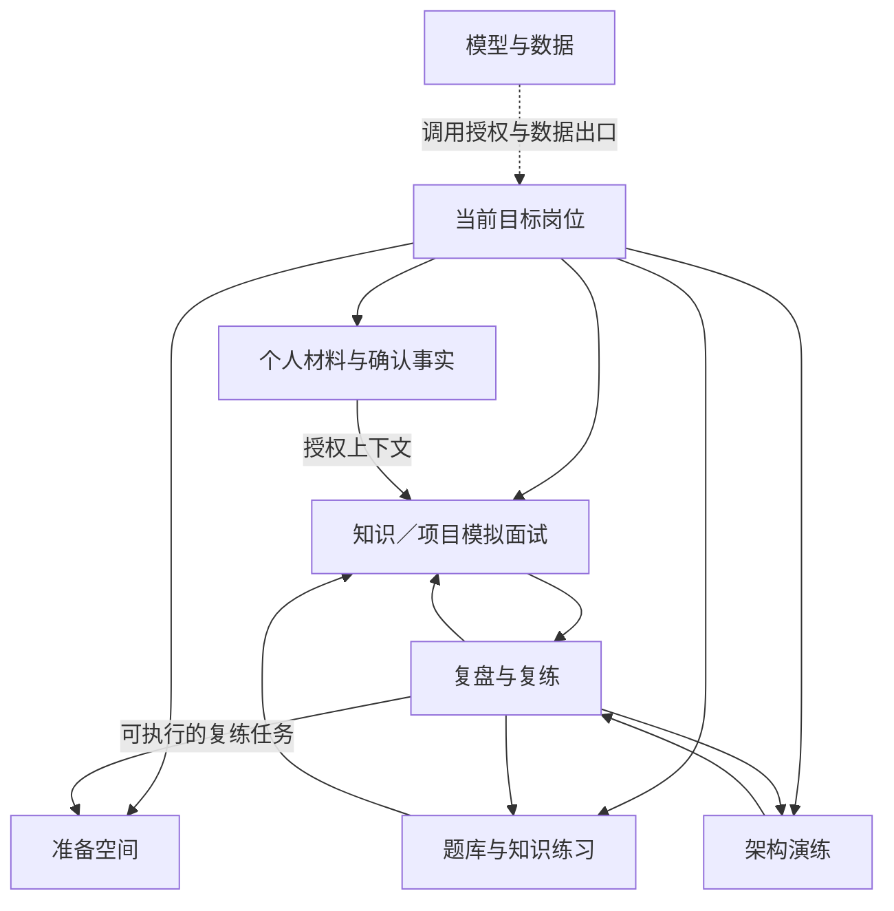
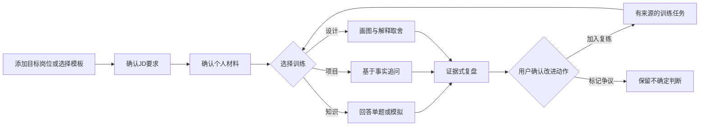
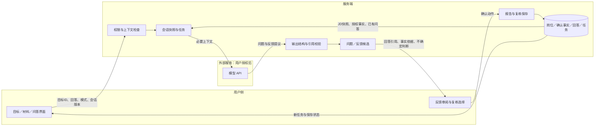
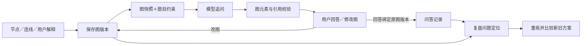
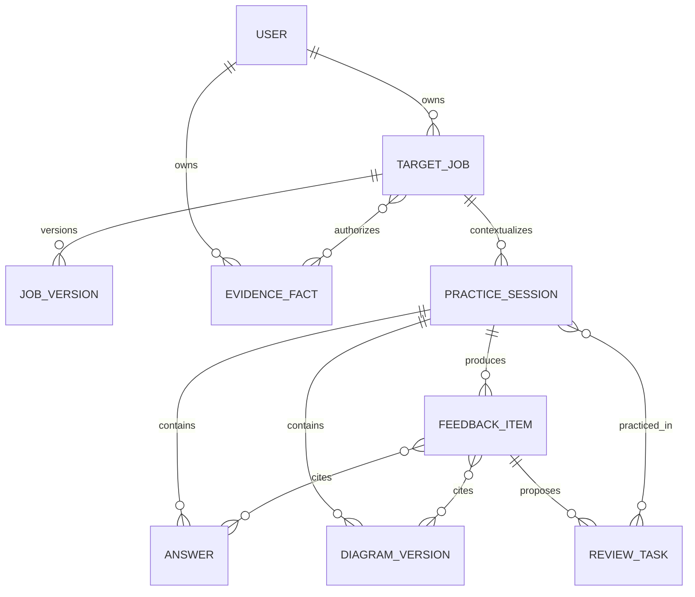
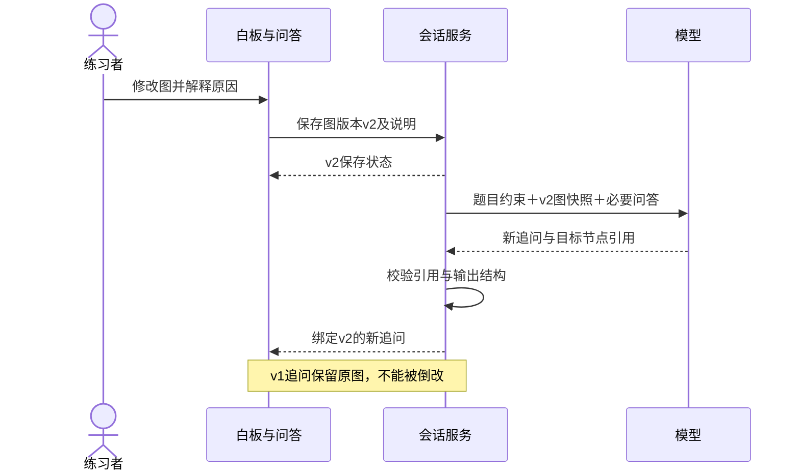

# 问阶：模块、业务流程与数据流

图中服务端、模型任务和可靠存储是正式应用的目标设计。原型只展示本地交互与固定样例。可视化版本见 [流程页面](../prototype/flows.html)。

## 1. 信息架构／模块图

## 2. 准备业务流程／用户旅程

材料不是基础训练的强制门槛；当用户选择个性化项目训练时，使用已确认且有角色边界的事实。

## 3. 模拟面试数据流／DFD

## 4. 白板版本与追问数据流

### 数据不变量

- 每条图追问绑定确切版本与节点ID，不能指向模糊的“当前图”。
- 节点删除后，历史快照仍可回放；新报告检查引用是否有效。
- 同一用户保存动作通过请求ID去重；报告与复练不重复生成。
- 项目事实默认私密且待确认，不能由模型自动升级为真实经历。
- 反馈可标不确定或争议，不强制给开放设计问题一个标准答案。

## 5. 核心对象关系

对象关系是设计草图，不是已执行DDL。岗位、材料、会话和报告保留独立版本，删除与保留策略需一致设计。

## 6. 图修改后追问时序

