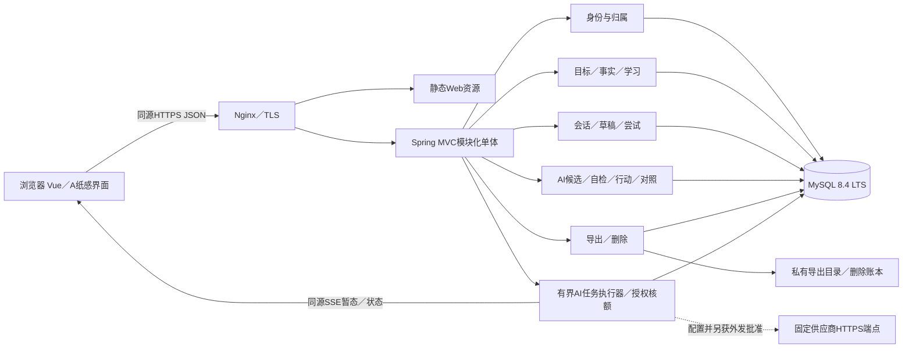
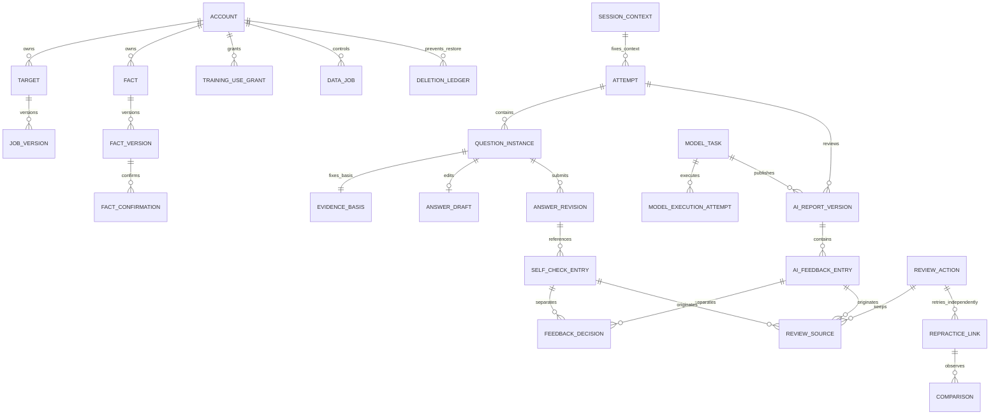
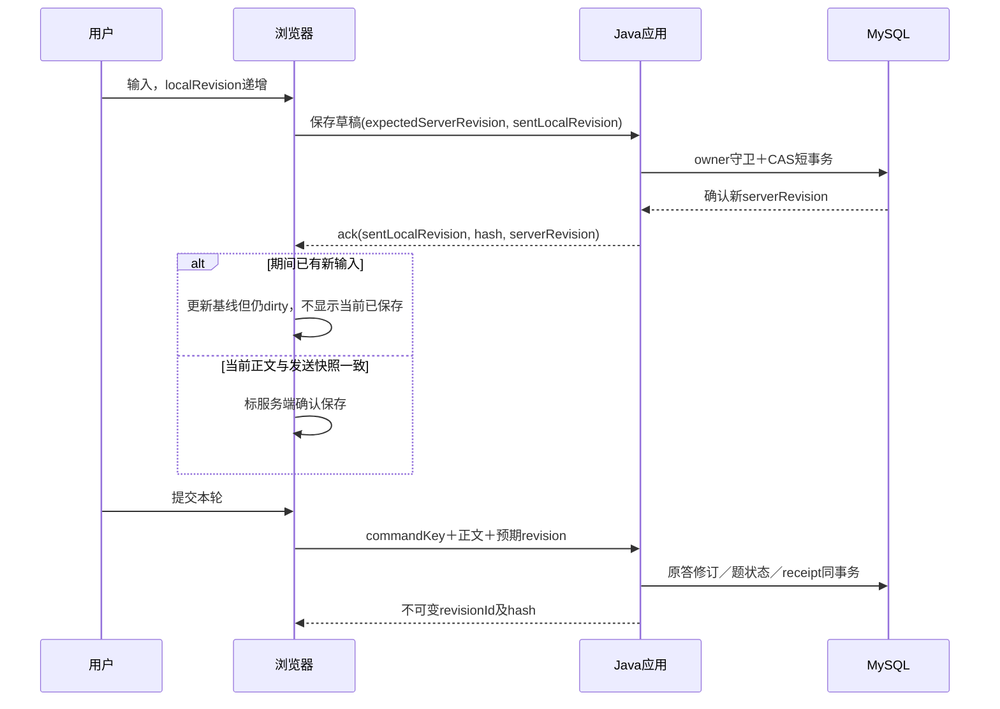
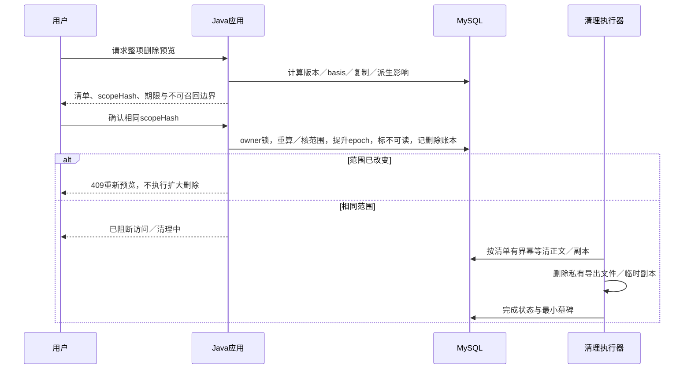

# 问阶 · 系统设计与技术选型

| 项目 | 内容 |
|---|---|
| 版本／日期 | v1.1 · AI文字首期设计基线／2026-11-04 |
| 对应需求 | [PRD v0.4](../PRD.md)；[两套内容样例](09-content-samples.md)；[AI体验规格](12-ai-experience.md) |
| 定位 | 个人自托管的证据式AI文字面试与复练系统；不是通用聊天、题库搬运或正式面试代答工具 |
| 当前状态 | 设计文档，未创建正式工程、安装依赖、执行DDL、接入模型或部署 |
| 授权边界 | 本轮受托直接作产品与技术决定；用户可回审调整。正式工程、真实外发、费用与上线分别另获批准 |

本文可独立阅读。当前入口是PRD、本文、核心原型和就绪审查；不使用工作流，不更新历史 `plan.md`，不把旧原型存储或历史技术建议当成已实现的正式底座。设计目标、官方证据、未验证事项分别标明。

## 1. 系统范围与关键决定

### 1.1 首期交付的业务闭环

**Java主题／最小项目事实 → AI生成或选题 → 独立文字作答与可靠提交 → 受控面试官追问／证据评价 → 来源动作 → 空答新尝试 → 新旧对照与用户结论。**

首个用户版一起设计：单当前目标／手工事实、两套种子题及自建题、AI单次生成1–3题、题干／标准答前固定、专项1主问＋≤2追问、短模拟3主问／每主问≤1追问总≤6、问题流式、按需本轮评价／结束复盘、来源复练与AI比较建议、可靠保存、身份、导出删除及任务／费用控制。安装默认AI未启用，授权后才能发送；无AI闭环为内部可靠性里程碑及用户退路，不把自检冒称AI。

不纳入首期：完整计时／暂停、自由图、音视频、批量文件解析、公开注册、支付、社区、投递与复杂排程。AI只一个固定供应商适配和有限任务，不引通用Agent、工具执行、RAG或多模型平台。当前没有正式工程或真实调用。

### 1.2 采用的架构

- **单实例、模块化单体、同源。**一个Web客户端、一个Java应用、一个MySQL实例；不先拆微服务。
- **关系数据库是业务事实源。**草稿、版本、幂等、权限、删除账本通过显式事务保证；缓存不决定历史或权限。
- **普通表单与长文编辑。**A纸感编辑式为全站基线，首期无图库／富文本；后续架构界面借D布局。
- **AI与自检分开。**模型自动读取本次已提交原文形成带证据候选，用户决定接受或争议；自检由用户自己选证据。引用合法不等于语义正确，未审技术标准不能作确定判题。
- **隐私删除单独覆盖历史不可变规则。**普通编辑追加版本；受控删除允许正文清除与最小墓碑，不能用不可变历史拒绝删除。

## 2. 技术选型与制品规则

### 2.1 已选定的栈与取舍

| 层 | 采用 | 选择理由／明确不采用 |
|---|---|---|
| UI | Vue 3、TypeScript、Vite；Vue Router；CSS变量＋语义表单 | 中文长文／分区状态适合组件化；不先加大型UI框架、富文本或图引擎 |
| 前端状态 | Pinia仅保存跨路由的当前尝试索引、dirty草稿与发送状态；页面查询结果放页面服务 | 路由ID决定打开对象，服务器决定持久状态；不把全历史、权限或版本真相塞进store |
| 前端通信 | 标准fetch封装，同源JSON、AbortController；统一错误契约 | 请求取消不代表服务端业务回滚；不引另一套网络框架 |
| 服务端 | Java 21、维护中的稳定Spring Boot线、Spring MVC、Spring Security、Bean Validation | MVC足以支撑首期表单与事务；不默认全栈WebFlux或微服务 |
| 持久层 | Spring JdbcClient、参数化SQL、显式事务、少量类型化repository | CAS、幂等和删除边界看得见；不先引ORM、MyBatis或自动对象图级联 |
| 数据库 | MySQL 8.4 LTS、InnoDB、utf8mb4 | 单实例关系／事务与版本引用足够；不引向量库、Redis或MQ |
| 迁移 | Flyway Community的core与mysql模块，优先由Boot BOM管理 | 可审查迁移顺序；版本及MySQL支持／许可证需按第2.2节核定，迁移不在本轮执行 |
| 构建 | Node LTS＋npm lock；Maven 3.9稳定线Wrapper＋Boot BOM | 开工时提交锁文件和wrapper校验和；不用动态latest范围或官网最新驱动覆盖BOM |
| 测试设计 | Vitest／Vue Test Utils；JUnit 5／Spring测试；真实MySQL集成与GUI端到端 | 测试库到正式工程再引；H2不能替代MySQL锁、utf8mb4和迁移测试 |
| 部署 | Linux x86_64单实例，Nginx同源TLS反代／静态资源，Java后台进程；MySQL不公开端口 | Windows可开发；先不引Docker、Kubernetes、CDN或托管平台；本轮不启动任何服务 |
| 后续图 | Vue Flow，用于节点／边编辑，不承诺业务版本与历史 | 后续另锁版和IME／容器／撤销验收；图库不负责业务证据 |
| AI首期 | 服务端固定供应商适配、标准Java HttpClient、有限结构化任务；同源fetch消费SSE，AbortController控制连接 | 同步表单与MVC事务不变；不浏览器直连、不隐藏SDK重试、不通用Agent。供应商／模型／地区／价格待启用前核定与批准 |

### 2.2 版本线与证据状态

本轮选定下列版本线；核对日期均为 **2026-11-04**。表中“官方页面明确”只支持对应明示内容，**不证明制品已下载、依赖已解析或应用兼容测试通过**。不沿用历史精确补丁号作为本次锁版。

| 组件／本轮选择 | 官方证据 | 尚未验证／开工核定 |
|---|---|---|
| Vue 3稳定线、Vue Router 4、Pinia 3 | [Vue Quick Start](https://vuejs.org/guide/quick-start.html)明确Vue3、create-vue／Vite／可选TS；Router／Pinia主线为设计选择 | Vue具体minor／patch、Router／Pinia包与插件peer未本地解析；用同一create-vue工具链锁定，不虚填版本 |
| TypeScript 7.0稳定线为首选编译器候选，不采用7.1 beta | [TypeScript下载页](https://www.typescriptlang.org/download/)显示当前7.0，7.1为后续beta；[Vue TS说明](https://vuejs.org/guide/typescript/overview.html)要求独立类型检查，Vite转译不等于类型通过 | 所选vue-tsc／Vue插件对7.0的支持未验证；正式工程先做类型兼容闸门，不静默绕过类型检查或追beta |
| Vite 8.3稳定线；Node24 LTS、最低24.12.0 | [Vite Guide](https://vite.dev/guide/)页面标8.3.4、Node20.19+／22.12+；Vue脚手架更严，为`^22.18.0 || >=24.12.0`；[Node release状态](https://nodejs.org/en/about/previous-releases)明确24为LTS、20为EOL | 选择24安全补丁与npm精确版本；Node维护截止未由该页取得；不因Vite允许20而选EOL线；具体插件兼容仍需验证 |
| Java21，发行版采用Eclipse Temurin21 | [Temurin FAQ](https://adoptium.net/docs/faq)明确GPLv2＋Classpath Exception、免费取得／社区best effort；[support](https://adoptium.net/support)列21 LTS至少到2029年12月及季度更新 | 支持期是项目计划，不是本产品SLA；[平台表](https://adoptium.net/supported-platforms)抓取未给具体OS最低值；正式工程锁Linux／Windows x64 GA二进制、许可证与校验和，不猜补丁号 |
| Spring Boot 4.1稳定线＋BOM；Maven3.9稳定线Wrapper | [系统要求](https://docs.spring.io/spring-boot/system-requirements.html)明确4.1.2、Java17–27、Framework7.0.10+、Maven3.6.3+、Servlet6.1（Tomcat11线），包含Java21 | [支持页](https://spring.io/projects/spring-boot#support)和[Supported-Versions](https://github.com/spring-projects/spring-boot/wiki/Supported-Versions)未取得OSS维护截止表；**4.1仅已选候选，仍有开工维护／制品硬门槛**。不能以Stable标签或商业延长支持推断免费维护 |
| MySQL8.4 LTS；Connector/J由Boot BOM管理 | [LTS策略](https://dev.mysql.com/doc/refman/8.4/en/mysql-releases.html)明确系列内修复、功能稳定；[Connector兼容](https://dev.mysql.com/doc/connector-j/en/connector-j-versions.html)目前文档26.10支持MySQL8.4+／JRE8+／JDBC4.2 | 26.10不是Boot BOM取值；Linux实际8.4.x GA／驱动／数据库软件许可、迁移与还原未验证；5年Premier＋3年Extended不是免费OSS支持承诺 |
| Flyway Community core＋mysql模块，BOM管理 | [官方仓库](https://github.com/flyway/flyway)列MySQL；[根LICENSE.md](https://github.com/flyway/flyway/blob/main/LICENSE.md)为Apache2.0 | 该根许可证不证明所有edition／artifact相同；当前MySQL专页取得404，所选BOM版本对8.4的支持及模块POM／分发许可尚未闭环。**开工前核支持和精确制品许可，不直接执行迁移** |
| Vue Flow1.48稳定线，后续才引 | 2026-11-03历史官方证据：官网1.48.2、Vue3.3+、可变package peer `^3.3.0`；[getting started](https://vueflow.dev/guide/getting-started.html) | 本轮未重新读取发行包；不算首期阻断，接入前核不可变tag、license、Vue peer及行为 |

**技术决定已作，不等于完整依赖门槛已通过。**Boot OSS维护证据、TS工具链兼容、Flyway8.4支持／精确许可和部署制品是开工前待核项；只研究或文档校对无法消除运行兼容门槛。若证据不满足已选线，在本文记录调整理由，再继续，不把用户直接委托决策变成无条件采用不支持版本。

锁版规则：

1. 核对正式发布标签／制品、受支持范围、安全补丁、Node／JDK要求与许可证；记录URL、日期与制品号。页面页眉和可变main不是锁文件。
2. npm提交精确lockfile，Maven通过Boot BOM管理兼容依赖；Wrapper的分发地址与SHA-256固定。驱动优先BOM，不随官网最新号走。
3. 初次只做Vue构建、Java启动、数据库连接、utf8mb4／事务／迁移的最小兼容验证；任何不支持项修改本节再继续，不以升级全栈掩盖。
4. 补丁更新在同稳定线内重新跑兼容与安全检查；跨次版本更改须记录理由、迁移影响与回滚策略。首期不建立自动升级供应链。
5. 不读取旧项目密钥，不执行第三方下载脚本；依赖、软件许可、题目内容与字体图像权利分别核对。本轮仅公开资料研究。

## 3. 运行结构与模块边界



| 模块 | 职责 | 不允许做什么 |
|---|---|---|
| identity | 预置账号、登录会话、CSRF、owner与生命周期代次 | 不因为只有一个账号省略归属；不承担公开注册／邮件找回 |
| preparation | 一个当前目标、JD／要求版本、首页下一步选择 | 不改历史上下文，不输出准备总分 |
| material | 事实版本、责任边界、确认、训练用途与撤回 | 不将待核实事实升级，保存不构成外发授权 |
| learning | 题干与参考标准版本、来源权利、提示、自建题 | 不抓取材料URL，不执行用户代码，不批量搬题 |
| practice | 固定SessionContext、Attempt、轮次、草稿、提交、结束清单 | 不把模型任务执行混作训练Attempt，不允许结束后原地重开 |
| review | 不可变AI反馈／报告与自检、强类型用户决定、来源动作、复练链接／比较、笔记 | 不自动接受／结项，不按题号丢来源，不以结构合法认证语义 |
| data-control | 导出、删除预览／确认、清理、墓碑、备份恢复记录 | 不只删除主表留下正文副本，不把下载链接当权限；也清AI候选／输入副本／事件缓冲 |
| ai | 有限出题／追问／评价／复盘／比较任务；发送清单授权、预算、执行、验证与SSE | 默认不发送；不任意工具、不自动联网查材料；本轮不实际接供应商 |

模块同进程分包；controller薄、application service明确事务与守卫、repository参数化SQL。跨模块通过类型化服务操作，不让controller绕过应用守卫直接更新其他模块表。所有命令使用同一顺序的生命周期／对象锁，避免删除与写入互相错过。

## 4. 业务对象、版本与关系

### 4.1 全局数据约定

- ID为不透明UUID；并非访问凭证。个人对象均带 `ownerId`，公共题包版本单独标公共可读，用户题为私有。
- 每个业务版本含稳定ID、单调版本号、创建时间、作者类型、正文SHA-256；普通编辑不可变。时间存UTC，展示带用户时区，导出ISO-8601。
- 原文统一CRLF为LF后展示并提交，**不做NFC归一化、不自动删前后空白**；只用trim判断是否空答。拒绝非法孤立代理项，Unicode补充字符正常保存。
- 引用区间为Unicode code point的 `[start,end)`，正文hash必须匹配。客户端从UTF-16选区转code point，Java用 `offsetByCodePoints`／`codePointCount`，不把JS／Java字符下标直接当证据位置。
- `serverRevision` 用于可变草稿／用户状态CAS，客户端 `localRevision` 仅描述本标签输入变化，二者不可混用。
- 版本普通不可变不等于永久可读：删除后正文清空、引用显示墓碑；hash与片段也不得作为可恢复敏感副本偷偷留下。

### 4.2 首期逻辑模型（不是DDL）

| 逻辑对象 | 关键字段／关系 | 唯一与约束 |
|---|---|---|
| Account／Lifecycle | ownerId、activeTargetId、lifecycleEpoch、会话安全状态 | 首期一个预置账号；测试另造第二账号验证越权；所有写命令核epoch |
| Target／JobVersion | targetId、ownerId、currentVersionId、JD、手工要求、状态 | 当前目标指针CAS；旧JobVersion不可变，归档不删 |
| Fact／FactVersion | factId、versionId、责任OWNED／PARTICIPATED／UNVERIFIED、正文／出处 | 每项编辑新版本；事实版本与确认分开 |
| FactConfirmation | factVersionId、contentHash、确认人／时刻 | 内容hash与责任版本一致才有效；UNVERIFIED仅作未知约束，不进入个人事实评价 |
| TrainingUseGrant | ownerId、确切subjectRefs、purpose、active、authorizationEpoch | 允许训练不等于外发；撤回提升epoch，历史用途保留标记 |
| QuestionVersion／CriterionVersion | 题干、条件、主题、类型、提示、权利／审查状态、参考标准、generationTaskId／sourceRefs | 自建标准可空；AI采用为私有新版本，题干及标准答前固定；审查按精确版本，AI新标准默认AI_UNREVIEWED，不继承人工审阅 |
| InterviewPolicyVersion／InterviewPlanVersion | 角色、模式、阶段、主问题／标准清单、允许追问数、反馈时机 | 专项1主问＋≤2追问；短模拟3主问／每主问≤1追问，总≤6；无计时；用户采用后固定 |
| SessionContext | jobVersionId或Java模板、factVersionRefs、grantRefs、policyVersionId／planVersionId、主问题／标准、状态 | 创建时固定；OPEN／ARCHIVED；上下文变化建新Session，归档禁新Attempt |
| Attempt | sessionId、ownerId、state、originActionId、generationEpoch、activeQuestionInstanceId、结束清单 | 新Attempt为空答；结束不可重激活；提交新修订／轮次状态变化使实时任务代次失效 |
| QuestionInstance／EvidenceBasis | attemptId、ordinal、questionVersionId、criterionVersionId、parentQuestionId／answerRevisionId、固定basis | 主问或用户采用的追问；每轮创建即固定完整输入依据；候选不算正式轮次 |
| AnswerDraft | questionInstanceId、ownerId、text、serverRevision、updatedAt | 每题一个当前草稿；CAS，不无声覆盖；结束后草稿只读待删除 |
| AnswerRevision | questionInstanceId、revisionNo、text、hash、submittedAt、draftRevision | 提交追加不可变；唯一题实例＋revisionNo；同命令不重复 |
| HintUsage | attemptId、questionInstanceId、hintVersion／level、phase、openedAt | 记录作答前／中／后，不扣分；比较呈现，不复制原文到日志 |
| SelfCheckEntry | subjectAttemptId、basisId、answerRevisionRef／range或NOT_MENTIONED、type、condition、limitation、action | 用户自检不可变，可supersedes；引用二选一、完整原文code point范围 |
| AIReportVersion／AIFeedbackEntry | reportId／version、subjectRef、modelTaskId、basis／answerRefs、维度／等级、证据／条件／限制／动作 | 报告主体ATTEMPT xor POST_INTERVIEW_RECORD_VERSION，首期只ATTEMPT；本轮评价亦有报告容器；唯一task＋结果序号，失败不创建；未审技术标准不得确定判题 |
| FeedbackDecision | sourceRef.kind=SELF_CHECK_ENTRY或AI_FEEDBACK_ENTRY、sourceRef.id、decision、说明、serverRevision | 强类型解析校验owner／关联，不任意ID；ACCEPT／DISPUTE／IGNORE与原判断分开 |
| ReviewAction／ActionVersion | ownerId、动作／判断条件、state、priority、serverRevision | 默认一来源一动作；编辑新版本，已有对照指原版本 |
| ReviewSource | actionId、强类型sourceRef、originSubjectRef、actionVersionId、state | 唯一kind＋id＋动作版本；显式合并保集合，不按题合并；每来源独立状态，行动为聚合展示 |
| RepracticeLink／Comparison | sourceRefs、新attemptId、旧／新revisionRefs、动作版本、上下文diff、hintSummary、verdict、证据／理由 | 双方Attempt结束，Comparison不可变；只改所选来源状态，未处理来源仍保留 |
| AIComparisonCandidate | taskId、sourceRefs／动作版本、旧／新refs、比较建议、证据／条件／限制 | 同固定输入；模型建议不修改Comparison或ReviewSource状态，用户显式确认另命令 |
| ModelUseGrant／AIInputManifest | providerConfigVersionId、用途、exact subjectRefs／字段、manifestHash、authorizationEpoch | 训练用途另有grant；每次生成核这份发送清单，资料中的命令不变系统指令 |
| ModelTask／ModelExecutionAttempt | kind、manifest／basis、模型／提示／标准／价格版本、generationEpoch、currentExecutionId、token、lease、sendState | 逻辑任务与执行分离，后者不是用户Attempt；发送／接纳／费用分别守卫，详见第10节 |
| BudgetReservation／UsageSettlement | executionId、币种／价格／周期、R／H／S金额、settlementOperationId | 唯一执行预留与结算操作，UNKNOWN不记0、不双释放；有限个人预算非支付系统 |
| PracticeNote | attemptId、text、serverRevision | 首期每Attempt一条可编辑笔记，不自动变事实 |
| DataLineage | sourceKind／id、dependentKind／id、edgeKind | STRUCTURED_REF／CONTENT_COPY／DERIVED_WITH_BASIS；引用与复制区别；所有业务写同时登记 |
| CommandReceipt | ownerId、commandType、idempotencyKey、requestHash、结果引用、状态 | 唯一owner＋type＋key；同key异body拒绝；不缓存回答正文；删除后旧回执不可回放正文 |
| DataJob／DeletionLedger | ownerId、kind、scopeManifest、scopeHash、epoch、state、leaseToken、结果引用 | 导出／删除作业有界、可重试；账本独立保留最小墓碑，不藏正文 |

普通外键／唯一索引保障结构，owner与版本可读／授权校验由事务守卫补齐，不能只靠跨表外键。所有可删除正文的位置都有lineage或所属聚合登记；未来增加快照／导出字段时要一并补清理覆盖。



ER图只表示核心关系，不能当作完整schema或已执行迁移。Session的题目／事实／grant由版本引用表连接；比较／lineage也按强类型引用验证，不使用任意JSON ID绕过owner。

## 5. 状态机与业务事务

### 5.1 Session、Attempt与轮次

- Session：`OPEN → ARCHIVED`。固定上下文可多次尝试；改变JD、事实、题干／参考条件、模式必须新Session；归档不会自动删除。
- 首期Attempt：`DRAFT → ACTIVE → COMPLETED`，或 `ABANDONED`。无计时／暂停。后续完整模拟再扩 `ACTIVE ↔ PAUSED` 和服务器活动时间。
- QuestionInstance：`PENDING → ANSWERING → ANSWERED`，可显式 `SKIPPED`；结束时无提交且非明确跳过标 `UNANSWERED`。返回活动题可提交新修订，不覆盖旧答。
- 追加追问是用户命令，可选明确标预设的候选或生成AI候选后采用；专项主问外最多2轮，短模拟每主问最多1轮、总≤6。采用事务核父问题、确切回答、generationEpoch、轮数和CAS；候选不计未答。下一个预先采用的主问题与生成追问分开，推进主题不调用模型。
- 短模拟固定3主问的阶段顺序，无材料时项目阶段用技术情景；本轮评价接口在短模拟ACTIVE状态拒绝，提示／参考也不可读，结束后另请求复盘。专项提交后可主动评价，不自动跟随提交。
- 继续编辑未提交草稿不改已发任务basis；成功提交新修订、跳题／返回／推进、采用其他追问或结束会递增generationEpoch，并取消旧实时任务接纳。已成功旧报告仍指R1，历史不倒改。
- 提交与结束分开。结束只冻结每题最新提交清单，不删除更早修订／自检。存在未交草稿时展示差异及三选择：先提交、只纳入旧提交并留未纳入标记、返回编辑。无提交可标未答／放弃，不能伪称已完成一次有效回答。
- 结束后的补充只能新Attempt；原草稿允许只读复制或另新尝试恢复，不直接重开。Session归档会拒绝新尝试，复练可新Session保原来源。

### 5.2 提交事务

一次提交的顺序：

1. 校验登录、CSRF、owner；锁owner生命周期行，再锁Attempt／QuestionInstance，核资源及结果仍可读，不能回放已删除正文。
2. 查 `CommandReceipt`；同key与requestHash先返回原修订引用，异body返回409。既已成功的命令可以在Attempt结束后回放，但不重新激活或写新版本；回放仍核owner、删除状态与结果可读性。
3. **只有不存在成功回执的新写命令**才核ACTIVE、当前epoch／scope、预期草稿serverRevision、正文hash与容量；提交body含正文和预期修订，不依赖另一次自动保存成功。
4. 在同事务保存当前草稿新修订、追加AnswerRevision、更新题状态／最新指针及generationEpoch、使旧实时生成失效，登记lineage和命令回执。业务提交不自动发模型。
5. 提交事务后返回revisionId／hash／serverRevision。不成功就没有正式回答，客户端仍留输入并可用同key重试。

结束命令持相同顺序锁，核 `expectedSubmittedManifestHash`、未交草稿处理和可见在途任务清单；提交／草稿／采用轮次或任务清单变化则409重预览。确认后递增generationEpoch、取消本地接纳在途实时任务，只冻结已采用题和最新正式提交，不纳入暂态题或草稿。结束不自动生成复盘；后续报告任务须独立授权和核额。

### 5.3 用户自检与复练

自检保存必须同时验证：subject为本人Attempt、依据版本属于该QuestionInstance、revision仍可读、hash匹配、range合法、引用类型二选一（QUOTE／NOT_MENTIONED）、标准存在时版本一致。NOT_MENTIONED绑定整答范围与用户填写的所需条件，不自动搜索否定。待核实事实只在未知条件区显示。

自检条目提交即固定，不必等结束；R1不因R2移动。自检聚合仍标“用户自检”，不是AI报告。AI本轮评价与结束复盘分别由主动任务生成 `AIReportVersion＋AIFeedbackEntry`，完整成功及结构／引用／业务验证后同事务提交；证据校验复用同一code point／hash规则。NOT_MENTIONED须完整被检范围，不混QUOTE。AI报告主体严格二选一 `ATTEMPT(attemptId)`／`POST_INTERVIEW_RECORD_VERSION(recordVersionId)`，首期只前者，不伪造回忆为训练。

`FeedbackDecision／ReviewSource.sourceRef` 是SELF_CHECK_ENTRY或AI_FEEDBACK_ENTRY强类型引用，服务端分别解析验证owner、subject、basis及可读性；AI记录不能伪存成用户自检。每条AI判断含条件、限制、标准版本和审查状态；AI_UNREVIEWED技术标准不产生确定技术对错／等级。

接受动作事务：核强类型来源＋动作版本防重、保存用户决定、创建默认独立ReviewAction及ReviewSource。显式合并核所有来源同owner／可用，保source集合；每来源独立pending／addressed／archived，行动只作聚合展示。重复接受返回原行动，已关闭来源不因重试复活；改变决定不自动删除或完成历史行动。

复练事务：核原Attempt已结束、来源仍可读且用途未撤回，检查上下文；不变且Session OPEN可建同Session新Attempt，否则新Session。新回答为空，无旧答默认预填。原来源缺失或删除时，不宣称完成原来源对照；用户仍可独立练题。

Comparison保存要求双方Attempt结束且有新提交，绑定旧来源revision、新revision、动作版本、context与提示。用户选 `ADDRESSED／PARTIAL／NOT_ADDRESSED／UNDETERMINED`，均写理由；ADDRESSED／PARTIAL须合法新答证据。AIComparisonCandidate是独立不可变建议，不修改正式Comparison或来源状态；用户显式确认另命令。ADDRESSED只关闭所选ReviewSource，其余仍保；非已处理默认待复练或明确归档原因。上下文变化标“不宜直接比较”，不自动计算提升分或技能掌握。

### 5.4 并发锁与幂等策略

首期单用户选择**owner级生命周期串行化短事务**作为简单安全起点：所有业务写、删除确认、导出发布与下载权限检查按owner→聚合ID顺序取得相同锁；网络、文件写、长扫描不在锁事务中。公开多用户规模时可细化，但不能仅加epoch字段而漏了写入检查。

- 普通写在锁内检查当前epoch及资源墓碑，登记所有引用／复制边；删除确认先升epoch并标受影响范围不可读，之后异步清理。删除前后排队的写均能看到新代次，迟到提交不能复活。
- 草稿CAS是 `WHERE owner_id=? AND server_revision=? AND not_deleted`，必须受影响行数=1；0行查明冲突或删除，不强行再update。
- 创建／提交／自检／行动／比较／导出／删除有命令幂等；前端重复点击禁用只是UX，不替代服务端唯一约束。
- 锁冲突／事务回滚返回可重试错误；只有明确回滚且未提交的本地SQL可有限重试。同key确认已提交则返回原引用。网络超时不代表数据库未提交，不能换key盲重发。
- 首期Receipt保留到聚合删除；只存结果ID与hash／类型，不存正文。如果将来清理Receipt须保最小去重墓碑或过期拒绝，不让旧key重新创建记录。

## 6. 草稿、浏览器状态与恢复



前端策略：800ms无输入后保存、最长5秒一次；每题只一条在途保存，新输入排队。参数是设计起点，正式工程验证中文IME期间不触发错误提交。输入中不关闭页面、不把blur当提交。旧ack只推进服务器基线，若hash／localRevision不对应当前输入，dirty保留。

首期**不自动把敏感正文写localStorage／IndexedDB**。页面内存保护在途输入；已服务端确认内容刷新后从数据库恢复；未确认内容关闭／崩溃可能丢失，离开时清楚警告并提供复制。后续如需本地恢复副本必须用户显式开启、说明未加密／浏览器扩展／过期与删除，不能假称浏览器加密等同安全保管。

冲突返回本地基线、当前服务器修订引用和差异；界面保本地文本，用户可复制、采纳对端、在独立合并输入框合并后用新预期修订提交。只有明确采纳才替换本地输入；不自动last-write-wins。服务端502／超时先查询同命令状态，保同key重试；不知道结果时显示“待确认”，不显示0条记录或成功。

客户端路由：`/prepare`、`/materials`、`/learn`、`/practice/:attemptId`、`/review`、`/compare/:comparisonOrActionId`、`/data`。这些是未来应用约定，不是当前可访问服务。查看历史使用独立只读数据／组件，不把旧答加载到当前草稿；路由切换保护dirty内容。

## 7. 首期API契约

### 7.1 共用请求与错误

所有API同源 `/api/v1`，Cookie会话；读GET，写POST／PUT，不用GET改变状态。创建命令带 `Idempotency-Key`，可变状态带 `expectedServerRevision`；用户ID从认证得到，不接受客户端owner字段。响应包含 `requestId` 与结果引用，不在日志回显正文。

错误按Problem Details风格：`type、title、status、code、requestId、fieldErrors、retryable`；冲突可带当前修订引用及只向本人返回的差异数据。400格式／范围，401未登录，403 CSRF／权限，404对象不存在或非本人（避免探测），409版本／幂等／状态冲突，410本人来源已删除，413超容量，422缺确认／缺合法证据，429限速，503暂不可用。错误正文不带凭据、SQL或服务器栈。

### 7.2 资源与命令

| 接口 | 关键输入／输出与守卫 |
|---|---|
| `POST /auth/login`、`POST /auth/logout`、`GET /me` | 登录限速与会话轮换；无注册；返回模式、自身信息与CSRF获取约定，不返回secret |
| `GET /prepare` | 当前目标、一个下一步与原因、未完成尝试／行动索引；排序确定、不调用模型 |
| `POST /targets`、`POST /targets/{id}/versions`、`POST /targets/{id}/archive` | 单当前目标；正文版本追加、current指针CAS、归档不改历史 |
| `POST /facts`、`POST /facts/{id}/versions`、`POST /fact-versions/{id}/confirm` | 责任标签、版本hash与出处；确认仅确切版本；UNVERIFIED不升级 |
| `POST /training-use-grants`、`POST /training-use-grants/{id}/revoke` | exact subjectRefs与purpose；核owner，撤回提升authorizationEpoch；不外发 |
| `GET /questions?topic=&type=`、`POST /questions`、`POST /questions/{id}/versions` | 公共／私有界限；自建参考可空；来源URL仅存文本，不请求抓取 |
| `POST /sessions`、`POST /sessions/{id}/archive` | job/template、确切facts／grant、policyVersionId／planVersionId与题目／标准清单；事务固定上下文，不以最新指针替代 |
| `POST /sessions/{id}/attempts` | OPEN上下文、新Attempt空输入、可含originAction；拒绝复用旧槽 |
| `GET /attempts/{id}` | 固定basis、轮次、当前草稿与修订索引、结束清单；逐层owner校验 |
| `PUT /questions-in-attempt/{id}/draft` | text、expectedServerRevision、sentLocalRevision；CAS保存，不提交 |
| `POST /questions-in-attempt/{id}/submissions` | 正文、expectedRevision、hash、key；返回不可变answerRevisionId；与状态receipt同事务 |
| `POST /attempts/{id}/followups` | source=PRESET或AI_CANDIDATE＋版本／candidateId、expectedGenerationEpoch／revision；核ACTIVE、父题／确切原答、策略轮数、可读性；采用即固定basis，未采用候选不计未答 |
| `POST /questions-in-attempt/{id}/skip`、`POST /questions-in-attempt/{id}/return` | 指定题／原因／expectedGenerationEpoch，保草稿；ACTIVE；返回更新当前题指针并递增生成代次，不覆盖修订 |
| `POST /attempts/{id}/advance` | 当前题／提交或跳过状态、expectedGenerationEpoch；推进到已采用的下一主问，更新指针及代次；零模型调用，不自动生成追问 |
| `POST /attempts/{id}/finish-preview`、`POST /attempts/{id}/finish` | 预览manifest／未交草稿；确认expectedManifestHash＋草稿策略；变动409重预览 |
| `POST /attempts/{id}/abandon` | 明确原因／保留草稿策略，不当作有效新答 |
| `POST /questions-in-attempt/{id}/hint-usages` | 专项level／phase／version及命令防重；短模拟ACTIVE拒绝提示／参考，不只是前端折叠 |
| `POST /self-checks` | 用户QUOTE／NOT_MENTIONED、basis、revision／hash／range、条件／动作；来源不可变 |
| `POST /feedback-decisions` | sourceRef.kind／id、decision／说明、expectedRevision；分别解析AI反馈或自检，同owner／subject及可读性 |
| `POST /review-actions`、`POST /review-actions/{id}/sources` | 强类型sourceRefs＋动作版本；默认独立、显式合并、唯一防重，不按题号合并 |
| `POST /review-actions/{id}/repractice` | 来源已结束／可用、同上下文或新Session；新Attempt空答，变式须先采用 |
| `POST /comparisons`、`POST /review-actions/{id}/archive` | 双Attempt结束、旧／新refs、动作版本、verdict／理由／证据／所选source；另可引用AIComparisonCandidate；追加对照与仅所选来源状态同事务 |
| `PUT /attempts/{id}/note`、`GET /history` | 笔记CAS／每尝试一条；历史首期按时间、目标、状态过滤，不假全文检索 |
| `POST /exports`、`GET /exports/{id}`、`GET /exports/{id}/download` | 选择scope、固定manifest、owner／epoch／期限二次检查；秘密排除；详情见第8节 |
| `POST /deletion-previews`、`POST /deletions`、`GET /deletions/{id}` | scopeHash、确认nonce、完整影响；守卫／tombstone／cleanup；详情见第8节 |
| `GET /commands/{type}/{key}` | 只查本人命令结果引用／状态，响应丢失恢复；删除后不能回放正文 |

这些是可实现的首期接口清单，不是所有接口已经存在。具体字段由类型化DTO与JSON Schema／OpenAPI在正式工程创建，不能用泛化 `POST /execute` 绕过状态和权限。

### 7.3 两个关键请求样例（说明，不执行）

```json
{
  "answerRevisionId": "opaque-answer-r1",
  "basisId": "opaque-basis-v1",
  "evidence": {
    "kind": "QUOTE",
    "contentHash": "sha256-of-exact-saved-text",
    "rangeUnit": "UNICODE_CODE_POINT",
    "start": 0,
    "end": 8
  },
  "type": "CONDITION_NOT_STATED",
  "condition": "结果未知时先确认原请求是否生效及去重保证",
  "limitation": "不能据此判断用户不会处理或供应商确有幂等",
  "action": "交代请求号、确认路径与重试前提",
  "acceptance": "能在新答指出状态、前提与验证方式"
}
```

区间只是格式示例，必须根据实际保存正文算出并校验，不能照抄数字。NOT_MENTIONED改为该类型及完整被检查范围，不允许同时携带QUOTE。

```json
{
  "scope": { "kind": "FACT", "id": "opaque-fact-id", "versionPolicy": "ALL_VERSIONS" },
  "previewId": "opaque-preview-id",
  "expectedScopeHash": "sha256-of-visible-impact-manifest",
  "confirmationNonce": "one-time-owner-bound-nonce"
}
```

确认nonce有界过期且绑定owner／范围，不能凭HTML勾选或前端hash决定合法删除。

### 7.4 首期AI命令与只读结果

每个创建命令使用独立幂等key，重试沿用原key；先回放仍可读的成功回执，再核新任务状态／授权／预算，同key异body拒绝。任务GET或SSE重连不创建执行，响应丢失按key查原task。

| 接口 | 输入／结果与守卫 |
|---|---|
| `GET /ai/config-status` | 只返回是否配置、provider／model／地区、当前价格版本和预算状态；不返回secret；未核定不显示可发送 |
| `POST /ai/input-previews` | purpose、强类型subjectRefs／字段；核owner与训练用途，冻结manifest及hash、费用预留上限，返回可见发送清单；不发送供应商 |
| `POST /model-use-grants`、`POST /model-use-grants/{id}/revoke` | 确切manifestHash／provider版本／用途；撤回提升authorizationEpoch、阻新发／旧接纳；不是训练用途grant |
| `POST /ai/question-generations` | manifest／grant、主题／级别、数量1–3；核额后建QUESTION_GENERATE task，不立即成为题库记录 |
| `POST /ai/question-variants` | 旧题／动作版本、明确变更条件、manifest；单题候选，采用前不建新Attempt |
| `GET /ai/question-candidates/{id}`、`POST /ai/question-candidates/{id}/adopt` | 完整合法结果及审查标签；采用为私有题＋标准新版本，核可读／授权与幂等；丢弃不退费 |
| `POST /interview-plans` | 策略模板、模式、角色、已采用题／标准清单；短模拟必须3主问、阶段明确，专项1主问；固定计划，无模型规划调用 |
| `POST /ai/followup-generations` | 当前Attempt／父题／answerRevisionId、expectedGenerationEpoch、manifest；核ACTIVE、确切当前提交及剩余轮数；结果另经7.2的采用命令 |
| `POST /ai/answer-evaluations` | 专项题／确切revision／标准、manifest；短模拟ACTIVE拒绝；R2使旧实时任务失效，成功产生AI报告／条目 |
| `POST /ai/attempt-reviews` | 已结束Attempt及冻结manifestHash；用户主动获取或再生成，报告追加版本；不发草稿 |
| `POST /ai/answer-comparisons` | 所选ReviewSource、ActionVersion、旧／新revision、双结束Attempt、manifest；只比较候选，不改来源状态 |
| `GET /ai/tasks/{id}`、`GET /ai/tasks/{id}/events` | 状态／结果引用／费用待确认，SSE仅观察；每层owner、代次、可读性；不得GET即启动生成 |
| `POST /ai/tasks/{id}/cancel` | 取消本应用接纳，幂等；供应商费用另核，不声称停算／退款 |
| `POST /ai/tasks/{id}/retry` | 显式确认额外费用／原H保留、新manifest与当前grant；仅允许终态／UNKNOWN，创建关联新task，不复活旧任务或自动换key |
| `GET /ai/reports/{id}/versions/{version}`、`GET /ai/comparison-candidates/{id}` | 完整候选、版本／basis／限制；历史只读，删除来源不可回放；决定经feedback-decisions，对照经comparisons |

模拟模式的提示／参考以及评价不能只从DOM隐藏：活动模拟相关题／标准读取采用受限视图，当前Attempt的提示／本轮评价命令拒绝，结束后再提供复盘。用户在开始前可能已看过题或另有题库阅读记录，照实记录，不能宣称技术防作弊或将个人训练变成监考系统。

## 8. 导出、删除与恢复

### 8.1 导出

导出包含UTF-8 JSON manifest与可读Markdown（同一ZIP），选定目标／事实／训练／行动范围；列版本、责任、提示、来源、动作、对照与缺失标记。不是可直接导入的完整数据库备份；首期不做恢复导入。排除密码、Cookie、API密钥、内部安全日志和未选择范围。

1. 在owner锁短事务冻结manifest与当前lifecycleEpoch，创建导出作业；内容生成在事务外，路径是不可公开的随机ID目录。
2. 发布前再次取owner锁核删除epoch／manifest可读范围，不通过则销毁临时文件，不能用旧快照发布。
3. 下载路由再检查owner、有效期、scope删除状态与epoch；不得直接公开静态目录或只靠URL token。流开始时检查并限制时长；删除确认中止关联在途下载，已发送字节／已下载文件不能召回。
4. 最长24小时失效，默认压缩包20 MiB上限；超限提示缩小范围，不截断。删除相关来源使未下载产物失效；与范围无关的epoch改变可保守失效重生成。
5. 记录作业状态和大小，不记录正文；JSON／Markdown对用户文本保持惰性，链接不自动抓取。失败重试同key，不重复创建下载产物。

### 8.2 删除的影响计算

首期提供FACT／ATTEMPT／TARGET／PRIVATE_QUESTION／ALL_PERSONAL_DATA整项删除；事实／目标／自建题均含全部版本，不提供“仅清最新隐私版本”或任意选段脱敏。归档和用途撤回是独立命令。

`DataLineage`分三种：

- **结构引用**：可只留缺失标记，正文不存在被删内容复制的独立记录可保留。
- **内容复制**：上下文内联、反馈摘录、行动引用、对照、导出正文必须清除。
- **依完整basis派生**：哪怕最后反馈只声明另一个引用，也检查其完整输入／上下文；不可可靠局部脱敏就清整份派生产物。

不能只相信模型声明的最终引用，也不能只跟一个外键。对于以被删事实为依据的回答，能证明只有结构引用且没有正文复制时可保原答并标缺失；无法证明则按预览清除相关回答／派生正文。误删风险与保守范围须在确认前显露。

### 8.3 删除协议与并发



删除确认短事务先阻断读、写、新引用、导出发布和迟到结果，然后按manifest分批清理。作业有 `currentExecutionId、leaseUntil、fencingToken`，旧worker不能标新作业成功；文件清理重复安全，完成前核token与epoch。部分失败显示清理中／失败项，不宣称彻底删除；线上清理目标24小时内，正式工程须故障注入验证。

墓碑只保不透明资源ID、类型、代次、时刻与状态，不保正文、摘录、可还原hash或加密藏匿副本。新账号即使同名也不继承旧ownerId。用户可查看清理状态；账户删除／注销属于后续明确管理操作，ALL_PERSONAL_DATA首期保账号用于作业查看。

### 8.4 备份与还原

- 备份加密、最少权限、不公开下载；最长14天轮替；密钥与DB备份分离。备份可能含已删正文，在线删除不等于备份即刻物理擦除，界面须说明残留窗口。
- 删除账本单独持久留最小记录，覆盖所有仍可能还原的备份；不能只在即将还原的DB内部保存账本。账本副本／还原期间的删除增量必须可靠获取。
- 还原先离线恢复DB、导出／文件索引，再重放最新删除账本与epoch，清理被删范围与过期导出，验证无复活后才恢复登录／业务服务。未取得最新账本不得开放。
- 拟目标RPO≤24小时、RTO≤4小时，以每日一致备份和实际还原演练为证，不是现在已达到的SLA。数据库备份≠用户导出，不能用导出替代备份测试。

## 9. 身份、安全、内容与运维

### 9.1 个人版安全基线

- 预置账号用Spring Security的维护中密码哈希方案（自适应PBKDF2或bcrypt按部署核定参数），无默认公开密码；凭据从安全引导输入，不从旧项目复制。登录轮换会话，登出失效；空闲30分钟、绝对12小时为首期目标。
- 同源TLS；Cookie `HttpOnly、Secure、SameSite=Lax`，显式CSRF保护；严格Origin／内容类型校验，不开放泛CORS。反代只信固定代理，未授权公网暴露不进行。
- 所有嵌套路径从父到子验证owner与关联，历史版本／command查询／导出下载同样检查；公共题包与私人题分开。第二测试owner的越权用例必须通过。
- 参数化SQL、字段白名单、请求／正文限额、登录和写入限速、异常不泄露栈。用户URL、SQL、代码、模型文本都是惰性内容；不自动抓URL、不执行脚本、不允许任意baseURL。
- 正文与密钥不进入运行日志、URL参数、分析埋点或错误上报；运维日志14天、安全最小审计90天。禁第三方埋点，日志只ID／状态／时延／错误码；生产健康详情不公开。
- CSP、无不受信任HTML渲染、输出编码、依赖清单与安全扫描。用户Markdown只以安全受限渲染或文本展示；首期表单先纯文本。

### 9.2 秘密与模型边界

AI凭据仅在另获接入批准后服务端加密配置，解密key与DB备份分离；前端只见是否配置，原型不收密钥。固定HTTPS baseURL／出站白名单，禁私网／元数据、任意重定向及跨域携secret；“OpenAI-compatible”不等于同地区或留存。未配置不发送，不从旧项目取凭据。

个人自托管不等于不外发。每次任务核确切manifest、训练用途及供应商外发grant／epoch，历史选择不构成永久许可。训练使用、端点store、留存、驻留、费用逐项核定，没有证据不承诺零留存、退款或立即停算；详见第10节。

### 9.3 运行与维护

Linux部署仅作为设计默认，不采购／执行。Nginx提供Web静态与 `/api` 同源反代；应用仅内网／回环监听；MySQL使用最小业务账号，迁移账号单独权限，端口不公网开放。SSH／管理员通道由部署者另配，不在应用内放远程shell。

数据库连接池拟上限10，HTTP请求线程池与导出／删除执行器有界；首期数据作业总并发1、单用户1，定时扫描DB任务表，不依赖MQ。任务超时／租约恢复只重跑幂等清理或只读生成，发布再核epoch／token。不要把网络与文件I/O放在业务长事务里。

监控最小项：保存成功／冲突／待确认、事务时延、命令重复、无效证据、删除清理时长、导出失败、磁盘／DB容量、认证拒绝。无正文、无准备分数。发布前验证备份还原、迁移失败停止、证书／secret轮换；数据库迁移默认向前兼容，不能把应用版本回滚当DB自动回滚。

## 10. 首期AI接入、流式与费用契约

本节属于首个AI文字用户版设计，不是已运行的服务。无配置／授权时零发送；先实现可靠文字内部里程碑，不能用它替代AI用户版验收。当前不收密钥、不调用模型、不上传资料。

### 10.1 有限任务、输入与输出

| 任务类型 | 允许的输入与输出 | 业务守卫 |
|---|---|---|
| QUESTION_GENERATE | Java主题／级别、1–3题、确切目标与选定事实；题干、条件、能力、标准、合理替代、提示及生成依据 | 完整校验后用户采用为私有题／标准版本；AI_UNREVIEWED，不公开、不押题 |
| QUESTION_VARIANT | 来源题／动作及明确变更条件；一题变式和改变的能力／标准 | 不随机换词；未审新标准不继承旧人工审阅；采用后新Session／Attempt |
| FOLLOWUP | 父问题、确切已提交revision／hash、允许事实、阶段、policy及剩余轮数；一个主要追问 | ACTIVE且父题为当前题；提交／跳题／推进／结束的generationEpoch变更使旧实时候选失效；采用CAS核轮数 |
| ANSWER_EVALUATE | 专项确切题／标准＋原答＋允许事实；分维度条件／证据／限制／动作 | 仅专项主动请求，短模拟进行中拒绝；技术未审不确定判题；成功旧报告仍指原revision |
| ATTEMPT_REVIEW | 已结束Attempt的冻结清单及最新提交，题／标准／获准事实；报告和分题反馈 | 不发送未交草稿，不以未答当不会；报告追加新版本，结束不自动调用 |
| ANSWER_COMPARE | 选定来源／ActionVersion、旧／新revision、双方context／提示；比较候选 | 双方Attempt结束；建议不写正式Comparison／来源状态；不同条件不出提升分 |

JD_REQUIREMENTS、EXPRESSION_SUGGESTION、ARCHITECTURE_FOLLOWUP及面后回忆报告后续收敛，不随首期一起启用。短模拟先采用3个题／标准版本形成 `InterviewPlanVersion`，策略由应用模板固定，不额外让模型自由规划或调工具。轮数、反馈时机、状态由应用决定，模型无权限改。

每次生成先冻结 `AIInputManifest`：用途、providerConfigVersion、模型／提示／标准／价格版本、exact subjectRefs／字段、内容hash与体积、币种／预留上限、当前授权／删除代次。界面显示可理解的字段清单，用户确认该hash后创建任务；正文变化或新增材料须新清单，不继承旧确认。训练用途和供应商外发grant独立。输入只本次必要字段，不默认全简历、全历史或完整复练旧答；比较才包含双方明确选定原文。

输出是按任务的类型化DTO，不是自由HTML或通用命令。评价证据为 `QUOTE xor NOT_MENTIONED`，引用exact revision/hash/code point范围；range全局按完整正文，NOT_MENTIONED整份被检原答。引用ID只能从manifest白名单解析，拒跨owner、未知ID、hash／范围／标准不匹配、非法Unicode、超限和多余执行指令。模型给出的URL只作不可信文字，不新建“官方来源”；不抓取、不执行SQL／代码，不转义成工具调用。

候选技术判定仅可使用精确HUMAN_REVIEWED标准；AI新题／新标准是AI_UNREVIEWED，采用不改标签，技术维固定“依据待审／无法确定”，只能探索性澄清及有证据的事实／表达建议。格式、引文和自称高置信度均不替代语义审核。严重编经历、越权或确定性无依据技术误判阻相关能力发布；20–30例合成／获准案例由人类Java审阅者独立检查。

### 10.2 执行状态、代次与结果提交

- `ModelTask`：QUEUED → RUNNING → VALIDATING → SUCCEEDED，或FAILED／UNKNOWN／CANCELLED／STALE。终态不原地复活；SUCCEEDED表示完整合法候选已持久化，不表示专家认证或用户采用。
- `ModelExecutionAttempt`与用户Attempt分离；固定输入／价格版本，有currentExecutionId、递增fencingToken、leaseUntil、authorizationEpoch、generationEpoch和sendState。sendState为NOT_SENT／SEND_INTENT／SENT／UNKNOWN，费用状态另外记录，不以任务取消判0费用。
- 短事务按owner→聚合→task／预算顺序领取、预留并登记发送意图，网络在事务外。发送前再核授权／删除／取消；尚未进入SEND_INTENT的撤权可阻发，进入后无法证明未发就按可能外发／UNKNOWN处理，不声称撤权可召回字节。
- 网络只标准Java HttpClient的固定HTTPS适配，绑定服务端凭据；不浏览器直连、不任意baseURL、工具、第三方自动联网或隐藏重试。反代／客户端的重试必须显式关闭并测试，不能把SDK默认当保证。
- 结果在owner锁短事务核task仍RUNNING／VALIDATING、currentExecution、token、lease、授权／删除epoch。FOLLOWUP和ANSWER_EVALUATE还核当前父题／revision及generationEpoch；提交R2／跳题／推进／结束使旧实时任务STALE，不再新增候选。已成功旧报告依据不改。
- ATTEMPT_REVIEW及ANSWER_COMPARE绑定不可变已结束清单／refs，不跟随活动题指针；但授权、删除、task fencing仍核。编辑动作版本不会把旧比较建议移到新动作，保存正式Comparison须明确旧版本并显示差异。
- 完整成功终态、结构／引用／业务校验和唯一task结果键一起提交候选／AIReportVersion、AIFeedbackEntry或AIComparisonCandidate及lineage；任一失败不提交半份产物。候选采用另命令核task结果仍可读、父依据／代次和轮数，生成成功不能绕过采用时守卫。
- 取消提升接纳代次并阻本地提交，供应商停算尽力而为；断流或租约失效不能证明未发送，禁止自动再次派发。候选、暂态缓冲、发送副本与派生产物受完整manifest／basis的删除lineage约束，不能只跟模型最终声明引用。

### 10.3 同源SSE与恢复

客户端采用 `fetch`读取同源SSE（Cookie会话、AbortController、受控Last-Event-ID），不引另一套网络框架。GET订阅只观察任务，不改变或创建生成。事件至少：

| 事件 | 内容／客户端行为 |
|---|---|
| status／heartbeat | taskId、状态、有限进度，无敏感正文；断线可查状态 |
| question-delta | 仅公开题干字段的暂态片段、task／execution／generation标识及单调eventId；不可答题／采用 |
| reset | 缓冲过期、重启或执行切换；清暂态片段并GET任务／正式结果，不假装完整token重放 |
| candidate-ready／report-ready | 正式结果引用，客户端GET经owner检查的完整对象；不是原始JSON流 |
| failed／unknown／cancelled／stale | 清或封存不可采用的暂态，显示原答不变、费用是否待确认及退路 |

题干流只在适配器可安全提取定义的公开字段时开放；不原样转发供应商token、隐藏推理、参考／标准或工具片段。无法安全提取就只显示进度，等完整问题。评价／复盘／比较**不流式展示未经核验的判断**，只进度后完整展开。模拟中参考标准、提示／纠错和本轮反馈由服务端mode守卫拒绝，不能只靠前端折叠；用户明确结束后才开放复盘。参考条件只可在模拟开始前的出题采用预览或专项中查看；活动模拟的追问候选仍仅展示题干与新增假设，不泄露标准。

供应商HTTP200、token出现、EOF、`[DONE]`或合法JSON均不能单独证明成功。适配器必须核明确终态／finish reason、非空完整输出及业务schema；拒绝、长度截断、过滤、未知结束、缺字段及引用失败不产生正式结果。各供应商终态语义须获准接入后按实际官方文档和样例锁定，不能从兼容字段推同语义。

每次重连只订阅同task，不重发供应商、不再预留。客户端校验task／execution／generation与eventId去重，按UTF-8增量解析SSE空行分帧及多行data；不按网络chunk边界当事件。持久结果GET是恢复权威，暂态有界缓存不是数据库历史。订阅、重放和每次敏感写入前核owner／epoch；撤权／删除关闭关联连接并清缓存，排队旧delta不能继续下发。已送到浏览器的字节无法召回，正式页面收到删除事件后清可控DOM／内存。

MVC SseEmitter采用有界独立写执行器，每连接队列／背压／心跳／超时／cleanup；写入可能阻塞，不能当天然非阻塞。起点：每用户最多2连接、每连接64个事件、单事件≤16KiB、全用户暂态≤256KiB／保留2分钟、心跳15s。超限断开并reset后查正式状态，不无限积压。断开订阅不取消任务，取消必须独立POST。反代关闭SSE缓冲与内容缓存；连接寿命及TLS配置正式工程实测。

### 10.4 预算、不确定费用与重试

`可用=B−S−R−H`：预算B、已结算S、活跃预留R、未知暴露H。采用固定币种及整数最小记账单位，不用浮点；价格版本明确输入／输出计价及舍入规则。用户／周期／全局核额、manifest确认、幂等、reservation、task与首次NOT_SENT execution同事务，避免双标签各看可用再重复花费。

每execution绑定priceVersion、currency、reservation及唯一settlementOperationId。R→H→S转移原子互斥：明确实际usage结算转S并释放剩余；不明转H，不能记0或先释放再重派。重复usage不双扣／双释放，未知补报只结算一次。旧执行usage可以结算真实费用，不能发布业务产物；真实超预留仍记真实数额、告警停新派发，不能截成预算内。无用量但确切未发送才可安全释放，不从“无结果／取消／HTTP错误”推断未计费。

首期本地执行并发1、每用户1个活跃接纳任务；UNKNOWN或取消后供应商可能仍运行，不把本地并发上限写成对方已停算。QUEUED超过2分钟无派发可取消；单execution总等待起点90s、连接10s、空闲30s，超时视发送状态确定失败／UNKNOWN，无隐藏重试。单响应上限256KiB；生成题≤3、追问1、每份反馈优先≤3重点条目，模型输入／输出token上限由获准模型上下文和价格核定，预算未配不发送。

只有证明尚NOT_SENT的本地失败可在同命令／reservation有限重派。SEND_INTENT后无法证明未发不自动重试；RUNNING重连只观察。用户明确UNKNOWN重试时，原task终止接纳为STALE，保原H，创建关联的新task／execution并单独预留，晚到旧usage只结算。FAILED／CANCELLED终态再次生成、已成功再生成也新逻辑任务及新费用确认，报告追加版本；不复活终态。幂等回放仅返回原task，不额外花费。

### 10.5 接入证据与尚未确定的配置

设计选定标准Java HttpClient＋单供应商适配，无SDK、浏览器secret或任意端点。具体供应商／模型／部署地区／币种／预算不是助手当前模型的继承配置；当前未采购或批准发送，不能填假的额度或政策。正式接入前核官方模型能力／维护、流式终态、usage、结构化限制、上下文容量、价格及端点留存／训练／地区，记录不可混用的providerConfigVersion。

2026-11-04公开核对：

- [DeepSeek JSON模式](https://api-docs.deepseek.com/guides/json_mode)正文可取得：要求json_object及含json的提示／示例；可能空白／截断，语法合法不是业务schema或事实正确。官网建议重试不是本应用自动收费重试许可。
- [DeepSeek Chat Completion接口](https://api-docs.deepseek.com/api/create-chat-completion)访问超时，未取得当前finish reason／usage／模型线的完整证据。
- [OpenAI Streaming](https://platform.openai.com/docs/guides/streaming-responses)、[Structured Outputs](https://platform.openai.com/docs/guides/structured-outputs)本轮均403；不据此声称已核具体事件、模型、地区、store或零留存。

这些支持或限制文档依据，不是最终供应商选择、免费维护、费用或数据授权。实际API不会在本轮调用；供应商未核定是AI发布门槛，不阻本轮先完成产品／交互设计。

### 10.6 后续语义画布

Vue Flow只负责编辑层。应用负责稳定node／edge ID、方向与属性、容器删除及撤销、图／约束／解释同版本、CAS、历史只读、basis与lineage。标签不是ID，删后同名重建为新ID；拖动／视口不污染业务证据。图追问固定确切diagramVersion及选元素，查看历史不替换当前草稿／视口／撤销。

1440／1280优先大画布与停靠证据，360为语义节点／关系／问答列表；IME／文本删除／撤销优先输入框，不误删图。代码惰性不执行。容量／性能后续核定，旧建议不冒称实测。


## 11. 非功能目标与验收证据

下表全部是**首期拟验收目标，未实测，不是生产SLA**。初始环境：Linux x86_64、2核／4 GiB RAM／SSD，个人单实例、两个同时编辑标签、合成数据10,000条回答修订。运行环境和试用成本需正式工程／部署时另获批准。

| 目标 | 起点／判据 | 必须取得的证据 |
|---|---|---|
| 普通API时延 | 无模型、非导出／删除请求p95≤500ms；草稿服务端确认常见≤2s | 指定环境、样本数／失败数和原始时延；不能用平均或原型内存证明 |
| 草稿与原答 | 已确认保存刷新／服务重启可恢复；失败不清输入；CAS无声覆盖0次 | 断网／丢响应／双标签／旧ack／服务器重启GUI＋MySQL核验 |
| 版本证据 | 中文／emoji区间与hash往返正确；跨owner和basis不匹配全部拒绝 | 多Unicode样例、故意错hash／range、第二测试owner、历史更正走查 |
| 容量 | 回答20,000 code points；事实5,000／项；JD20,000；自建题5,000；HTTP JSON1 MiB | 边界／超限提前提示且不截断；补充字符／换行往返；DB字符集实测 |
| 任务范围 | 专项≤3问，短模拟3主问／每主问≤1追问、总≤6；生成／采用／提交／结束分开，AI比较不自动结项 | GUI与服务端模式／轮数／CAS、R2／跳题／结束／旧task失效、幂等 |
| AI流式／执行 | 有界SSE，重连同task不重发；完整成功＋schema／引用后接纳；取消／撤权／删除／旧worker不发布 | 实际供应商终态、UTF-8分帧／断网／reset／重启、fencing／epoch、排队旧delta阻断 |
| AI费用 | 单本地执行、币种／价格固定、B−S−R−H；未知非0，重复usage不双扣、重试新预留 | 双标签核额、SEND_INTENT故障、迟到usage／超预留、取消／UNKNOWN后无隐形重试 |
| 访问安全 | 会话／CSRF、嵌套对象／task／SSE／下载归属、未授权零发、发送字段最少 | 第二测试owner、安全集成、发送manifest抽查及secret不泄；不靠前端隐藏 |
| 导出 | JSON＋Markdown清单与可读正文；≤20 MiB；最长24h；删来源失效 | 真实下载／内容／权限／过期／发布中删除竞态；不是只点按钮 |
| 删除 | 确认即阻访问／新引用，在线正文与副本目标≤24h清理；范围改变重新确认 | 并发写／旧worker／失败重试／副本清单／下载失效验证 |
| 恢复 | RPO≤24h、RTO≤4h；14天备份窗口；账本先重放 | 隔离环境实际还原、删除无复活与时间记录；文档或备份存在不够 |
| 可用性 | 1440／1280／360正文与关键操作可达，44px触控，focus-visible，错误就近可读 | 实际截图查看、点击／键盘／IME、长文／空态／冲突操作；不宣称全WCAG符合 |
| 内容与价值 | 两题技术条件／权利复核；AI出题／追问／评价／比较的20–30例合成／获准案例由人类独立语义审阅；获准后5–8人可用性观察 | 审阅人／版本／日期、允许与禁止判断、重复生成／顺序互换、严重错误阻断；不设虚构正确率或提升率 |

## 12. 开工与发布的分离

**设计可实现不等于批准开工，也不等于产品可发布。**正式工程开始前应具备：PRD／本文／题样／原型契约一致，关键原型检查明确通过或阻断，版本与许可核定策略清楚，用户另外批准首期工程范围。没有批准不创建apps工程、不安装、不执行DDL。

获准工程后的依赖顺序：先同源身份／数据库／迁移兼容及无AI文字版本／来源／新Attempt，补导出／删除／恢复；再经单独模型费用与外发批准接有限AI出题／面试官／评价／比较。AI用户版发布须两部分共同达到第10.1节AC与本文非功能／内容门槛，不能把内部无AI里程碑称为最终产品。

模型实际启用、真实用户试用、上线分别批准；图、语音、公开运营后续另审。当前只设计及合成预览，实际检查、未执行项和阻断结论见[开发就绪审查](10-development-readiness.md)。
