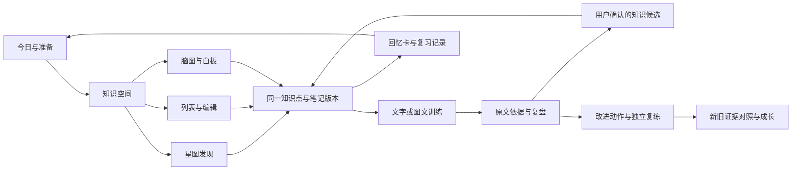

# 知识星图与工作台交互规格

版本：v1.2 · 2026-11-10。对应[完整产品需求](../需求文档/产品需求文档.md)第 5.5、5.6、8、12、13 节；参考依据见[星图界面与开源调研](../调研/星图界面与开源参考.md)。包含 S5 第二十三批候选星图层及第二十九批面后回忆关系证据的交互边界，具体静态／运行状态见开发记录，其余完整产品设计不据此视为已实现。

本文是完整产品的交互设计规格；实现按[开发阶段与进度](../开发记录/开发阶段与进度.md)推进，不能将全文功能视为已完成。视觉与交互在用户部署服务器后验收。

## 1. 使用场景与设计原则

用户在电脑前整理 Java 知识、回顾项目事实和进行长篇文字作答，既需要发现关联，也需要安静、稳定的阅读与写作空间。知识星图承担探索与导航；列表、编辑器和训练工作区承接精确操作。

- 星图是知识区首次进入时的默认发现视图；用户可切换列表，并记住上次选择。
- 深色宇宙画布是星图方向；全站阅读主题独立选择，不因银河风格强制全部深色。
- 概念身份、正文、业务关系和视图布局分别管理。拖动或换主题不会改写知识内容。
- 默认轻量模式，完整动效可选；静止模式与列表拥有等价业务操作。
- 真实没有关系时显示未关联，不为视觉连贯编造连线。已存在的跨主题关系保持可发现。

## 2. 六个入口与共享对象

| 入口 | 主任务 | 页面组织与主要动作 |
|---|---|---|
| 今日 | 决定下一步并继续未完成内容 | 按来源分组的任务列表、恢复位置、日期；继续／改期／查看来源 |
| 准备 | 管理岗位目标、事实材料与面试安排 | 目标切换、要求、材料、安排；确认事实／补充条件／选择训练范围 |
| 知识 | 写作、发现关系、组织与回忆 | 星图／列表／脑图／白板；搜索、编辑笔记、关联概念、创建回忆卡 |
| 训练 | 独立文字或图文作答 | 模式与上下文、题目、编辑区、保存状态；提交／暂停／结束 |
| 复盘 | 核对原文、形成改进动作与复练 | 原文与反馈对照、争议、行动、新旧答案；定位依据／采用候选／独立重答 |
| 成长 | 观察有范围和来源的变化 | 考察项、回忆记录、回答和复练历史；查看证据／选择待验证项 |

模型与数据、外观偏好、导入导出放在辅助入口；搜索与快速记录跨页可达。今日完成状态由来源业务决定，不能仅靠勾选结束一项复练。

## 3. 知识空间结构

桌面由稳定的全站导航、知识工具栏、主视图和可收起详情组成。工具栏容纳搜索、主题、关系类型、视图切换、动效与布局状态；详情打开后主画布重新适应可用空间，不能覆盖正在操作的控件。

### 3.1 视图与内容同源

| 视图 | 核心对象 | 允许改变什么 | 不隐式改变什么 |
|---|---|---|---|
| 星图 | 概念、确认关系及按需展开的关联对象 | 选择、镜头、节点坐标、正式关系的显式编辑 | 笔记正文、掌握程度、画布组织 |
| 列表／编辑器 | 概念与笔记 | 筛选、正文、标签、归属、版本 | 星图坐标、历史回答、已提交快照 |
| 脑图 | 提纲节点及源对象引用 | 父子组织、折叠、排序、临时文本 | 概念前置关系、源对象身份 |
| 白板 | 源对象卡片、临时文本、视觉线与分组 | 位置、尺寸、图面组织、撤销 | 正式知识语义、原笔记删除、历史图文答案 |

笔记卡默认引用源对象；复制内容必须显式选择“复制为新笔记”，说明将失去同源更新。一篇笔记关联多个概念时不复制正文，主笔记入口始终打开同一源笔记。

### 3.2 四类交互状态

- **选择状态：**当前概念／关系／笔记、详情标签、探索路径；与浏览器前进返回联动。
- **镜头状态：**缩放、平移、视口范围；默认属于用户在该视图的偏好。
- **布局状态：**节点世界坐标、锁定位置、布局版本；与对象内容分别保存。
- **内容状态：**草稿、已确认的源版本、引用和关系；只有明确编辑／采用操作才改变。

离开再返回恢复已确认保存的视图状态；任何未同步变更显示状态。刷新不能把未保存位置或正文伪装成已恢复的服务端结果。

## 4. 星图节点、主题与关系

### 4.1 节点和意象

默认主图只展示概念节点。主题通过星域轮廓、颜色标记或筛选呈现；同一概念有多个主题时只保留一个节点，可显示多个主题标记。

光球、水母、花状结构可作为原创主题意象，其具体形态待服务器页面评审。意象不代替可读标题与固定点击目标；不照搬参考项目媒体。装饰轨道不连接业务节点，也不出现在关系计数和路径查询中。

笔记、题目、事实、回答与复练默认在详情查看。用户明确展开时才作为临时关联节点进入当前视图，并用类型标签区分；折叠仅隐藏展示。

### 4.2 关系图例与候选层

| 类型 | 主图与方向规则 | 点击后的说明 |
|---|---|---|
| 确认的概念关系 | 默认显示；按前置、组成、比较、应用等实际含义表达方向 | 关系类型、来源、创建者身份、确认时间和相关依据 |
| 笔记正文引用 | 展开笔记或启用引用层后显示；保留单向正文出处 | 跳转原笔记与引用位置；反链是查询结果 |
| 主题归属 | 主题标记或独立归属层；不计作概念间关系 | 所属主题，可调整归属 |
| 训练证据引用 | 展开证据层后显示，绑定精确版本 | 原回答片段、题目、条件、反馈层级及复练来源 |
| 画布视觉连接 | 只在其画布内默认显示 | 当前画布的文字说明；可显式转换为知识关系候选 |
| AI／规则候选 | 默认关闭，启用后使用虚线及“待确认”文字 | 建议类型、依据、限制、采用／修改／拒绝 |

正式路径查询只使用适用的已确认关系；候选、主题共属、画布线、装饰线和词频共现不自动加入。图例提供文字和形状，不只依靠颜色。

S5 第二十九批的[面后回忆关系证据](../技术架构/正式关系面后回忆原文证据契约.md)位于知识详情“关联与出处 → 完整语义关系”。用户主动展开元数据目录，再选一份回忆的确切版本，选择1–8段原文与理由；完整不确定性始终展示并保存。保存后只返回记录元数据，另行展开单条才读取固定原文；回链到确切历史版本。来源补记／归档／恢复只改变状态说明，不替换旧片段；界面始终提示事后补记及原作答条件未知。父页保留未保存输入与原键恢复状态，翻页、切换、移除关系和离开页面沿同一保护。该人工保存不授权模型，不新增图边或改变关系计数、路径与布局；实际交互与视觉待服务器验收。

S5 第二十三批接入的[知识关系候选层](../技术架构/知识关系候选星图契约.md)默认关闭。用户先读取成功的关系任务摘要目录，再明确选择一个任务读取候选；目录与投影独立呈现载入、失败重试和空态。画布仅为当前显示节点中两端均存在的未决定候选绘制虚线与“待确认”文字，范围外候选保留列表及数量，不自动补点或扩图。列表分别显示原始、已决定、待审、当前图内和范围外数量，保留原始 rN；0 条成功候选与全部已有决定分别说明。

画布和键盘列表共享候选选择，图下独立面板展示原理由、摘要、限制、引用数量、全部固定知识版本和本次来源状态；点击候选保留当前知识编辑器及未保存布局。逐字引文和编辑／采用／补充／忽略均跳到原 AI 任务另行审阅。开关或刷新不改变节点坐标、镜头、正式关系计数、邻域、路径和布局保存，适应画布也排除候选。关闭、刷新、切任务、会话或资料权限变化立即移除旧投影，拒绝迟到结果；恢复权限后需主动重新读取。历史来源失效仍可回看，不代表当前可采用或关系语义正确。该层已通过静态复核及构建，视觉、尺寸变化和上述交互均待服务器验收；规则／画布等其他候选来源不据此视为已接入。

## 5. 星图操作契约

| 操作 | 选择与详情 | 镜头与布局 | 内容影响 |
|---|---|---|---|
| 单击概念 | 选择节点，打开概览，加入探索路径 | 只在节点被详情遮挡时适度移镜头；不重排 | 无 |
| 单击关系 | 选择该线，显示关系说明与出处 | 保持镜头；可主动定位另一端 | 无 |
| 单击空白 | 清除临时高亮；已打开详情保留，可单独关闭 | 保持镜头 | 无 |
| 双击节点 | 可选快捷操作：聚焦该节点邻域；提供同名按钮 | 调整镜头，不重排 | 无，不直接编辑正文 |
| 悬停节点／线 | 临时显示标题、类型和关联高亮 | 无移动；移出还原 | 无，不产生探索历史 |
| 拖动空白／空格拖动 | 保持选择 | 平移镜头；结束后保存视口 | 无 |
| 拖动节点 | 保持选择，进入位置调整状态 | 仅移动该节点世界坐标；松开后保存布局 | 无，不改主题归属 |
| 滚轮或缩放按钮 | 保持选择；提供缩放值和重置 | 以指针／视口中心缩放，限制可用范围 | 无 |
| 切换主题 | 保留当前对象；若不在主题内显示跨主题提示 | 默认淡化无关节点；主动聚焦可调整镜头，坐标不变 | 无 |
| 展开邻域 | 增加可见范围，显示本次新增数量及关系类型 | 新点按已保存坐标出现，已有点不移位 | 无 |
| 返回／前进 | 恢复对应选择、详情标签和探索位置 | 恢复该步镜头，保留后续已保存的布局编辑 | 无，不撤销正文编辑 |
| 主动重排 | 显示影响节点范围及预览；确认后生成布局修订 | 改坐标，支持撤销到重排前布局 | 无 |

触摸设备用手势和显式按钮完成同样操作；长按菜单不能是唯一入口。拖动与点击需区分阈值，拖动结束不误开详情。

新节点优先占用邻近空位，不能每次新增就重排全图。撤销重排只作用于布局；若另一标签已更新布局，显示冲突并允许另存视图，不能覆盖他处的新布局。

## 6. 详情、引用与回到原文

右侧详情标题固定显示对象名称、类型、主题和当前版本状态；主要动作是打开笔记、练这一点、创建回忆卡、关联对象。菜单收纳归档、导出、删除等次要操作。

| 标签 | 内容与操作 |
|---|---|
| 概览 | 概念简介、主笔记摘要、明确关系与下一步入口；无证据不显示掌握分 |
| 笔记 | 主笔记及关联笔记，来源和更新时间；打开全宽编辑或新建自由笔记 |
| 关系 | 出链、反链、概念关系、主题归属分别显示；可看创建依据和断链 |
| 练习 | 关联题目、题单、回忆卡；显示是否曾看参考或答过同题 |
| 证据 | 项目事实、回答、反馈、复练对照；标明版本、日期、辅助条件和可信度层级 |

从证据点击“查看原文”进入该次提交的确切版本并高亮引用片段；页面保留“返回知识星图”。默认不跳到最新正文冒充原依据；已更正的来源显示当时版本和更正提示。

出处不存在、无权访问或正文已清除时分别显示原因；可保留的最小历史标记不展示已清除正文，也不能用缓存还原。编辑可写笔记与查看历史原文使用不同状态和标题。

## 7. 长文、脑图与训练的衔接

### 7.1 长文编辑

- 编辑器提供标题、正文、概念关联、明确引用、来源与保存状态；主笔记正文不在侧栏和编辑页各存一份。
- 打开全宽编辑保留星图返回位置。长文默认使用适合持续阅读的行宽，代码块可独立横向滚动。
- 自动保存显示“未同步／保存中／已保存／失败／冲突”；只有服务端确认后显示已保存及时间。
- 冲突显示本地草稿与服务端版本，支持比较、合并或另存；不静默最后写入覆盖。
- 自由笔记可先写后关联，不强迫选主题或先创建概念。AI 整理结果先作为候选预览差异。

### 7.2 脑图与白板

展开、折叠、重排、对齐、分组与撤销只修改画布。临时文本转笔记、视觉线转语义关系均有独立操作，展示目标对象、关系类型与来源，再确认一次结果。

同一源笔记可在不同画布有多个实例。移除实例使用“移出画布”；删除源对象另开影响预览，不能共用一个含义不明的删除按钮。

用于系统设计训练时，选择题目后建立训练画布；提交保存图面、引用版本和说明文字快照。学习白板后续修改不会倒改已提交答案。

### 7.3 独立训练与参考暴露

学习模式允许资料与答案并排；独立专项和模拟默认收起主笔记、参考答案、旧答案与报告，不用宇宙动效吸引作答注意。

从搜索、星图、白板、历史或侧栏打开与当前题相关的参考，统一先说明该操作将记录辅助条件；用户可取消并继续独立作答，或确认转为辅助。纯目标条件和已固定项目事实按本次训练规则呈现，不能一概视为参考答案。

已经提交的原回答保留当时条件；提交后看报告只影响后续曝光记录。暂停时不允许提交或生成追问，恢复后从服务端确认的题目及草稿继续。独立复练打开空白编辑器，旧答案在提交前隐藏。

产品记录自身能观察到的操作，不声称限制外部浏览器、纸面资料或完全识别用户是否借助外部内容。

## 8. 状态与边缘场景

| 状态 | 呈现与可执行下一步 |
|---|---|
| 首次空库 | 说明概念、笔记与星图关系；提供写第一篇笔记、建概念、导入预览和明确标注的示例，不灌入假数据 |
| 有笔记无概念／孤立概念 | 自由笔记入口或未关联区域；建议手工关联，不自动补线 |
| 搜索无结果 | 保留查询条件，提示放宽筛选或创建；不自动联网或造引用 |
| 同名概念 | 显示主题、简介、来源和可区分标识；选择后才合并，不能只凭同名覆盖 |
| 超长标题 | 图上限行省略，选中详情完整显示；键盘与列表可读完整名 |
| 部分图已加载 | 显示已加载／匹配总量与限制；提供继续展开、局部查询和列表 |
| 网络断开／保存失败 | 保留当前输入，标记未同步，支持重试；不承诺刷新后未同步数据仍在 |
| 正文／布局并发冲突 | 指明冲突对象和版本，分别处理；不会因布局冲突丢弃正文 |
| 来源归档／更正 | 保留允许阅读的历史并显示状态；相关复习／引用操作按业务规则受限 |
| AI 候选过期 | 显示来源或目标已变化；比较差异、重新生成或放弃，不强行覆盖 |

## 9. 视觉、动效、键盘与窄屏

正文建议从 16 CSS px 起，辅助文字建议不小于 13 px；正文对比度目标至少 4.5:1，重要操作目标建议至少 40×40 CSS px、触屏 44×44。它们是设计与验收目标，不是本轮合规认证。

默认轻量模式只保留静态星域、少量选中光效和短过渡。完整模式可增加漂浮、粒子、循环意象，需用户主动选择；静止模式移除非必要动画。系统减少动效优先于完整模式，关闭动效不隐藏内容。输入长文及标签页隐藏时暂停持续装饰动画。

键盘通过全局搜索或节点列表定位对象，Enter 打开详情，Tab 按工具栏→结果／画布入口→详情顺序移动；Escape 逐层关闭临时层，未保存内容有提示。方向键在聚焦画布时平移；位置编辑提供方向按钮或独立键盘模式，不能劫持编辑器光标键。焦点可见，返回后落回原触发项。

常规视图以渐进显示不超过 200 节点／600 边作为待测起点；超过时提示局部查看，不强制全部加载。支持二维轻量绘制和列表退路，WebGL 不可用不影响读写与训练。帧率门槛在目标浏览器与终端明确后确定。

桌面保留三栏，768 CSS px 左右优先收起目录；390 CSS px 以列表／局部图和全屏详情切换，保留返回按钮、选中对象和操作入口。画布自身允许平移，页面外框不得意外横向溢出；字体放大后操作不得被遮挡。

## 10. 缓存知识实例与服务器验收

用户新建“缓存一致性”概念，关联缓存和分布式两个主题，写一篇主笔记；再明确建立与“幂等”的应用关系。星图显示一份概念身份与一条可解释关系，其他同主题概念不会自动全连。

选择该节点，侧栏显示主笔记与一道异常场景题；开始独立专项后从空白作答。提交后查看带原文的受限反馈，确认一个改进动作，选择片段生成知识候选；采用后形成笔记新版本，旧回答与原反馈版本不变。

下一次从今日进入复练，提交新答案后查看新旧对照，再从证据回到星图。此时显示新增证据记录与待验证范围，不因完成一次练习把整个节点标为已掌握。

| 验收组 | 服务器上的可观察结果 |
|---|---|
| 跨视图同源 | 列表、星图和两块白板打开同一笔记；编辑更新当前视图，移出卡片不删正文 |
| 稳定探索 | 切主题、展开邻域、返回、刷新后恢复已保存布局；主动重排可撤销 |
| 真实关系 | 无关节点保持未关联；候选、主题归属、画布线不计入正式语义路径 |
| 证据版本 | 点击反馈定位确切原文；更正与清除状态明确，不拿新版本替旧依据 |
| 训练边界 | 独立模式各入口的相关参考都受相同提示约束；复练从空白开始 |
| 保存恢复 | 断网、响应丢失和双标签冲突能明确说明已保存与未保存部分 |
| 多种终端 | 1440／1280／768／390 CSS px、字体放大、键盘及静止模式完成核心流程 |
| 容量与动效 | 在约定设备和 200 节点／600 边轻量视图下测平移缩放；记录设备、范围及失败点 |

本轮仅完成规格与静态一致性检查，上述场景均待服务器验收；没有本地启动、浏览器实测或单元测试结果。
