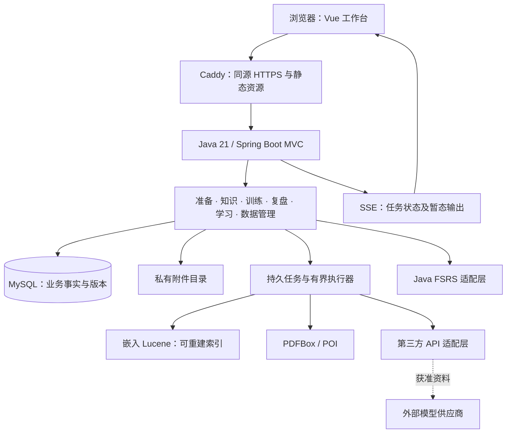

# 问阶 · 技术选型与决策

| 项目 | 内容 |
|---|---|
| 版本／日期 | v1.3 · 2026-11-05；对齐正式开发与 S3 解析制品核验 |
| 适用范围 | [完整产品需求 v1.0](../需求文档/产品需求文档.md)，包含独立知识库、知识星图、文字训练、复盘复练和间隔复习 |
| 状态 | 用户已确认 Java 21、MySQL、MyBatis、服务端直接对接第三方 AI API，并接受后续技术组合、授权开工；S1 正在落地，完整产品的未来依赖不提前安装，运行能力仍待服务器验证 |
| 规则分工 | 本文负责技术选择及理由；[系统架构与数据边界](系统架构与数据边界.md)负责业务对象、版本、关系、事务和生命周期 |
| 执行限制 | 遵守 [AGENTS.md](../../AGENTS.md)：不启动本地服务、不编写单元测试；正式工程需明确开工，运行和视觉验收在用户部署的服务器进行 |

## 1. 现在是否可以进入开发

产品范围和主要业务边界已经有设计稿，技术栈可以按本文收敛。**选型完成后，还应把第一批功能的表结构、状态转换和 API 契约写清，再进入该批编码。**这不要求先把整个产品的每张表、每个页面和所有模型参数全部设计完。

| 工作 | 当前状态 | 进入编码前的要求 |
|---|---|---|
| 完整产品范围、知识与训练两条主线 | 已有 PRD、交互规格和验收场景；仍可据评审修订 | 不因分批开发丢失完整范围 |
| 模块、对象、历史版本、引用和权限边界 | 已有架构建议 | 第一批命令使用同一套规则 |
| 技术组件选择 | 本文给出明确推荐及取舍 | 开工时将所需制品固定到构建清单 |
| 第一批数据字典、DDL、API、错误与幂等回执 | 已补充[首阶段契约](首阶段接口与数据契约.md)、OpenAPI 与 V1 迁移 | 相应功能按同一契约编码并交叉核对；SQL 待服务器执行 |
| 依赖锁定与编译 | S1 工程已创建，实际检查见[开发记录](../开发记录/开发阶段与进度.md) | 只做允许的静态检查／编译；不能把未来模块版本候选当成已安装依赖 |
| 服务器、域名、备份目标、模型供应商 | 尚无实际配置 | 分别在部署、备份和模型接入前确定，不阻塞纯业务代码设计 |

建议首先细化身份与归属、笔记／概念及版本、主题与关系、草稿保存、布局保存、幂等操作和索引变更记录；它们决定后续训练证据和知识沉淀能否一致。第一批完成知识资产的真实保存、编辑、检索和图谱读取，后续按架构中的依赖扩展完整产品。这是实施顺序，不是 MVP 删减。

## 2. 推荐组合

**Vue 3 单页应用 + Java 21 / Spring Boot 4.1 模块化单体 + MySQL 8.4 LTS。**搜索、材料解析、后台任务和复习计算均放在 Java 应用内；AI 只通过服务端直连第三方 API，不部署本地模型。浏览器负责界面和图形交互，业务真相由服务端维护。

| 层面 | 选型 | 选择理由与职责 |
|---|---|---|
| 前端工具链 | Vue 3、TypeScript、Vite、Vue Router；Node 24 LTS、npm 锁文件 | 沿用已有 Vue 方向；私有交互工作台使用 CSR，部署静态资源即可，不需要 SEO 驱动的 SSR 服务 |
| 状态与请求 | TanStack Vue Query 管服务端查询；Pinia 管少量跨页客户端状态；原生 fetch | 详情、星图和列表共享数据失效规则；编辑草稿独立保存，不与服务端缓存混在一起 |
| UI | Naive UI + 项目自身的业务组件、CSS 变量 | 基础表单／弹窗等复用；六入口、长文训练、反馈对照和星图保持自己的视觉结构 |
| 编辑／阅读 | CodeMirror 6 + markdown-it + DOMPurify | Markdown 便于长文、代码片段和 Obsidian 交换；编辑、语法渲染和 HTML 净化各自负责明确任务 |
| 知识星图 | Cytoscape.js；坐标恢复用 preset；主动重排按需加载 fCoSE | 关系探索与稳定世界坐标适配；主题变化不重跑布局 |
| 脑图／结构白板 | Vue Flow；简单树布局由应用计算 | 自定义卡片、端口、拖动与连接；同一套画布基础用于知识组织和架构演练 |
| Java 基线 | Eclipse Temurin JDK 21 LTS；Maven 3.9 系列 | 用户明确要求 Java 21；统一编译与部署基线，使用受维护的 LTS 补丁 |
| 应用框架 | Spring Boot 4.1、Spring MVC、内嵌 Tomcat；一个可执行 JAR | 模块化单体便于跨模块事务和个人运维；不需要微服务的远程一致性成本 |
| 持久层 | MyBatis + 官方 `mybatis-spring-boot-starter` 4.1.0；HikariCP | 创建工程时核验 Central 制品与父 POM 后固定；XML SQL 便于审查 CAS、幂等和关系查询，MyBatis-Spring 等依赖由 starter 协调 |
| 数据库／迁移 | MySQL 8.4、InnoDB、utf8mb4；Connector/J；Flyway SQL 迁移 | 已有数据库方向符合版本／来源／关系事务；DDL 与代码一同版本化 |
| 全文搜索 | Apache Lucene 10，嵌入 Java 进程 | 中文、英文、Java 标识符需要不同字段和分词；避免部署单独搜索集群 |
| AI 接入 | JDK 21 HttpClient + Jackson；项目 ModelGateway 封装供应商 HTTP／JSON／流式协议 | 服务端直接调用第三方 API，不引入 Spring AI、LangChain4j 等 AI 框架，不部署本地模型；任务、授权、预算、证据和采用由业务模块控制 |
| 异步与推送 | MySQL 持久任务／执行记录 + 有界 worker；Spring MVC SSE | 任务能恢复，前端能订阅；现有单实例规模不需要专门 MQ 或 WebSocket 服务 |
| 登录 | Spring Security + 服务端 Session + HttpOnly Cookie + CSRF | 同源个人工作台使用可撤销会话；不维护浏览器长期 JWT 与刷新令牌体系 |
| 材料解析 | Apache PDFBox 3.0.8、Apache POI XWPF 6.0.0；Markdown／JSON／ZIP 受控解析 | PDF 文字层和 DOCX 提取留在 Java；S3 使用单独 JVM 限制资源，不为材料导入增加 Python 服务 |
| 复习调度 | Java 适配接口，采用 java-fsrs 1.0.0 作为接入基线 | 固定来源版本和复习事件；库的算法兼容、依赖协调及参考序列仍需通过接入检查 |
| 文件 | 服务器私有目录 + MySQL 元数据和引用 | 适合单实例；附件不进入公开静态目录；Storage 接口预留未来对象存储替换 |
| API 契约 | OpenAPI 3.1、openapi-typescript；springdoc 3.2 负责运行接口核对 | 静态契约可先于服务运行生成前端类型；运行文档不成为另一套手写真相 |
| 部署／观察 | Linux 上 Docker Compose + Caddy + Java + MySQL；Actuator、Micrometer、结构化日志 | 少量部署单元，同源 HTTPS；提供必要健康与任务诊断，不默认部署监控集群 |

以上选择是产品适配判断。相应组件能力和兼容声明的官方证据见第 11 节；性能、易用性和完整组合须在本项目验证。

Lucene、解析器、FSRS 和 worker 是应用内组件，不是额外部署的后端服务。图上模型供应商是外部依赖，关闭模型仍可使用知识库、既有题目和人工复盘。

## 3. Java 后端的取舍

### 3.1 Java 21 与 Spring Boot 4.1

按用户决定，服务端固定使用 **Java 21 LTS**，编译和部署采用同一运行基线并跟进安全补丁。Spring Boot 4.1.2 的官方系统要求是 Java 17 至 27，因此 Java 21 在支持范围内。[T01–T04]

建议使用维护中的 Spring Boot 4.1 稳定补丁，未来随安全维护安排升级；不选择 RC／SNAPSHOT。部署前核验服务器运行时与 Java 21 基线一致，具体服务器环境目前未知。

采用普通 JVM JAR，不默认引入 GraalVM Native Image。可以使用稳定语言功能；虚拟线程也必须受数据库连接、解析并发和模型预算限制，不能替代有界任务设计。本轮不预设开启虚拟线程就能提高吞吐。

### 3.2 一个应用，按业务模块组织

建议一个后端 Maven 应用，按 identity、preparation、knowledge、practice、review、learning、ai、data 等领域分包；不按页面拆微服务，不用复杂多模块构建来替代业务边界。

- Controller 处理协议、身份与输入；应用服务处理守卫、事务和跨模块操作；MyBatis Mapper 与 XML 负责 SQL 和结果映射。
- 保存答案、更新幂等回执、记录待执行任务在同一数据库事务中完成；模型请求和文件解析不放进长事务。
- 跨模块通过应用接口协作；需要异步的动作提交持久记录，不把进程内事件广播当可靠队列。
- 今日与成长使用查询／统计投影，不各自复制“掌握状态”。

不选择 Spring Cloud、服务注册、独立网关、分布式事务或 Kubernetes。当前部署和领域需求没有相应拆分理由；这不限制完整产品模块数量。

### 3.3 MyBatis、MySQL 与 Flyway

用户已确定采用 **MyBatis**。S1 创建工程时核到官方 Central 的 starter **4.1.0** 与其父 POM，故工程固定该版本；父 POM 声明 Java 17、MyBatis 3.5.19、MyBatis-Spring 4.1.0、Boot 4.1.0，本工程由 Boot 4.1.2 BOM 协调。此前官方文档的 4.0.0 示例只是设计参考，不再作为工程版本。SQL 以 XML 为主；实际依赖解析／编译结果在开发记录维护，声明兼容不等于运行验收。[T05、T29]

MyBatis 适合本产品的原因是：版本保存、CAS 更新、幂等唯一键、关系去重、邻接查询和游标分页都需要可审查的 SQL。Mapper 接口、XML 和结果映射按领域组织，不让控制器绕过应用服务直接调用 mapper，也不为简单转发额外套一层 repository。

采用原生 MyBatis，当前不叠加 MyBatis-Plus 或另一套持久化框架。事务由应用服务上的 Spring 事务边界控制，事务管理器与 SqlSessionFactory 使用同一数据源；MyBatis-Spring 管理事务内 SqlSession 的提交／回滚。[T05]

SQL 参数用 `#{...}` 绑定；排序列等结构字段由服务端白名单映射。CAS 更新必须检查受影响行数，幂等由数据库唯一约束保障；这些规则不会因为换用 MyBatis 自动实现。默认关闭 mapper 二级缓存，避免跨模块更正／撤权后的陈旧结果；批量写入必须有数量上限和明确事务范围。

MySQL 8.4 是 LTS 系列，保留既有方案；不为未来可能需要的向量检索换数据库，也不因界面有图就选择图数据库。概念关系用有约束的边表、索引和有界遍历，布局另存。对称边归一化、循环检查、归属与版本仍由业务规则保证。[T06]

**驱动版本不等于数据库版本。**Boot 4.1.2 BOM 管理 Connector/J 9.7.0；Oracle 说明该驱动支持 MySQL 8.0 及以上，故不能只因数据库为 8.4 就手工锁旧驱动。[T04、T07]

Flyway 选择开源 SQL 迁移模块 `flyway-core` 与 `flyway-mysql`，使用同一版本；执行 `validate / migrate` 的权限与时机放在服务器发布步骤。正常应用启动不自动修表，迁移失败停止发布；MySQL DDL 不按可完整事务回滚处理，数据库回滚需要独立恢复方案。已有迁移不原地修改，也不使用自动 schema-update。

本轮官方 Flyway 页面确认 MySQL 独立模块，但其已验证版本清单没有单列 8.4；这不足以宣称该组合已被官方逐项认证。**保留 Flyway 选型，并把 8.4 空库迁移、已有数据迁移及中途失败恢复作为服务器接入必验项。**[T08]

## 4. 前端、编辑器与知识图形

### 4.1 Vue 单页应用与状态职责

采用 CSR 和路由懒加载。用户登录后的编辑、训练和图谱是主要场景，搜索引擎收录没有成为需求，不增加 Nuxt／SSR 运行服务。Node 只参与前端构建，服务器运行静态产物。

服务端数据由 **TanStack Vue Query** 统一请求、缓存和失效；收藏、笔记更新、关系变化后精确使相关查询失效。查询键包含归属、对象版本和训练上下文；退出／切换身份时清理，进入独立训练时不得从已有缓存绕过参考暴露守卫。[T09]

Pinia 仅保存跨页面的界面偏好、当前工作区等客户端状态；表单及编辑器草稿留在页面或专用草稿模块。URL 负责当前对象、筛选和可分享的导航状态。任何缓存都不能替代服务端授权与版本检查。

写操作不盲目自动重试，超时先查询幂等回执。浏览器恢复副本采用原生 IndexedDB，仅在用户开启后保存必要草稿，并明确清除规则；不默认为离线优先 PWA。密钥不进入任何前端持久存储。自动重新获取详情不能覆盖尚未保存的编辑内容。

### 4.2 Naive UI 与自己的设计语言

选择 Naive UI 的输入、选择、弹窗、菜单、通知等基础控件，以 JS 主题覆盖和 CSS 变量协调样式；不照搬管理后台模板。工作区、侧栏、阅读行宽、原文对照和星图工具栏由业务组件设计。[T10]

星图使用局部暗色主题；阅读和训练允许独立浅／深色。统一字号、间距、焦点和状态文案，检查弹层传送后的主题与键盘焦点。不同时引入另一套完整 UI 库。成长页面先用语义 HTML、CSS 和少量 SVG 呈现已有指标，复杂图表需求出现再选择图表库。

### 4.3 Markdown 是正文，编辑器状态不是数据格式

选择 CodeMirror 6 源文编辑，配合工具栏和阅读预览；正文、稳定 ID、附件引用和业务版本独立保存。不以 Tiptap／ProseMirror JSON 作为唯一内容源，从而减少 Markdown／Obsidian 交换和原文定位之间的转换损失。[T11]

渲染流程为：源 Markdown → 受控业务引用解析 → markdown-it → DOMPurify → 展示。默认关闭任意原始 HTML、脚本和远程图片自动加载；内部附件走授权接口，外部链接限制协议。净化后不再拼接未净化 HTML；内容净化不能代替资料外发授权。[T12]

双链解析在服务端产生正式引用投影，前端解析只为编辑提示；二者共享明确语法与兼容案例。服务端保存的 Markdown 是唯一原文，证据不按 HTML 偏移定位。中文输入法、撤销、10 万字符、代码块、粘贴和未保存恢复均等待服务器验证。

### 4.4 星图与白板使用不同渲染器

**Cytoscape.js 管关系探索，Vue Flow 管可编辑卡片与画布。**二者都将内部状态映射到业务 DTO，不直接把组件序列化结果当权威业务格式。[T13–T15]

星图恢复世界坐标使用 preset。筛主题只改变可见性／淡化和镜头；新节点在邻域安排位置，既有节点保持。只有用户主动重排才按需加载 fCoSE、预览并形成可撤销的布局修订。主题是多对多归类，不使用 Cytoscape 单一 compound parent 冒充多主题关系。

脑图的层级属于视图；一个概念可以由多个视图实例引用，不能把多个父节点强行写入同一树节点。简单树布局由应用计算，白板以手工摆放、吸附、对齐为主。当前不引入 ELK，也不把 Markdown 提纲导入等同于恢复完整自由画布。

发光节点、背景和连接强调做在受控视觉层，默认轻量，不要求 Three.js 或常驻粒子引擎。列表和键盘可完成业务操作，图像导出走显式功能。200 节点／600 边是既有待测目标，不是图库承诺或本次实测结果。

## 5. 搜索与资料处理

### 5.1 选嵌入 Lucene，不另部署搜索服务

MySQL ngram 能处理中文，但默认二元切分及停用词规则会同时作用于英文串。对于 `ConcurrentHashMap`、`@Transactional`、类全名及中文说明，建议 Lucene 使用不同字段：名称／别名精确匹配、代码完整标识符、代码拆词、中文正文。[T16–T18]

选 Lucene core、analysis-common 等实际需要的模块，由一个应用内写入者维护；请求不创建独立索引写入器。中文可从 CJK 分析器起步，代码字段使用受控的拆词及原词保留；单字和短词规定专门召回规则。不开任意正则或无界通配查询。相关性权重以真实 Java 材料验收，不能只测“数据库能查到”。

MySQL 业务事务同时写变更记录，worker 幂等更新可重建索引。保存成功与索引同步分开呈现；索引失败不回滚正文。重建生成新索引代次，补齐期间变更后切换；恢复以最新删除／撤权状态为准。

索引先限定归属和可见状态，再对命中以数据库当前版本和训练条件复核，最后生成标题、摘要、高亮和发送片段。旧索引中的删除内容不能因为检索命中再次出现。AI 资料问答先用本地关键词检索和明确引用即可实现，向量检索不作为完成 PRD 的硬前置。

### 5.2 附件与解析留在 Java

PDF 使用 PDFBox 3.0.8 提取文字层与页码，DOCX 使用 POI XWPF 6.0.0 提取支持的段落／表格文本。它们不承诺复杂排版、扫描件 OCR 或 Word 宏执行。解析结果带原附件引用和限制说明，不伪装成完整原文重建。S3 已按官方发布／Central 核定补丁，并在最终 JAR 中核到实际解析版本；代码编译不能代替复杂文档验证。[T19、T31]

S3 使用同一可执行 JAR 的独立 ParserMain，限制内存／时间和结果量，固定环境与输出路径，父子进程均守卫生命周期。上传配额、ZIP／XML、图片重编码和来源摘录规则见[附件与安排契约](附件与安排接口与数据契约.md)；这不等同于操作系统沙箱。本地仅打包检查，进程与文件处理留服务器验收。

ZIP、Markdown、受支持的 YAML 属性和 JSON Canvas 采用格式白名单、路径与解压上限、未知字段提示和预览映射。常见属性只按数据读取，不创建任意对象。原始附件保存到私有目录，数据库维护状态、摘要与引用；解析失败保留可重试状态，不自动抓取任意 URL。

## 6. AI、任务与流式返回

### 6.1 服务端直接对接第三方 AI API

用户已确定 AI 只接第三方 API，不使用 Spring AI、LangChain4j 等 AI 框架，不在本机或自托管服务器部署推理模型。建议使用 **JDK 21 自带 HttpClient + Jackson**：普通响应解析 JSON，流式响应按供应商协议读取 SSE 等事件。官方 HttpClient 提供同步／异步发送和流式响应体，具体协议仍需应用实现。[T20]

ModelGateway 是项目内部的薄接口，供应商适配器负责请求字段、鉴权头、错误、终止事件、用量和请求 ID 映射。共享 HttpClient 及连接池，固定服务端允许的 API 地址；浏览器调用本应用 API，不能拿模型密钥直连供应商。配置读取仅返回掩码，普通日志不得记录鉴权头或原始请求／响应全文。

供应商／模型尚未选择，因此不预填价格、地区、上下文上限或数据保留承诺；也不假定不同供应商采用完全相同的 API。模型选定后核对流式、结构化输出、用量回执、取消和请求幂等支持。普通回答与流式读取共用这套 HTTP 调用方式，不额外引入供应商 SDK。

问题、追问、评价、比较、候选沉淀等使用固定输入清单；输出先做结构、对象／版本、引用片段及范围校验，再形成候选。合法 JSON 不是技术评价正确的证明；事实采用仍需用户确认，知识更正和撤权守卫在结果接纳时再次检查。

**模型 POST 不做应用层自动重试，HTTP 底层行为也须核验。**JDK 文档列出连接失败重试和非幂等请求重试开关；接入时关闭连接失败的自动重试、保持非幂等请求重试关闭，并禁用自动重定向。配置属于本应用 JVM 的部署参数，不修改本机系统设置。仍不能据此宣称外部调用“恰好一次”；是否已发送不明时进入待核对，需要再次发送时创建新执行记录、重新预算与授权。[T21]

分别设置连接超时、普通请求总时限、流式首事件／空闲／总时限、事件及响应体大小上限。流式不能只按单行 JSON 拆分，应处理 UTF-8 跨块、SSE 多行 data、心跳、结束事件和截断；结束／取消后关闭响应流，取消能否阻止供应商继续执行与计费以实际 API 能力为准。客户端配置不等于这些场景已验证。

### 6.2 数据库负责恢复，SSE 负责通知

持久任务表与执行尝试表分开，worker 用租约／条件更新认领，有限并发处理。仅 QUEUED 且确定未发送的执行可安全认领；进程在“可能已发送”区间中断时进入待核对，不能只因租约过期就重复调用模型。费用预留、结算和未知状态遵守架构规则。

任务创建、取消和采用使用普通 JSON 命令；浏览器通过同源 SSE 订阅状态与暂态输出。Spring MVC 的 SseEmitter 满足这条单向推送路径，不需要全应用改为 WebFlux。[T22]

持久化可恢复的状态事件和序号，文字 token 可暂态合并传输；终态以查询接口为准。重连遇到事件缺口读取快照；未验证文本不能冒充正式报告。SSE 需要心跳、超时、慢客户端上限和反代不缓冲配置。切换页面或断开订阅不自动取消任务。

保留任务状态查询作为退路；不要把重新连接 SSE 解释为重新生成答案。原文、引用与结果回执已持久化后，应用重启和浏览器刷新才能按业务状态恢复。

## 7. 复习算法、登录与可恢复数据

### 7.1 Java FSRS 的选择与明确限制

建议选 `io.github.open-spaced-repetition:fsrs:1.0.0` 作为回忆排程接入基线，固定源码标签对应提交 `c561ee6c56239b621a0a45b16a6c2e688441eae5`。官方仓库、MIT 许可、Java 17 编译基线和 Maven Central POM 均已读取。它是 Java 21 应用内的复习调度算法，不是本地大模型；无需 Python／Rust 服务。[T23]

已读 README 明确：使用 UTC；支持 21 个权重、期望记忆率、学习／重学步骤、最大间隔与随机扰动；**不支持参数优化器**。因此可提供基于学习历史的间隔调度，但不能宣传已具备自动训练个人参数或与当前 Anki 完全一致。算法代际与公开参考序列尚未逐式核验。

适配层把自身领域对象转换为调度输入，固定卡版本、复习时刻、自评、算法实现版本、参数及前后状态；初始关闭随机扰动以便重放，用户时区只影响展示和每日分组。卡片实质更正后的继承／重置遵守 PRD，历史事件不随策略升级重写。人工指定日期仍可使用，必须明确排程方式。

存在一个具体依赖风险：库 POM 引用了 Jackson 2.15.3 与 jsr310 2.19.2，而 Boot 4.1 使用 Jackson 3 并另外管理 Jackson 2 BOM。接入时将库所需 Jackson 2 统一到受维护版本，JSON 序列化不跨业务层暴露；优先映射自己的 DTO，不直接持久化库的整包 JSON。[T04、T23]

在复习模块编码时核验有效依赖树、时间单位、同日学习步骤和公开序列对照；不满足则暂保留明确标注的人工／固定规则排程并解决适配问题，不能悄悄把它称作 FSRS。此兼容核验不要求编写单元测试，也不阻塞先开发知识存储。

### 7.2 身份与密钥

个人单实例仍启用 Spring Security。使用安全属性正确的服务端会话 Cookie，保留 CSRF 检查；SSE 复用同源会话，不把凭据放入 URL。服务重启允许重新登录，业务草稿和任务不能丢失，因此初始使用容器内会话，不增加 Redis 或 Spring Session 表。[T24]

模型凭据只在获准接入时设置。推荐服务端加密保存、部署提供主密钥并与数据库备份分离；读取只回掩码和配置版本，恢复后模型默认关闭。具体密钥提供方式及轮换在服务器部署契约中核定。本轮不读取、生成或修改任何实际凭据。

### 7.3 文件、备份与删除账本

数据库、附件、发布产物、可重建索引和最新删除／撤权账本分开管理。挂载目录不是自动备份；完整恢复要有数据库与附件一致的清单，恢复后重建搜索。

生命周期账本不能随业务备份一起回滚，实施时须确定独立持久位置、当前代次和备份策略；账本不完整时按架构守卫关闭受影响读取和模型发送。此操作契约是数据管理模块的必需设计，不因为选择 Compose 或 MySQL 就已经实现。

## 8. API、构建、部署与验收

### 8.1 契约与错误

采用 `/api/v1` 下的 JSON API，显式操作表达提交、采用、归档、恢复和取消。OpenAPI 3.1 是契约格式；先在 `docs/技术架构/` 相应专题中写出第一批契约，再用 openapi-typescript 从本地静态规格生成前端类型，不为类型生成启动后端。[T25]

Springdoc 选择与 Boot 4.1 对应的 3.2 线，用于服务器上核对实际接口和静态规格；不引入其可选 MCP 模块。错误采用 Problem Details 风格，补充稳定业务 code、traceId、冲突修订号和可重试性。保存、提交和 SSE 的完整状态约定仍须落入具体 API。

### 8.2 依赖与静态检查

- Java 使用 Maven 和 Boot BOM；MyBatis starter、Lucene、解析器与 FSRS 版本显式管理。AI 直连复用 JDK HTTP 与项目 Jackson，不引入 AI 框架 BOM。记录 effective POM／依赖树，检查覆盖和重复 JSON 体系，不随意逐项覆盖 Spring 组件版本。
- 前端使用 Node 24 LTS、npm 与 `package-lock.json`；选择当时已核验的稳定制品，禁止浮动 `latest` 作为交付依据。依赖安装脚本先审查。
- 本地只做资源允许的类型／语法／格式检查和编译；Vite 转译不能替代 vue-tsc。检查流程不隐式运行应用、预览服务或单元测试。[T26]
- 不引入 JUnit、Vitest、Testcontainers 或测试脚手架作为本项目默认依赖；第三方仓库自身有测试文件不意味着在本项目运行它们。

### 8.3 部署与观察

推荐用户在 Linux 服务器采用 Docker Compose 管理 Caddy、应用和 MySQL。Caddy 提供静态资源、同源反代和 HTTPS，SSE 路径确认即时转发与连接超时；若服务器已有成熟反代，在保持同源和流式语义的前提下复用，不强制再套一层。[T27]

数据库与附件有独立持久卷，Lucene 索引可重建；正式发布固定镜像／产物版本和校验值。迁移作为部署步骤显式执行，备份、失败停止与回滚方案在操作前给出。服务器规格、路径、证书方式和发布命令尚未约定，本轮不创建部署脚本、不操作服务器。

Actuator 提供受控健康信息，Micrometer 记录请求耗时、错误、连接池、任务排队、模型执行和搜索积压；日志记录 traceId、对象 ID、耗时与安全错误摘要。管理端点不公开暴露环境／堆信息，日志不存凭据、回答全文或模型上下文。[T28]

验证分为：文档／契约静态一致性，开工后的类型检查和编译，用户部署后的 API／数据库／恢复与 AI 样例集成验收，以及最终浏览器视觉／可访问性／容量验收。本轮只完成第一类中的文档检查。

## 9. 现在固定与延后固定

| 时机 | 必须确定的内容 |
|---|---|
| 本轮选型 | Java 模块化单体、数据库与持久方式、Vue 与图形／编辑职责、Lucene、AI 适配边界、Java 复习路径、同源会话与部署形态 |
| 第一批业务编码前 | 稳定 ID 表示、UTC／时区约定、业务版本与草稿 revision、初始 DDL／索引、核心 API／错误／幂等／事务及删除引用规则 |
| 创建工程时 | 精确依赖、lockfile、工具版本、编译脚本、静态检查和资源边界；不得生成单元测试 |
| 各模块接入前 | 图像／画布导出格式、编辑语法兼容、Lucene 相关性样例、FSRS 参数与依赖核验、解析上限、模型能力与费用预算 |
| 服务器部署前 | 实际 CPU／内存／磁盘、域名／HTTPS、私有目录与主密钥提供方式、备份／最新账本、迁移和发布恢复流程 |
| 上线验收前 | 已有业务验收场景逐项运行、AI 质量、200 节点／600 边与知识规模目标、移动端和减少动效 |

不把服务器尚未提供解释成无法继续设计；也不把主干选型完成解释成数据和运行验收已完成。

## 10. 本次核验的制品与剩余兼容项

以下是 **2026-11-05 设计候选与 S1 接入核验**。S1 实际安装版本以工程清单／锁文件与开发记录为准；其余组件仍为后续模块接入起点，不能将整表视为已安装或已运行验证的依赖组合。

| 组合 | 本次核验结果 | 仍需检查 |
|---|---|---|
| Java／Boot | Java 21 LTS（用户确认）；Boot 4.1.2 支持 Java 17–27 | 实际发行包、编译和服务器运行 |
| MyBatis | S1 固定 starter 4.1.0；Central 制品／父 POM 已核，MyBatis 3.5.19、MyBatis-Spring 4.1.0 | 实际依赖与构建看开发记录；事务集成仍需服务器验证 |
| Boot BOM | Framework 7.0.10、Security 7.1.2、Tomcat 11.0.27、HikariCP 7.0.2；以 BOM 统一管理 | 不手工混配，检查有效依赖图 |
| MySQL／迁移 | DB 8.4 LTS；BOM 的 Connector/J 9.7.0、Flyway 12.4.0 | 驱动声明涵盖 8.4；Flyway 8.4 的实际迁移／失败恢复未验证 |
| AI／接口 | JDK 21 HttpClient 的 JSON／流式响应读取；springdoc 3.2.0 对应 Boot 4.1 | 第三方 API 协议、超时／重试、流式用量及前后端契约核对；无 AI 框架／本地模型 |
| Node／Vue | Node 24.22.2 LTS；Vue 3.5.44；Vite 8.3.5；plugin-vue 6.0.10；vue-tsc 3.3.14 | 官方 Vue 入口要求至少 24.12.0；实际解析与构建 |
| TypeScript／UI | TypeScript 7.0.2、Naive UI 2.45.3；peer 声明范围涵盖所选 Vue | 宽 peer 声明不是 TS 7 与全部插件已实测兼容，须以 vue-tsc／构建为准 |
| 编辑 | CodeMirror view 6.43.15、lang-markdown 6.5.2；markdown-it 15.0.3、DOMPurify 3.4.17 | CodeMirror 多包解析、中文输入与净化策略 |
| 图形 | Cytoscape 3.34.4、fCoSE 2.2.0、Vue Flow core 1.48.2 | 插件兼容、布局约束、导出和真实交互性能 |
| 检索 | Lucene 10.6.0，系统要求 Java 21+ | 所需模块同版；分析器设计与内存／延迟 |
| 解析／排程 | PDFBox 3.0.8、POI XWPF 6.0.0；FSRS 1.0.0（Java 17 基线） | S3 解析依赖已打包，文件处理与进程边界待服务器验证；FSRS 的 Jackson 2 与 Boot 4 依赖协调、公开序列对照仍待接入 |

Vue Router、Pinia、Vue Query 和构建工具的具体补丁在创建工程时与上述组合一同解析，不在未解析前捏造“兼容锁版”。许可核验已覆盖主要前端制品元数据及 FSRS；正式分发时仍需保留实际制品许可证／NOTICE，不能将它们与参考 UI 仓库的素材授权混同。

## 11. 官方证据索引

访问日均为 **2026-11-05**。本轮先调用 `web.run`，其搜索／打开未返回可读正文，随后以可见的只读 HTTPS 请求读取官方文档、官方仓库和制品元数据；未执行下载内容。表中能力是官方声明，取舍为本文建议，均不等于本项目运行证明。

| ID | 官方资料 | 实际核验内容／限制 |
|---|---|---|
| T01 | [Adoptium Support](https://adoptium.net/support/) | 前轮 HTTP 200；Java 21 LTS 与可用性日期；不是本项目运行证明 |
| T02 | [Spring Boot 官方项目数据](https://spring.io/page-data/projects/spring-boot/page-data.json) | current GA 4.1.2；3.5／4.0／4.1 的 OSS 与 Enterprise 支持月份分列 |
| T03 | [Boot System Requirements](https://docs.spring.io/spring-boot/system-requirements.html) | 4.1.2、Java 17–27、Maven 3.6.3+、Tomcat 11；带 `/4.1/` 的另一地址重定向失败，未降低协议保护 |
| T04 | [Boot 4.1.2 BOM](https://repo.maven.apache.org/maven2/org/springframework/boot/spring-boot-dependencies/4.1.2/spring-boot-dependencies-4.1.2.pom) | HTTP 200；Flyway／MySQL／Spring 等版本；Jackson 2 BOM 2.21.7 与 Jackson 3 BOM 3.1.7 同时受管理 |
| T05 | [MyBatis Spring Boot Starter](https://mybatis.org/spring-boot-starter/mybatis-spring-boot-autoconfigure/) · [MyBatis-Spring Transactions](https://mybatis.org/spring/transactions.html) | 本轮 HTTP 200；starter 4.0、MyBatis-Spring 4.0、Boot 4.0+、Java 17+ 的要求表；Spring 事务与 SqlSession 共用数据源，文档版本不等于已锁定制品 |
| T06 | [Oracle：MySQL 8.4 发布模型](https://docs.oracle.com/cd/E17952_01/mysql-8.4-en/mysql-releases.html) | HTTP 200；确认 8.4 LTS；商业支持策略不等于免费运维服务 |
| T07 | [Oracle：Connector/J 兼容](https://docs.oracle.com/cd/E17952_01/connector-j-en/connector-j-versions.html) | 9.7 支持 MySQL 8.0+、JRE 8+；MySQL 主站错误页未作证据 |
| T08 | [Flyway MySQL](https://documentation.red-gate.com/flyway/reference/database-driver-reference/mysql) · [支持表](https://documentation.red-gate.com/flyway/getting-started-with-flyway/system-requirements/supported-databases-and-versions) | HTTP 200；独立 `flyway-mysql` 模块；本次已验证版本列表未单列 8.4 |
| T09 | [TanStack Vue Query Overview](https://tanstack.com/query/latest/docs/framework/vue/overview) | 服务端状态缓存／请求职责；未读取某个具体制品组合 |
| T10 | [Naive UI README](https://github.com/tusen-ai/naive-ui/blob/main/README.md) · [制品元数据](https://registry.npmjs.org/naive-ui) | Vue 3、TypeScript、主题覆盖；2.45.3、MIT、Vue peer |
| T11 | [CodeMirror Guide](https://codemirror.net/docs/guide/) · [view 元数据](https://registry.npmjs.org/@codemirror%2Fview) · [Markdown 元数据](https://registry.npmjs.org/@codemirror%2Flang-markdown) | 模块化编辑器与 MIT 制品；不证明项目双链／中文体验 |
| T12 | [markdown-it 元数据](https://registry.npmjs.org/markdown-it) · [DOMPurify README](https://github.com/cure53/DOMPurify/blob/main/README.md) · [元数据](https://registry.npmjs.org/dompurify) | 版本、HTML 净化；DOMPurify 许可为 MPL-2.0 或 Apache-2.0；另查的 markdown-it 安全页 404 未作证据 |
| T13 | [Cytoscape.js](https://js.cytoscape.org/) · [元数据](https://registry.npmjs.org/cytoscape) | preset、世界坐标、视口、单 parent 与 MIT；美术和性能未测 |
| T14 | [fCoSE README](https://github.com/iVis-at-Bilkent/cytoscape.js-fcose) · [元数据](https://registry.npmjs.org/cytoscape-fcose) | 固定节点／约束；2.2.0 与 Cytoscape peer；不能自动保证稳定布局 |
| T15 | [Vue Flow Guide](https://vueflow.dev/guide/getting-started.html) · [状态处理](https://vueflow.dev/guide/vue-flow/state.html) · [元数据](https://registry.npmjs.org/@vue-flow%2Fcore) | 节点、边、状态接管与 Vue peer；业务持久化仍由应用提供 |
| T16 | [Oracle：MySQL ngram](https://docs.oracle.com/cd/E17952_01/mysql-8.4-en/fulltext-search-ngram.html) | 中文切分、默认 n=2、停用词与查询规则 |
| T17 | [Lucene](https://lucene.apache.org/core/) · [10.6.0 系统要求](https://lucene.apache.org/core/10_6_0/SYSTEM_REQUIREMENTS.html) | HTTP 200；Java 搜索库、10.6.0、Java 21+ |
| T18 | [CJKAnalyzer](https://lucene.apache.org/core/10_3_2/analysis/common/org/apache/lucene/analysis/cjk/CJKAnalyzer.html) · [WordDelimiterGraphFilter](https://lucene.apache.org/core/10_3_2/analysis/common/org/apache/lucene/analysis/miscellaneous/WordDelimiterGraphFilter.html) | 分词能力正文来自 10.3.2；10.6.0 具体 API 仍需编译核对 |
| T19 | [PDFBox 3 Migration](https://pdfbox.apache.org/3.0/migration.html) · [POI Overview](https://poi.apache.org/overview.html) | HTTP 200；Java PDF 库、内存读取方式、XWPF 的文档及文字提取范围；未验证复杂文档 |
| T20 | [JDK 21 HttpClient](https://docs.oracle.com/en/java/javase/21/docs/api/java.net.http/java/net/http/HttpClient.html) | 本轮 HTTP 200；共享客户端、同步／异步发送、连接超时、InputStream／Publisher 与关闭资源；供应商协议由项目适配 |
| T21 | [JDK 21 java.net.http 模块](https://docs.oracle.com/en/java/javase/21/docs/api/java.net.http/module-summary.html) | 本轮 HTTP 200；disableRetryConnect 默认 false、enableAllMethodRetry 默认 false；应用需显式约束重试，不能推断外部恰好一次 |
| T22 | [Spring MVC Async](https://docs.spring.io/spring-framework/reference/web/webmvc/mvc-ann-async.html) | SseEmitter、异步输出、心跳与超时；不代表任务持久化 |
| T23 | [Java FSRS 固定源码](https://github.com/open-spaced-repetition/java-fsrs/tree/c561ee6c56239b621a0a45b16a6c2e688441eae5) · [Central POM](https://repo.maven.apache.org/maven2/io/github/open-spaced-repetition/fsrs/1.0.0/fsrs-1.0.0.pom) | 实际读取 README、build.gradle、Scheduler 片段及 POM；UTC、21 权重、无优化器、Java 17、旧 Jackson 依赖；未执行公式对照 |
| T24 | [Spring Security CSRF](https://docs.spring.io/spring-security/reference/servlet/exploits/csrf.html) | 不安全方法默认 CSRF 保护及 SPA 特殊集成说明；会话策略为项目决定 |
| T25 | [OpenAPI TypeScript](https://openapi-ts.dev/introduction) · [Springdoc 兼容表](https://springdoc.org/) | 静态 YAML／JSON 生成 3.0／3.1 类型；Boot 4.1 对应 springdoc 3.1–3.2 |
| T26 | [Vue Quick Start](https://vuejs.org/guide/quick-start.html) · [Vue TS](https://vuejs.org/guide/typescript/overview.html) · [Vite Guide](https://vite.dev/guide/) · [Node 发布列表](https://nodejs.org/dist/index.json) | Node 24.22.2 LTS；Vue 入口要求 `^22.18.0` 或 `>=24.12.0`；Vite 与类型检查职责；Vue／TS／Vite／plugin-vue／vue-tsc 版本另由 npm 官方元数据核对 |
| T27 | [Docker Compose](https://docs.docker.com/compose/) · [Caddy reverse_proxy](https://caddyserver.com/docs/caddyfile/directives/reverse_proxy) | HTTP 200；多容器应用定义；Caddy 对 `text/event-stream` 的即时转发说明；本项目部署尚未执行 |
| T28 | [Boot Actuator Endpoints](https://docs.spring.io/spring-boot/reference/actuator/endpoints.html) | HTTP 200；health 与端点暴露／访问控制；管理面安全仍需部署配置 |

S1 已进入正式开发，源码、依赖清单和静态检查状态以[开发记录](../开发记录/开发阶段与进度.md)为准。前端实际采用 TypeScript 5.9.3：S1 核到 `openapi-typescript` 7.13.0 的 peer 为 TypeScript `^5.x`，因此没有将此前 TypeScript 7 候选直接安装；前端锁文件与类型检查共同核定组合。后续接入发现不兼容时更新本决策与对应契约，不改变历史版本、来源证据或用户已确认的产品范围。

### S1 追加制品证据 · 2026-11-05

| 编号 | 官方来源 | 实际证据与限制 |
|---|---|---|
| T29 | [MyBatis starter Central 元数据](https://repo.maven.apache.org/maven2/org/mybatis/spring/boot/mybatis-spring-boot-starter/maven-metadata.xml) · [4.1.0 父 POM](https://repo.maven.apache.org/maven2/org/mybatis/spring/boot/mybatis-spring-boot/4.1.0/mybatis-spring-boot-4.1.0.pom) | 只读 HTTPS 返回 release 4.1.0；父 POM 中 Java／Boot／MyBatis 版本明确。编译和运行分别记录，不把制品存在视为集成通过 |
| T30 | [openapi-typescript 7.13.0 元数据](https://registry.npmjs.org/openapi-typescript/7.13.0) | peerDependencies 的 TypeScript 为 ^5.x；S1 选择已核实的 TypeScript 5.9.3 并进行类型／构建检查 |

### S3 追加解析制品证据 · 2026-11-05

| 编号 | 官方来源 | 实际证据与限制 |
|---|---|---|
| T31 | [PDFBox 发布页](https://pdfbox.apache.org/download.html) · [PDFBox 3.0.8 POM](https://repo.maven.apache.org/maven2/org/apache/pdfbox/pdfbox/3.0.8/pdfbox-3.0.8.pom) · [POI 发布页](https://poi.apache.org/download.html) · [POI 6.0.0 POM](https://repo.maven.apache.org/maven2/org/apache/poi/poi-ooxml/6.0.0/poi-ooxml-6.0.0.pom) | 只读 HTTPS 200；发布／制品元数据固定 3.0.8／6.0.0。S3 最终 JAR 含 PDFBox／FontBox／pdfbox-io 3.0.8，POI／ooxml／lite 6.0.0，XMLBeans 5.4.1，commons-compress 1.28.0、commons-io 2.22.0；Java 21 编译通过。未运行解析样本或进程，不宣称完整运行兼容 |
