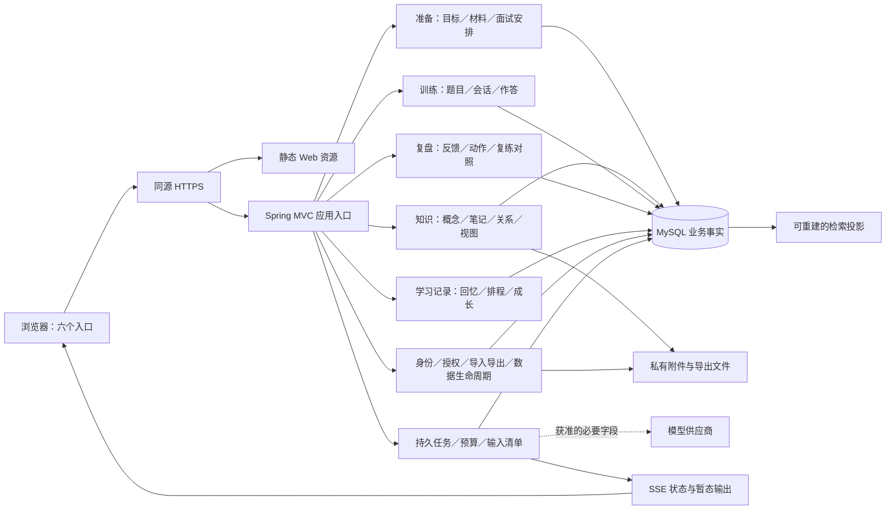
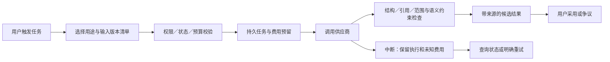

# 问阶 · 系统架构与数据边界

| 项目 | 内容 |
|---|---|
| 版本／日期 | v1.10 · 2026-11-11；对齐 Java 21／MyBatis／第三方 AI API，补全站最近访问与原键队列边界 |
| 对应产品 | [完整版产品需求文档](../需求文档/产品需求文档.md) |
| 定位 | 为完整产品确定模块、数据和协作边界；不是已实现能力、数据库 DDL 或完整接口规格 |
| 当前证据 | 本文为完整架构规格；S1 源码及检查记录见[开发记录](../开发记录/开发阶段与进度.md)，具体 API／DDL 见[首阶段契约](首阶段接口与数据契约.md)。应用运行、模型和容量未验收 |
| 执行约束 | 以根目录 [AGENTS.md](../../AGENTS.md) 为准：本地不启动服务、不编写单元测试，由用户部署服务器后进行运行及视觉验收 |

## 1. 架构结论

建议继续采用**个人单实例、同源 Web、Java 模块化单体、关系数据库为业务事实源**。知识库是独立业务域；星图、列表、脑图和白板是同一知识资产的不同视图。训练、复盘与复习通过确切对象和版本连接知识，不复制出互相漂移的笔记正文。

六个页面入口为今日、准备、知识、训练、复盘、成长；页面数量不决定后端服务数量。完整产品按依赖分批实现，所有批次共同构成目标范围，不把分批交付等同于删减产品功能。语音、实时面试代答、公开社区和多租户运营不属于本轮产品。

具体技术选择、理由、官方兼容证据和接入检查以[技术选型与决策](技术选型与决策.md)为准。以下为摘要，仍不是已验证的依赖锁定结果：

| 层 | 建议 | 选择边界 |
|---|---|---|
| Web | Vue 3、TypeScript、Vite、Vue Router；Naive UI；Vue Query 管服务端数据，Pinia 管必要客户端状态 | Node 24 LTS 构建；业务外壳与局部暗色星图独立设计；具体包组合需构建验证 |
| 编辑器 | Markdown 为正文；CodeMirror 6、markdown-it、DOMPurify | 编辑、渲染和净化分层；双链、附件授权、中文输入法由项目集成验证 |
| 星图 | Cytoscape.js，封装渲染适配器；preset 恢复坐标，fCoSE 用于用户主动重排 | 美术表现、节点规模和移动端性能没有本项目实测 |
| 脑图／白板 | Vue Flow；简单树布局和持久状态由业务层管理 | 不让画布组件决定知识、证据或历史语义 |
| 服务端 | Java 21（用户确认）；建议 Spring Boot 4.1、Spring MVC、显式应用服务与事务 | 当前精确组合与编译证据见开发记录；服务器运行兼容仍待验 |
| 持久层 | MyBatis（用户确认）；官方 Spring Boot Starter、Mapper 接口与 XML SQL、HikariCP | Spring 管事务；SQL 参数绑定、CAS 行数校验、唯一约束保障幂等；不叠加另一套持久化框架 |
| 数据库／迁移 | MySQL 8.4 LTS、InnoDB、utf8mb4；Connector/J 与 Flyway 由 BOM 协调 | Oracle 官方镜像已补核 LTS 与驱动范围；Flyway 8.4 实际迁移仍待服务器验证 |
| 文件／检索 | 私有附件目录＋数据库元数据；Java 内嵌 Lucene 可重建索引 | 不默认引入对象存储、图数据库、向量数据库或搜索集群 |
| AI／任务 | 服务端直接调用第三方 API；建议 JDK 21 HttpClient＋Jackson；持久任务、有界执行器、同源 SSE | 不用 Spring AI 等 AI 框架，不部署本地模型；应用掌管授权、预算、重发和候选采用 |
| 解析／复习 | PDFBox 3、POI XWPF；Java FSRS 适配层 | 文字材料与排程留在 Java；算法、依赖和文档兼容未做运行验证 |
| 部署 | 单实例 Linux、Docker Compose、Caddy 同源 HTTPS、静态 Web、Java、MySQL | 复用已有合适反代亦可；具体服务器资源由用户提供，本轮不安装、启动或部署 |

## 2. 模块与运行结构

模块在同一进程内按职责分包。控制器只处理协议、身份和调用，应用服务处理业务守卫与事务，MyBatis Mapper 处理 SQL 和行映射；跨模块调用通过明确的服务接口，不允许控制器或其他模块越过守卫直接调用 Mapper 修改对象。

今日和成长是聚合读取入口。它们读取任务、学习和训练记录的投影，不各自保存另一份“已掌握”真相。用户记忆／复习记录、个人偏好、模型任务上下文分别存储和授权。

## 3. 标识、版本和来源

所有私有对象拥有稳定的不透明 ID 与 ownerId；ID 不是访问权限。引用用受约束的对象类型＋ID，历史证据额外固定 versionId。接口和后台任务都校验对象归属、可见状态及用途授权。

- **实体 ID**表示持续身份；改标题、归类或布局不换身份。
- **业务版本**表示可引用的正文、题目、标准、事实、画布和报告版本；已提交版本不原地覆盖。
- **编辑修订号**用于草稿、偏好、当前状态的乐观并发校验；不与业务版本号混用。
- **来源记录**说明手写、导入、内容包、AI 候选采用或训练沉淀，并保存确切来源版本及必要摘录范围。
- **外部标识**仅用于导入映射；文件路径、笔记标题、别名和 Obsidian 链接都不能替代内部稳定 ID。
- **引用定位**使用规范化原文、Unicode 位置、片段与内容摘要共同校验。渲染 HTML 的 DOM 偏移不能直接作为 Markdown 原文证据位置。

## 4. 核心对象

| 对象组 | 核心内容 | 关键边界 |
|---|---|---|
| Account／Preference | 私有归属、主题、时区、显示与提醒偏好 | 个人部署仍校验身份；界面偏好不修改训练条件 |
| Target／RequirementVersion | 多目标、JD、考察项、优先级、要求版本 | 切换当前目标不改历史训练上下文 |
| Project／FactVersion | 项目、事实、职责范围、核实状态、来源 | 事实和表达分开；模型不能扩大本人职责 |
| ExpressionVersion | 自我介绍、STAR、项目长短表达 | 引用确认事实；润色不自动新增事实 |
| KnowledgeConcept／ConceptVersion／Topic | 概念身份、名称、别名、可引用的定义摘要版本、主题 | 概念可属多主题；分类与内容版本分开，主题不拥有正文 |
| Note／NoteVersion | 独立笔记、Markdown 正文、附件引用、编辑历史 | 可不关联概念；多个概念和视图引用同一正文 |
| ConceptNoteLink | 概念与笔记关联、主笔记标识 | 一个概念可有主笔记；关联笔记不隐式替换主笔记 |
| SemanticRelation／Citation | 概念语义关系、正文引用及出处 | 类型、方向、来源、确认状态明确；共现不是正式关系 |
| KnowledgeView／ViewElement | 星图、脑图、白板视图；坐标、层级、镜头、折叠状态 | 布局不改语义；同一对象可出现在多个视图 |
| Attachment／Source | 私有文件、校验值、格式、来源及解析状态 | 上传不等于成功解析；引用不等于授权外发 |
| QuestionVersion／CriterionVersion | 题干、场景、考察项、参考标准、来源与审阅状态 | 题干和标准在作答前成组固定；AI 生成默认未审 |
| QuestionCollection／LearningRoute | 题单、章节顺序、学习目标和推荐依据 | 路线完成不自动升级知识掌握状态 |
| SessionContext／Attempt | 目标、事实、题目、模式、时间规则快照；一次作答过程 | 新的独立复练创建空白 Attempt，不复制旧答案 |
| QuestionInstance／AnswerRevision | 本次问题、父问、当前草稿与已提交回答修订 | 提交追加版本，结束不重开；草稿不能覆盖已提交答案 |
| AssistanceEvent／PauseEvent | 提示、参考暴露、辅助转入、暂停恢复事件 | 呈现作答条件；单纯暂停不自动记为作弊或失败 |
| DiagramDraft／DiagramVersion | 架构演练图、语义节点、约束、说明、提交快照 | 学习白板与正式作答快照分开；图后续编辑不倒改旧证据 |
| ReportVersion／FeedbackEntry | 反馈层级、证据、条件、限制、标准及模型任务 | 结构正确不等于技术正确；未审标准不能支持确定判题 |
| FeedbackDecision／ReviewAction | 接受、争议、忽略；改进动作及验证条件 | 用户决定独立于原反馈；来源集合不可丢失 |
| RepracticeLink／Comparison | 动作来源、基线类型、本次答案、上下文差异、结论 | 基线为正式原答／面后回忆片段／无旧答；后两者不冒称已提交原答或提升；AI 比较是候选 |
| RecallCardVersion／ReviewEvent | 问答／填空、源 NoteVersion 或 ConceptVersion、揭示、自评、复习历史 | 强类型来源固定版本，自评不是技术审阅或岗位能力；历史保留原卡版本 |
| ScheduleState／PlanItem／InterviewEvent | 回忆排程、今日安排、到期时间、面试及轮次 | 时间使用明确时区；计划完成、卡片复习和复练结项分开 |
| AICandidate／ModelTask | 候选目标、输入清单、执行、验证、采用状态 | 未采用不进入正式笔记／关系／事实；采用前再次核版本和权限 |
| BudgetReservation／UsageRecord | 单次执行预留、实际用量、未知费用、结算依据 | 未知不是零；重试不重复释放或结算 |
| ImportJob／ExportJob／DeletionLedger | 清单、冲突、任务状态、墓碑和恢复守卫 | 删除、授权撤回和归档不是同一动作 |
| DataLineage／RevalidationImpact | 摘录／内容派生／结构引用及源版本；更正传播起点、对象和处理状态 | 传播可沿内容派生链传递；仅结构关联不自动污染独立正文 |

## 5. 关系与视图的分离

| 关系 | 是否有方向 | 创建方式／用途 |
|---|---|---|
| 属于主题、笔记关联概念 | 无 | 用户指定或采用候选；分类，不表示知识前置 |
| PRECEDES／PART_OF／APPLIED_IN／RELATED／CONTRASTS | 前三者有向，后两者对称 | 以 PRD 第 6.2 节为唯一类型表；拒绝自身语义边、前置循环和组成循环；对称边归一化去重 |
| 正文引用 | 有 | 解析笔记中明确的引用，保存源版本和位置；反链由该边反查 |
| 训练证据引用 | 有 | 系统依据已提交回答、题目、标准、事实、图版本建立 |
| AI 候选关系 | 有／无 | 暂存候选层，默认不参与正式路径、统计或推荐 |
| 视图连线／树父子 | 视图内 | 表达组织或排版；转成知识语义关系必须显式确认 |

星图默认显示概念及用户选择的正式关系；笔记、题目、事实和作答证据按需展开，避免把每个附件都变成发光节点。筛主题是视图过滤或淡化，既有节点世界坐标保持；聚焦相邻节点改变镜头和可见层，不执行全图重排。新增节点分配新坐标；用户主动重排另存布局版本，可回到上次布局。

同一概念出现在两个主题仍是一个实体。图谱应如实显示孤立知识；“连续探索”依靠跨主题真关系和导航，不允许为了视觉连通伪造边。脑图遇到多父概念使用引用实例；删除实例只删视图元素，删除源知识必须走独立的影响预览。

## 6. 状态与生命周期

| 对象／操作 | 建议状态与规则 |
|---|---|
| 笔记／概念 | 活跃 → 归档 → 回收站；恢复是显式命令。彻底清除另有确认和影响清单，不用普通编辑覆盖历史 |
| 知识更正 | 新版本产生差异；沿摘录／有依据派生关系传递待复核，卡片暂停、候选重核、确定观察降为待复核；不自动改写用户正文 |
| 归档 | 退出默认选择和推荐；历史引用保留。依赖归档正文的卡片暂停，多主题归类变化不等同于正文失效 |
| 训练 | 草稿 → 进行中 ↔ 已暂停 → 已结束；结束保留未提交题清单和只读草稿，不原地重激活 |
| 反馈决定 | 待处理 → 接受／争议／忽略；后续改判留记录，不删除原反馈 |
| 动作／来源 | 待处理 → 已安排 → 已复练待判断 → 已处理／部分处理／未处理／无法判断；每个来源独立结论 |
| AI 候选 | 待审 → 已采用／已拒绝／已过期；目标编辑、来源撤权、来源删除会触发重新校验 |
| 回忆卡 | 活跃／暂停／待复核／归档；揭示与自评分开记录；同一次复习只推动一次排程 |

彻底清除必须覆盖正文版本、附件副本、摘录、索引、任务输入快照、缓存和派生正文。只保留必要的无正文墓碑与删除账本。独立手写内容不会因一个结构引用被删除而整篇丢失；含来源复制的内容需在预览中分清可分离摘录与不可分离混合正文。

更正传播覆盖“事实 → 表达／AI 整理笔记 → 回忆卡／成长观察”的传递依赖。每条影响保存源版本、传播原因、受影响对象及复核状态；结构关系不自动传播错误，已写正文不被替换。根因处理后下游仍需按依据复核，不自动全部恢复有效。

回收站和导出有效期沿用 PRD 的默认建议，附件与服务器备份策略在部署规格中明确。备份不属于“即时删除已完成”的承诺。恢复必须使用不随业务备份回滚的最新删除／撤权账本，在不可对外服务状态核对、清除受影响内容并重建索引，再开放读取；账本完整性无法确认时不开放受影响内容，模型保持关闭。不得用旧备份内的旧账本／授权代替最新记录。本文不执行本机删除、备份清理或服务器操作。

## 7. 前后端契约与事务

建议采用同源 JSON 命令／查询 API；不同视图共享对象详情服务。URL 标识当前打开对象，前端缓存不决定权限、持久状态或历史版本。具体 OpenAPI 在对应模块编码前补齐，以下守卫不应推迟。

| 操作 | 请求与事务要求 | 用户可观察结果 |
|---|---|---|
| 保存草稿 | 带 expectedRevision；检查归属、生命周期、状态和修订号后更新 | 服务端确认后才显示“已保存”；冲突返回当前版本并保留用户输入 |
| 提交回答 | 幂等键＋请求摘要＋固定问题依据；同事务写答案修订、草稿消费信息与提交回执 | 同请求重试返回同一答案；同键不同正文拒绝 |
| 结束训练 | 校验当前版本、已提交／跳过／未答清单，固定结束状态 | 结果迟到不插入已结束训练的新问题 |
| 采用 AI 候选 | 校验候选输入、目标版本、来源权限、候选未消费；一次创建正文／关系和来源记录 | 重复点击不生成重复笔记；目标变化展示差异或重新生成 |
| 记录回忆自评 | 固定卡版本、该次揭示记录和复习操作 ID；事件与排程同事务提交 | 重试不多推进一天；自由回看不冒充正式复习 |
| 更正／合并知识 | 校验影响清单与版本；关系迁移、别名、重定向和待复核标记一致提交 | 不丢引用；冲突或循环不能静默吞掉；原历史身份可追溯 |
| 删除或撤权 | 先返回影响清单和摘要；确认时重核清单与授权代次 | 清单变化需重新确认；在途任务不能以旧授权落正式结果 |
| 复练判定 | 固定动作来源、本次回答、基线类型／有则旧答或回忆片段、辅助条件与比较版本 | 无旧答只检验本次是否满足来源条件，不伪造提升；只更新所选来源 |

成功响应包含对象 ID、版本、保存时间及后续可执行动作；错误包含稳定 code、可理解说明、可重试性和冲突版本，不返回内部堆栈或敏感正文。取消 HTTP 请求不等于服务端事务回滚；提交超时先查回执，再用原幂等键重试。

所有保存与生命周期操作使用一致的锁／校验顺序；多标签冲突让用户保留两份、合并或另存。断网输入保留在当前编辑状态；是否启用浏览器恢复副本由明确设置决定，不能无提示长期保留敏感材料。页面恢复以服务端状态为准，显示尚未同步的本地差异。

## 8. AI 任务、上下文与失败恢复

AI 仅经服务端直接调用第三方 API，不引入 Spring AI、LangChain4j 等 AI 框架，不在本机或服务器部署本地模型。项目内的薄适配层处理 HTTP／JSON／流式协议，前端只连接本应用；具体 HTTP 与超时／重试建议见[技术选型](技术选型与决策.md)。任务与证据规则不依赖某个框架提供。

逻辑任务与供应商执行尝试分开：一个任务可以有有限次执行，计费按执行记录。任务种类限定为岗位要求提取、材料／事实候选提取、出题、追问、反馈、比较、知识整理、关系建议、资料问答和准备建议，不给予模型任意文件／网络／工具执行权限。材料提取只读用户所选获准资料、输出待核事实；准备建议只读所选目标、时间与缺口摘要、输出可编辑安排，两者均不自动采用，不能借用别的用途授权。

推荐任务状态为 QUEUED、RUNNING、VALIDATING、SUCCEEDED、FAILED、CANCEL_REQUESTED、CANCELED；费用状态独立为预留、已知结算、待核对。进程恢复依据数据库租约和执行标识重新认领，不能仅凭内存线程判断是否已发送。

输入清单记录用途、供应商配置版本、模型、材料字段、对象版本、检索片段与授权代次。只读本地资料、向外部模型发送资料、把结果写入正式知识是三种不同动作。上传／导入、收藏或在星图中展开均不构成外发授权。

持续许可独立于不可变任务清单，每个尝试固定本次单次／持续方式与许可修订。许可限定完整配置及明确的固定版本／片段，撤回停止其待发任务、阻止在途接纳并保留费用；独立训练可管理安全授权元数据，来源正文仍受原守卫。状态、范围摘要、旧请求兼容及本进程确认规则以[持续范围授权与撤回契约](AI持续范围授权与撤回契约.md)为准；对象用途撤回和最新独立账本仍按生命周期范围实施。

供应商凭据仅保管在服务端，配置读取接口只返回状态、掩码与版本；浏览器不持久化密钥，日志和业务导出排除原值。替换／移除形成配置版本，所有待发任务重核，已发送执行保留原配置引用。恢复部署后默认不启用模型，重新核验当前配置、账本和用途授权后才能发送；安全存储组件在接入前核定。

检索先过滤归属、生命周期和授权，再选取相关片段；模型返回必须能关联清单中的真实来源。无命中时说明无资料依据，可在用户选择后提供明确标记的通用解释。提示注入内容按资料处理，不允许改变任务范围、权限或发送对象。

SSE 分为无正文状态通知和独立单尝试暂态正文。通知游标只要求重新查询现状，不重放完整业务事件；正文每次连接先取得当前内存快照，本连接序号及 UTF-16 偏移仅供校验增量，不持久重放。正文必须另核资料与来源权限，不能沿通知或追问元数据例外放行；断线不重发模型，最终状态与校验后结果由原查询接口恢复。显式配置、缓冲及协议边界以[单次尝试暂态正文契约](AI单次尝试暂态正文流契约.md)为准。未通过验证的评价不显示为正式结论。问题生成失败可以继续已有题；评价失败保留原答并允许自检，不能用固定文案伪装模型成功。

取消阻止后续结果接纳与尚未通过最后检查的新发送；已经通过最后检查的请求仍可能到达供应商，能否停止及费用依实际记录。网络超时和供应商无用量回执记为待核对，不能自动释放全部额度或显示零费用。预算上限、并发数、输出上限和重试次数都由服务端守卫；提示词版本、价格版本、用量与候选结果分别留记录。

## 9. 检索、索引与容量

优先为 ownerId＋状态＋更新时间、业务外键、确定顺序的分页、主题关联、关系两端、卡片到期时间、任务状态与租约、幂等键建立必要索引。唯一约束覆盖正文版本号、候选采用记录、一次复习结果和同一提交操作；不依赖前端按钮禁用防重复。

全文检索选择 Java 内嵌 Lucene，为中文正文、名称／别名和 Java 标识符建立不同检索字段；MySQL 保存事实、权限和版本，业务事务记录待索引变更。索引可重建，命中必须依据数据库当前状态与训练条件复核后才生成摘要或送入模型。具体分词和相关性在真实材料上验证。语义检索是可扩展方向，不是直接引入向量数据库的理由；嵌入生成本身也属于外发用途与费用。选择理由及 MySQL ngram 的取舍见[技术选型](技术选型与决策.md)。

统一检索第一批按知识、准备、已存资料摘录和题面分别查询，不统一评分或混排。知识继续用 Lucene 与数据库回验；其余域对白名单字段做有界字面候选及原文匹配，不扩充旧知识 outbox 或索引格式。每条保留确切版本／固定摘录，存在完整字面命中时提供 UTF-16 位置；准备事实核实和父项目状态分别显示，题目参考不经搜索出口读取。新入口沿普通资料守卫，发现内容不自动形成模型上下文或外发授权；范围、分页上限及后续域见[跨模块统一检索契约](跨模块统一检索契约.md)。

第二批增加正式回答、获准人工反馈与面后回忆，仍只读且按域查询。回答以不可变提交 ID 定位，保留全部提交及当时条件；人工反馈以反馈 ID＋明确整数修订定位，候选匹配前先按确切原答许可及反馈时机限制可读集合，来源投影和返回前另核访问。它不读取引文或自动开放评价区。回忆使用真实对象／版本及 RECOLLECTION／NONE 基线，完整保留不确定性，不升级为正式回答。训练与反馈没有归档语义；旧四域形状保持，规则和待服务器场景见[训练、复盘与回忆检索契约](训练复盘与回忆检索契约.md)。返回前复核与实际网络发送仍有窗口，本批不替代 S8 独立最新撤权账本。

第三批AI评价观察使用任务／成功尝试／原报告字节摘要／f观察编号固定身份，没有正文版本号。目录先限制已开放原答许可，只投影身份和报告长度；最多64报告／8MiB预算内逐份严格解析，五字段原文匹配，不对整份JSON做LIKE。完整作答条件、报告限制、校验说明、观察限定及AI_UNREVIEWED随结果保留，当前决定独立推进。详情及复盘回链须核固定身份，不回退别份报告；失权清正文，同时保留未决写请求原键供重核后恢复。该扫描不保证覆盖全部报告，限额和严格回链见[AI评价观察检索契约](AI评价观察检索契约.md)。

[跨域来源问答](跨域来源问答契约.md)承接八域搜索后的手工选区。SOURCE_QA独立于资料摘录问答，实际模型投影仅问题、1–5个固定来源的1–8段原文及必要限定；本地checks参与当前性和摘要，不外发，不补读整库或关联正文。V57追加有序类型绑定及owner复合外键；问题和所选片段仍保存在原任务Manifest。引用用原字段绝对UTF-16范围，必须位于单个选区内；不足为合法收费结果，不自动重试或转通用解释。

新外发与历史查看分别核对：改版／归档／决定推进使旧清单失去再次发送资格，正常历史仍按固定身份及当前许可读取。已签发SOURCE_QA回执恢复先核绑定和权限，暂时失权保留原键；返回预览／任务正文前另核普通资料和原答评价许可。前端清理展示及查询数据，未决命令保留必要请求和摘要，持续授权组件不因清正文卸载。检查后的网络窗口和S8独立最新撤权账本仍待后续处理；运行与视觉状态以开发记录为准。

[全局命令面板](../交互设计/全局命令面板与搜索预填.md)只在本地筛选固定页面与表单入口，统一经路由守卫导航，不直接执行业务命令或读取隐藏内容。八域搜索链接仅接受单值domain／status／q，非法条件阻止查询；预填、刷新和前进／后退只重置条件与旧请求代次，用户主动搜索后才读取正文。同地址重复命令使用无载荷事件重读当前路由，不传递任意业务载荷；检索词进入地址和浏览器历史，界面明确提示。严格AI报告身份变化同时纳入复盘同页保稿，防止未决决定请求被卸载。

[全站最近访问](全站最近访问契约.md)是独立导航索引，V58仅保存owner／类型／对象ID／服务器访问时间。13类对象读取时联查本人当前标题、子类型与状态，不读来源正文；每页最多20项、单次最多检查64条访问索引，以最后已检查行的UTC微秒／类型／ID续查。知识新旧访问在原owner事务锁内共同更新全站及原RECENT时间，原键恢复不更新时间。新目录和记录沿普通资料守卫，点击仍由原详情核权限；目录不是正文许可或历史选区恢复。

前端13类详情在真实可见接纳后向32项常驻内存队列加入固定请求，逐次单请求发送，未知回执保原键并主动恢复。知识访问也不再注册独立导航锁；正式保存和正常离开不等待辅助记录。重登、命令缓存回填、轮询和隐藏详情不制造新访问机会，跨标签只通知变化；会话或资料失效清目录标题，恢复不自动查询或重放。访问记录清除与业务对象生命周期仍由S8实施，完整规则及16项待服务器场景见专项契约。

星图按视图／相邻层获取节点与边；返回截断标识和继续加载入口，不静默漏边。布局配置、主题过滤和邻接查询分离。缩放分层、标签取舍、关闭粒子与低动效模式用于控制渲染成本；“支持大量节点”必须用真实数据和目标终端验证。

容量基准应覆盖：笔记数与正文长度、关系密度、附件总量、训练历史、同时编辑标签数、星图可见节点／边数、单次检索片段数、模型任务并发和导入包大小。具体数值在服务器规格可知后确定，并写入可验证的超限提示与分页规则；本轮不虚报吞吐或帧率。

## 10. 导入、导出与内容边界

导入采用“上传／选择 → 格式检查 → 解析预览 → 冲突与来源确认 → 幂等落库”。文件名重名、外部 ID 冲突、断链、缺附件、无法识别格式逐项显示；不静默覆盖已有笔记。Markdown／Obsidian 导入保留可支持的正文、双链、附件与元数据，插件私有数据按兼容清单处理，不承诺完整插件或双向实时同步。

导出至少保留正文、稳定 ID、版本、关系类型、来源、附件清单及训练记录；提供机器可恢复格式与可阅读 Markdown。导出的每份包注明范围、格式版本和生成时间；导入外部“已审”声明不能直接取得本系统审阅资格或外发授权。

普通合并导入建立来源包／来源对象到本地新 ID 的持久映射，对包内全部引用一致转换。重复导入先查询映射，另存需显式选择；采用已有对象必须匹配确切版本，不以同标题或最新正文替代历史依据。缺目标、冲突、无权来源单列预览。完整恢复是另一个受控操作：仅在指定恢复环境、冲突预检及最新删除／撤权账本守卫通过后保留原 ID，不覆盖在用实例。配置中的凭据／旧授权不能通过普通导入启用。

HTML 预览、Markdown 图片、图表和附件均按不可信输入处理。默认不执行嵌入脚本、不自动加载远程媒体、不自动抓取任意材料 URL。数据日志记录必要的状态、对象 ID、耗时和错误码，不记录完整回答、凭据或发送正文。

## 11. 分批实现依赖与验收安排

| 依赖层 | 形成的完整能力 | 进入下一层需要的证据 |
|---|---|---|
| 身份与数据底座 | 对象归属、版本、草稿、幂等、迁移、附件与生命周期 | 静态契约一致；部署服务器后的保存、冲突、恢复验证 |
| 独立知识资产 | 笔记、概念、主题、真实关系、导入导出、列表与星图 | 同源多视图、位置保存、来源及断链可查 |
| 准备与文字训练 | 目标／事实／题单、训练模式、追问、作答、架构图快照 | 原答不可被覆盖；辅助条件和结束清单准确 |
| AI 与复盘 | 获准任务、证据反馈、候选采用、来源动作、独立复练与对照 | 失败恢复、费用状态、引用合法性和技术内容质量均有证据 |
| 学习与组织 | 脑图／白板、回忆排程、今日安排、面试事件、成长观察 | 自评、作答证据与岗位判断分开；更正传播可复核 |
| 完整体验 | 跨模块检索、规模退化、可访问性、数据恢复和视觉打磨 | 在用户部署的服务器完成完整业务和视觉验收 |

这些是工程依赖，不是 MVP 清单。模块可以并行准备契约，但共享对象、状态和来源规则必须先一致。用户已授权正式开发，工程、增量 DDL 和依赖按[开发记录](../开发记录/开发阶段与进度.md)推进；不编写单元测试、不为验证启动本地服务，其他执行边界以根 AGENTS 为准。

## 12. 开工前与模块接入前的待定项

第一批编码前需收口：具体 API、表结构、状态／幂等与错误契约。创建工程时再固定依赖清单、锁文件、构建命令及资源边界，不能在没有工程时宣称依赖已验证。[技术选型](技术选型与决策.md)已给出编辑器、图形、Java FSRS 与 Lucene 的接入方向；各模块接入前核验格式兼容、布局、算法与依赖、中文检索相关性、模型供应商和预算、上传限制及服务器备份策略。PRD 第 13 节的规模和响应指标为初始验收目标，不是实测结果。

不要求在编码前先拿到尚未实现功能的运行验收；同样，完成编码也不能把这些验证标为通过。所有运行、视觉、数据库、模型质量和容量结论都等待对应服务器证据。是否冻结某个技术细节，以其是否影响数据不可逆性、跨模块契约和当前实施为判断标准。

## 13. 官方资料与证据状态

以下访问日期均为 **2026-11-05**。公开文档只证明官方描述，不证明问阶实际性能、依赖组合或产品验收。web 工具没有返回可读正文的请求未作为证据；本轮以只读 HTTP 请求的实际输出复核。

| 来源 ID | 一手资料 | 本轮可验证内容／限制 |
|---|---|---|
| A01 | [Vue Quick Start](https://vuejs.org/guide/quick-start.html) | HTTP 200；官方工具链说明 Vite、create-vue 与可选 TypeScript。未创建工程或锁定版本 |
| A02 | [Spring Boot System Requirements](https://docs.spring.io/spring-boot/system-requirements.html) | HTTP 200；取得系统要求正文。本文不据可变页眉冻结精确版本、维护期限或兼容组合 |
| A03 | [Cytoscape.js 官方文档](https://js.cytoscape.org/) | HTTP 200；图可视化／分析、手动位置、preset 布局及核心 MIT 说明。扩展和具体制品接入时另核 |
| A04 | [Vue Flow Guide](https://vueflow.dev/guide/) | HTTP 200；拖动、缩放、平移、自定义节点边与 MIT 说明；不证明大规模星图适配 |
| A05 | [CodeMirror 官方站](https://codemirror.net/) | HTTP 200；编辑组件、Markdown、键盘／读屏与 MIT 说明。官方站显示开发托管入口已变化，接入时以官方当前指向和包制品核对 |
| A06 | [MySQL 8.4 Release Model](https://dev.mysql.com/doc/refman/8.4/en/mysql-releases.html) | 早先请求返回 Technical Difficulties；后续从 Oracle 官方镜像补核 LTS／驱动范围，见选型文档 T06–T08；仍未验证本项目数据库运行 |

本文件的业务对象、事务、状态和分批安排为针对问阶提出的设计建议；不能归因于上述库已经替产品实现这些职责。
