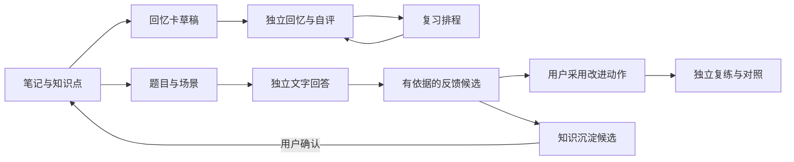

# 知识管理、星图与复习调研

| 项目 | 说明 |
|---|---|
| 核对日期 | 2026-11-05，Asia/Shanghai |
| 用途 | 为问阶完整产品的知识库、星图、脑图、白板、主动回忆和训练沉淀提供依据 |
| 证据范围 | 官方产品文档、官方仓库 README、根 LICENSE；未安装、登录或运行这些产品 |
| 阅读方式 | 外部已确认事实标来源 K 编号；“问阶建议”是本轮设计建议，不是已有能力或用户逐项确认 |
| 实施约束 | 本地不启动服务、不编写单元测试；视觉与运行验收等待用户部署服务器 |

## 1. 研究结论

**建议把知识库建为独立资产层，把星图、列表、脑图和白板建为不同工作视图，再让回忆与训练消费同一批有版本的内容。**

关键依据：Obsidian 区分正文链接、反链与 Canvas 临时文本；Heptabase 明确白板不拥有卡片；RemNote 区分引用、分类与正文嵌入；Anki 区分承载内容的 note 与实际被练习的 card。[K01–K08]

由此形成的问阶设计建议：

1. 知识点负责汇聚一个概念，笔记负责正文；一篇笔记可关联多个知识点，一个知识点可归属多个主题。
2. 星图节点默认代表知识点；笔记、项目事实、题目、回答证据在选择后展开，不把所有对象同时铺成一团。
3. 主题归属、概念关系、正文引用、训练证据、画布连线分别建模，分别筛选。
4. 星图与白板保存视口和布局；切换主题仅改变强调与显示，不隐式改写知识关系或已有坐标。
5. 回忆卡绑定源内容版本，保存独立的回忆记录与排程；不把一次自评或模型评价直接换成“已掌握”。
6. AI 可以建议摘要、关系、卡片和训练题；采用前保持候选，采用后保留来源与整理身份。

## 2. 产品与工具对照

| 对象 | 官方已明确的能力 | 问阶可借鉴 | 不直接承诺或照搬 |
|---|---|---|---|
| Obsidian | Markdown 文件、链接与反链、全局／局部图谱、Canvas [K01–K04] | 自由记录、关联探索、来源跳转、可带走的笔记 | 不能由 Markdown 可导入推导出插件兼容或实时同步 |
| Heptabase | 独立卡片库、跨白板复用、块级反链、白板与心智图 [K05] | 同一正文多处使用；研究主题时逐步组织材料 | 不照搬音视频能力、团队功能或自动把当前页面全发给 AI |
| RemNote | Reference／Tag／Portal 语义分离，笔记中制作多类回忆卡 [K06–K07] | 引用／分类／嵌入有明确操作，选段制卡并预览 | 不把所有笔记强制改成术语大纲，也不把填空表现当自由表达能力 |
| Anki／FSRS | note／card 分离，自评驱动间隔，排程参数与目标保持率 [K08–K10] | 到期队列、揭示后自评、复习历史、排程可解释 | 不宣称提高面试通过率；不把预测回忆概率当知识正确率 |
| Anytype | 对象图谱，正文链接与属性引用可分开显示，按对象类型筛选 [K11] | 图例与关系筛选；孤立对象仍可发现 | 不因此引入通用低代码数据库或任意用户自定义对象系统 |
| Markmap | 从 Markdown 层级生成交互 SVG 脑图 [K12] | 长笔记结构预览、表达提纲与题目路线 | 层级脑图不等于任意关系星图，不承诺自由拖拽编辑等价能力 |
| Excalidraw | 无限画布、图形、图片、绑定箭头、撤销、JSON／图片导出 [K13] | 架构思考与草图交互，可作为画布候选参考 | 编辑器不自动提供站点协作、后端保存、问阶证据语义 |
| JSON Canvas | 节点、边、坐标、尺寸、文件／文本／链接／分组交换格式 [K14] | 画布导入导出的兼容目标 | 格式不自动覆盖知识版本、权限、题目标准和复练来源 |

## 3. 对知识正文、引用与视图的启发

### 3.1 Obsidian：链接的可发现性

官方 Graph view 用节点表示笔记、连线表示内部链接；支持搜索过滤、分组颜色、方向、孤立节点、全图与可调深度的局部图。反链面板区分显式链接提及和未链接的名称提及，支持查看上下文。[K01–K02]

问阶建议：

- 星图可以从全局转为“当前知识点的一跳／两跳邻居”，同时保留返回位置。
- “引用我”来自真实引用索引；“可能有关”来自名称或 AI 推断，两者使用不同标签。
- 用户看得见边的类型、方向、来源及是否已确认；不能用发光连线掩盖关系含义。
- 节点连接多只说明关联多，不能用大小或亮度暗示掌握程度。
- 未关联的新笔记进入收件箱或孤立项列表，不强迫先创建主题和关系。

Obsidian 将 Markdown 笔记存在文件夹式 vault 中，并另存布局、设置和元数据缓存。这是其产品存储模式，不是问阶必须采用相同底座的依据。[K04]

### 3.2 Heptabase：卡片独立于白板

官方说明卡片统一位于 Card Library，白板可以引用已有卡片或创建新卡片；同一卡片能出现在多个白板，并能从卡片信息跳回相应白板位置。白板还有临时文字、心智图与分组；正文提及能显示块级反链。[K05]

问阶建议：

- 知识库列表、星图详情与白板引用同一个 `Note`，各视图只存引用和展示参数。
- 移除白板卡片只移除该视图实例；删除源笔记必须单独操作并预览影响。
- “这篇笔记在哪些视图／训练中使用”是详情中的反向导航，不另复制正文。
- 临时便签可以留在白板；显式执行“存为笔记”后才进入知识库、检索与回忆制卡。
- 编辑主笔记时，其他入口读取新版本；历史回答和证据仍固定当时版本。

### 3.3 RemNote：引用、分类与嵌入分别表达

官方将 Reference 定义为指向其他条目的链接，Tag 用于分类，Portal 展示同一源内容并在编辑后同步各处。三者都有反向查找，但表达的含义不同。[K06]

问阶建议：

- “属于 Java 并发主题”是分类；“理解线程池需要队列知识”是带方向的前置关系；“此段引用官方说明”是正文引用。
- 引用显示摘要与跳转；嵌入明确提示来自哪篇笔记，避免用户把被引用内容当本段独立副本。
- 当前学习视图可嵌入最新笔记；训练报告只能展开其锁定的源版本。
- 同主题、同白板或同一篇笔记提及两个概念，不自动生成两个概念之间的语义关系。

### 3.4 Anytype：按关系类型阅读图谱

官方 Graph 文档允许分别切换正文链接和属性引用，显示孤立对象、方向、标题，并按对象类型筛选；搜索匹配会高亮而其余图谱变暗。[K11]

问阶建议保留这种“按关系看图”的能力，但使用固定且可理解的业务对象，避免让个人求职者承担配置通用数据库的负担。

## 4. 星图、脑图与白板的业务边界

| 视图 | 核心问题 | 默认内容 | 编辑影响 |
|---|---|---|---|
| 星图 | 我知道哪些概念，它们如何相连 | 知识点与已确认概念关系；按需展开引用证据 | 建立／更改语义关系须明确提交；移动节点只改布局 |
| 笔记列表 | 我刚写的或想找的内容在哪里 | 笔记、主题、标签、更新时间、来源状态 | 编辑正文产生版本，不改变历史引用 |
| 脑图 | 如何组织这段讲解或学习结构 | 笔记标题层级、用户编排的提纲、路线 | 调整提纲结构；转知识关系需另行确认 |
| 白板 | 如何同时比较材料、草图与方案 | 笔记实例、便签、图形、附件、带标签连线 | 白板箭头只描述当前图，不默认成为全局关系 |
| 回忆队列 | 今天要回想什么 | 已启用的回忆卡与到期状态 | 新增复习事件并更新排程，不改源知识事实 |

Markmap 明确从 Markdown 的层级结构生成可交互脑图，官方提供 Vue 示例入口。它适合提纲展示；任意交叉关系、自由画布、知识持久化需要另外设计。[K12]

Excalidraw 的官方 README 分开列出 npm 编辑器能力和 excalidraw.com 站点能力。后者列出的实时协作、端到端加密及本地自动保存，不能直接算成编辑器集成后的问阶能力；官方安装说明使用 React／React DOM，若主框架选择 Vue，需要评估嵌入成本。[K13]

问阶星图建议采用“低干扰常态、选中时强调”的视觉规则：

1. 常态保留稳定节点和可读标签，环境粒子不携带业务含义。
2. 指向节点时强调相邻边；选中后侧栏展开正文、来源、题目与训练记录。
3. 跨主题边始终可查；主题聚焦不能制造互不相连的多个假宇宙。
4. 全局探索与严肃长文编辑可使用不同明暗表面，导航与控件保持一致。
5. 减少动态效果设置下关闭持续漂移与脉冲，仍可用列表完成相同任务。
6. 大图优先显示范围、聚合和可解释过滤；容量与帧率须服务器部署后另行实测。

这些是问阶设计建议，不是以上产品已经验证了问阶视觉方案。

## 5. 主动回忆、卡片版本与排程

### 5.1 从笔记到可练习对象

RemNote 官方支持从笔记条目创建问答、双向、填空等卡片，并说明上下文有时会泄露答案。Anki 的 note 保存内容，card 是按模板产生、分别被学习的对象。[K07–K08]

建议问阶支持：

- 从选中段落、知识点或已采用反馈生成卡片草稿；手动创建和 AI 候选都需预览问题、参考和来源。
- 基础形式覆盖开放问答、概念对比、短清单和填空；代码阅读以短片段说明为主，不默认执行代码。
- 卡片可关联多个知识点，但只存一份题面与参考；每个练习方向独立记录。
- 题面固定必要场景，如 Java 版本、并发条件、项目假设；不能只问无条件的“最佳方案”。
- 正式开始回忆时锁定 `CardVersion` 与源笔记版本；先记录回答／跳过，再揭示，最后自评。

### 5.2 排程与能力必须分开

Anki 根据自评安排后续出现时间；FSRS 官方解释了回忆概率、稳定性、难度及用户历史参数，默认参数用于历史不足的情况。Anki 文档强调“忘记”和“困难但回想成功”不是同一等级，目标保持率提高会增加复习量。[K08–K10]

问阶建议：

- 界面使用“忘记／费力想起／正常想起／轻松想起”，提供简短解释。
- 持久化每次回忆的卡片版本、日期时区、作答、揭示行为、自评、练习模式和排程版本。
- 重复提交同一次回忆只产生一条事件和一次排程更新。
- “额外练习／冲刺”是否影响常规排程应显式可见，不能悄悄重置全部到期日。
- 允许暂停、恢复、日负荷限制与逾期处理；日程调整不删除既有复习历史。
- FSRS 可作为调度候选；算法版本、实现语言、许可证、默认参数和迁移规则须接入前确定。
- UI 展示“本卡回忆记录”与“已到期”等事实；不显示未经验证的“知识掌握率”或“面试准备总分”。

FSRS 官方 wiki 将部分减少复习量的数字明确标为模拟结果。本轮未重现算法评估，也没有问阶 Java 内容的学习收益证据，因此不据此承诺任何提升比例。[K10]

### 5.3 内容被改正时

以下是问阶必须补充的业务规则，不能由调度算法替代：

1. 纯排版修改保留历史源版本，并按明示规则决定后续卡片是否更新。
2. 参考结论、适用条件发生变化时，生成新卡片版本并标记待复核；旧记录显示当时题面。
3. 源内容撤回或被认定错误时，受影响卡片暂停进入常规队列，用户审核后重新启用。
4. 调整卡片版本不把旧自评改成新内容下的表现；是否延续排程由变更类型和用户确认决定。
5. 删除源正文时预览卡片参考中的摘录和 AI 派生正文，处理内容副本而不只断开链接。

## 6. 与文字训练的连接

建议形成两条相互连接、记录独立的学习循环：

- 回忆卡检验一个较小的知识单元；面试题还检验条件分析、取舍、个人职责与表达组织。
- 回忆通过不自动结清复练动作；某次训练回答也不自动成为所有相关卡片的成功记录。
- 训练期间打开相关笔记、参考答案或 AI 提示，应记录辅助条件，后续比较可见。
- 原答可作为笔记来源，但不能仅凭生成摘要就升级成已确认项目事实。
- AI 给出的关系、笔记和卡片在采用前不进入正式检索与复习队列。
- 检索到一篇笔记不意味着允许将其发送给外部模型；用途授权与检索权限分别判断。

## 7. Obsidian 与外部数据交换边界

Obsidian 的 Markdown 文件与 JSON Canvas 开放结构提供互操作基础；它们不能自动承载问阶的业务版本、授权、训练证据和排程语义。[K03–K04、K14]

完整产品建议纳入显式导入／导出，而不是默认后台同步：

| 数据 | 建议支持 | 必须提示的限制 |
|---|---|---|
| Markdown | 正文、标题、代码块、相对链接、基础属性；文件夹路径作为来源信息 | 不把文件名当唯一业务 ID；复杂扩展语法需兼容清单 |
| Wiki 链接 | 将可解析的名称／路径映射为内部引用；保留别名 | 同名、缺失目标和歧义进入待处理列表，不随意指向第一条 |
| 附件 | 用户选定的附件与相对路径映射、缺失清单 | 不默认抓取外部 URL；导入文档中的脚本或插件不执行 |
| JSON Canvas | 已支持的文本、文件、链接、分组、坐标和连接 | 自定义字段、嵌入与视觉效果不保证等价；连线不自动转全局概念关系 |
| 问阶完整包 | 自有格式保留稳定 ID、版本、关系、来源、排程与布局 | 可恢复性须另行验证；不等同于 Markdown 导出 |

导入先预览对象数量、冲突与不支持项，再选择新建／跳过／映射；保留外部来源标识。再次导入不能静默覆盖用户编辑，重复内容也不能自动继承外发授权或“技术已审”状态。

导出至少区分“便于阅读的 Markdown／图片”和“保留业务结构的完整数据包”。导出成功须说明未覆盖哪些字段，不能把一张星图截图称为知识库备份。

实时双向同步、Obsidian 插件执行、主题 CSS 兼容以及外部工具的端到端加密均不在本轮已确认能力中。

## 8. 许可与工程接入状态

| 对象 | 本次实际核对 | 接入前仍需做什么 |
|---|---|---|
| Markmap | 官方文档；GitHub API 返回根 LICENSE 为 MIT，已读取原文 [K12、K15] | 固定制品版本，核对依赖、字体／图标与许可保留方式；验证所需编辑能力 |
| Excalidraw | 官方 README；根 LICENSE 原文为 MIT [K13、K16] | 评估 React 嵌入、包体、导出和历史恢复；站点能力不能直接归给编辑器 |
| JSON Canvas | 1.0 规范；官方仓库根 LICENSE 原文为 MIT [K14、K17] | 定义支持子集、路径安全、未知字段处理及无损往返范围 |
| FSRS | Anki 文档与算法作者维护的 wiki [K09–K10] | 尚未选择具体语言实现／制品，不能把“算法开放”当全部库许可已核定 |
| Obsidian／Heptabase／RemNote／Anytype | 阅读官方产品文档，作为行为参考 [K01–K08、K11] | 本轮未取得其产品代码／素材复用许可结论，不复制受限代码或内容 |

许可证核对仅记录取得的源文件事实，不构成全部第三方依赖已审结论；本轮未执行任何外部仓库脚本或安装依赖。

## 9. 交给产品文档的需求检查项

以下是完整产品应有的验收场景，当前均为待实现／待服务器验收：

1. 新建无主题笔记后，能搜索到；稍后关联两个知识点，不复制正文。
2. 同知识点关联两个主题，切换聚焦后位置不跳变，跨主题边仍能追踪。
3. 图谱和白板引用同一笔记，编辑后当前内容一致，旧训练仍读原版本。
4. 删除白板实例不删除笔记；删除源笔记展示引用、摘录和派生内容影响。
5. 展示正文引用、前置关系与训练证据时，各自有明确类型和来源。
6. AI 建议十条关系，用户只采用两条，正式图谱只增加这两条。
7. 回忆前未揭示参考，回答后自评；重复提交不重复更新排程。
8. 更正源知识结论后，相关卡片被标记待复核，旧成绩不冒充新版本表现。
9. 额外冲刺练习有明确排程影响，取消／失败不写成功记录。
10. 从训练沉淀笔记时保留原答出处；不自动把模型补充认定为本人经历。
11. 导入同名笔记、缺失附件、未知 Canvas 节点时给出可处理清单，不无声丢弃。
12. 减少动态效果、窄屏或大图过滤时，列表和详情仍能完成知识查找与训练入口任务。

## 10. 来源与取证限制

全部下列来源访问日期为 **2026-11-05**。web.run 在本次调用中未返回可用正文，随后以 PowerShell `Invoke-WebRequest`／`Invoke-RestMethod` 只读访问官方 HTTPS 页面与 GitHub API；无登录、无私有数据、无远程脚本执行。成功项取得 HTTP 200 且检查正文；HTTP 200 本身不作为功能实测证据。

| 编号 | 一手来源与 URL | 实际取得的内容 |
|---|---|---|
| K01 | Obsidian Graph：`https://help.obsidian.md/plugins/graph` | 官方页面给出的公开正文端点；节点、连线、过滤、局部图说明 |
| K02 | Obsidian Backlinks：`https://help.obsidian.md/plugins/backlinks` | 官方公开正文；显式／未链接提及及上下文展示 |
| K03 | Obsidian Canvas：`https://help.obsidian.md/plugins/canvas` | 官方公开正文；文本卡、文件卡、连接、转换、JSON Canvas |
| K04 | Obsidian 存储：`https://help.obsidian.md/data-storage` | 官方公开正文 `Files%20and%20folders/How%20Obsidian%20stores%20data.md`；Markdown、设置、缓存 |
| K05 | Heptabase Fundamental Elements：`https://wiki.heptabase.com/fundamental-elements` | 官方英文正文；卡片库、白板、提及和 AI 上下文交互 |
| K06 | RemNote References／Tags／Portals：`https://help.remnote.com/en/articles/6634227-what-s-the-difference-between-references-tags-and-portals` | 官方文章全文；三类关系与复用语义 |
| K07 | RemNote Creating Flashcards：`https://help.remnote.com/en/articles/6025481-creating-flashcards` | 官方文章；卡片类型、上下文、预览与启停 |
| K08 | Anki Getting Started：`https://docs.ankiweb.net/manual/getting-started.md` | 官方 Markdown 正文；note、card、deck、揭示与自评 |
| K09 | Anki Deck Options：`https://docs.ankiweb.net/manual/deck-options.md` | 官方正文 FSRS 小节；目标保持率、自评误用、参数与复习历史 |
| K10 | FSRS 作者维护 wiki：`https://github.com/open-spaced-repetition/awesome-fsrs/wiki/ABC-of-FSRS` | 新 wiki 正文；记忆状态、缺少历史时默认参数、模拟结果边界 |
| K11 | Anytype Graph：`https://doc.anytype.io/anytype-docs/basics/graph` | 官方正文；正文链接／属性引用、类型过滤和高亮搜索 |
| K12 | Markmap 官方说明：`https://markmap.js.org/docs/markmap` | Markdown 层级转交互 SVG、模块职责与 Vue 示例入口 |
| K13 | Excalidraw 官方 README：`https://api.github.com/repos/excalidraw/excalidraw/readme` | GitHub raw media 响应；编辑器与站点能力分别列举 |
| K14 | JSON Canvas 1.0：`https://jsoncanvas.org/spec/1.0/` | 规范全文；节点类型、坐标和边字段 |
| K15 | Markmap LICENSE：`https://api.github.com/repos/markmap/markmap/license` | 原文 MIT；文件 SHA `b4381398a7aa0476fd55361d77ab7daf9f757bad` |
| K16 | Excalidraw LICENSE：`https://api.github.com/repos/excalidraw/excalidraw/license` | 原文 MIT；文件 SHA `8a844bc750a313db95d147bea9e4c9537b2cebc0` |
| K17 | JSON Canvas LICENSE：`https://api.github.com/repos/obsidianmd/jsoncanvas/license` | 原文 MIT；文件 SHA `910b7f7ff2fb14afc2a8eed8c730489096f34e02` |

Obsidian 页面正文通过其 HTML 明示的 `https://publish-01.obsidian.md/access/f786db9fac45774fa4f0d8112e232d67/` 公开内容地址读取，不使用认证信息。K04 最初尝试的旧路径返回“Not Found”，后改读官方存储正文并从其 permalink 得到上述入口。FSRS 旧 wiki 明确指向 K10，新旧入口未混用。

部分 GitHub 网页／raw 链接连接超时，已对 K13、K15–K17 使用官方 API 取得所需正文。Anytype 旧 object 路径 404，未用它支持对象编辑能力；本稿只采用成功取得的 Graph 文档。

未覆盖：实际产品登录操作、收费版本差异、大规模图性能、移动端实测、中文搜索质量、往返导入、算法收益和正式依赖兼容。上述限制不妨碍形成业务设计，但必须保留在后续验收记录中。
