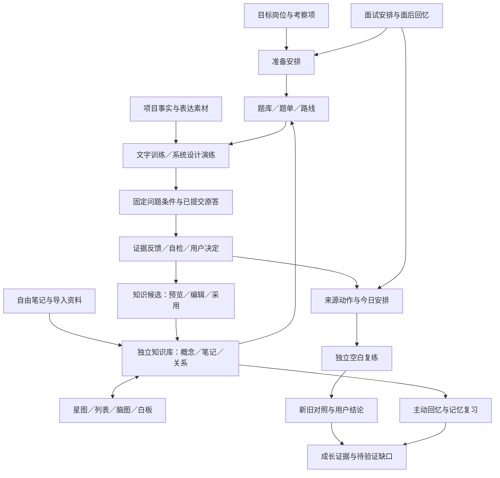

# 问阶 · Interview Studio 完整产品需求文档

| 项目 | 定义 |
|---|---|
| 版本／日期 | v1.0 · 完整产品设计稿 · 2026-11-05 |
| 产品 | 面向 Java 后端求职者的个人准备、知识管理、AI 文字训练与复练工作台 |
| 范围 | 完整目标产品，包含独立知识库、知识星图、脑图／白板和主动回忆；不以 MVP 裁剪 |
| 使用方式 | 个人单实例自托管，桌面浏览器为主，窄屏支持核心阅读、回忆和文字流程 |
| 当前状态 | 完整目标规格；已获授权分阶段开发，实现进度见[开发记录](../开发记录/开发阶段与进度.md)，不能将全部要求当作已实现能力 |
| 配套 | [调研](../调研/README.md) · [交互设计](../交互设计/知识星图与工作台.md) · [技术架构](../技术架构/系统架构与数据边界.md) · [验收场景](../审查/产品验收场景.md) |
| 执行边界 | [AGENTS.md](../../AGENTS.md)：本地不启动服务，不编写单元测试；用户部署服务器后开展运行与视觉验收 |

## 1. 依据、决定与适用边界

**用户已明确的方向：**完整产品而非 MVP；暂不做语音面试；知识是跨岗位、跨训练的长期资产；知识点与笔记分层，一篇笔记可关联多个知识点，一个知识点可属多个主题；星图在同一空间连续探索，切换主题保持位置；认可深色银河方向不等于全站深色。相关文档放入 `docs/` 分类子目录。

**本轮设计默认值：**六个主入口、下文的模块和业务规则、轻量动效默认、题目评价分层、计划去重、内容更正、格式兼容及验收目标。它们是受托完成的完整建议，可评审调整，不记为用户逐项确认。

**设计成稿时的核验基线：**清理后保留的旧 `docs/PRD.md` 为 v0.4，已原样放入[历史 PRD](历史-PRD-v0.4.md)；`design/` 下有独立原型，成稿时尚无正式应用工程。当前实施状态另见开发记录。不恢复被删除的系统设计和旧资料，不把已删除完整版文档的历史摘要当作现行规格。

**外部证据限制：**调研读取官方公开页面及部分固定提交源码，未注册使用竞品、未运行其代码。两段抖音短链取得跳转页但未取得可观看画面；视频视觉细节仅来自用户描述。研究结论及访问限制见调研文档。用户学习收益、模型准确率、图谱性能均待验证。

本文替代旧 PRD 的首期范围作为当前产品基线。技术架构规定实现职责，交互文档补充界面状态，验收文档提供操作场景；如果规则冲突，应记录冲突并修订主规则，不把各稿功能简单相加。用户已于 2026-11-05 明确授权正式开发，授权不改变根目录约束和服务器验收边界。

## 2. 产品定位与价值

### 2.1 产品要帮助用户完成什么

让准备面试时积累的资料、知识、真实项目经历和每一次作答互相连接：用户知道自己正在学什么、曾怎样回答、反馈依据是什么，以及下一次需要独立验证什么。

产品包含两条相互连接、也能单独使用的主线：

- **知识主线：**捕捉内容 → 写笔记／整理概念 → 建立真实关联 → 星图与白板探索 → 主动回忆 → 更正和持续积累。没有岗位、训练或 AI 也能使用。
- **准备主线：**目标要求／项目事实 → 选题或生成题 → 独立文字回答 → 有原文依据的反馈 → 改进动作 → 空白复练 → 新旧对照 → 把经过选择的内容沉淀为知识。

星图是知识的探索入口；笔记和关系有自己的业务价值。训练从知识中获得上下文，训练记录也能成为知识的来源，两者不互相冒充：读过笔记不代表会回答，模型给的建议不代表用户真实做过。

### 2.2 主要用户与使用时机

| 用户情境 | 主要任务 | 产品支持 |
|---|---|---|
| 有项目经验，正在准备 Java 后端岗位 | 说明职责、技术取舍、异常与结果 | 目标、事实、项目追问、证据复盘和复练 |
| 暂无明确岗位，日常积累 | 管理知识、连接资料、回忆薄弱点 | 独立知识库、星图、脑图／白板和记忆复习 |
| 基础有缺口或没有完整材料 | 从一道题开始，逐步建立体系 | 无材料入口、主题路线、学习练习和自由笔记 |
| 面试前冲刺或面试后复盘 | 按日期安排、记录模糊回忆并补练 | 今日安排、面试日历、面后记录、来源复练 |

Java 后端为内容与模板的主要领域，不以工作年限做准入门槛。高阶架构与行为表达使用同一训练模型，不建设跨行业课程市场。

### 2.3 完整产品之外

暂不做语音／视频面试、录音转写、正式面试实时代答或隐身辅助；不做自动投递、招聘爬虫、联系人 CRM、公共社区、真人撮合、支付订阅、多租户运营、任意代码执行沙箱。支持私人面试安排，不扩为全流程招聘系统。

Obsidian 文件交换属于本产品；直接运行 Obsidian 插件、监视用户本机整个 vault、双向实时同步和同步服务不在当前完整范围。文本与图文推演可覆盖系统设计；不能因此宣称运行了代码、压测了架构或验证了真实生产经历。

### 2.4 可观察的产品价值

| 目标 | 观察口径 |
|---|---|
| 知识能找回、能关联 | 从搜索／星图／白板进入同一正文，发现真实出处和相关内容 |
| 准备有方向 | 今日任务能说明来自哪个目标、到期回忆或改进动作，允许调整 |
| 作答可信保存 | 服务端确认的原答可恢复；重复提交不重复产生记录；冲突可处理 |
| 反馈可解释 | 用户能定位原文、了解依据和限制、接受或争议具体反馈 |
| 复练有结论 | 对同一来源动作完成空白新答，比较条件并记录已处理／部分／未处理／无法判断 |
| 长期积累不失真 | 更正知识不篡改历史，参考暴露和标准状态不被隐藏 |

不以节点数量、连续打卡、总学习时长或 AI 总分替代这些价值。统计默认只在个人空间展示；不默认外发回答、笔记或分析埋点。实际访谈、学习收益和留存数据尚不存在。

## 3. 信息架构与模块

### 3.1 六个主入口

| 入口 | 第一眼要回答的问题 | 二级内容与主要操作 |
|---|---|---|
| 今日 | 接下来做什么，什么尚未保存？ | 继续草稿、今日安排、到期回忆、待复练、面试提醒、快速记一条 |
| 准备 | 为哪个目标准备，我有哪些真实材料？ | 目标／JD、要求与考察项、项目事实、表达素材、面试日历 |
| 知识 | 我知道什么，它们如何关联？ | 星图、全部笔记、主题、脑图／白板、回忆卡、资料与收藏 |
| 训练 | 这次要练什么，按什么条件作答？ | 题库／题单／路线、学习练习、独立专项、多阶段文字模拟、系统设计 |
| 复盘 | 证据是什么，接下来如何改？ | 训练历史、原文报告、争议、动作、独立复练对照、面后记录 |
| 成长 | 哪些地方有记录支持，哪些还没验证？ | 按目标／主题／考察项查看回忆、作答、复练证据与待验证缺口 |

全局入口：搜索／命令面板、最近访问、模型任务与用量、设置／外观、导入导出及数据管理。相同任务不因入口不同复制为多条数据。

命令面板及搜索链接的具体白名单、主动查询、保稿与键盘规则见[全局命令面板与搜索预填](../交互设计/全局命令面板与搜索预填.md)；实现与验收状态仍以开发记录为准。

最近访问按稳定对象去重，回到当前内容入口，不承诺上次历史版本、选区或滚动位置。只有真实详情接纳且可见时记录，访问不计为学习、训练或复习完成；辅助记录失败不阻塞正式保存与正常离开。13类对象、分页、知识RECENT兼容及原键队列见[全站最近访问契约](../技术架构/全站最近访问契约.md)，运行与视觉仍待服务器验收。

### 3.2 业务模块与支撑域

完整业务包含：今日安排、目标准备、材料与事实、独立知识库、知识星图、脑图与知识白板、题库与路线、主动回忆、文字训练、系统设计演练、反馈复盘、独立复练、面试安排与面后记录、成长证据。模型任务与数据管理是两个跨模块支撑域。模块不等于独立服务或导航数量。

“知识候选”是用户选择沉淀的入口，不是每次训练后强制填写的表单。常用路径保持少步骤，版本、来源和授权在必要操作点展开。

## 4. 贯穿案例与主要旅程

### 4.1 缓存知识与项目追问

小林准备三周后的 Java 后端面试，实际项目中参与过缓存排查，未主导整体架构。

1. 自由写一篇“缓存更新失败时怎样定位”的笔记，关联缓存一致性、幂等、消息重试三个知识点；不填岗位也能完成。
2. 在星图选择缓存一致性，查看跨主题关系、主笔记、关联题目；相关知识共用一张空间图，切换“分布式”不会重排原节点。
3. 保存 JD，把“分析异常与恢复”和“讲清本人职责”列为考察项；在项目事实中标记“参与排查”，保留待确认的指标。
4. 选择一题说明具体失败场景，开始独立文字回答。题干、标准、引用事实及辅助规则在开始前固定；原答不预填。
5. 反馈指出“没有说明怎样确认恢复成功”，可定位到原文与题目条件。标准未经过技术审阅时，系统只能给受限观察与自检建议。
6. 用户采用一个动作：“下一次说明恢复判据及验证步骤”，另将自己选中的片段整理为知识候选。采用笔记不会将方案变成“本人主导实施”的项目事实。
7. 今日出现同一动作的复练安排；新回答从空白开始。新旧对照展示题目变化、曾看参考和本次提示使用，用户判定“部分处理”。
8. 回忆卡的自评可以更新记忆排程，但不会关闭项目复练动作。如果来源笔记后来被纠正，卡片和相关结论进入待复核，原回答保持原样。

该案例只说明业务行为，不提供缓存正确性标准，也不代表真实用户资料。

### 4.2 冷启动与中断恢复

- **不填资料开始：**进入训练 → 选择主题／自建题 → 独立作答 → 自检或获准 AI 反馈 → 保存动作。之后补资料不回填到旧作答条件。
- **只用知识库：**新建笔记 → 关联概念或暂存未归类 → 搜索／星图发现 → 创建回忆卡。不得要求先创建岗位或完成面试。
- **AI 不可用：**已有题、笔记、草稿、提交、自检及手工复练持续可用；生成和评价显示失败／未启用，不用固定示例冒充 AI。
- **中途离开：**重新进入以服务端记录恢复；显示最后成功保存点和尚未同步差异；暂停、跳过、结束分别有明确含义。

## 5. 功能需求

以下编号是完整产品要求，均待实现和服务器验收；实现可以按依赖分批，不把后文未首先编码的模块移出产品范围。

### 5.1 今日安排

| 编号 | 用户能力与业务规则 |
|---|---|
| DAY-01 | 首页优先显示继续未完成内容、到期回忆、待复练与最近面试；没有数据时给写笔记、练一题和建目标三个入口。 |
| DAY-02 | 每项安排说明来源、目标、预计时长、到期原因；用户可排序、延期、暂停、移出今日，保留源动作／卡片。 |
| DAY-03 | 同一个来源任务在今日、日历和动作列表共用身份；重复加入不生成重复安排。手工待办可独立存在。 |
| DAY-04 | 按可用时间给出可编辑的建议清单；容量超出时显示剩余，不自动无上限补满、不扣“完成率”制造惩罚。 |
| DAY-05 | 快速记录进入知识收件箱；未同步草稿显著提示，不能显示成服务端已保存。 |

### 5.2 目标与准备

| 编号 | 用户能力与业务规则 |
|---|---|
| PRE-01 | 建立多个目标，保存岗位名称、公司备注、JD、来源与日期；选择当前关注目标，允许无目标训练。 |
| PRE-02 | 手工拆解或采用 AI 提取的要求，映射可观察的考察项，如解释、排错、取舍、职责、表达；采用前可改写。 |
| PRE-03 | 每目标关联项目、事实、知识、题单、面试安排及训练证据；关联是复用，不复制正文。 |
| PRE-04 | 根据面试日期、时间预算、缺口形成准备路线；调整日期或优先级先预览尚未开始的变更，已完成记录不移动。 |
| PRE-05 | 更换 JD、要求或归档目标保留历史版本；旧训练显示原目标条件，当前摘要重新判断证据适用范围。 |

### 5.3 材料、项目事实与表达

| 编号 | 用户能力与业务规则 |
|---|---|
| MAT-01 | 手工录入或导入简历／项目资料；解析后逐项预览，显示遗漏、不支持格式及需要核实的数字，不默默补造。 |
| MAT-02 | 项目事实保存场景、问题、动作、结果、技术版本、来源和责任边界；“本人负责／参与／仅了解／待核实”明确可见。 |
| MAT-03 | 事实核实和用途授权独立；事实保存或确认不等于同意外发模型。多目标可引用同一事实版本。 |
| MAT-04 | 从已确认事实组织长短项目介绍、自我介绍、STAR 与技术取舍表达；表达是单独版本，AI 润色不会新增真实经历。 |
| MAT-05 | 事实更正显示差异及受影响训练／表达；历史保留当时内容和更正提醒，新任务不得默认使用已撤回事实。 |
| MAT-06 | 支持素材收藏、标签和复用；从训练沉淀事实须单独经过用户核实，不因“采用笔记”一并确认。 |

### 5.4 独立知识库

| 编号 | 用户能力与业务规则 |
|---|---|
| KNOW-01 | 创建独立知识点与自由笔记。知识点有名称、别名、定义摘要和主题，摘要等可作依据的内容形成概念版本；笔记有自己的标题、正文、附件与版本，可暂不关联知识点。 |
| KNOW-02 | 一篇笔记关联多个知识点、一个知识点关联多篇笔记及多个主题；可指定主笔记。概念摘要和笔记正文为不同字段，不互相偷偷同步。 |
| KNOW-03 | 编辑 Markdown、标题层级、代码块、表格、引用和附件；阅读与编辑可切换。内容净化，嵌入代码只展示不执行。 |
| KNOW-04 | 使用明确的对象引用和双向查询；点击反链可回到源笔记版本及引用段落。标题改变不破坏对象链接，同名目标由用户选择。 |
| KNOW-05 | 按文本、主题、标签、来源、类型、状态搜索；提供收藏、最近访问、未归类与断链整理，结果说明命中位置。 |
| KNOW-06 | 手工定义概念前置、组成、相关、对比、应用等关系；每条关系有类型和来源，AI／共现建议单列为候选。 |
| KNOW-07 | 从训练片段、反馈或资料生成笔记／关系候选；预览来源及差异，可编辑后采用、忽略、另存；不自动覆盖现有笔记。 |
| KNOW-08 | 支持合并重复知识点、重命名、归档、恢复与删除影响预览；保留别名／历史身份，主笔记冲突需处理。 |
| KNOW-09 | 资料来源记录标题、地址、作者信息（有则录入）、获取时间、适用版本和权利说明；链接失效不抹掉用户独立笔记。 |

### 5.5 知识星图

| 编号 | 用户能力与业务规则 |
|---|---|
| GAL-01 | 默认以知识点为节点，主题为可筛选星域；全库共用坐标空间，同一知识点不因多主题复制。无关系节点如实显示“未关联”。 |
| GAL-02 | 真实关系形成跨主题探索；支持图例、关系类型开关、主题淡化／聚焦、邻域展开与可解释路径。不用装饰线伪造业务关系。 |
| GAL-03 | 单击选择并联动侧栏，搜索定位，平移缩放，前进／返回探索历史；详情展示主笔记、关联笔记、题目、事实、回答与复练入口。 |
| GAL-04 | 主题切换和邻域展开保留节点世界坐标；保存布局与视口，刷新后恢复已保存状态。主动重排独立预览，可撤销。 |
| GAL-05 | 点击线查看类型、方向、创建方式与出处；笔记正文引用和训练证据不混作概念前置，候选线默认不进入正式路径。 |
| GAL-06 | 深色宇宙画布支持光球／星域意象、克制的发光和选中路径；标签和点击目标稳定，尺寸／颜色若编码数量必须有图例。 |
| GAL-07 | 提供轻量、完整动效和静止模式；默认轻量并尊重减少动效设置。关动效不损失功能，长文输入时降低氛围干扰。 |
| GAL-08 | 节点过多时渐进加载、局部查看、明确已加载范围，并提供等价列表；手机以局部图／列表加详情完成核心操作。 |

### 5.6 脑图与知识白板

| 编号 | 用户能力与业务规则 |
|---|---|
| MAP-01 | 创建脑图提纲或自由白板，放置知识点、笔记、题目、附件链接、临时文本与分组；选择引用原对象或明确复制。 |
| MAP-02 | 同一笔记可在多个画布出现；移除卡片只移除视图实例。编辑源正文影响当前引用视图，已提交历史快照不变。 |
| MAP-03 | 支持层级折叠、拖动、连线、分组、对齐、缩放和撤销；脑图父子默认只是提纲组织，不自动创建概念前置。 |
| MAP-04 | 临时文本可显式转笔记，画布线可显式转语义关系；转换展示目标类型、来源和影响，重复操作不生成重复对象。 |
| MAP-05 | 从学习白板准备系统设计时，选择建立训练快照；普通白板编辑不冒充已经提交的架构答案。提供图像／受支持画布格式导出。 |

### 5.7 题库、题单与学习路线

| 编号 | 用户能力与业务规则 |
|---|---|
| BANK-01 | 按知识点、主题、考察项、题型、场景与自定难度检索；题目有来源、条件、适用技术版本和标准状态。 |
| BANK-02 | 自建题、导入题候选与 AI 出题采用相同结构；题干和参考标准成组版本化，开始作答后固定，修改后生成新版本。 |
| BANK-03 | 题单维护顺序／目的，学习路线增加依赖和检查点；同题可入多个题单，不复制历史回答。 |
| BANK-04 | 支持 Java 基础解释、代码阅读、故障分析、项目追问、方案取舍、系统设计、行为与表达训练；本期产品无代码执行器。 |
| BANK-05 | AI 生成题／变式先预览并明确变化条件、考察项与未审身份；难度和“高频”是来源声明，不能伪装客观概率。 |
| BANK-06 | 停用题退出默认推荐但保留旧答；选择旧题复练显示重复曝光，选择变式显示可比性差异。参考答案在独立作答前默认隐藏。 |

### 5.8 主动回忆与记忆复习

| 编号 | 用户能力与业务规则 |
|---|---|
| MEM-01 | 从笔记／概念创建问答卡或填空卡，手工或采用 AI 候选；题面、参考、来源版本、相关概念分别记录。来源明确指向笔记版本或概念版本，不使用可变摘要作为历史依据。 |
| MEM-02 | 先写／想再揭示，提供“忘记／困难／记得／熟悉”自评；揭示、自评、跳过不同，支持仅浏览不改变排程。 |
| MEM-03 | 记录每次卡版本、揭示时间、自评、耗时和排程变化；重复提交一次只记录一次，不把自评变成技术审核结论。 |
| MEM-04 | 常规复习队列有每日新卡与复习预算，积压可延期／暂停；用户可查看下次时间、调整理由及复习历史。 |
| MEM-05 | 面试冲刺支持指定范围与日期的额外练习；默认不改变常规排程。仅在明确选择“计入常规复习”且满足同一规则时更新一次。 |
| MEM-06 | 参考内容被实质更正时暂停相关卡进入待复核；确认新版本后重新启用。归档与恢复不会默默重置历史或立即挤入今日。 |
| MEM-07 | 复习算法采用可替换策略，推荐评估 FSRS；无论算法如何，记录原始事件、参数版本和建议时间。算法选型及学习效果另行验证，不展示未经验证的记忆概率。 |

### 5.9 文字训练与模拟

| 编号 | 用户能力与业务规则 |
|---|---|
| TRN-01 | 学习练习可看参考并即时反馈；独立专项先答后看；多阶段文字模拟默认结束后反馈。开始前说明规则、材料和问题范围。 |
| TRN-02 | 选择主题、目标、题单、项目或时间预算，预览主问题／考察范围；支持无目标与无 AI 模式。 |
| TRN-03 | 每题有草稿保存、明确提交、跳过、待答状态；提交保留不可变修订，修订同一答案不伪装一次独立复练。 |
| TRN-04 | AI 追问绑定父问题与确切已提交答案，受范围／次数限制；候选被接纳后才成为正式问题，不能追问未提交草稿。 |
| TRN-05 | 可选时间预算、暂停／恢复和提前结束；记录真实开始、暂停及活动时长。关闭页面不自动声称全程在线独立作答。 |
| TRN-06 | 打开提示、相关笔记、旧答或 AI 改写前说明将影响独立性；确认后保留暴露事件，不能切回“从未辅助”。 |
| TRN-07 | 结束汇总已答、跳过、未答及未提交草稿；结束后草稿只读可另存，迟到追问不得改变已结束问题清单。 |
| TRN-08 | 断线、刷新、多标签冲突、评价失败可恢复；AI 失败不阻止保存与结束，不把流式暂态当正式回答或报告。 |

默认专项为 1 主问、最多 2 追问；短模拟为 3 主问、每主问最多 1 追问。完整模拟模板可配置多阶段、题量、追问上限和反馈时机；预设只帮助开始，不限制完整产品只有短模拟。时间到默认提醒，用户选择提交或结束，不自动提交残缺草稿；复盘标记超时。时间与题量上限在服务器设置中显式显示。

### 5.10 系统设计与图文演练

| 编号 | 用户能力与业务规则 |
|---|---|
| ARCH-01 | 从场景和约束开始，记录容量假设、服务边界、数据流、异常、取舍与验证方式；图必须有文字说明。 |
| ARCH-02 | 使用结构化节点／边绘图，支持关联知识与材料；提交时固定图和解释版本，历史反馈绑定当时图元素。 |
| ARCH-03 | AI 基于已提交图结构、约束和说明追问或反馈；不声称仅凭漂亮拓扑证明可用性、性能或生产可行性。 |
| ARCH-04 | 复练使用新的图草稿和文字答案；可比较节点／边／约束／说明差异；复用旧方案进入辅助模式并保留标记。 |

### 5.11 反馈、复盘与争议

| 编号 | 用户能力与业务规则 |
|---|---|
| REV-01 | 反馈逐项给出观察、条件、原文证据或“未提及”、依据标准、限制和建议动作；用户能点击定位答案／图版本。 |
| REV-02 | 区分 AI 候选、自检、手工录入他人意见和已审标准支持的观察；未审标准不能输出确定技术判错。 |
| REV-03 | 原答、参考解释、改写候选并排且标签明确；不将 AI 改写写回原答，不用“你其实想表达”补齐用户未说内容。 |
| REV-04 | 用户可接受、争议或忽略每项反馈，说明原因或补充资料；决定与原反馈分开留存，争议不自动视为缺陷。 |
| REV-05 | 将反馈／自检／面后记录转为带验证条件的动作，可合并动作但保留每个来源，不能只按题号去重。 |
| REV-06 | 将选择的片段沉淀为笔记、卡片、关系或事实候选；各类型分别采用、保留来源，不批量默认确认。 |
| REV-07 | 结束报告总结实际已提交范围、缺项及条件，允许部分结果和失败重试；无答案不给假分，缺证据不按失败处理。 |

### 5.12 独立复练与历史对照

| 编号 | 用户能力与业务规则 |
|---|---|
| RET-01 | 从动作或旧答发起新的空白尝试，选择相同题干／变式；保留来源动作、原版本及本次条件。 |
| RET-02 | 独立复练默认隐藏旧答／参考／改写；已经在过去看过参考属于已知曝光，不伪称第一次见题。 |
| RET-03 | 完成后按来源动作并排比较原答和新答，展示题干、标准、事实、辅助与时间条件变化。面后来源区分正式原答、回忆片段、无旧答三种基线；无旧答按问题与验证条件检查本次回答，不生成虚构旧答或提升结论。 |
| RET-04 | AI 可提出比较候选，用户记录已处理／部分／未处理／无法判断及依据；条件不一致时不直接输出可比总分。 |
| RET-05 | 只更新本次选择且实际判断的来源状态；读笔记、完成回忆卡或勾选“练过”不自动关闭全部复练动作。 |

### 5.13 面试安排与面后记录

| 编号 | 用户能力与业务规则 |
|---|---|
| EVENT-01 | 记录目标、轮次、时间、时区、地点／链接备注；列表和日历共用安排，支持改期和取消。 |
| EVENT-02 | 面试前关联准备任务、材料、题单与提醒；改期只预览移动未开始且未锁定日期的安排，不搬动历史。 |
| EVENT-03 | 面试后手工记录回忆的问题、回答片段、反馈和不确定性；明确“回忆记录”，不标逐字实录或自动事实。 |
| EVENT-04 | 从回忆创建待审题、知识缺口及复练动作；记录来源和模糊处，避免猜测面试官真实评价或录用原因。 |
| EVENT-05 | 站内展示到期／错过提醒，按用户时区处理；浏览器关闭不保证推送，重进显示未处理事项。不集成自动投递。 |

### 5.14 成长与准备证据

| 编号 | 用户能力与业务规则 |
|---|---|
| GROW-01 | 按目标、主题和考察项汇集自评、回忆、独立回答、变式及复练证据，提供时间和来源入口。 |
| GROW-02 | 区分未有记录、仅回忆、自评、依据待审、受审观察、有争议／待复核；不存在统一“能力已掌握”开关。 |
| GROW-03 | 跨目标复用已有证据时检查考察项、场景、技术版本、辅助条件和日期，显示覆盖与未覆盖内容。 |
| GROW-04 | 展示实际活动趋势和复练处理情况，说明统计口径；不生成占位增长曲线、录用概率、准备总分或未经验证的衰退数值。 |
| GROW-05 | 下一步建议解释来自哪个缺口／到期记录，可忽略和调整；改优先级不更改历史表现。 |

### 5.15 模型与任务支撑

| 编号 | 用户能力与业务规则 |
|---|---|
| AI-01 | 配置已支持供应商、模型及任务用途；默认未启用，界面可见连接／可用状态与预算，不从其他应用读取密钥。 |
| AI-02 | 外发前给出用途、资料范围和供应商清单；允许本次授权或明确范围的持续授权，范围／供应商变化重新确认。 |
| AI-03 | 任务中心显示排队、处理中、校验、成功、失败、取消及费用待核对；重复触发复用同一操作，不创建重复结果。 |
| AI-04 | 流式内容为暂态；结构、引用及范围检查后发布结果。取消后停止后续接纳，已发生费用如实记录。 |
| AI-05 | 资料问答先检索获准内容，能打开引用；无命中明确说明，可选择通用解释。另支持从跨域搜索显式选择确切原文、预览完整限定后发起来源问答；该用途依据不足时明确答复，不自动召回或切换通用解释。提示注入不能改变系统权限或任务范围。具体边界见[跨域来源问答契约](../技术架构/跨域来源问答契约.md)，实现和验收状态以开发记录为准。 |
| AI-06 | 限制单任务输入／输出、并发、重试和周期费用；费用不明保持待核对，预算上限由服务端执行。 |

### 5.16 身份、保存与数据管理

| 编号 | 用户能力与业务规则 |
|---|---|
| DATA-01 | 私有账号访问，关闭公开注册；所有对象、任务、附件和导出均校验归属，不能仅凭 ID 或链接读取。 |
| DATA-02 | 草稿区分未同步、保存中、已保存、失败、冲突；服务端确认才显示已保存，冲突让用户保留、合并或另存。 |
| DATA-03 | 提交、采用候选、自评、结束和导入幂等；响应丢失可查结果／重试，不能重复生成业务对象。 |
| DATA-04 | 按兼容清单导入资料，预览冲突、来源和附件；不自动执行脚本、加载远程媒体或继承外部“已审”身份。 |
| DATA-05 | 提供机器可恢复的完整导出，以及可阅读 Markdown／指定画布导出；显示版本、范围、遗漏、完成状态和失效时间。 |
| DATA-06 | 归档、用途撤回、回收站和彻底清除分开；删除前展示所有版本、摘录、派生内容、附件和任务影响。 |
| DATA-07 | 普通更正保留历史；清除隐私按确认范围处理正文副本与索引，恢复备份前应用删除／撤权记录，不能承诺备份立即消失。 |
| DATA-08 | 系统设置提供主题、字号、内容宽度、动效、时区、保存恢复偏好及数据用量；个人偏好不自动发送给模型。 |

## 6. 核心对象和关系

### 6.1 对象与创建权

| 对象 | 谁创建／确认 | 与其他对象的关系 |
|---|---|---|
| 目标／要求／考察项 | 用户建立，AI 可提取候选 | 多目标引用知识、事实与证据，保留要求版本 |
| 项目事实 | 用户核实；AI 只能提出候选 | 关联项目、来源和责任边界；表达不等于事实 |
| 知识点／概念版本／主题 | 用户建立或采用候选 | 多对多；稳定知识点身份、可引用的定义摘要版本与分类分开 |
| 笔记／笔记版本 | 用户写作、导入确认或采用候选 | 可独立存在；关联多个知识点，供多个视图引用 |
| 题目／标准版本 | 用户、受审内容包或 AI 候选采用 | 关联知识与考察项；题干与标准在回答前固定 |
| 视图／节点实例 | 用户组织，系统生成初始布局 | 保存坐标、层级、镜头；不拥有源正文 |
| 回忆卡／复习事件 | 用户创建／采用、自评；系统排程 | 绑定源版本，独立于训练反馈和能力观察 |
| 训练上下文／尝试／题实例 | 用户发起，系统固定条件 | 每次尝试独立，追问有父问题和父答案 |
| 草稿／回答修订／图版本 | 用户编辑和提交 | 草稿可变；提交版本不可覆盖；图和文字成组 |
| 报告／反馈／用户决定 | AI 或用户产生观察；用户决定 | 固定证据和标准；用户不同意不修改原报告 |
| 动作／动作来源／比较 | 用户采用和判断 | 一个动作可含多来源，每来源独立处理 |
| 安排／面试事件 | 用户创建或采用建议 | 同一任务的不同入口；不复制源状态 |
| AI 候选／任务／输入清单 | 用户触发，系统记录 | 输入是当次获准版本；候选未经采用不写正式知识 |

### 6.2 关系类型

| 类型 | 方向与含义 | 是否默认画入概念主图 |
|---|---|---|
| 主题归属／概念关联笔记 | 分类与归属，不推导前置或掌握 | 用筛选／详情表示，不把同主题全部互连 |
| 概念语义关系 | 类型与方向严格按下表定义 | 是；说明类型、来源，方向明确 |
| 正文引用 | 源笔记某版本某段 → 目标对象 | 默认详情层；反链由原引用反查，不另造一条引用 |
| 训练证据引用 | 反馈／比较 → 确切题目、原答、事实或图版本 | 按需展开证据层，不能冒充知识正确性论证 |
| AI／共现候选 | 解释建议原因，等待用户处理 | 默认独立候选层，不计正式路径与统计 |
| 画布连线／脑图父子 | 某个视图中的组织与表达 | 仅该视图；显式转换后才成为正式语义关系 |

概念语义关系的权威类型表如下；界面文案、导入映射和后端枚举均据此定义：

| 类型 | 从 A 到 B 的含义 | 对称／环与重复规则 |
|---|---|---|
| 前置 PRECEDES | A 是理解 B 的前置知识 | 有向，保存／采用时拒绝自身前置和前置循环 |
| 组成 PART_OF | A 是 B 的组成部分 | 有向，拒绝自身组成和组成循环；不与前置边混算 |
| 应用 APPLIED_IN | A 应用于 B 所指的知识／场景概念 | 有向，不推导前置；不接受指向自身 |
| 相关 RELATED | A 与 B 有明确记录的关联理由 | 对称，允许形成一般关联环，端点归一化去重 |
| 对比 CONTRASTS | A 与 B 值得在某条件下比较 | 对称，允许成环，端点归一化去重 |

同一对概念可有不同类型关系；同端点同类型只保留一个有效关系，补充理由／来源合并到关系记录。全部语义类型拒绝自身连线。正文互引可以形成环，不能当作语义前置错误；“解释”“补充”等自由说明作为关系理由，不另造未定义枚举。

### 6.3 身份与历史

对象 ID 不随改名、换主题或拖动变化。普通阅读入口显示当前版本；训练、回忆和反馈指向当时版本，并同时提示有更新。正文摘录保存来源位置和版本；展示层自动换行不改变证据定位。

合并知识点须预览别名、主题、关系、主笔记、卡片及视图影响，选择保留身份和布局；旧身份可追溯到合并记录，历史证据仍指原版本。合并操作不等于物理删除所有旧证据。

## 7. 内容更正、归档与删除

| 操作 | 当前使用 | 历史／依赖行为 |
|---|---|---|
| 改标题、标签、主题、位置 | 更新当前索引或视图 | 不改变原答条件，不因排版修改撤销评价 |
| 更正事实、参考答案或知识含义 | 保存新版本与差异，旧内容标更正 | 沿摘录／有依据派生链传递待复核；卡片暂停、候选重核，不自动改用户扩写 |
| 归档概念 | 退出默认选择和推荐，可在历史／归档中找到 | 共享笔记不随之归档；仅依赖该概念的安排暂停，多有效来源的安排保留并提示 |
| 归档笔记／卡片 | 暂停依赖此内容的常规回忆与默认检索 | 历史可读；恢复需要显式选择重新启用安排 |
| 用途撤回 | 该用途不再选入新输入，阻止在途结果接纳 | 不等于删除本地材料，也不能收回供应商已处理请求 |
| 移入回收站 | 从正常检索、推荐和 AI 上下文移除 | 可恢复；不是“已彻底删除”，关系保留状态标记 |
| 彻底清除 | 按确认清单清除正文／副本及派生缓存 | 保留最小无正文墓碑；有关报告不能继续展示已清原文 |

更正传播也覆盖间接依赖，例如“事实 → 表达／AI 整理笔记 → 回忆卡／成长观察”。系统沿内容摘录或有依据派生关系传播标记，记录起始版本、影响对象、原因和处理状态；仅有主题／一般结构关联不自动受影响。用户可逐项更新、保留为个人观点、取消依赖或归档；清除源头问题后仍需复核下游，不能自动宣布全部恢复正确。正文保留用户扩写，影响未处理前暂停相应卡片／推荐，不继续显示确定成长结论。

分批接入的“知识发布／归档 → AI 知识采用 → 回忆卡及受审证据”规则见[知识采用来源更正与复核契约](../技术架构/知识采用来源更正与复核契约.md)，知识采用链的真实版本范围、循环／菱形及逐跳查看见[多跳传播契约](../技术架构/知识采用多跳传播契约.md)。实现状态以开发记录为准；知识采用链不替代本节要求的事实／表达、其他来源、更正历史回填与完整生命周期。

“事实／项目 → 表达”的保存基线及显式核对见[表达素材依据复核契约](../技术架构/表达素材依据复核契约.md)。来源撤回或归档后恢复，不自动证明旧表达仍适用；用户可核对并说明理由保留当前表达，或选择当前确认事实后保存新版本。升级前无可证明基线的表达须显式复核，不补造历史确认。本批不代表准备来源已传播到已采用知识或其下游。

删除传播分为：**结构引用**只移除／失效链接；**明确摘录**按确认范围清除对应片段；**可分离派生**保留用户独立部分并要求复核；**不可分离的来源混合正文**在清单中明确列为整份清除。禁止因一个概念被删而静默级联删除所有独立笔记，也禁止用“历史不可变”拒绝隐私清除。

选择删除后如依赖已变化，重新生成影响清单。关联附件被其他有效对象引用时不直接清除共享文件；历史导出包、任务输入及索引也要纳入清单。原文删除后，缺证据报告不可继续作为当前确定结论。

建议回收站默认保留 30 天、到期提示处理而不自动彻底清除；导出下载有效期默认 24 小时。以上是服务器产品策略建议，部署时可以调整并明确展示；不执行本机文件删除。备份保留与物理清除由服务器运维策略定义，界面必须说明限制，恢复时先应用删除与撤权账本。

恢复使用**不随业务备份回滚的最新删除／撤权记录**；恢复期间不对外提供相关数据或模型发送。先核对账本、处理正文和派生内容、重建索引，再开放业务。若无法证明账本完整，不得开放受影响数据，模型默认保持关闭；不能直接采用旧备份里的旧授权。

## 8. 训练条件、反馈层级与可信度

### 8.1 作答条件

| 维度 | 规则 |
|---|---|
| 学习练习 | 允许随时看资料／提示／示例，记录已用辅助，目标是理解与练习 |
| 独立专项 | 开始后默认隐藏参考；查看相关资料前确认转为辅助；保留已提交原答 |
| 多阶段模拟 | 开始前固定阶段和反馈规则，默认结束后反馈；提前查看报告记为条件变化 |
| 暂停 | 记录时间和原因，暂停时不可提交／生成新追问；恢复保留上下文 |
| 离线／关闭页面 | 不据离线时间推断作弊或实际学习；标记未观察区间，避免宣称完全受控 |
| 历史曝光 | 以前读过同题参考、同题回答及本次提示分开显示；独立复练不等于从未见过 |

开始后发生的相关辅助事件按题和时间记录；后续看报告不会追溯改变已提交原答的当时条件，但会成为未来同题复练的曝光背景。不能通过刷新、改模式或另开入口清除该记录。

### 8.2 评价层级

| 层级 | 可输出什么 | 不可输出什么 |
|---|---|---|
| 自检／外部意见 | 用户所选证据、个人观察和下一步 | 平台认证技术正确或客观能力分 |
| AI 未审建议 | 对明确原文的描述、可能缺项、条件化解释与待核实 | 仅凭未审标准断言技术错误、编造缺失原文 |
| 有受审标准支持的观察 | 限定条件下检查项的证据和结论 | 自动推导岗位整体胜任或真实生产能力 |
| 争议／依据被更正 | 保留原判断和变化理由，标记待复核 | 偷换历史内容或隐藏争议 |

“用户采用”只表示用户决定使用，不赋予技术已审身份。审核绑定确切题目／标准版本、审核人说明和日期；不能因创建者自选一个标签而认证。个人单用户没有合适审阅证据时，维持个人／未审层级也能继续使用。

系统验证引用存在、属于获准输入、位置吻合及版本正确；这只能验证依据链结构。技术语义还需内容审阅和模型评估，不能将合法 JSON 或原文命中等同于评价正确。默认不用百分制总分，以检查项和观察为主。

## 9. 复习、行动与每日安排的衔接

常规回忆排程、项目复练动作、面试准备任务是三类不同来源；今日只是统一入口。完成条件由来源定义，不能由日历勾选代替。

| 来源 | 完成／推进条件 | 延期或取消的影响 |
|---|---|---|
| 回忆卡 | 本次揭示后提交自评，原子更新复习记录和下一次时间 | 移出今日不抹掉到期记录；暂停使其不进入队列 |
| 复练动作 | 新尝试完成并对选中来源作出判断 | 延期保留未处理状态；取消安排不取消动作 |
| 普通准备任务 | 用户明确标记完成 | 仅影响该任务，不改变知识／能力状态 |
| 面试安排 | 用户记录已发生／取消／改期 | 不自动生成“面试成功”或删除准备历史 |

复习预算按用户可用时间设置，默认建议而非强制打卡。常规排程采用算法时记录算法和参数版本；修订算法不改写原始事件。来源卡片含义实质变化，重新启用时用户选择沿用间隔或作为新卡，系统解释影响。服务器定时任务漏跑时，重进按实际到期时间重算待办，不伪造已完成提醒或学习记录。

## 10. AI 能力与上下文边界

| 任务 | 触发和允许输入 | 结果落点／失败退路 |
|---|---|---|
| JD／材料提取 | 用户选中材料及用途 | 要求／事实候选；失败仍可手工录入 |
| 出题／变式 | 指定目标、知识和题型、获准事实 | 题干与标准候选预览；继续已有题或自建题 |
| 追问 | 已提交答案、固定题干、上下文与策略 | 受限问题实例；失败跳过追问或结束 |
| 反馈／报告 | 已提交原文、固定依据和获准资料 | 有证据的反馈候选；失败保留原答并自检 |
| 新旧比较 | 仅正式双答案基线输入选定动作、两次答案及条件；面后回忆片段仅作非正式背景 | 比较候选；无旧答走本次回答与验证条件的反馈／人工判断，不请求双答案比较、不输出提升结论 |
| 知识沉淀／关系建议 | 用户选择的片段、当前目标版本 | 候选差异与来源；不自动发布正文／关系 |
| 知识资料问答 | 当前查询及获准检索片段 | 带可打开出处的解释；无命中说明或经选择给通用建议 |
| 准备建议 | 用户选择的目标、时间和缺口摘要 | 可编辑安排；不自动改期、发送消息或关闭动作 |

每次外发固定输入清单，记录供应商／模型配置、用途、版本和授权范围。检索先过滤归属、归档／删除状态和用途许可，再取片段；不能先把全库发走后才过滤答案。外部嵌入服务也属于外发和费用，不因名叫“索引”而豁免。

授权可按任务或明确范围持续，但新增材料、不同用途／供应商不自动包含。任务排队后在发送前、结果接纳前再次核验授权。笔记中的命令仅作为资料文字，不能指挥模型读取额外文件、改变预算或执行工具。

用户的记忆复习历史、个人偏好、当前模型上下文彼此分开。模型说过的信息不自动成为事实；一般聊天不自动成为永久个人记忆。本产品采用有边界的任务和资料问答，不建设可任意执行外部动作的通用 Agent。

供应商失败可重试，但先说明是否已发送和是否可能产生再次费用。费用未知不按零展示，不自动重复发送。流式断开不等于任务失败；重新打开查询任务最终状态。输入／输出限额、每日预算和并发限制由服务器执行，具体值在模型配置前确定。

模型凭据仅由服务端保管；配置读取接口只返回是否配置、掩码和版本，浏览器不持久保存原值，正文、日志、导出和客户端状态不带密钥。替换／移除凭据产生配置版本，待发任务必须重新核验；已经发出的请求保留原执行记录。恢复部署后模型默认未启用，由用户重新确认配置与授权。具体安全存储方式在模型接入前确定，本轮不读取或创建凭据。

## 11. 内容覆盖与资料交换

### 11.1 Java 后端内容骨架

| 主题域 | 训练与知识覆盖 |
|---|---|
| Java／集合／并发 | 原理、线程与资源边界、代码阅读、异常场景 |
| JVM／性能 | 内存、GC、诊断证据、性能取舍与适用版本 |
| Spring／Web | 请求链路、事务、依赖管理、安全和异常处理 |
| 数据库 | 索引、事务、锁、查询分析、迁移与恢复 |
| 缓存／消息 | 一致性条件、重试、幂等、消费与恢复验证 |
| 网络／分布式 | 协议、超时、服务边界、容错与一致性取舍 |
| 系统设计／工程实践 | 需求约束、容量假设、可观测性、发布与故障演练 |
| 项目／行为／表达 | 责任边界、沟通、冲突、项目叙述与反思 |

内容包由自拟或许可明确的题目构成，明确题干条件、参考依据、检查项、错误示例及审阅状态。公开知识站用于来源导航和覆盖参考，不默认整库复制。首轮内容验收应覆盖基础、项目、故障和系统设计样例；具体数量不作为完整产品功能边界，也不把尚未制作的题目算作已有资产。

### 11.2 格式兼容目标

| 输入／输出 | 完整产品目标 | 明确限制 |
|---|---|---|
| Markdown／纯文本 | 正文、代码块、标题、常见 YAML 属性；支持常用 Wiki 双链／标准相对链接的预览映射 | 未识别语法保留原文并提示；标题冲突、路径缺失不猜目标 |
| Obsidian 导出包 | 用户选择的 Markdown、支持的附件与链接、可识别元数据 | 不直接读取整个本机 vault；不执行插件、Dataview 查询或主题代码；无实时双向同步 |
| PDF／DOCX 材料 | 支持文字层解析和段落来源预览，保留原附件 | 扫描件、复杂表格或损坏文件提示解析限制，可手工摘录；不把 OCR 作为默认已有能力 |
| 图片附件 | 私有保存、预览、文字说明和引用 | 无默认人脸识别／多模态解析；远程图片不自动加载或抓取 |
| JSON Canvas | 按支持的文件／文本节点、边、位置做预览映射；提供兼容导出 | 不自带问阶的训练证据、权限和全部版本；未知类型列遗漏清单 |
| Markdown 脑图 | 按层级导入／导出提纲及对象链接 | 自由布局不会无损变成一棵树；不据此重建知识语义边 |
| 问阶完整导出包 | 正文、对象 ID、关系、版本、记录、附件清单及格式版本，可预览恢复 | 凭据、会话令牌不导出；保留／冲突／缺附件逐项确认，不静默覆盖 |

上述是实现目标而非已验证兼容矩阵。导入任务支持预览、分项确认、失败原因和重复导入去重；不支持项可跳过并保留原始包。导入不会继承外部已审标签、模型发送许可或他人身份。包解压、文件类型、尺寸和路径限制属于必须验证的边界。

**普通合并导入与完整恢复是不同操作。**普通导入为新对象分配内部 ID，建立“来源包／来源对象 → 本地对象”的一致映射；包内笔记、概念、卡片和证据引用全部按该映射转换，不按标题猜测关联。同一包重复导入先复用映射或明确选择新副本，断链单列。显式采用已有对象时要匹配确切版本，不能用最新正文替换历史依据。完整恢复只在指定恢复环境、身份冲突检查和最新生命周期账本守卫通过后保留原 ID；不能当普通导入覆盖在用数据。

## 12. 页面、视觉与可访问性

推荐整体为稳定、可长时间使用的工作台，知识星图提供暗色发光的探索空间。全站阅读主题可独立设置，星图风格不决定编辑器和答题页必须深色。具体交互见[星图与工作台规格](../交互设计/知识星图与工作台.md)。

- 今日以任务列表、继续位置和来源说明为主，不用统计卡墙；成长以可追溯记录呈现。
- 知识区采用目录／工具栏＋内容视图＋可收起详情。详情不抢走主视图位置，返回可恢复探索路径。
- 长文编辑与文字训练优先可读行宽、稳定光标、清晰保存状态；默认不在独立训练旁展开答案和主笔记。
- 复盘以原文与反馈对照为核心；点击证据能定位，高亮不改变原文。
- 图内悬停不是唯一入口；键盘和列表可完成选择、查看关系、阅读、训练、返回。
- 加载、空态、错误、未授权、保存失败、冲突、无检索命中、内容被归档／清除均有可执行下一步。

视觉验收在用户部署后的真实页面进行。本次不生成新 UI 原型、不启动旧预览服务、不把静态文档说明当成视觉通过。

## 13. 非功能要求与验收目标

下列数值是便于工程设计的初始验收目标，不是已测能力；服务器及浏览器设备确定后允许记录理由调整，不能靠默默降低容量使检查通过。

| 方面 | 设计目标与检查方式 |
|---|---|
| 保存与恢复 | 服务端成功保存的数据在刷新／应用重启后可恢复；两个标签同时改写出现明确冲突；重复提交只产生一次结果 |
| 编辑规模 | 单篇笔记建议起始上限 100,000 Unicode 字符，单题回答 20,000；接近上限提示，超限明确拒绝，不静默截断 |
| 知识规模 | 用 10,000 篇笔记、2,000 概念、10,000 条关系作为初始容量评估集；默认单视图渐进显示不超过 200 节点／600 边，继续展开有提示 |
| 操作响应 | 普通保存／详情／分页在约定服务器、网络与数据集下目标 p95 ≤ 1 秒；模型任务独立计时；超时仍能知道是否已保存 |
| 星图交互 | 以 200 节点／600 边轻量模式测平移缩放，目标持续可操作且无明显阻塞；帧率门槛在目标终端明确后确定 |
| 响应式 | 1440、1280、768、390 CSS 像素宽度下核心流程可用，无整页意外横向溢出；画布可主动平移 |
| 可访问性 | 正文对比度目标至少 4.5:1，焦点清楚；不只靠颜色区分状态；键盘可达；减少动效保留全部业务信息 |
| 安全与隐私 | 私有附件／报告／任务／导出校验归属；跨站请求与不可信内容防护；日志不记录凭据、原答全文和模型输入正文 |
| 数据可靠性 | 迁移、导出恢复、删除传播、授权撤回、服务器备份恢复在目标环境验证；不能用空库启动代替恢复验证 |
| AI 质量 | 覆盖正确、不完整、争议、超出事实、错误引用、无依据和注入样例；越权外发、伪造引用、职责扩写为阻断问题；其他质量阈值按受审样本核定 |

模型响应时间、最大附件／导入包、备份周期、中文检索相关性和算法参数需要实际环境与样本收口。未确定或未测项列入待验证清单，不推断为通过。

## 14. 完整产品验收与实施依赖

[产品验收场景](../审查/产品验收场景.md)覆盖正常流程、无资料／无 AI、跨视图同源、主题切换、更正传播、辅助暴露、并发与恢复、费用未知、导入／导出、删除、服务器视觉和容量。它们是人工／系统集成验收场景，不要求或生成单元测试。

实施按依赖组织：身份与版本／保存底座 → 独立知识资产及视图 → 准备和文字／图文作答 → AI 与复盘复练 → 记忆排程及成长 → 跨模块与服务器验收。模块可并行做契约，完整范围不随开发先后消失。知识星图和真实持久化不能用静态演示替代最终交付。

开工前应确定跨模块对象、核心命令契约和第一批表结构；对应模块接入前再锁定编辑器／图引擎、算法和模型。并非所有未来技术参数都要现在冻结，但影响历史和数据归属的规则不能拖到页面完成后才补。

## 15. 仍需验证的假设与下一步

| 项目 | 已给出的默认方向 | 后续证据 |
|---|---|---|
| 个人知识＋训练的操作负担 | 简单路径只选题／作答，来源与版本由系统记录 | 代表用户完成贯穿案例，观察是否需要频繁辅助 |
| 星际探索的实际帮助 | 保持真实关系、清楚标签、旁侧详情、列表替代 | 服务器视觉及键盘／窄屏观察，比较找回知识的成本 |
| 图与编辑技术组合 | Vue 为建议基线，星图和白板分别适配 | 依赖兼容、中文输入、保存、真实数据量验证 |
| 中文 Java AI 质量 | 有限任务、证据校验、标准分层、失败退路 | 获准模型和材料后进行人工标注样例评估 |
| 间隔复习 | 可替换策略，优先评估 FSRS；自评不冒称能力 | 算法制品、参数、排程恢复与后续实际学习观察 |
| 自托管环境 | 单实例、用户部署后验收 | 服务器资源、域名／HTTPS、备份与运维策略明确 |

下一步是审阅本稿与星图交互规格，收口有影响的业务规则，再把核心数据／API 细化为可开发契约。当前交付为完整产品设计和研究包，不是工程开工或上线验收证明。
