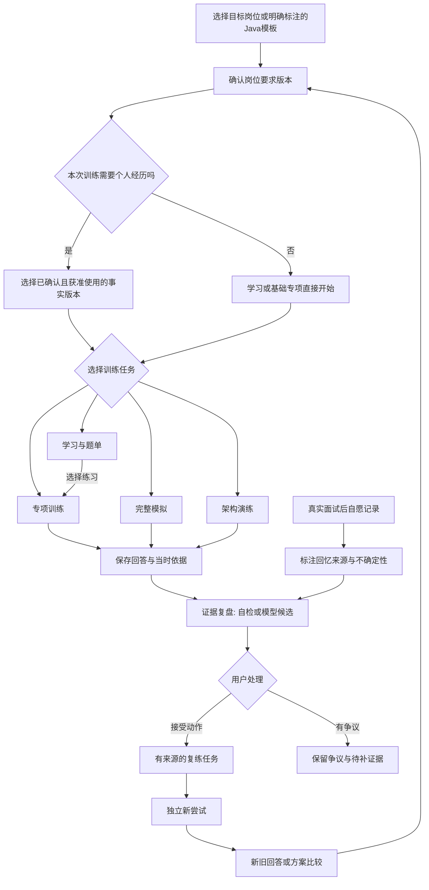
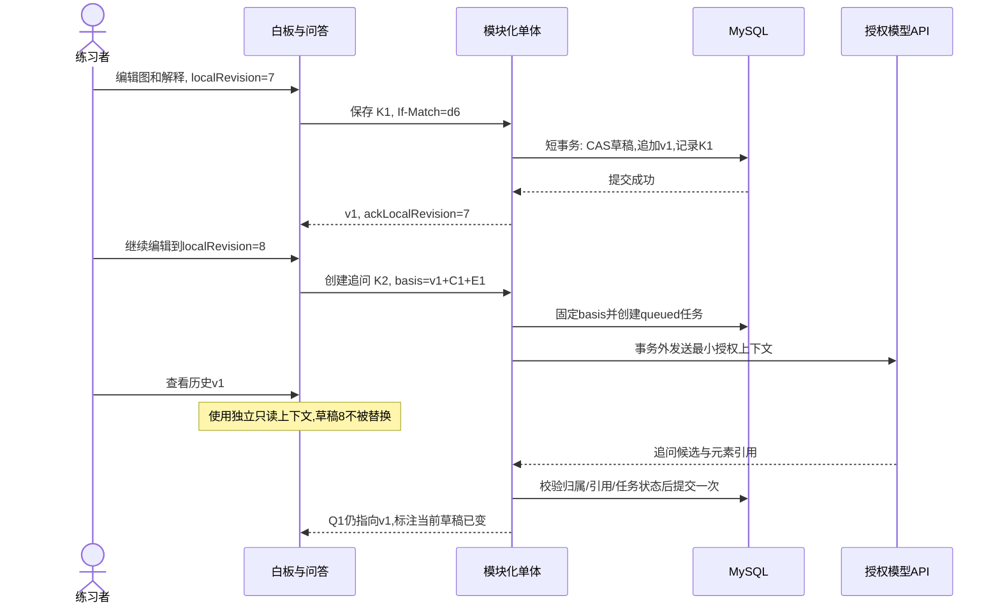
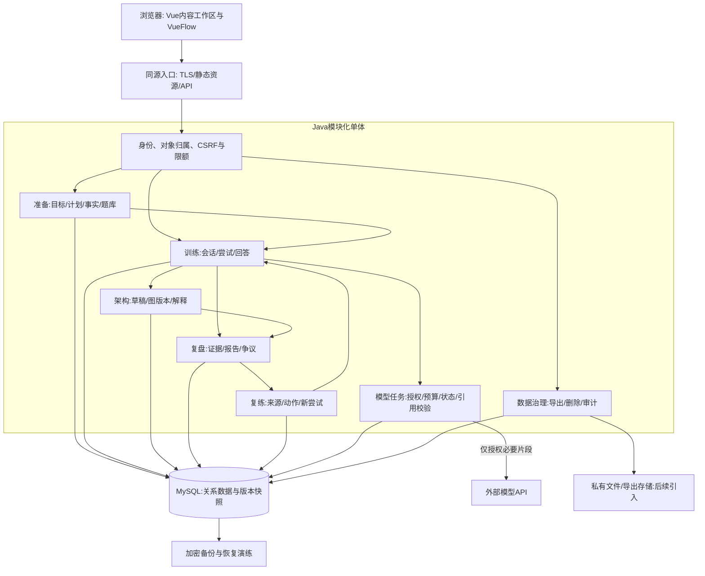
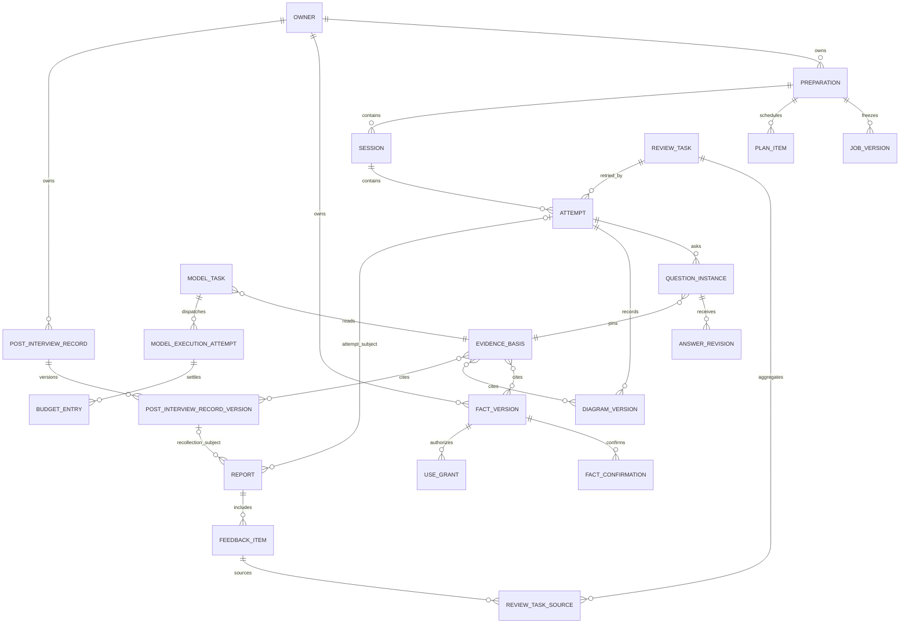
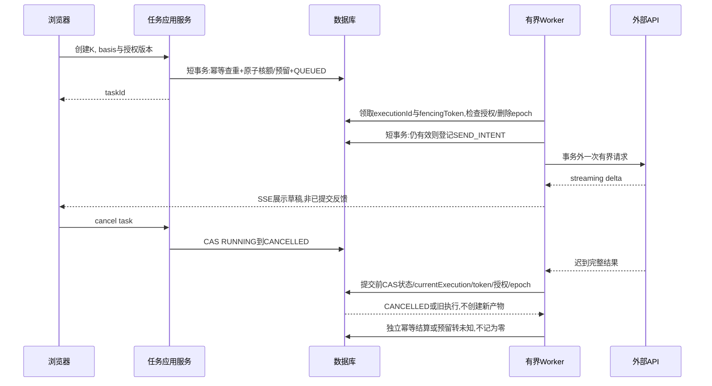

# 实施方案

> **问阶 · Interview Studio｜研究驱动的系统设计与 UI 风格提案**  
> 核对日期：2026-11-03。当前阶段：产品讨论、系统设计与初版原型，未正式开工。  
> **交付状态：未完成（系统设计可审阅；视觉补证未完成，原保存版工作流内置校验未完成），另有用户决定待确认；不可直接交给 task-run。**  
> 本文中的模块、对象、接口和检查均为目标设计，不是已实现能力。现有 UI、原型、文档及用户数据保持不变。认可本文或选择风格不授权正式开发、模型费用、真实材料外发或部署。

## 阅读入口与交付边界

本文是唯一主方案入口：先说明研究及产品设计，再展开 UI、白板、技术、数据、接口、授权和验收，**最后给分阶段路线**。附件用于核对证据，不另设重复 PRD、UI 规范或开发方案。

| 支持材料 | 用途与可信边界 |
|---|---|
| [原始需求与保存版参数](.zcode/task-plans/a76faee2850b20a802ca475d8c4c6c64283d43fa11a81f54695964ad82868ce5/input.json) | 保留完整需求、standard、allowShell=false、中文及执行限制；不是批准记录 |
| [接手记录](.zcode/task-plans/a76faee2850b20a802ca475d8c4c6c64283d43fa11a81f54695964ad82868ce5/supports/handoff/handoff-status.md) | 原运行因进程退出中断；用户授权无法恢复时接手；不伪造原工作流通过状态 |
| [市场补充研究](.zcode/task-plans/a76faee2850b20a802ca475d8c4c6c64283d43fa11a81f54695964ad82868ce5/supports/a6-takeover/research.md)／[既有学习与组织证据A5](.zcode/task-plans/a76faee2850b20a802ca475d8c4c6c64283d43fa11a81f54695964ad82868ce5/analysis/A5-confirmed-9c2fce747748c837e176ed13d0d1d72b745b47978732f0df93bf4cbc98407554.json) | A6接手模拟／复盘闭环；A5复用岗位、学习、知识和手记研究；官方说明不等于账号内实测，confirmed文件名不等于整体批准 |
| [开源实现与许可证据](.zcode/task-plans/a76faee2850b20a802ca475d8c4c6c64283d43fa11a81f54695964ad82868ce5/supports/handoff/opensource.md) | 固定版本、实际模块、采用成本；不因公开可读而默认可复制 |
| [技术与模型授权证据](.zcode/task-plans/a76faee2850b20a802ca475d8c4c6c64283d43fa11a81f54695964ad82868ce5/supports/handoff/technology.md) | 官方兼容要求、API 与数据政策；本项目没有安装版本 |
| [四种 UI 风格研究](.zcode/task-plans/a76faee2850b20a802ca475d8c4c6c64283d43fa11a81f54695964ad82868ce5/supports/handoff/ui-research.md)／[同场景静态对照](.zcode/task-plans/a76faee2850b20a802ca475d8c4c6c64283d43fa11a81f54695964ad82868ce5/supports/handoff/ui-comparison.html) | 新建支持材料，不替换业务页面；未渲染核验，不是完成的视觉稿或交互验收 |
| [本次真实验证记录](.zcode/task-plans/a76faee2850b20a802ca475d8c4c6c64283d43fa11a81f54695964ad82868ce5/supports/handoff/verification.md)／[接手独立评审](.zcode/task-plans/a76faee2850b20a802ca475d8c4c6c64283d43fa11a81f54695964ad82868ce5/supports/handoff/independent-review.md) | 与原工作流内置门禁分开，按实际输出记录；不冒称UI、应用或开工通过 |

本轮允许：只读工作区与公开资料、研究分析、新建本次方案和必要支持材料。禁止：task-run、正式工程、DDL、依赖安装、项目构建／测试／服务／部署、修改旧资料、读旧项目凭据、提交推送、上传私有内容。后续验收设计不表示本轮执行了验收。

---

## 1. 现状、定位与成功标准

### 1.1 已有基线与证据

已按 README → PROJECT_STATUS → docs 产品／UI／流程／调研／开发边界／验证 → prototype 核对，采用当前未提交工作区内容，不回退已有改动。

| 项目 | 当前事实 | 依据 |
|---|---|---|
| 产品阶段 | 有设计文档、离线原型和独立白板预览；无正式前后端、数据库、实时模型、语音、自由图编辑 | `README.md:27–31`，`PROJECT_STATUS.md:7–9` |
| 原型问答 | 固定题目、追问及反馈，不因回答实时推理 | `prototype/app.js:47–90`，`docs/06-validation.md:24–30` |
| 原型数据 | 浏览器本地状态，材料确认是布尔值；题目 ID 下原位保存回答与复练笔记 | `prototype/app.js:99–111`，`docs/05-development.md:63–70` |
| 图与历史 | 初版／修订版为预置展示；当前内容复盘不能证明不可变历史 | `prototype/index.html:135–145`，`docs/06-validation.md:68–71` |
| 验收 | 完整浏览器视觉、八视图多宽度和问答／白板完整链路未通过 | `docs/06-validation.md:45–64` |

这些是原型取舍，**不作为本轮修复旧原型的 bug**。HTTP 200、语法／静态检查、几何布局与独立预览都不代表实际视觉、自由图编辑或可靠保存通过。

原保存版任务已启动并完成部分调查，后因宿主进程退出中断。用户随后授权无法恢复时由主代理接手。本次正文及补证由接手完成，独立评审、文档检查与原工作流内置发布门禁分开披露；不修改旧合同或检查点“补通过”。

### 1.2 产品定位

**面试前准备与面试后复盘工作台**：围绕目标岗位，把可核对的个人事实、学习与训练、回答与图版本、有依据的复盘和针对性复练连成同一段准备流程。

起步用户：准备 Java 后端岗位、需要把知识、项目参与边界与系统设计表达讲清楚的求职者。角色模板、题型、能力标签和评价维度保留扩展，不把 Java 名称写死在会话或数据结构里。

核心价值不在“答得快”或“题目多”，而在：**知道下一步练什么；回答基于真实边界；反馈可回到证据；复练可看见改进。**

### 1.3 设计原则与非目标

1. 基础训练可直接开始，完整简历不是门票；个性化经历训练才检查事实版本和授权。
2. 学习、专项、完整模拟、架构演练各有适合任务的工作区，共享底层记录而不是共用一个万能聊天框。
3. 用户先答；提示分层；解析、自检、模型候选和用户结论分开。
4. 反馈可解释、可争议、可复练；开放问题不制造精确分数、录用率或标准答案幻觉。
5. 普通编辑只生成新版本；已发生的回答与引用不倒改。用户主动删除是另一个受控流程，不用“不可变”拒绝删除权。
6. 默认简单可靠：文字闭环、模块化单体和事务数据库优先；模型是可停用能力，不是保存链路的前提。
7. UI 与完整任务体验是质量主体；界面数量、代码行数、API 数量或 AI 生成比例不是质量指标。

排除：正式面试暗中代答、隐身辅助、监考规避；招聘爬取、自动投递、公共社区运营；薪资／录用预测；真人教练撮合；完整简历排版平台；首期在线执行代码、微服务和多 Agent 自主行动。

### 1.4 可观察的成功

- 无简历用户能完成一次基础训练；带材料用户能明确哪些事实被用于哪次训练。
- 服务重启后仍能读到已确认保存的回答及引用；失败或冲突时没有无声覆盖。
- 每条反馈有可打开的原回答、约束、事实或图版本；引用缺失时显示不足而非生成假依据。
- 一条反馈能变成一个清晰动作、一次新尝试和新旧对照，而非只勾“完成”。
- 用户能解释外发范围、费用边界、导出及删除影响。上述均为待实施验收目标，尚无用户研究或产品效果实测。

## 2. 研究结论与功能融合

### 2.1 方法与证据等级

先复用已有 `docs/04-research.md` 与已落盘调查，再补缺，不重复堆同类来源。广筛覆盖国内外岗位组织、材料编辑、学习路线、专项、模拟、编程／系统设计及复练；代表样本按“能解释一种成熟任务模式”精选，不按热度排名。

本文使用四类表述：**O 官方明确说明**；**S 固定版本源码可确认**；**D 面向问阶的设计推断**；**U 未验证**。O 不等于用过产品，S 不等于运行兼容，D 不等于市场验证。来源核对日期为 2026-11-03，详细 URL、版本与限制见附件。营销准确率、录用率、star、最近推送不作质量证据。

### 2.2 产品筛选与代表模式

广筛入口包括 Teal、Huntr、Jobscan、Yoodli、Big Interview、interviewing.io、Exponent、面试鸭，补充技术训练和证据复盘相关产品。筛选结果分为以下任务谱系；不为名单覆盖而复制每个功能。

| 深读样本／定位 | 核心任务、功能组织与关键旅程 | 可借鉴模式 → 问阶融合 | 不适配与限制 |
|---|---|---|---|
| Teal：岗位／材料组织 | 岗位条目承载轮次、准备清单和笔记；简历修改可选当前或同步其他简历；岗位→轮次／笔记→准备 | 目标是轻量准备容器，轮次＋可编辑计划；问阶另外自建不可变材料版本，不把跨简历同步当历史能力 | 不做全量投递CRM、自动指标编造；版本回滚未证实，没有账号内走查。O：[轮次清单](https://help.tealhq.com/en/articles/9530138-job-tracker-interviewing)、[岗位笔记](https://help.tealhq.com/en/articles/9530145-job-tracker-taking-notes)、[材料修改](https://help.tealhq.com/en/articles/9457698-making-changes-across-resumes) |
| Huntr：求职组织 | JD／简历生成准备问题，岗位看板与导出；岗位→准备问题→整理 | 题目候选带岗位原文依据；数据出口是核心能力 | 生成内容不是个人事实；公开导出说明不证明全部资产恢复。O：[准备问题](https://help.huntr.co/en/articles/10697703-ai-interview-questions)、[导出](https://help.huntr.co/en/articles/11757717-download-export-your-board) |
| Big Interview：教学＋表达＋模拟 | 方法课、故事组织、Answer Builder、专项录制及模拟反馈；先学方法→整理自己的故事→专项→模拟 | 区分“学会”“练一项”“完整模拟”；STAR 是表达视图，不生成新经历 | 录制／表达指标不等于技术正确性；不照搬机构课程或视频内容。O：[学习](https://www.biginterview.com/platform/learn-to-interview)、[练习](https://www.biginterview.com/platform/practice-with-interview-simulator) |
| 面试鸭：中文技术题库＋AI训练 | 技术／岗位／公司／题型、路线、综合与专项；选目标→题单／专项→模拟 | Java 知识、场景、项目、自我介绍、行为／HR分层；题目与能力标签贯通 | 商业题库、企业标签不复刻；公司分类不表示企业必考。O：[题库](https://www.mianshiya.com/)、[AI入口](https://ai.mianshiya.com/) |
| Jobscan：岗位定制模拟 | 公开说明配置模拟、时长／答题限制、自定义问题、回答回看与历史；配置→作答→回看 | 模拟开始前确认范围和计时；内容与表达反馈分栏 | 不采用 ATS 分数替代准备质量；真实恢复、历史比较、导出范围须逐项核对。O：[产品页](https://www.jobscan.co/ai-interview-practice) |
| Yoodli：角色扮演与表达训练 | 岗位／行为场景、基于回答追问、结构／表达反馈和练习建议；角色→对话→回看 | 上一轮回答影响追问；建议要成为用户可接受的改进动作 | 流畅度不代表知识和事实正确；不同套餐训练数据政策不能混用。O：[面试准备](https://yoodli.ai/use-cases/interview-preparation)；详细隐私核对见市场附件 |
| interviewing.io：技术模拟 | 真人技术模拟与公开 AI coding／system-design 入口、学习指南；真人预约→语音／编程→反馈；AI具体交互未验证 | 训练过程与设计取舍比最终答案重要；系统设计需要约束和解释 | 真人撮合、匿名匹配、题目与教练网络不纳入主线；未登录功能保持U。O：[官网](https://interviewing.io/)、[系统设计指南](https://interviewing.io/guides/system-design-interview/part-three) |
| Hello Interview：引导训练＋完整系统设计模拟 | Guided分阶段任务与Live完整演练分开；Live公开说明35分钟口述、共享白板、追问及音频／转写／图同步回放 | 明确训练／模拟反馈时机，评论定位具体产物；问阶先以回答与图版本定位，不前置音频同步 | 不照搬录用评级或置信分；Live说明不能扩成所有题型，恢复／跳题／版本比较未验证。O：[Live](https://www.hellointerview.com/live)、[Guided](https://www.hellointerview.com/practice/overview) |
| roadmap.sh：岗位／技能学习路线 | 角色路线与技能专题分层，后端／Java路径关联分级项目；选路线→学习主题→项目实践 | M4按岗位路线和技能专题两层组织，知识学习链接到场景／项目练习 | 文字入口未展开完整图节点、掌握状态或个性计划保存；不复制路线图／项目内容，不用题量表示能力。O：[Backend](https://roadmap.sh/backend)、[Java](https://roadmap.sh/java)、[项目](https://roadmap.sh/backend/projects) |
| RemNote：笔记与回忆练习 | 结构化笔记→不同卡型→先回忆再展开→按文档／到期练习；引用／反链返回来源，考试日期影响安排 | M4笔记可转练习并保出处；M9先手工动作，后评估间隔调度；知识记忆与开放回答评价分开 | 活引用会随目标文字更新，不符合问阶历史快照；导出有媒体缺口，考试调度不等于面试准备效果。O：[卡片](https://help.remnote.com/en/articles/6025481-creating-flashcards)、[引用](https://help.remnote.com/en/articles/6030714-references)、[练习入口](https://help.remnote.com/en/articles/7925835-the-flashcard-home) |
| Notion：关联式知识／项目工作台 | 数据库页面关联，单／双向关系显式配置，按相关属性汇总；建条目→关联来源→从不同视图查看 | 岗位、材料、训练、报告与行动由关系连贯，不为每种任务复制数据；汇总只作可追溯观察 | 通用关系不自动提供事实确认和不可变证据；CSV关系变URL且不能据此重建，不以导出代替备份。O：[关系](https://www.notion.com/help/relations-and-rollups)、[导出](https://www.notion.com/help/export-your-content) |

以上学习／知识样本复用保存的A5实读证据，不另做重复网页采集；公开帮助未授予课程、题目、模板或界面素材采用许可。Exponent 为高相关候选，但本轮官网与practice页403，不能写成当前功能已核实。国内补筛牛客AI面试，可确认专项／题卷入口，不把它当完整闭环已深读。模拟控制／数据政策逐项证据见市场附件：Jobscan的跳过／提前结束不证明暂停恢复；Yoodli的删除录制不必然删除分析；Hello Interview一般语音条款与模拟录音删除清单适用边界未明确，不据此承诺不留音频。Final Round AI仅将面试前后任务作为旁证，实时代答、隐身功能明确剔除。没有访谈、留存和付费意愿数据，不能以竞品存在推断市场规模或问阶已经验证产品匹配。

### 2.3 成熟模式 → 融合取舍

| 成熟模式 | 问阶设计 | 优先级／成本 | 现在加入或后置的理由 |
|---|---|---|---|
| 目标容器＋准备清单 | 岗位版本、轮次、一个下一步、可编辑计划 | P0，低；手工为主，无外部授权 | 直接连接主旅程；不做复杂智能排程 |
| 事实→故事→练习 | 事实库、责任边界、STAR／长短表达、笔记素材 | P0事实／P1表达，中；隐私与授权成本高于页面成本 | 防止编经历；PDF排版后置，不复制简历工具全套 |
| 教学／专项／完整模拟分离 | 学习资源和题单、单技能练习、可配置完整模拟 | P0最小专项，P1丰富模式，中；题目审核持续运营 | 用户任务不同，不用聊天页替代学习路线 |
| 过程证据复盘 | 回答段落／图节点定位、争议、不足说明、动作候选 | P0，中高；证据与版本成本是核心 | 是问阶差异化，不先做综合分 |
| 反馈→独立再试 | 多来源复练、改进动作、原尝试与新尝试比较 | P0，中；无公共运营 | 闭环必须首期成立，间隔算法后置 |
| 真实面试后记录 | 用户自愿手工回忆、来源与不确定性、关联岗位／轮次 | P1轻量，低中；企业资料与第三方隐私需提示 | 与复盘天然相连，不能冒充逐字转录；录音另审 |
| 技术练习过程 | 场景题、代码阅读／解释、系统设计画布 | P1代码解释／P2自由画布，中高 | 无代码沙箱也可练推理；执行环境只有明确需要再评估 |
| 语音表达 | ASR／TTS、转写修订、文字退路 | P3，高；费用、地区、录音同意与留存成本高 | 不阻塞文字／证据／保存闭环 |

其中计划、故事、笔记和面试后记录已经出现在旧产品范围，本次是明确入口、对象和分期，**不是凭空新增的需求**。本表P0／P1／P2／P3表示功能优先级，末尾P1–P4是交付阶段，二者不能机械等同。

新增复杂度主要来自数据与运营，不是导航数量：M5拆分与M8／M9拆分增加状态和来源维护但不增加账号／存储系统；题目路线需要持续审核、纠错和许可证台账，首期用小批自拟内容验证；模型引入按实际tokens、请求与供应商留存计费，语音另按音频处理与存储计费；文件解析、录音、社区或真人服务的授权与运营成本高，因此不塞入首期。自托管仍有计算、数据库、备份、TLS、出站和维护成本，“开源免费”不代表总成本为零。

### 2.4 开源研究与采用策略

开源只借鉴实现与许可允许的能力，不整体迁移旧项目，不读旧私有凭据，不运行第三方脚本。

| 候选／固定核对版本 | 实际实现与成熟模式（S，限定已读范围） | 采用、适配成本与必须自研部分（D） |
|---|---|---|
| Vue Flow：`v1.48.2` → `52a030124876245ddc7e32e30445ba506246503d`，MIT | `packages/core/src/store/actions.ts` 的 `applyNodeChanges/applyEdgeChanges/removeNodes/toObject`；Vue peer `^3.3.0`。删除关联边与删除子节点不是同一个默认策略，导出JSON没有持久化调用 | 唯一推荐的画布依赖候选，基础集成中、业务版本中高。领域命令、分组删除原子性、撤销、保存冲突、不可变快照、证据与复练自研；已核changes为原位数组／对象更新，不是命令日志，`createGraphEdges`建边内部与依赖全量仍有未核项 |
| Reactive Resume：`ee0f22e961f7b63f8cf1f6b964e6b16bc5165418`，MIT | `packages/resume/src/proposals.ts` 的 `getProposalState/applyResumeProposals`、Web `proposal-list.tsx`：原文／建议／原因分开，应用前核基线，实际applied才记接受；应用schema区分当前和已发送版本 | 优先借鉴审阅协议，局部中、整库高。React／Node／PostgreSQL不能直接嵌入Vue／Java；事实真实性、责任边界、版本确认、外发许可与证据链仍自研，不把接受润色当事实认证 |
| JobSync：`8c20325c35dbf203334a270cef5aef446f06a774`，MIT | `prisma/schema.prisma` 的 `Job/JobStage/JobStagePrepQuestion`、`src/actions/jobStage/prep.ts` 归属校验、`addJob.ts` 批准；`matchJob/reviewResume` 不共享同样批准门槛，结果有覆盖保存 | 借鉴岗位—材料—轮次准备题容器，局部中、整库高。Next／Prisma／PostgreSQL另栈；不搬CRM／爬取／投递。岗位与答案版本关联、统一授权、报告与复练自研；下游事务及并发幂等未证实 |
| Liftoff：`550e4bf74eab1b329dcb64830ed6172063f34d27`，MIT | `pages/demo.tsx` 可见前段→`pages/api/transcribe.ts`→`generate.ts`→`utils/OpenAIStream.ts`：固定题、一次录音、Whisper转写、当前题与回答的流式反馈，**不是动态多轮引擎** | 只借鉴处理阶段，参考低、生产改造高；2023年Next13／旧SDK快照，不直接引入。125KB前端响应截断未全读；媒体／FFmpeg构建许可另核。可靠保存、授权、取消预算及证据报告自研 |
| System Design Primer：`ae9bbd7b02d90b9866215de185217d33f39ab733`，CC BY 4.0 | `README.md:182–285` 与 `solutions/system_design/pastebin/README.md:7–117` 的需求→假设→高层→细化→权衡，**不是白板应用** | 仅参考内容结构；若改编许可覆盖部分，保留署名、来源／许可及修改说明。图片、引文、外链和包内媒体另核；首批Java题自主编写 |

主样本四个均有固定源码链，但深度不等同全量审计；Primer为内容许可补充。OpenResume／ts-fsrs保留旧研究、不再扩研：OpenResume的AGPL不作为当前默认代码复用；一个调度库不构成引入独立Node服务的理由。固定SHA＋路径／函数与可靠行号、提交日期、技术栈、许可证原文URL及实际缺口见开源附件（核对2026-11-03）。

软件代码、文档题目、图片／音视频、人像声音、品牌商标、字体及第三方依赖分别准入；MIT仍需保留版权许可，AGPL的网络服务源码义务另审，内容许可不自动覆盖第三方资产。未安装、运行、复制上游代码或媒体；未完成锁文件、安全公告、CI、发布物、依赖组合与浏览器验证。package版本／未归档／最近推送只说明定位或元数据，不证明维护SLA、安全或可直接部署。真正采用前逐模块记录来源、固定SHA、作者、许可、修改与允许用途，权利不明只留链接。

## 3. 功能版图与模块组织

### 3.1 推荐信息架构

**五组主导航＋辅助设置，十个职责块**；十不是最终数量限制，也不意味着十个后端服务。高频入口可固定“专项”“模拟”“架构”，不把画布藏入聊天标签。

| 导航组 | 职责块 | 用户看到的任务 |
|---|---|---|
| 准备 | M1准备与计划、M2目标与轮次 | 当前目标、继续上次、下一步及岗位资料 |
| 材料与素材 | M3事实与表达 | 项目、简历摘要、个人故事、来源与使用范围 |
| 学习 | M4知识与题库 | 主题、路线、题单、笔记、知识点和单题入口 |
| 训练 | M5专项、M6完整模拟、M7架构演练 | 按任务选择工作区，共享会话和尝试底座 |
| 复盘 | M8证据复盘与历史、M9复练行动 | 回看原记录、处理争议、开始针对性再试 |
| 辅助区 | M10模型与数据 | 模型授权／预算、保存状态、导出删除与隐私 |

不同岗位扩展采用版本化 `RoleTemplate`（岗位族／能力树）、`TrainingTemplate`（题型／阶段／计时策略）及 `RubricVersion`（检查维度／适用范围／限制）。Java后端只是首批内容模板；新岗位可增加题目与规则而不新建另一套会话／报告。模板升级只影响新建训练，不能自动重算旧反馈；在尚无有效评价依据的岗位，只提供自检／待核实，不复用Java量表给精确分数。

### 3.2 与现有八模块的覆盖映射

| 原模块 | 调整 | 原核心任务去向 |
|---|---|---|
| 准备空间 | 扩展为M1，不变成统计仪表盘 | 当前目标、继续练习、复练入口；补可编辑计划和“为什么现在练” |
| 目标岗位 | M2扩展轮次与轻量阶段 | JD、版本、要求和关联；保留归档而非自动投递CRM |
| 个人材料 | M3更名“事实与表达” | 摘要、项目、STAR保留；增加故事／素材视图，不提升未经确认事实 |
| 题库与练习 | 拆分M4学习资源与M5专项任务 | 搜题／题单／笔记与一次作答生命周期分开 |
| 模拟面试 | M6专注完整模拟；单技能移M5 | 连续追问、计时、暂停／恢复、总结均保留 |
| 架构演练 | M7独立专用工作区 | 图、约束、解释、追问、版本和复盘保留，接共享证据 |
| 复盘与复练 | 拆为M8审阅与M9行动 | 历史报告与新的练习任务生命周期分开，多来源不丢 |
| 模型与数据 | M10继续辅助域 | 授权API、预算、失败退路、数据出口与密钥边界 |

无需额外主模块的增强：面试后记录属于M8；准备计划属于M1；素材笔记属于M3或M4并区分个人经历与公共知识；间隔调度属于M9后续增强；代码阅读属于M5题型。多人协作、公共社区、招聘运营和沙箱不前置。

### 3.3 模块职责、输入输出、流程与异常

| 模块 | 输入→主要功能→输出 | 关键流程及异常状态 |
|---|---|---|
| M1准备与计划 | 目标／期限、未完成尝试、复练来源→手工优先级与推荐理由→可执行下一步 | 恢复未完尝试优先；允许直接练弱项。无目标可用Java模板；无记录显示“开始基础训练”，不造统计；计划逾期可顺延，不自动改历史 |
| M2目标与轮次 | 手工JD／来源、阶段、轮次时间→要求确认与版本→JobVersion及上下文 | AI提取只是候选，回链JD范围，用户修正后确认；切目标只影响新任务；归档不删历史；时区明确，重复轮次不自动合并 |
| M3事实与表达 | 手工事实、可选授权导入→版本、责任边界、确认、表达建议→FactVersion/Grant/Story | 本人负责／参与了解／待核实是责任标签，确认是另一个状态；编辑产生新版本并需重确认。AI建议接受／拒绝可追溯，不自动扩大职责；上传解析失败保留原文入口 |
| M4知识与题库 | 自拟／授权题、标签、资源→搜索、题单、路线、收藏笔记、分层提示→题版本与学习记录 | 学习可不生成训练会话；看解析不算完成作答；内容纠错生成新题版本。无搜索结果提供自建题；过期许可停止新使用但保留必要来源说明 |
| M5专项训练 | 题版本／技能目标、可选确认事实→单题、限时、项目深挖、行为／HR、代码解释→Attempt/AnswerRevision | 先答再看；回答、提示使用和用户自评分开；失败保草稿；用户可跳过／结束并注明原因，不把空答评价成错误事实 |
| M6完整模拟 | 岗位／轮次、题型比例、训练或计时模式、范围与授权→多轮流程→轮次清单及报告 | 开始前确认上下文、时长和费用；暂停时锁定剩余时间；刷新从服务端状态恢复；模型故障允许转手工题继续。模式切换产生记录，不暗改已用时间 |
| M7架构演练 | 题约束、假设、估算、API／模型设计、图与解释→语义编辑和版本追问→DiagramVersion/Turn | 草稿／历史分离，先可靠保存再基于该版本追问；冲突不覆盖；窄屏切语义列表。完整细节见第6节 |
| M8证据复盘与历史 | 原始问答／事实／图版本、自检／模型候选、可选面后回忆版本→引用审阅、争议与比较→Report/Feedback/Action候选 | 报告subject严格二选一：训练Attempt或回忆版本；缺依据显示“不足以判断”；争议不自动删除反馈；重生成新报告版本，不覆旧；回忆标“手工回忆，非逐字记录”，不自动认证材料或伪造训练记录 |
| M9复练行动 | 反馈来源集合、用户接受的动作→同题重答／变式／补知识、独立尝试→新旧对照与处理记录 | 同反馈＋动作重复添加返回原任务；同题不同反馈可归入同任务但新增来源，或用户拆分；一次完成只处理对应来源，不自动清空同题所有弱项 |
| M10模型与数据 | 授权范围、模型配置、预算、所有权→最小外发、任务状态、导出删除→可审阅记录与数据出口 | 模型关闭不影响已有内容；连接失败不收取假费用，不显示已保存；秘密服务端管理，导出排除；删除前预览影响，过程见第11节 |

## 4. 用户旅程与业务闭环

### 4.1 主旅程与材料可选分支



基础训练从模板建立可追踪的准备上下文，而非强制用户填写虚假JD；模板不是目标企业预测。学习完成记录不自动变成面试表现。

### 4.2 首条端到端链路

合成岗位“Java后端·营销交易”→确认事实“负责预算接口；发奖服务仅参与了解”→选择项目专项→回答“发奖超时后先查单，不能直接补发”→保存回答修订r1及事实v1→自检标出未解释的状态竞争→接受“补充查单与回调并发的条件更新”→创建复练任务及来源→新尝试r2→并排看原文、反馈和改进动作。

首期不接模型也能走完：明确显示自检清单／参考要点，不伪装实时AI评价。待授权模型接入后，在同一记录结构中添加模型候选，不替换原始回答。P1的下一步仅由未完成尝试／已确认复练动作产生；完整可编辑手工计划和面后回忆统一放P2，不留“如果有空就前置”的隐含范围。

P2面后分支：用户自愿回忆→保存`PostInterviewRecordVersion`并标来源／不确定性→以该确切版本为复盘subject创建自检或获准模型候选→反馈定位回忆段落→接受改进动作→**新建训练Session／Attempt**练习并保留回忆来源。不伪造一次已发生的训练Attempt，不把回忆里的面试官原话／企业题目当验证事实；修改回忆产生新版本，旧报告不跟随改写。

### 4.3 恢复与计时的产品规则

- 一次会话可包含多个独立 Attempt，但共享其不可变SessionContext；复练若要使用新的JD／事实／量表版本，必须建立新Session并关联原Attempt，不能原位更新旧context。每个问题实例固定题干和来源，回答可有多次修订，提交后的修订只追加。
- 训练模式允许提示／回看；计时模拟说明计时规则和提示影响，不禁止用户退出。计时使用服务端 `startedAt/pausedAt/accumulatedActiveMs`，客户端仅显示；关闭页面不自动暂停，重新进入展示真实剩余时间及可选结束。
- 暂停是显式状态迁移；模型等待时间是否计入须在模式模板中声明，推荐面试计时扣除系统故障等待并记录，正常思考时间计入。
- 刷新恢复读取服务端已确认状态；本地未同步草稿提示合并，不直接覆盖。断网期间继续输入但不显示已持久保存。
- `FINISH`只锁定当前Attempt的问题／答案／图版本最终清单，不关闭或改写SessionContext；Session是固定上下文容器，可另行归档以禁止新Attempt。**每轮依据从创建时已固定**，不能等Attempt结束才冻结。
- 问题状态区分PENDING、ANSWERING、ANSWERED、SKIPPED、UNANSWERED。`SKIP`必须指定questionInstanceId及原因，保留原草稿／已提交修订，不伪造空回答；Attempt仍ACTIVE时可通过显式`RETURN_TO_QUESTION`返回SKIPPED或ANSWERED问题继续作答并追加修订，保留跳过／提示／计时记录。完整模拟返回旧题不重置计时，也不自动重发已生成的追问；只允许推进到尚无实例的下一题。FINISH时无任何提交修订的PENDING／ANSWERING标UNANSWERED；若ANSWERING已有先前提交，则最终仍为ANSWERED并指向该修订，未提交新草稿单列提示且不冒充已答。SKIPPED保留跳过状态及历史修订，ANSWERED指向最终提交修订；结束后不能返回编辑，只能新Attempt。暂停时可读草稿但不提交／跳题，先恢复再操作。

## 5. 四种 UI 候选与公平选择

### 5.1 同一内容、同一任务比较

比较场景固定：Java后端营销交易目标；3条已确认事实／1条待核实；继续“发奖超时结果未知”的训练；上次回答“超时就补发”存在待解释项；同一张扫码→资格→预算→发奖、状态存储→查单的图。三类工作区均比较：**准备空间、文字模拟、架构白板**，不拿营销首页对比复杂后台。

[静态对照材料](.zcode/task-plans/a76faee2850b20a802ca475d8c4c6c64283d43fa11a81f54695964ad82868ce5/supports/handoff/ui-comparison.html)为四列×三场景的原创结构示意，内联HTML/CSS/SVG，无脚本或外部资源，不是正式业务页面。当前未完成渲染和审美／交互验证，不称“视觉稿已完成”。旧Lapa入口截图已由UI研究代理实际查看，存在拼接／裁切，只支持入口页局部观察，不支持具体工作台结论。当前会话未暴露官方浏览器runtime入口，因此没有新拍参考截图或渲染比较板，不借shell绕过。

已从[Refero入口](https://styles.refero.design/?utm_source=openai&q=auth)定位[Warp条目](https://styles.refero.design/style/d4c51049-58eb-404a-9fcb-f195928b1c99)与[Prisma条目](https://styles.refero.design/style/8e9e585f-5ad4-4273-8418-e1f82cdb51cf)，不局限auth；从[Lapa入口](https://www.lapa.ninja/?utm_source=openai)定位[Craft案例](https://www.lapa.ninja/post/craft-do-4/)与[Linear案例](https://www.lapa.ninja/post/linear-5/)，再追到下表官方具体内容页。第三方条目中的强调色／按钮描述存在矛盾，不作官方token标准。可迁移材质、字阶和信息层级，不迁移hero、营销卡墙、装饰动画或过度留白；没有实际产品screen证据的分屏／停靠布局均是问阶设计推断。

### 5.2 候选设计系统

以下值为设计起点，不是已测对比度或验收通过值。具体来源与迁移判断见UI附件。

| 维度 | A 纸感编辑式 · 推荐 | B 紧凑工程台 | C 引导式训练室 | D 画布优先研究台 |
|---|---|---|---|---|
| 一句话定位 | 像认真整理资料和练习的专业工作台 | 像IDE，信息密、切换快、键盘友好 | 像训练课程，一次聚焦一个明确步骤 | 像系统设计工具，空间与版本优先 |
| 参考页面及借鉴 | [Craft写作](https://www.craft.do/write)、[文档／页／块](https://support.craft.do/hc/en-us/articles/360019555537-Documents-Pages-and-Blocks)：正文层级与渐进展开；证据抽屉是问阶设计，不称实际看过其内部screen | [Linear显示选项](https://linear.app/docs/display-options.md)：分组、属性显隐和偏好；Warp仅作第三方材质参考。分屏和紧凑密度是问阶设计推断 | [Brilliant学习路径](https://brilliant.org/help/features/what-are-learning-paths/)：建议顺序与检查点；复练卡和可跳步骤自研，不推断游戏机制或参考产品界面外观 | [Eraser图表代码](https://docs.eraser.io/docs/diagram-as-code)：图与文字有明确语义、布局与自由绘图分工；停靠面板、版本和回放是问阶设计责任 |
| 色彩角色 | 纸底#F6F3EC、正文面#FFFEFA、墨蓝#172E3D、青绿#176B61动作、雾蓝#EAF1F4证据层 | 冷白#F2F4F7、石墨#202B3B、蓝#315BCB动作、灰蓝#E9EDF4辅助，细线分栏 | 浅灰绿#F3F6F1、深绿灰#26372E、绿#2F6B4A动作、琥珀#FFF3D8提示；进度不只靠色 | 研究底#EEF2F4、画布#FCFDFD、蓝灰#223747、深青蓝#146D82焦点；语义用形状／文字区分 |
| 中英文排版 | 中文／英文系统无衬线16px/1.75；品牌／短标题可克制系统衬线，中文正文不混装饰衬线 | 中文／英文UI系统sans 15px/1.6、标签13px；只有代码／请求号／快捷键等宽 | 中文／英文系统sans 16px/1.75、步骤标题20/24px；序号不是能力分 | 面板正文15px/1.6、工具13–14px、节点14–15px；ID等宽，缩放后有列表替代 |
| 间距／形态 | 4/8/16/24/32px，输入圆角6px、面板10px；1.5px线性图标配标签，无纹理、阴影只给浮层 | 4/8/12/16px，圆角4/6px；线性图标、细边界、无玻璃材质 | 8/16/24/32px，步骤面板圆角10px、复练卡14px；步骤号与选项分层，无勋章或装饰插画 | 4/8/12/16/24px，节点圆角4px、面板8px；低干扰点阵、细线工具、浮层微阴影 |
| 导航／密度／动作 | 左侧五组导航＋正文＋按需证据抽屉，中密度，一屏一个主动作 | 窄导航＋可调整索引／编辑／检查器，高密度，主动作固定页头 | 导航弱化，阶段条＋单主列，低中密度，下一步按钮固定当前步骤 | 全局导航可收起，工具轨＋主画布＋停靠面板，主动作区分保存与追问 |

不默认远程加载字体：首期系统字体，后续自托管字体需单独许可证与体积审查。所有方案正文最低可读字号、焦点、选中、警告和保存状态采用同一可用性底线。以[WCAG2.2](https://www.w3.org/TR/WCAG22/)为核验参考：普通正文对比度4.5:1、大字与关键非文字边界3:1；焦点清晰、操作不只靠颜色、触达至少满足相应条款并优先44px触控区域；这些是验收目标，尚未测量或取得全站无障碍符合性结论。

### 5.3 三场景应用与异常

| 风格 | 准备空间 | 文字模拟 | 架构白板 | 长文／空错状态／窄屏 | 优点、风险与实现成本 |
|---|---|---|---|---|---|
| A | 目标摘要＋一个继续动作＋最近原文／复练，不用卡片墙 | 问题与作答主列，事实／证据右抽屉，历史在左索引 | 画布占主区，题目与属性渐进展开，底部版本／解释 | 长文约34–42汉字行宽；空态给可直接开始基础训练；失败贴近输入且保草稿；360单列、证据独立页、白板语义列表 | 品牌延续、阅读舒适、适合混合任务；风险是过于文档化、画布入口不突出；成本中低，推荐 |
| B | 待做列表＋上下文预览，同屏看来源和任务 | 三栏题目索引／答案／证据检查器，可收窄；快捷键均有可见替代 | 可调整分栏，工具与属性常驻；键盘冲突必须管控 | 长文可切阅读模式；无数据不占多空栏；错误进入局部栏且有重试；窄屏退到任务＋详情，不压缩三栏 | 熟练工程用户高效；风险是新用户认知负担及中文密度；分栏、快捷键和状态成本中高 |
| C | 今日可修改的训练路径，一次展示一项目标，直接训练仍可达 | 明确准备→回答→追问→回看；提示分层、下一步需用户选择 | 需求→草图→解释→挑战的阶段框架，阶段切换不强制清空图 | 长文可展开原文，避免只显示摘要；空态给一题体验；失败留在原步骤；窄屏天然单列 | 入门清晰；风险是强引导束缚高手、误用进度当能力分；成本中，复杂模拟／画布需保自由切换 |
| D | 最近演练文档索引＋当前案例预览，不用巨大装饰图 | 问答作为工作文档与侧面板，必须保留独立文字聚焦模式 | 画布全幅、左右面板可收、版本时间线抽屉；选择元素决定检查器 | 长文进阅读面板；空图提供语义组件而非模板替用户作答；保存错保留图与解释；360列表／分区，桌面才完整自由编辑 | 白板效率最强；风险是把产品误读为只做系统设计，非画布任务迁就工具；成本高 |

### 5.4 推荐与选择方式

**推荐A“纸感编辑式”作为整站方向，M7借鉴D的画布优先操作骨架。**这不是混搭两套颜色，而是统一A的字阶、色彩、状态和组件，白板按任务采用停靠面板与大画布。理由：问阶高频任务包含阅读、材料确认、长回答、证据复盘与图设计；A更均衡，也保留现有品牌，迁移成本较低。B适合高手高密度偏好，C适合强教学定位，D适合未来系统设计占绝大多数使用的产品。

当前只请求选择方向，不要求用户设计组件。最终风格须在相同内容、三场景、1440／1280／360实际渲染截图及操作走查后确认；现在可表达偏好，但不能把偏好标为视觉验收或开工授权。

## 6. 架构白板专项设计

### 6.1 工作区组成

顶栏：题目／训练阶段、正在编辑的草稿修订号、最近持久版本、保存状态、保存并追问、结束。左题目面板承载需求、约束、假设、必要估算、练习API／数据模型与未解决问题，可折叠；中央主画布；右检查器分“元素属性／本轮追问／证据”而不是三列同时常驻；底部解释和版本抽屉。

1440可三栏，但画布优先；1280先收起题目，禁止全局导航＋题目＋图＋属性＋聊天五栏挤压。360改为节点、关系、约束、解释、问答和历史六类可读分区，支持文字改属性及回答；完整自由拖绘桌面优先，不把桌面图缩成小图。

### 6.2 语义模型与训练上下文

- 节点：`id/type/label/properties/parentId`；类型包括service、database、cache、queue、external、container。外部／内部边界、数据责任和技术选择是属性，不把组件图标当作语义。
- 边：`id/sourceId/targetId/sourcePort/targetPort/direction/label/protocol/interaction`；同步／异步、请求／响应在标签或属性明确。允许合理业务回路，不把所有环当错误。
- 容器：边界类型、名称、父容器及成员；硬校验父容器不能循环。子节点坐标与容器变换明确，不能依赖DOM推导。
- 布局：位置、尺寸、折叠、层级与画布坐标；视口／选择是个人编辑状态，不自动进入语义版本差异。
- 上下文：题版本、需求、约束、假设、带单位估算及来源、API／数据模型、解释。未做估算可注明不适用／待澄清，不造流量或成本数字。
- 练习中的SQL／接口设计是惰性文本，平台不执行DDL、代码或外部请求。

### 6.3 操作契约

| 操作 | 行为规则 |
|---|---|
| 创建／编辑 | 从语义组件面板放置或用菜单创建；显示标签与稳定ID分离；编辑属性即时保本地草稿，不等于已服务端保存 |
| 选择／多选／拖动 | 点选、框选、键盘可达；拖动结束形成一次命令，多选对齐为复合命令；只读历史禁编辑 |
| 连接／标签 | 可见端口与方向；拒绝不存在端点、重复ID；允许自环／多边时说明含义，不强行按拓扑评分 |
| 分组／删除 | 删除容器先选“仅移除分组保留成员”或“连同成员删除”；节点删除同时处理关联边；撤销一次完整恢复 |
| 缩放／平移／适配／导航 | 视口独立；适配不会移动节点；小地图、搜索定位和选中元素聚焦均有可见入口 |
| 对齐／撤销重做 | 对齐是布局命令；普通视口变化不进业务撤销栈；保存后的撤销生成新草稿，不回写历史版本 |
| 中文文本／快捷键 | IME组合输入、输入框Delete/Backspace/Ctrl+Z优先文本编辑；画布快捷键不吞输入，支持可见按钮替代 |
| 解释／保存 | 解释与图上下文同次快照；明确本地暂存／保存中／已持久化／失败／冲突；不以旧保存响应清除更新草稿的dirty标记 |

### 6.4 草稿、版本与逐轮追问

`DiagramDraft`可变且有CAS修订号；`DiagramVersion`为不可变快照；`ArchitectureTurn`固定其创建时版本、上下文和解释。三个对象不得合成一个“当前版本”字段。



一次保存失败时不得悄悄基于本地未确认图发追问；用户可明确选择最近持久版本。模型迟到仍按原basis检验；取消后不增加问答。图版本与约束／解释必须同快照，不能v1图搭当前约束。

### 6.5 历史、删除、比较与复练

- 历史定位使用 `(diagramVersionId, elementId)`；当前草稿删节点不会让旧证据跳到“同名新节点”。删除后重建必须新ID。
- 打开历史、比较或回放不修改草稿、解释、选择、视口和撤销栈。若要延续旧方案，必须明确“从此版本另建草稿”，建立父版本关系。
- 回放首期是逐版本＋当时解释／问答，不承诺录制鼠标轨迹。比较分类：新增删除、连接变化、属性／标签、布局、约束、解释；约束不同显著提示，不按节点多少评分。同一lineage内按稳定ID比较；跨Attempt从旧图派生时记录来源版本和元素映射，独立新图只做并排及人工匹配，不能因标签相同推断同一元素。
- 反馈定位旧版本→接受改进动作→新Attempt→新图版本；复练保留原反馈与旧图，新旧方案可比。
- 图内删元素与用户删除整个敏感资产不同：后者执行第11节清除策略，可使历史引用显示已删除，而不是永久保留内容。
- 整图、选区、语义JSON、解释分别导出；选区外边说明省略规则；导出图片不等于可恢复备份。

## 7. 技术选型、架构与部署

### 7.1 推荐栈及适用条件

| 层 | 推荐 | 为什么／条件／替代成本 |
|---|---|---|
| Web | Vue3稳定线＋TypeScript＋Vite8.3评估维护线，Node24 LTS且不低于24.12.0；Pinia仅管理跨页上下文／草稿 | 与现有建议及VueFlow一致；Node取Vue脚手架与Vite官方要求交集，不采用已EOL的Node20。G0复核并锁补丁，路由／服务端查询状态与草稿分开；官网动态版本不是本项目安装事实 |
| 画布 | Vue Flow受控节点图 | 与稳定元素ID、连接和分组匹配；应用自建命令与业务版本。tldraw自由绘图和生产许可成本不适合默认替换，ReactFlow切React带来整套迁移成本 |
| 表单／内容 | 结构化表单＋受限Markdown／代码文本 | 事实和证据优先；不用富文本HTML作唯一事实源。复杂协同编辑暂不引入 |
| 服务端 | Java21＋Spring Boot4.1.x评估线，模块化单体；Spring MVC＋异步HTTP／SSE | 官方动态要求页可见4.1.2并列Java17–27兼容，支持Java21；采用前复核维护窗口和最新GA补丁，不声称免费维护期限已确认。不因SSE迁移全栈响应式或微服务；证据见技术附件 |
| 存储 | MySQL8.4 LTS评估线，关系列＋JSON快照；迁移工具后续择一 | 常用查询关系化，图／上下文快照JSON；JSON不是绕开归属校验。无需先配向量库／搜索集群 |
| 后台任务 | 数据库任务表＋有限线程池／定时扫描＋租约 | 模型请求和导出是有限任务；重启可恢复，幂等提交。不默认Redis/MQ；吞吐证据不足不拆服务 |
| 模型 | 授权API适配，首个建议评估OpenAI官方API；能力档案、结构化候选＋服务端证据校验，SSE展示 | 不是启用／采购批准，不指定未核实模型名；逐端点及地区证据未齐前不发真实资料。OpenAI-compatible不保证同能力／留存，不采用复杂Agent自动调用工具 |
| 文件与运维 | 首期手工材料；后续私有对象存储。单实例同源部署＋DB备份 | 小规模简单可靠；企业材料上传需授权、隔离、清理及成本门禁。音频存储和CDN后置 |

不选择微服务、RAG、复杂Agent、消息队列或代码沙箱的理由：当前闭环可用显式选择的短上下文、关系查询和DB任务表完成。未来只有检索准确率／上下文容量、并发可靠投递、真实执行任务出现明确瓶颈时再立项，不预先堆技术。

**建议初始容量边界（D8待确认，不是实测性能）：**单题回答20,000个Unicode code point；单图150节点／300边／两级容器作为首批验收样本，快照JSON上限2MiB，超过时保留本地草稿并提示分图或调整限额，不静默截断；服务端模型worker总并发2、每用户1，单任务总期限90秒／无数据30秒提示停滞；单次输出预算默认2,000 tokens、最多一次可证明未发送的自动重试。上述为单实例个人试用的保守起点，需按实际供应商、图编辑体验和长文本样本调整；不是可支持的用户规模承诺。历史不因数量阈值静默删除，存储水位给出提示和导出／清理选择。

### 7.2 整体架构与领域边界



模块通过应用服务调用，不跨模块直接改表；内部接口也检查归属和版本。共享ID／时间／错误类型是小型基础包，不把所有实体塞进common。训练域拥有Attempt生命周期，白板域拥有Diagram，复盘域拥有反馈与报告；模型域只生成候选，不直接替用户确认事实或完成复练。

### 7.3 身份与部署建议

推荐首期为**单用户使用、单实例自托管、预置账号／关闭公开注册**的设计，仍保留 `ownerId` 与对象归属检查；不是“本机所以不鉴权”。用户若选择多用户托管，需要增加账号恢复、邮件／身份供应商、滥用额度、删除队列与地区责任，是影响实施的决定D2。

会话使用HttpOnly/Secure/SameSite Cookie；写操作CSRF校验；口令采用成熟哈希库，登录限速。CORS不默认全开。模型密钥只在服务端受控加密配置，前端不保存；管理员看连接状态和操作审计，不默认可读用户正文。

部署建议：一个静态Web＋同源反代＋一个Java进程＋MySQL，后台worker同进程可恢复；DB连接／任务线程有上限，外部请求不占数据库事务。Servlet异步不等于端到端非阻塞：MVC的SSE响应写可能阻塞，采用专用有界写执行器、每连接有限队列／背压、心跳、超时和断连清理；慢客户端丢弃可恢复的展示delta并要求GET状态，不阻塞模型worker或堆积无界队列。出站可用受控异步HTTP客户端，不因此转全栈WebFlux。模型和导出任务重启后依据状态查询／恢复，不重新复制业务记录。最小监测只保请求错误率／延时、任务年龄与失败原因、备份新鲜度、存储水位、预算预留／未知费用，不记录材料正文；服务可用检查与模型供应商健康分开。月成本按主机＋数据库／磁盘＋备份＋出站＋模型调用＋可选音频计算，无法在未选地区／供应商前给可信报价。没有在本轮创建、启动或部署任何组件。

## 8. 核心数据模型、版本和状态

### 8.1 对象关系



### 8.2 关键字段与存储职责

所有业务对象有稳定ID、ownerId、创建时间；时间存UTC，显示使用用户时区。对外ID不可替代权限检查。schema版本、内容版本、乐观锁修订和客户端编辑序号是不同字段。ER是关系概览，不表达全部条件约束：`Report.subjectRef`严格二选一`ATTEMPT(attemptId)`或`POST_INTERVIEW_RECORD_VERSION(recordVersionId)`，对应ID恰有一个且必须属于同owner；不能两者都空或同时存在。ModelExecutionAttempt是模型执行记录，与用户训练Attempt不同。

| 对象 | 关键字段／约束 |
|---|---|
| Preparation / TargetJob | id、ownerId、title、status、currentJobVersionId、templateId可空；归档不覆盖会话 |
| JobVersion / JobRequirement | versionId、sourceText、sourceUrl可空、requirements及原文范围、confirmedAt、parentVersionId；提取候选不自动确认 |
| InterviewRound / PlanItem | preparationId、roundType、scheduledAt/timezone、manualPriority、dueAt、sourceTaskId、status；计划与真实面试记录分开 |
| Material / FactVersion | materialId、versionId、content、sourceLocators、responsibility=OWNED/PARTICIPATED/UNVERIFIED、parentVersionId；未知责任不靠模型补全 |
| FactConfirmation | factVersionId、confirmedBy、confirmedAt、contentHash；确认不跨版本继承，不等于外部真实性认证 |
| TrainingUseGrant | subjectRefs（事实／回答／图／面后回忆的确切版本集合）、factVersionId用于事实授权、preparationId、allowedPurpose、providerScope/region、consentRevision、authorizationEpoch、revokedAt；内部训练和外部发送分开，新增内容类不自动继承旧许可 |
| Story / Note | factVersionIds或questionVersionId、narrative、sourceType、parentVersionId；知识笔记不能悄悄转个人履历 |
| QuestionVersion / LearningResource | questionId、versionId、type、skillTags、prompt、hints、referencePoints、rights/source/version、reviewStatus；发布的题干不原位改 |
| Session / SessionContext | sessionId、mode、status=OPEN/ARCHIVED、jobVersionId或templateVersionId、frozenFactVersionIds、grantRefs、rubricVersionId、timingPolicy；context创建后固定，归档禁止新Attempt但保历史 |
| Attempt | id、sessionId、originReviewTaskId、parentAttemptId、status、startedAt、pausedAt、accumulatedActiveMs、finishedAt；复练创建新ID |
| QuestionInstance | id、attemptId、order、parentQuestionId、questionVersionId可空、promptSnapshot、basisId、generationTaskId可空、status；动态题也存原文 |
| AnswerDraft / AnswerRevision | draftId、clientMutationId、serverRevision、localRevision、text；submittedRevisionId、parentRevisionId、questionInstanceId、contentHash；提交记录只追加 |
| DiagramDraft | diagramId、attemptId、baseVersionId、serverRevision、graph/context/explanation、schemaVersion；草稿CAS更新 |
| DiagramVersion | versionId、diagramId、lineageId、parentVersionId、node/edge/group快照、layout、constraints/assumptions/estimates/api/dataModel/explanation快照、contentHash；正常编辑不可改；跨尝试复制保显式来源映射，不猜元素身份 |
| ArchitectureTurn | questionInstanceId、diagramVersionId、selectedElementIds、basisId；回答可另附新方案版本但不改问题旧依据 |
| EvidenceBasis / EvidenceRef | basisId、subjectRef、jobVersionId、factVersionIds、question/answerRevisionIds、diagramVersionId、postInterviewRecordVersionIds、constraintsVersion、rubricVersion；ref包含对象/版本/元素或字符范围/hash/available状态；回忆引用kind=POST_INTERVIEW_RECORD_VERSION |
| Report / FeedbackItem | reportId、subjectType及严格二选一的attemptId/recordVersionId、reportVersion、basisId、creationOperationId、generationTaskId可空、source=SELF/CHECKLIST/MODEL、status；item有claim/type、evidenceRefs、uncertainty、suggestion、userDisposition |
| ImprovementAction / ReviewTask / Source | actionId、verb/target/criterion；taskId、skill、status、dueAt可空；sourceId、feedbackId、actionId、originSubjectRef、originAttemptId仅训练来源可填；唯一来源约束，不以题ID去重，面后来源不伪造Attempt |
| PostInterviewRecord / PostInterviewRecordVersion | recordId、ownerId、preparationId、roundId可空、currentVersionId；版本有versionId、parentVersionId、recollectionText、confidence、source=MANUAL_RECOLLECTION、recordedAt、contentHash；编辑追加版本，不自动成为确认事实 |
| ModelTask / ProviderProfile | taskId、type、basisId、provider/model、prompt/schema/rubricVersion、grantRevision、authorizationEpoch、generationEpoch、state、currentExecutionId、deadline、resultHash、lastEventSeq；密钥另存加密引用 |
| ModelExecutionAttempt | executionId、taskId、ordinal、leaseOwner/leaseUntil、fencingToken、dispatchState=NOT_SENT/SEND_INTENT/SENT/UNKNOWN、providerRequestId可空、priceVersion、reservationId、usageKnown、settlementState；与训练Attempt分离，外部发送状态不可因租约到期假定未发送 |
| MutationReceipt / BudgetLedger | ownerId+operation+idempotencyKey、requestHash、resourceId、resultVersion；账本按executionId关联，记录reservation／unknownExposure／actualUsage、currency/priceVersion、settlementOperationId与唯一结算键，状态转账幂等 |
| ExportJob / DeletionJob | ownerId、scope、assetManifest、status、expiresAt、generationEpoch；删除屏障／清除证明／备份到期，见第11节 |

大段正文和图快照可JSON保存，关联、状态、归属、版本ID和常用筛选必须关系化。不能仅将整个前端state存一个JSON并称已实现版本化。首期不做原型localStorage自动迁移；如需导入，另定义格式、来源与事实重确认，避免默认吸入用户数据。

### 8.3 生命周期

| 对象 | 状态与合法转移 |
|---|---|
| 事实 | DRAFT→CONFIRMED；编辑得到新DRAFT，旧确认保留；撤销使用授权不改旧事实文字；删除走删除作业 |
| Session / Attempt | Session OPEN→ARCHIVED，不因FINISH当前Attempt而关闭；Attempt DRAFT→ACTIVE↔PAUSED→COMPLETED，或ABANDONED；只有ACTIVE/PAUSED可结束，新复练是新ID，不把已结束改回ACTIVE |
| QuestionInstance | PENDING→ANSWERING→ANSWERED；ACTIVE时可显式SKIP为SKIPPED、RETURN_TO_QUESTION返回作答并追加修订；FINISH仅将无提交修订的问题标UNANSWERED，已提交答复保最终修订并注明未提交草稿；冻结清单后不能返回编辑 |
| 草稿保存 | LOCAL_ONLY→SAVING→PERSISTED；输入更新后DIRTY；CONFLICT/FAILED保原输入，显式合并后再保存 |
| ModelTask / Execution | QUEUED→RUNNING→SUCCEEDED；另可FAILED/CANCELLED/EXPIRED/UNKNOWN。执行租约有递增fencingToken；UNKNOWN不自动重发，用户显式批准重试才登记新executionId、重新核授权及预算；旧执行费用独立待核，取消／超时也可同时费用UNKNOWN |
| 反馈 | CANDIDATE→ACCEPTED/DISPUTED/DISMISSED；用户处理记录独立，模型不能替用户接受 |
| ReviewTask | OPEN→IN_PROGRESS→REVIEW_REQUIRED→DONE，或DEFERRED；DONE是对应动作的用户结论，不代表同技能全部掌握 |
| 数据作业 | REQUESTED→PLANNED→CONFIRMED→RUNNING→DONE/PARTIAL/FAILED；删除和导出都可查看范围与结果 |

### 8.4 十条数据不变量

1. 每次训练／追问的依据在创建时固定；后续JD、事实、图编辑不能倒改旧引用。
2. 未确认、责任仍待核实或超范围事实不能作为个性化评价事实；待核实内容只能在用户允许时用于“请补充核实”的提示，不能伪装已知经历。基础题不受此门禁阻塞。OWNED与PARTICIPATED在模型上下文中保留，确认也不能把参与了解升级为本人负责。
3. 回答原文、修订和模型建议分别存储；AI整理不覆盖原答，模型输出不能自动认证经历。
4. 一份图快照同时固定约束、假设和解释；稳定ID不因改名变化，删后重建换ID。
5. 历史查看不写草稿；图内删除不破坏旧图；用户删除资产按明确清除策略处理。
6. 保存、生成、建报告、建复练分别有幂等边界；同key异载荷拒绝，同载荷返回原资源。业务唯一键长期防重，不仅依赖短期缓存。
7. CAS冲突不静默覆盖；旧ack只能确认其localRevision，不能清除较新输入的dirty状态。
8. 报告引用必须属于同一owner且在该Report.subjectRef对应的EvidenceBasis允许集合内；缺失／删除／失效显示明确状态，不猜测近似内容。
9. 复练保留多来源、动作及每次尝试；题相同不能替代来源相同或尝试相同。
10. 事务外调用外部服务；提交时同时校验任务状态、currentExecutionId、fencingToken、当前授权epoch与删除epoch，失效worker、旧执行、取消／撤权或删除后的迟到结果不能生成业务记录；费用核对走独立幂等账本，不因业务丢弃而记零。

## 9. 关键接口与模型任务契约

### 9.1 通用接口约定

JSON REST；同源Cookie身份；错误包含 `code/message/fieldErrors/retryable/requestId/currentRevision`，不含秘密或堆栈正文。分页用cursor，限制正文、节点数和模型上下文大小。所有资源先校验owner，嵌套引用再校验同归属，禁止只凭父ID已授权就接受任意子ID。

写请求用 `Idempotency-Key`（创建／提交命令）或 `If-Match`（可变草稿CAS），必要时两者都有。规范化载荷hash纳入上下文版本；不能把同key不同回答当成功重试。409区分IDEMPOTENCY_MISMATCH，412表示REVISION_CONFLICT，422引用或结构问题，403权限／授权不足，429预算或限额；前端保输入并给明确动作。

| 接口示意（目标设计，未实现） | 请求关键字段 | 响应／规则 |
|---|---|---|
| `POST /api/v1/preparations` | title, jobText或templateVersionId | preparationId＋jobVersion；模板路径可无个人资料 |
| `POST /preparations/{id}/job-versions` | sourceText, requirementEdits, baseVersionId | 新JobVersion；旧会话不变 |
| `POST /materials/{id}/fact-versions` | content, responsibility, sources | 新DRAFT版本；不继承确认 |
| `POST /fact-versions/{id}/confirmations` | contentHash | 确认绑定该版本；重复请求返回同确认 |
| `POST /training-use-grants` | subjectRefs/factVersionIds, preparationId, purposes, providerScope/region | grantRevision及authorizationEpoch；外发单列同意，回忆／回答／图须在明确版本范围内 |
| `POST /sessions` | mode, job/templateVersionId, selectedFactVersionIds, grants, timingPolicy | 冻结context；校验事实及范围；基础模式可空事实 |
| `POST /sessions/{id}/attempts` | parentAttemptId, originReviewTaskId | 新Attempt，不复用旧答案槽 |
| `POST /attempts/{id}/commands` | command=START/PAUSE/RESUME/FINISH/SKIP/RETURN_TO_QUESTION, questionInstanceId（跳过／返回必需）, reason, expectedRevision | 依4.3迁移，FINISH仅冻结Attempt最终清单；服务器计时与问题操作幂等 |
| `POST /sessions/{id}/commands` | command=ARCHIVE, expectedRevision | 归档固定context容器，禁止新Attempt，不倒改现有尝试 |
| `PUT /questions/{id}/answer-draft` | text, clientMutationId, localRevision；If-Match | serverRevision＋ackLocalRevision；冲突不覆盖 |
| `POST /questions/{id}/answer-revisions` | draftRevision或完整文本, basisId | 不可变answerRevisionId；重复提交不增记录 |
| `PUT /diagrams/{id}/draft` | schemaVersion, graph/context/explanation, localRevision；If-Match | CAS确认；结构错误不破坏原草稿 |
| `POST /diagrams/{id}/versions` | draftRevision, baseVersionId | 原子追加图版本及命令回执；返回确切版本 |
| `POST /model-tasks` | taskType, basisId, selectedElementIds, allowedProfileId, approvedBudgetPolicyId | 202 taskId；服务端构造上下文、原子核额并预留，客户端不能自报可用余额或任意传其他人事实 |
| `POST /model-tasks/{id}/retry` | expectedTaskRevision, acknowledgeUnknownExposure；仅UNKNOWN允许 | 显示潜在重复费用，重新核授权／额度后登记新executionId及token；相同幂等键不重复预留 |
| `GET /model-tasks/{id}`／`POST /{id}/cancel` | 所有权及expectedState | 状态／已提交资源；取消与提交竞态按CAS裁决 |
| `GET /model-tasks/{id}/events` | Last-Event-ID | 单调eventId、状态和展示delta；重连不重新生成 |
| `POST /attempts/{id}/reports` | basisId, sourceMode, rubricVersion | 自检或已校验模型结果生成新Report版本；不覆旧 |
| `POST /feedback/{id}/dispositions` | ACCEPT/DISPUTE/DISMISS, note | 独立用户处理记录；不修改模型原文 |
| `POST /review-tasks` | sourceFeedbackIds, improvementAction | 来源级去重；服务器从反馈导出originSubjectRef，不接受伪造父尝试；同题来源合并须保集合 |
| `POST /review-tasks/{id}/attempts` | selectedSources, mode, contextPolicy=REUSE或NEW, newSessionContext可空 | REUSE仅所选来源都对应同一适用的未归档Session／context且当前授权有效；来源跨context则必须NEW，创建新Session／Attempt。面后来源只能NEW；关联originSubjectRef，parentAttemptId仅真实训练来源可填，不伪造旧Attempt |
| `GET /attempts/{a}/comparison?with={b}` | 同owner，两尝试及比较范围 | 原文／版本／来源差异；不同约束警告，不给伪精确进步分 |
| `POST /post-interview-records`／`POST /post-interview-records/{id}/versions` | preparationId, roundId可空, recollectionText, uncertainty, baseVersionId（修订时） | 创建／追加不可变回忆版本；私密、不自动进入题库／事实或授权外发 |
| `POST /post-interview-record-versions/{id}/reports` | basisId, sourceMode, rubricVersion, creationOperationId | subject固定该回忆版本，自检或已校验模型候选；不要求／伪造attemptId，引用回忆范围并保不确定性 |
| `POST /exports` | scope, versionPolicy, format | 作业／清单／过期下载；默认排除秘密与日志正文 |
| `POST /deletions/preview` → `POST /deletions` | scope→previewHash＋明确确认 | 影响清单与删除epoch；范围变更需重新确认 |

接口载荷例：保存图版本传 `draftRevision=7/baseVersionId=v0` 及幂等键，响应 `versionId=v1/serverRevision=8/ackLocalRevision=7/contentHash`；创建架构追问只传 `taskType=ARCHITECTURE_FOLLOWUP/basisId=b1/selectedElementIds=[n_budget]`，服务端重新读取已授权v1而非信任任意客户端快照。SSE事件包含 `eventId/taskId/type=state|delta|committed|error|reset/payload`；`committed`必须携带已持久化资源ID。前端断线后GET任务状态即可确定是否真正提交，不以最后一段delta猜成功。

### 9.2 模型任务输入输出

任务种类有限：JD_REQUIREMENTS、EXPRESSION_SUGGESTION、FOLLOWUP、ARCHITECTURE_FOLLOWUP、FEEDBACK_DRAFT、REPORT_DRAFT、QUESTION_VARIANT。每类单独schema、提示与权限，不让模型任意调用数据库、浏览器、shell或创建用户任务。

输入信封至少包含：`taskId/taskType/schemaVersion/promptVersion/rubricVersion/basisId/contextHash`，选定岗位版本、获准事实版本及责任标签、精确问题／回答修订、图版本／选中元素、约束与用户解释，或明确标记的面后回忆版本及不确定性、报告subject、语言和输出预算。回忆任务单独核授权范围，不继承事实训练的外发许可。材料作为不可信数据分隔，不当系统指令；默认不发送完整简历、全历史或其他目标材料。

示例输出契约（仅用于讨论，不是正式应用代码）：

```json
{
  "schemaVersion": "feedback.v1",
  "basisId": "basis_example_v1",
  "items": [{
    "type": "NEEDS_EXPLANATION",
    "claim": "尚未说明发奖超时后的状态确认依据",
    "evidenceRefs": [{"kind": "ANSWER", "versionId": "answer_r1", "start": 0, "end": 5}],
    "uncertainty": "EVIDENCE_INSUFFICIENT",
    "suggestedAction": "区分结果未知与确定失败，并解释查单路径"
  }],
  "limitations": ["没有线上实现或运行证据，不能判断真实业务效果"]
}
```

字符范围规范为Unicode code point半开区间，由服务端与前端统一换算并校验实际文本hash；不直接混用Java UTF-16 offset和模型字符数。图引用使用确切versionId＋elementId。动态追问同时保存原问题文本，不依赖未来重放模型生成。

服务端验证：JSON/schema → 字段上限 → owner／basis集合 → 版本／hash／元素存在性 → 事实责任与用途 → 输出业务类型。引用有效只证明“能定位”，不证明评价语义正确；用户可争议，抽样人工评估误报。无有效证据的项目／架构评价不得当确定性结论，可以降级为提问或“缺依据”。

### 9.3 取消、重试、流式与预算



- 网络断开不等于模型取消；SSE重连查询同task，不新建任务。只有供应商明确成功终态、完整结构及业务校验都满足才提交一次；HTTP200、自然EOF、几段tokens、拒绝或截断JSON都不算成功，展示delta不得当已保存回答／报告。活跃delta仅在有界内存缓冲中重放，进程重启或Last-Event-ID已过期时发送`reset`并让前端GET任务状态／已提交资源，不承诺跨进程恢复全部半成品tokens；持久化任务终态与lastEventSeq，避免断线假成功。
- 一个逻辑ModelTask可有多条ModelExecutionAttempt，与训练Attempt分开。领取时在短事务递增`fencingToken`、设置`currentExecutionId/leaseUntil`；发送前登记SEND_INTENT，网络在事务外。只有任务仍RUNNING、执行ID／token仍当前、租约有效、授权epoch及删除epoch均未变化，才可通过同一提交事务生成业务产物；唯一`generationTaskId+resultKind`是额外防重，不能代替fencing。失效worker只能补记经验证usage，不能抢先提交结果。租约失效且已登记SEND_INTENT而无法证明未发送的执行进入UNKNOWN，不无条件重发，不能承诺外部网络恰好一次。
- 确定未发送的失败可重试；已发送后超时／连接丢失且供应商无可查询ID时进入UNKNOWN，提示可能发生费用，不后台无上限重发。UNKNOWN的用户重试须再次显示潜在重复费用，短事务重新核授权与额度，再登记新executionId和递增token、CAS回QUEUED，保留旧执行未知费用；旧结果永久失去业务提交资格。CANCELLED/EXPIRED为本地终态，如用户另行生成则建关联的新逻辑任务而不是复活旧任务；已SUCCEEDED不得作为重试；如需再生成须显式创建新逻辑任务，其中报告重生成追加新reportVersion。显式审查并关闭SDK／HTTP代理隐藏自动重试，统一由本任务策略控制；官方Python SDK当前README的默认额外2次重试与10分钟超时仅作风险证据，不能当Java客户端已核行为。
- 取消CAS先成功则不再提交；结果先提交成功则返回已完成，不谎称撤回供应商已收到的数据。随后尽力中止出站流／调用已获准的取消能力，但不保证停算、退款或清除供应商留存。当前取得的官方SDK说明仅允许取消`background=true`创建的Responses；不为取得cancel接口默认开启provider background，本应用DB任务不等于供应商后台模式，普通前台流断开效果仍待核实。
- 预算：`可用额 = 周期上限 - 已结算费用S - 活跃预留R - 未知暴露额H`。服务端在同一短事务中幂等查重、按适用用户／周期／全局额度原子核额并预留、创建任务及首条NOT_SENT执行记录，不把先查询余额再写两步分离；不接受客户端自报的预算授权。预留按实际模型token估计、maxOutput、派发时价格／币种版本及必要安全余量计算，code point限额不等于token费用上限，额外付费工具默认关闭。
- 每个executionId有独立费用分录及唯一`settlementOperationId`／结算回执；同一笔暴露只能处于R、H或已结算S之一。超时／取消／崩溃无法确认usage时，在事务中`R→H`，不得同时保留双扣或双释放；可信usage到达则`R或H→S`一次、释放差额。旧执行迟到usage可对账但不得创建业务产物；重复usage事件返回原结算，不重复扣费。无usage不写0元，无法核对保持未知并按D5批准策略处置；新重试需另外预留，不能挪用旧H冒充免费重试。实际账单超过预留仍如实记账，暂停新派发并告警，不能截断成预算内。本地预算不保证供应商硬停费；供应商、地区、金额、单次／日月限额与未知费用处置由D5确认。
- 并发、上下文长度、单次token、单用户速率、任务截止和最多重试次数必须有配置边界。首期具体数值作为安全配置建议在G0锁定并验证，不拿无测量的数字当性能达标承诺。

## 10. 保存、并发与一致性设计

### 10.1 保存路径

输入先更新本地草稿；受控延迟保存将一份明确localRevision发送服务端；服务端短事务验证If-Match、更新草稿、追加必要提交版本及幂等回执；返回ack。前端只有当ack对应当前localRevision才显示该份内容已保存。离开页面时显示未同步状态；本地备份若落浏览器需告知共享电脑风险、退出清理及有限保留，不因服务端可靠就永久留本地副本。

用户显式“提交回答／保存图版本”使用完整载荷或已确认草稿revision；不得在自动保存未完成时引用一个模糊的“最新草稿”。后端版本号用于并发，不把时间戳当唯一冲突依据。

### 10.2 幂等和事务边界

- 回执键：owner＋operationScope＋Idempotency-Key，存requestHash、目标resourceId、提交版本和结果摘要。同key异载荷返回冲突；同载荷返回同结果。
- 稳定业务唯一约束：answer的clientMutationId、graph版本saveOperationId、模型question/report的generationTaskId＋产物类型、自检report的creationOperationId、复练sourceFeedbackId＋actionId（由同一确认动作产生稳定actionId，重试不重新生成）。即使短期HTTP回执清理，仍不能生成重复业务记录。
- 报告重生成是显式新reportVersion，重试是同生成任务；二者UI文案和API不同。
- 跨领域写在同库短事务完成所需状态和引用；模型提交同时CAS currentExecution/token/授权及删除代次，预算核额预留与R/H/S转账也在各自短事务内幂等完成。外部模型、对象存储、用户确认均在事务外。涉及文件的删除／导出用有状态作业，失败重入不重复破坏数据。
- 多标签冲突展示“你的版本／服务端版本”，允许复制、另存新修订或明确合并；不默认最后写入获胜。

### 10.3 失败矩阵

| 故障 | 保留／恢复 | 不得发生 |
|---|---|---|
| 保存成功但响应丢失 | 相同key查回原结果，本地继续保新输入 | 再增一个答案／图版本 |
| 保存确定失败 | 未同步标记、文字复制／本地暂存、显式重试 | 显示服务端已保存或进入依赖该版本的追问 |
| 模型格式／引用失败 | 原回答不变，任务失败／降级提问，可查看不足 | 把错误结构当报告，自动编引用 |
| SSE断线 | 查询同task并按eventId续读，最终以资源状态为准 | 页面重连启动第二次生成 |
| worker／服务重启 | 租约到期使旧token失效；检查dispatchState／供应商及提交回执，发送状态不明转UNKNOWN，费用预留保守转H | 失效worker抢先提交、无条件重发或释放未知费用 |
| 删资产时生成迟到 | 删除屏障及epoch阻止新引用，丢弃待提交敏感结果 | 报告／日志把已删正文重新带回 |
| 未来语音失败 | 保留转写草稿／授权状态，文字继续 | 音频失败清空已写回答或重复提交 |

## 11. 权限、隐私、导出删除、备份与许可

### 11.1 权限与外发

首期只有本人对象访问与受控运维，不引入角色平台。前端隐藏按钮不是权限：每个对象／版本／嵌套引用、任务状态、SSE、下载URL均校验owner。管理密钥权限与内容阅读分离，审计不记录全文。

训练授权分三层：①用户确认该事实版本；②允许该目标／用途使用；③允许发送给某供应商／地区的必要片段。开始个性化训练或模型任务前可查看实际片段及字段清单；新增供应商、扩大目的／材料、发生撤权需重新检查。worker派发决定与撤权／删除按同一授权／删除代次串行核对，在短事务中登记发送意图；撤权先赢则不派发，发送意图先赢的调用视为已进入外发中，随后撤权尽力中止并禁止提交，但不能承诺召回已在传输或供应商已收到的数据。派发前再次读当前代次能缩小竞态，但不声称数据库状态与外部网络可形成原子事务。不可变SessionContext记录“当时选择了什么”，不保证永远可再次外发；后续任务要重新查当前grant，已撤权则阻止新任务并要求选择其他获准事实或无材料模式，不悄悄改写旧context。回忆录入不自动授权训练，更不自动外发。

供应商适配使用服务端允许的baseURL列表和固定出站策略，不能让用户输入任意URL访问内网或元数据端点；禁跟随到非允许域，凭据不随跨域重定向。上传后续加类型、尺寸、归档深度、解析超时与隔离；网页外链只作来源，不默认抓企业系统或加载远程图片。

### 11.2 日志与保留建议（待D4确认）

建议个人正文由用户保留至主动删除；普通运行日志不记简历／回答／图正文／token，14天滚动；安全审计只留操作类型、去标识对象ID、结果及时间，90天；加密备份14天滚动；导出下载24小时到期。以上是待确认的运营策略，不是法律规定或已经实施的保证。

模型供应商的留存、训练、日志和删除条件按具体API／地区／合同另审，不能用本系统14天备份承诺覆盖供应商。已取得的OpenAI[官方企业隐私概述](https://openai.com/enterprise-privacy/)说明API业务数据默认不用于训练，但有主动共享例外；通常至多30天保留及端点／功能／法律例外，合资格用途才可申请ZDR。**不训练不等于不留存、不处理或无人访问。**当前逐端点文档403，`store=false`默认与准确效果、Responses应用状态、background与ZDR、MAM／驻留及推理地区仍未验证；SDK／历史文章也不是现行模型能力目录。这是D5启用前必须补齐的门禁，不以兼容接口或概述替代合同。秘密放服务端加密存储，解密密钥不放同一导出或数据库备份；保留密钥轮换与撤销流程。

### 11.3 导出

用户选目标／材料／训练／图／报告／复练及历史范围；生成版本清单、schemaVersion、内容hash、来源许可、引用可用性和导出时间。JSON或Markdown为可读出口，图可另出图片；导出不含API key、会话Cookie、供应商token、内部日志或其他用户内容。

数据可带走与完整可恢复备份不同：首期提供文档化JSON格式，正式恢复导入若未实现必须说明；不能展示“导出成功”就承诺可一键恢复。导出创建时冻结范围／版本清单，生成前和下载时再查删除epoch与归属；期间资产删除则使相关导出失效并清理旧包，不从导出副本复活正文。下载完成、包完整和过期清除需分别验证；导出链接私密、短时效、所有权检查。

### 11.4 删除、撤权、归档与不可变历史

- 归档：隐藏活动入口，不清除内容。撤权：阻止未来使用／外发，不自动抹去过去记录。删除当前图节点：不删除历史图。删除敏感资产：按用户选定范围真正清除正文和复制快照。
- 删除先预览关联事实、SessionContext、图、报告引用、派生文本、导出、模型任务和本地副本影响；确认绑定previewHash，范围变化需再确认。清理依赖沿完整basis／任务上下文追踪，不能只删模型最终声称引用的字段；无法可靠局部脱敏时清除整份敏感派生产物并留下无正文状态，避免模型改写文字逃出来源清单。
- 确认后设置删除屏障／generationEpoch，停新引用，取消待提交任务；事务内清理本系统可控正文和派生快照，必要保最小墓碑“来源已删除”，不保原文hash作为可恢复替身。对象存储／导出及缓存通过作业清理，重试可恢复，部分失败显示PARTIAL。
- 历史普通编辑不可变，但主动删除可使历史证据不可用；报告显示缺失和原因，不自动以新事实补回。导出时也按当前可用性检查，不从已删快照恢复文字。
- 备份不是立刻可选择删除每一行：向用户明示最长残留窗口、访问隔离与到期清除。恢复备份后先重放删除清单／epoch再开放服务，避免已删资料复活。供应商侧删除若无可用接口只能给真实边界，不宣称全网彻底删除。

### 11.5 许可与运营责任

首批Java题自拟／明确授权，题目和参考要点可纠错并版本化；竞品研究不复制题库、商标或界面素材。所有引入软件保版本、LICENSE、NOTICE、依赖清单与安全扫描结果（后续执行）；网页和设计参考不作为可商用素材授权。项目自身源码许可、品牌／域名核查、隐私文本与商业化范围仍待决定，不替用户发布。

## 12. 验收设计与检查责任

以下是未来实施的验收计划，**本轮没有运行产品构建、测试、服务、数据库或浏览器交互验收**。命名检查是讨论中的回归契约，不是仓库已注册命令；不虚构 `npm run`／Maven脚本。正式工程批准后优先使用项目实际脚本，验收授权另行确认。

### 12.1 三道独立验收

| 验收门 | 必须拿到的证据 | 不能充当替代 |
|---|---|---|
| UI／交互 | 同内容1440／1280／360实际截图并查看，真实点击／输入／键盘／窄屏流程；每候选相同任务比较，选定后完整工作区复审 | 配色表、DOM存在、无溢出、静态板、HTTP200、别的产品截图 |
| 数据保存 | 真MySQL，刷新／服务重启／响应丢失／并发冲突／失败恢复下核对ID、版本和原文 | localStorage演示、mock成功、仅接口200 |
| 业务闭环 | 无简历基础入口＋项目事实→训练→证据复盘→来源复练→独立新尝试→新旧比较；图历史和数据删除另走完整链 | 单页截图、只打完成标记、模型返回一段文字 |

### 12.2 命名回归契约

| 检查ID | 输入／时序与关键断言 | 证据责任 |
|---|---|---|
| C01 基础直达 | 空材料＋Java模板→基础题→回答→自检；不要求填简历或伪造事实 | UI人工＋未来E2E |
| C02 事实版本与授权 | v1确认且允许项目用途；v2编辑待确认，外发未授权；实际任务只含v1允许字段，责任不扩大 | 服务端契约测试＋发送载荷检查 |
| C03 历史不倒改 | 会话用JDv1／事实v1，随后编辑v2；旧题、答、报告仍引用v1 | DB集成＋UI证据定位 |
| C04 幂等与冲突 | 保存提交后丢响应、同key重发、同key异载荷、双标签旧ETag；只一份资源，异载荷拒绝，旧草稿不覆新 | 并发集成＋前端状态测试 |
| C05 报告引用 | 中文含emoji原文、跨owner引用、无效范围、缺元素；定位精确，非法引用拒绝／明确降级，不自动补造 | schema／归属测试＋人工语义抽样 |
| C06 复练来源与面后分支 | F1重复添加，F2同题不同来源；新Attempt保留旧答案，完成一项不清全部来源；P2回忆v1→report→动作→新Session/Attempt，修订回忆v2不改旧报告 | 数据集成＋完整链路；来源subject严格二选一，不伪造历史Attempt |
| C07 模型生命周期 | 流断线、取消先赢／完成先赢、外部超时unknown、worker租约失效后旧结果先到；并发临界预算、新执行重试、重复／迟到usage | 故障注入断言旧execution/token不能提交，R→H→S幂等无双扣双释放，超预留真实记账并停派；未知费用不记零 |
| C08 图往返 | 服务／库／缓存／消息／外部／容器及带方向标签边、上下文解释→保存读取导出 | JSON快照等价、ID／端点／分组合法，未执行练习SQL/API |
| C09 图编辑与输入 | 多选拖动、连接、对齐、分组删除、撤销重做、中文IME和Ctrl+Z | 命令状态测试＋实际GUI；文本操作不删图 |
| C10 草稿历史隔离 | Q1基于v1创建，改图v2并删n1，再从报告定位Q1 | 只读v1仍有n1；v2不重建；草稿hash／选择／视口／撤销栈不变 |
| C11 图比较与复练 | 同ID改名／移动／改边，删后新ID；约束变化；新尝试比较 | 分别标语义／布局／删除新增／上下文差异，不产无依据优劣分 |
| C12 身份与密钥 | 横向ID访问、SSE、下载、伪造basis、CSRF、SSRF候选URL | 安全契约测试；秘密不入前端、导出、日志 |
| C13 导出与删除 | 选定范围、过期下载、删被多个报告引用的事实；生成迟到；备份恢复 | 清单准确、敏感副本不复活、墓碑可读；供应商边界单列 |
| C14 UI同场景 | 三场景三宽度、长文、空态、错误、冲突、键盘焦点 | 实际截图审美与操作验收，不能用静态尺寸代替 |
| C15 内容与许可 | 自拟／授权题、有来源图片字体、固定依赖许可 | 人工权利清单及后续依赖扫描，不以公开访问代授权 |
| C16 容量、计时与成本 | 目标图规模／长答／历史增长／模型预算临界、慢API；暂停/恢复、跳题/返回、FINISH后另建Attempt与Session归档 | G0先定义样本再实测；跳过不造空答、不重置计时，FINISH只冻结当前Attempt；本轮没有性能数字 |

自动测试证明结构与时序，人审确认反馈语义、审美和权利；两者不能互相替代。测试数据采用合成案例、隔离账号／数据库和浏览器上下文，不能清理或覆盖用户现有原型存储。

## 13. 风险、待确认决定及旧资料更新建议

### 13.1 主要风险

| 风险 | 处置／退出条件 |
|---|---|
| 研究只到公开说明，缺真实用户与付费证据 | 先做用户任务访谈／原型试用，验证下一步推荐、事实门禁和复练是否有用；不承诺就业效果 |
| 功能全面导致首期失焦 | 首期只打通可靠文字纵切；完整范围保留但不并行铺所有页面 |
| 模型似乎有依据但评价仍错误 | 可定位不等于语义正确；保留争议、人工样本集与不足以判断，技术／经历不由口语流畅度代替 |
| 图库被误当版本／保存系统 | 自研业务快照与引用，C08–C11不通过不得称白板完成 |
| 重试费用与重复业务 | 唯一业务键、状态CAS、unknown费用暴露；不承诺外部恰好一次 |
| 不可变历史与主动删除冲突 | 删除屏障、派生清理、墓碑和备份到期；恢复时重放删除记录 |
| UI缺真实渲染比较 | 四风格只作为方向，补同场景截图与走查后再确认视觉，不能以结构示意验收 |
| 第三方维护／许可／地区变化 | 固定版本和政策核对，采用前复查，不自动继承旧推送或网页版本 |
| 工作流中断被包装成完成 | 原run、接手文档、人审、确定性检查各自记真实结果，不伪造task-run合同 |

### 13.2 集中待确认（推荐不是已批准）

| 决定 | 推荐 | 影响与当前状态 |
|---|---|---|
| D1 UI方向 | A纸感编辑式，白板采用画布优先骨架 | 用户尚未选择；实际视觉比较未完成。可先表达偏好，不能标UI验收 |
| D2 使用与身份／部署 | 单用户自托管、预置账号、关闭公开注册、同源单实例 | 多用户托管会新增账号恢复、运维和数据处理责任；尚未批准部署 |
| D3 首期范围 | 第15节P1只做可靠文字纵切与基于复练的下一步；可编辑手工计划和自愿面后回忆明确放P2 | 这是把回忆从旧路线更晚阶段提前到P2的建议，尚待确认；不留实施员自行判断“有空就做”的范围口子 |
| D4 数据保留与删除 | 正文到用户删除；无内容日志14天、安全审计90天、备份14天、导出24h | 数值与地区／合规责任待确认；不默认永久保留或即时全网删除 |
| D5 模型供应商／费用／地区／外发 | 首期先无模型闭环，再逐供应商开通、预览发送范围与预算 | 凭据、单次／周期上限、真实材料外发与留存条件均未授权 |
| D6 文件／录音与内容权利 | 手工输入优先；授权导入和录音单独阶段；首批题自拟 | 解析／音频地区、内容许可、自身代码许可及品牌核查待明确 |
| D7 正式开工 | 先审本文和风格，再做获准的原型验证；另行明确批准开发 | 本轮接手和建立基线授权都不是正式开发授权 |
| D8 容量与任务边界 | 采用7.1的个人试用起点，G0用合成长文本／图样本复核 | 字数、图规模、快照、任务并发与超时影响体验和成本；尚无实测或用户采纳 |

无需用户先决定每个技术细节：模块化单体、稳定快照、显式上下文、UI状态和常规权限作为推荐方案可整体讨论；真正改变成本、数据或实施范围的事项集中在上表，不用连续选择题让用户替代设计工作。

### 13.3 对旧资料的建议，不在本轮修改

- `docs/01-product.md:78`及开发文档“八模块完整覆盖”解释为原核心任务全覆盖，补五组导航与职责映射，不把八或十固定成数量指标。
- `docs/05-development.md:66`补“每轮创建时即固定依据；结束仅锁最终清单”，消除会话中途引用漂移歧义。
- 白板比较从“以后考虑”改为完整设计已覆盖、分期实现；旧预览仍注明预置样例，不当自由编辑证据。
- 选定风格且完成真实验收后再更新UI基线与状态；不得倒改旧检查记录或写成旧原型已通过。

## 14. 需求覆盖与交付判定

| 原需求 | 本文覆盖 | 未来行为检查／当前边界 |
|---|---|---|
| 1 当前阶段与执行边界 | 开篇、1、13 | 只写本次材料；未开工程、不改旧UI，不自动开发 |
| 2 顺序核对与复用 | 1.1、附件原输入／接手记录 | 已读工作区，复用A1/A2/A3/A4/A5/A7，A6另行接手补证；历史验收不转本轮通过 |
| 3 开放模块与新增理由 | 2.3、3、13/D3 | C01/C06；十职责不是数量限制，完整／首期分离 |
| 4 国内外市场深读 | 2.2–2.3、市场附件 | 官方公开证据，账号内／效果保持未验证 |
| 5 固定版本开源与许可 | 2.4、开源附件、11.5 | C15；未核实依赖及许可不得直接采用 |
| 6 四风格与同场景选择 | 5、UI附件／静态板 | C14；未渲染核验，视觉补证及D1未完成 |
| 7 白板完整能力 | 6、8–10 | C08–C11/C14/C16；当前库／预览不算实现 |
| 8 事实／版本／复练／失败规则 | 3–4、8–11 | C01–C07/C12–C13，模型不能编经历 |
| 9 技术与授权API | 7、9–11、技术附件 | G0锁版；供应商与费用D5；无默认复杂技术堆栈 |
| 10 独立系统方案／Mermaid／路线 | 全文，架构／流程／ER／时序图，最后路线 | 接口／数据可讨论，不生成应用代码或DDL |
| 11 证据／评审／真实交付 | 2.1、12、接手记录与评审记录 | 原保存版内置门禁未完成；接手检查不能冒称原流程通过 |

**交付判定分层：**研究与设计可供审阅。接手后的独立静态评审及定点复核已完成，首轮4项文档契约问题已修订并由评审员关闭；在其实际阅读范围内没有剩余未关闭的重要文档问题。仍有UI视觉补证、用户决定和正式开工门禁，不能说明原工作流可交接、应用已验收或费用／数据外发已批准。当前缺少非shell argv检查入口，最终候选稿未重新程序化校验；早前经Bash启动的只读Node检查不能冒充符合该约束的门禁，具体失败与权限纠正在验证记录披露，不继续以shell验收。独立内容评审与检查执行状态分开报告，整体保持“未完成，另有待确认决定”。

**本次交付的恢复／继续方式：**保留原input、checkpoint、调查材料和接手记录；不创建或伪造task-run合同。若后续恢复了原保存版宿主接口，应先核对实际源码与支持材料，再把当前主文档作为修订参考，完成该流程真实的格式／合同／独立终审门禁，不能把本次文档检查结果填回旧run冒充执行。若用户继续授权人工方案迭代，可只更新本轮plan及必要支持材料；正式应用开发仍单独批准。

## 15. 分阶段实施路线（均须另行授权）

以下只是最后附的落地路线，不是本轮自动执行清单。每阶段按用户可完成的任务和数据闭环划分，不按行数、页面或接口数量衡量。每阶段都要有UI／交互、保存、业务闭环三道证据；依赖与共享契约变化先回方案复核。

| 阶段 | 范围／依赖与主要产出 | 退出标准 |
|---|---|---|
| G0 方案审阅与设计证据补齐 | 当前方案与风格方向；补真实同场景视觉比较、现有原型获准的浏览器验收；确定D1–D6及D8、栈兼容锁版／许可、图规模和成本边界 | 用户决定有真实记录；视觉材料实际查看，主流程操作有证据；未通过项不转开发；正式开工D7另行确认 |
| P1 可靠文字纵切 | D7批准后才建工程。身份归属→岗位／事实版本与授权→自拟题／项目专项→回答提交→自检／证据复盘→多来源复练→独立新尝试→对照；数据出口与失败保输入同时做 | C01–C06、C12–C15相关部分；真实DB刷新／重启、响应丢失和冲突通过；完整首条链路用户走查。自检不标AI；无简历基础入口可用 |
| P2 学习与丰富训练／授权模型 | 依P1；题单／路线／素材、代码解释、行为HR、完整模拟计时恢复，最小可编辑手工计划与自愿面后文字回忆；D5批准后模型任务、引用校验、预算、取消／unknown处理 | C02/C05–C07/C12/C16；动态追问确实引用当轮快照，缺依据降级，失败文字继续；回忆版本→复盘→新训练不伪造旧Attempt，计时／跳过／返回及终态明确；供应商费用／地区与训练政策可见；实际语义样本评审 |
| P3 结构化架构闭环 | 依共享版本／尝试／报告／复练底座；语义节点边分组、命令、视口、解释／上下文快照、逐轮追问、历史定位回放、方案比较和窄屏列表 | C08–C11/C13–C16；v1问答→改图v2删节点→仍可定位v1→复练新图比较；真实保存与浏览器操作同时通过，接入库不算完成 |
| P4 语音与训练增强 | 依文字／图闭环；单独授权ASR/TTS／录音、转写修订、打断恢复；再评估间隔复习、多岗位模板和必要检索 | 录音同意、地区／保留／费用确定；语音失败回文字不丢内容；原音频／转写版本与证据定位正确；没有必要性不引入RAG或沙箱 |

### 15.1 P1任务依赖与最小交付单元

这些是讨论粒度的任务书，不是已批准的可执行task-run包；未来路径只是建议，当前没有创建文件。

| 任务 | 依赖／接口输入 | 主要产出及拟实施区域 | 完成判据 |
|---|---|---|---|
| T1 身份与基础契约 | G0、D7；锁定错误／ID／版本／时间规范 | `apps/server/identity`及共享小型契约；Web同源会话壳；后续数据库迁移方案 | owner、CSRF、横向访问边界可测；未开始构建业务前固定契约，C12 |
| T2 准备上下文与事实 | T1；JobVersion/FactVersion/Confirmation/Grant | 准备／材料模块及接口；模板无材料起步；版本确认与用途可见 | C01–C03；未经确认或责任待核实不作事实，模板不是企业预测 |
| T3 文字Attempt与可靠保存 | T2；QuestionVersion/SessionContext/MutationReceipt | 自拟题、专项工作区、原文／修订与CAS保存；图先不做 | C03/C04；保存失败保输入，服务重启可读，不以本地内存充服务器 |
| T4 证据自检与报告 | T3；EvidenceBasis/Ref及字符范围规范 | 自检／参考要点、报告版本、原文定位、争议 | C05；模板明确标自检，创建即固定依据，无效引用不造结论 |
| T5 来源复练与新尝试 | T4；Action/ReviewTaskSource/parentAttemptId | 来源级去重、复练任务、新Attempt和并排比较；回准备空间 | C06及主纵切；完成一项不抹同题其他来源 |
| T6 导出删除与备份恢复 | T1–T5；资源清单／epoch／作业状态 | 用户可见出口、清理关联副本、过期下载和备份恢复步骤 | C12/C13/C15；删除与迟到生成／导出竞争不复活内容，不包含密钥 |
| T7 同场景完整验收 | T1–T6，D1最终视觉方向 | UI／保存／闭环三类证据；差异与修复记录 | C01–C06、C12–C15适用部分全部通过；用户实际走完主链后才退出P1 |

T1先固定共享契约；T2后，前后端可按同一接口并行，跨模块实体写入与任务版本变更仍由一个负责人合并，不能各自产生不同的basis/owner/幂等语义。每任务先读本方案对应对象／接口／验收，再实施，新增依赖或范围先补方案。失败保留现场和输入，不为使验收“通过”删除历史或放宽判断。

阶段回退原则：新功能先关闭入口或模型开关，不通过回滚数据库抹去已提交回答；迁移需独立备份／恢复演练，旧快照schema保持可读。外部模型关闭后P1文字闭环仍工作；白板未过门禁不影响已有文字训练。以上回退也只是设计，本轮未执行数据库或部署操作。

建议下一步只做两件事：**审阅系统方案与D1风格方向；明确是否授权补视觉与原型验证。** 不自动重做原型、不运行task-run、不创建正式应用，待用户另行确认。
